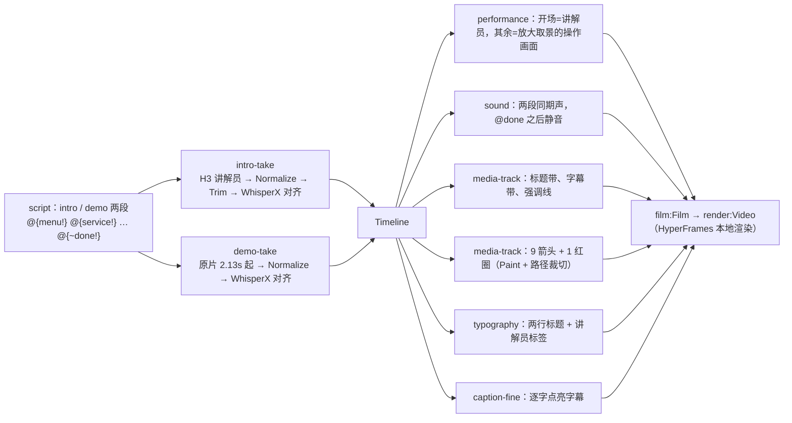

# Hypit · 实测：蓝V教程换讲解员

> [!abstract] 一句话结论
> 用户起了疑问：「我现在有点怀疑 hypit 到底是做什么的」。于是挑了一条真实的抖音企业号教程（新版蓝V认证，前 30 秒）做测试：**换讲解员 + 重做全部包装**。结果证明 Hypit 最有价值的是==把所有画面事件挂在台词的词上==：新开场比原片长了 0.67 秒，后面 9 个箭头、1 个红圈、全部字幕自动顺延，没有手改一个时间点。讲解员由服务器上的 H3 生成，全程零平台费用。【实测】

![[蓝V_原片vs复刻.jpg]]
*上排原片，下排 Hypit 复刻：开场讲解员换人；标题、字幕、红色指引全部重做；原片烧进去的标题和字幕被新版式遮住。*

## 1. 任务定义

| 项 | 内容 |
| --- | --- |
| 素材 | `~/Desktop/分公司文档/抖音相关规则/新版蓝V认证教程.mp4` 前 30 秒，392×704、30fps |
| 用户选择 | 「换讲解员 + 重做包装」；讲解员用 `~/Downloads/tk人物形象.mp4` 里的女生 |
| 保留 | 俯拍手机的操作画面、操作段原配音 |
| 重做 | 开场讲解员（H3 生成、对口型）、标题、字幕、红箭头与红圈（挂在词上） |
| 成片 | 桌面 `蓝V教程-Hypit复刻-30s.mp4`，720×1280，30.7 秒 |

## 2. 先读懂原片

- **转写**：本地 WhisperX（medium、zh、CPU int8）177 个字，30 秒音频 22 秒转完。首次准备时 NLTK `punkt_tab` 下载被代理的 fake-ip DNS 当成内网地址拦下（`restricted IP <fake-ip>`），手动 curl 放进 `programs/…/nltk_data/tokenizers/` 后 `hypit programs up --endpoint whisperx.local` 就绪【实测】。
- **红色指引**：每 0.1 秒抽一帧，统计高饱和红色像素（r>200、g<110、b<90，排除标题带和字幕带），得到 8 段出现区间和每个箭头的位置、上下跳动范围【实测】。
- **规律**：每个指引在「点 + 目标」的目标词说出后约 0.2 秒出现，停到下一步开始——正是词锚定的用例。

原片解读与时间线见附件 [[蓝V参考片_ANALYSIS]]、[[蓝V参考片_TIMELINE]]。

## 3. 整条片子在 Hypit 里的结构



源文件：[[lanv.svml]]、[[recipes.svs]]、[[lanv.svrun]]；生成辅助 [[pointers.py]]（箭头几何）、[[assemble.py]]、[[composition.svml.part]]。

### 3.1 台词与锚点

```text
<intro>  @{opening}这边是新版<蓝V|蓝微>的认证，|| 我带大家操作一遍。@{/opening}  </intro>
<demo>   我们首先点，我@{menu!}点右上角的三条杠。|| @{service!}同样的，点企业服务中心。|| @{lanv!}点亮<蓝V|蓝微>。||
         @{apply-say!}点@{apply!}立即申请。 … 这个确定是你@{origin!}原先的@{account!}抖音号，|| 点下一步。 … @{submit!}提交。@{~done!} </demo>
```

- `<蓝V|蓝微>`：显示「蓝V」，对齐时按「蓝微」的读音，避免 V 在中文对齐模型里对不上。
- `||` 是字幕换条，不切画面。
- 每个箭头的开始、结束都是一个词锚：`start="moment.cue" start-source={story.moment.menu} end="moment.cue" end-source={story.moment.service}`。

### 3.2 版式与「用放大取景遮住烧录字」

画布 720×1280：标题带 0–250、舞台 250–1050、字幕带 1050–1280。原片的标题烧在画面 13.9%–26.6% 高度，字幕在约 77% 高度。

操作画面不做裁切，而是给它一个**比画布还大的 Frame**：`left -156.4 top -222.5 right 782.5 bottom 1463.5`，按 2.395 倍放大，使原片 u≈0.55、v 在 0.28–0.755 之间的区域正好落在舞台里；烧录的标题和字幕被上下两条色带盖住。箭头位置用同一套换算：`x = -156.4 + u×938.8`，`y = -222.5 + v×1686.1`。

### 3.3 红色指引

9 个箭头 + 1 个红圈，每个由两个 media-track Item 叠成：白色描边在下、红色在上，都是 `Paint` 加 `clip={SpatialPath}` 裁成箭头形状；红圈是两个反向椭圆组成的环形路径。尺寸按原箭头的上下跳动范围设计，尽量盖住烧录的原箭头。

## 4. 讲解员：三次生成

| 版本 | 设置 | 结果 |
| --- | --- | --- |
| v1 | 4 秒，自然节奏 | 1.25 秒才开口，「操作一…」被 4 秒截断 |
| v2 | 5 秒，提示词要求「立刻开口」 | 先说了一句无意义的话（「大家合作给这个超甜…」），2.75 秒才开始说台词 |
| v3 | 6 秒，自然节奏 + 「只说这一句」 | 0.39–2.75 秒完整说完，取 0.15–2.95 秒 |

![[讲解员_v3_6秒.jpg]]

判断时长的方法：导出后 `hypit transcribe` 转写 + 每 0.25 秒测音量，确认说话起止。v3 用 build-record 固定（见 [[Hypit · 自有 H3 Provider 接入#9. 固定选中的镜头：build-record + satisfy]]）。参考音频用原开场 2.2 秒人声，作为音色参考。

## 5. 问题与修复

| 现象 | 原因 | 修复 |
| --- | --- | --- |
| `<author> does not accept title` | svrun 的 author 没有 title 属性 | 删掉 |
| `media-track:Item.appearance has the wrong Type` | 引用了不存在的 recipe `media.accent` | 补上 recipe |
| 需要 `@fontsource-variable/noto-sans-sc` | 中文字体包不随 hypit 安装 | `hypit packages install @fontsource-variable/noto-sans-sc@5.3.0` |
| `title document repeats run-1` | 一个 Area 里两个 `<P>` 各自默认 run-1 冲突 | 拆成两个 Area（两行标题各一个） |
| `Fine Caption Recipe requires background` 等 | caption-fine 的 recipe 必填 background、padding、radius | 补齐；padding 必须写成字符串 `"0"` |
| **所有箭头都没渲染出来**（第一版成片） | Hypit 0.2.16 渲染问题：media-track 单元写了 `exit` 动画、窗口又不是从 0 开始时，入场结束后单元就消失 | 用 1 秒小样逐项排除（裁切、motion、视频层、延迟窗口、退场），定位到 exit；指引不写 exit【实测】 |
| 标题变成一团黑 | typography 的 Paint 按书写顺序叠加，Stroke/Shadow 写在 Fill 后面把字盖住 | 顺序改为 Shadow → Stroke → Fill |

![[蓝V_v1_箭头未渲染.jpg]]
*第一版：画面里的箭头全是原片烧录的（橙红渐变），新箭头一个都没出现；标题被描边盖成黑色。*

![[蓝V_v2_修复后_1.jpg]]
![[蓝V_v2_修复后_2.jpg]]
*修复后：标题正常；白边红芯的新箭头和红圈在对应的词上出现。*

排除 exit 问题的小样：[[probe_exit动画bug复现.svml]]。

## 6. 结果与局限

- 成片 30.7 秒（原片 30 秒，开场长了 0.67 秒），渲染 921 帧约 1 分 49 秒；讲解员单次生成 3–4 分钟。全程本机 + 自有服务器，**零平台费用**【实测】。
- 原片烧录的箭头去不掉，原箭头上下跳动时边缘偶尔露出橙红色；要干净需拿到无包装原片。
- 讲解员保留了参考素材里的低领衬衫；企业号教程发抖音有被判低俗的风险，改一句提示词可换装。
- 「提交」之后原片还有半句下一段的话，用 sound 的静音 Use 从 `@{~done!}` 起静音。

## 7. 这次测试说明了什么

1. **Hypit 不是生成模型**，它是编排层：读懂参考片、按词组织时间、调度生成、用代码渲染包装。
2. **词锚定是真正的杠杆**：换讲解员改变了开场长度，所有下游事件自动顺延。
3. **包装全部是代码**：标题、字幕、箭头、色带都是 SVML 元素，改一处重渲即可，可复用到同类教程。
4. **生成部分可以换执行方**：这次 H3 走自有服务器，同一份 SVML 换个绑定就能走云端。

## 相关

- [[Hypit · 自有 H3 Provider 接入]] · [[Hypit · 词锚定机制]] · [[Hypit · SVML 语言]] · [[Hypit · 编译与渲染链路]]
- 工程：`~/hypit-projects/productions/lanv-remake/`（BRIEF.md 记录了全部决定与问题）
