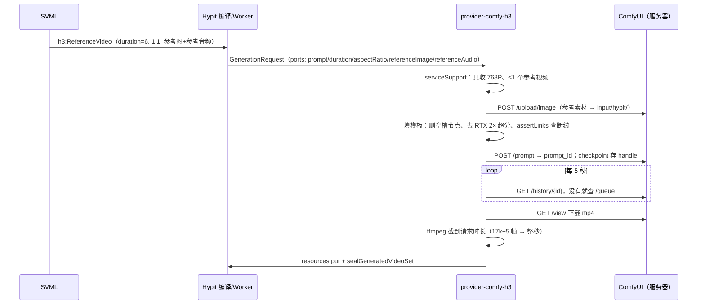

# Hypit · 自有 H3 Provider 接入

> [!abstract] 一句话定位
> 写了一个本地 Provider 包 `@local/provider-comfy-h3`，把 Hypit 里的 `@hypit/minimax-h3` 生成请求翻译成**自有 AutoDL 服务器上 ComfyUI 的 H3 工作流**去执行，再把成片交回 Hypit。SVML 一个字不改，`hypit plan` 显示「local, no Provider charge」——==Hypit 的编排 + 自有显卡的生成==接上了。【实测】

## 1. 为什么要做

- 用户原话：「我的这个云服务器里明明就有 minimax H3，而且还是加速的工作流。直接集成就行」「就 768 … 先写吧」。
- Hypit 的设计本来就是「模型描述」与「谁来执行」分开（见 [[Hypit · 模型接入与 Seedance]]）：官方提供 `@hypit/minimax-h3` 的**词汇包**，执行方可以是官方云端 provider，也可以是自己写的 provider。
- 服务器上的 Zealman 镜像自带 U 系列 H3 工作流（见 [[云端ComfyUI · 工作流全目录解读]]），缺的只是一层「翻译」。

## 2. 三层关系

| 层 | 本项目里是什么 | 管什么 |
| --- | --- | --- |
| 模型 | MiniMax H3（视频 + 音频联合生成），跑在 AutoDL 4090D 的 ComfyUI 里 | 真正生成画面和声音 |
| 词汇包 | `@hypit/minimax-h3@1`（Hypit 官方） | SVML 里能写 `h3:TextVideo` / `h3:FrameVideo` / `h3:ReferenceVideo` 及其参数；只描述「要什么」 |
| Provider | `@local/provider-comfy-h3`（本人编写，`~/hypit-projects/packages/provider-comfy-h3/`） | 把请求翻译成 ComfyUI 工作流、上传参考、提交、轮询、下载、截时长、交回 |

把三层接起来的是 `hypit.runtime.json` 的一行绑定：

```json
"endpoints": {
  "h3.autodl": { "use": "@local/provider-comfy-h3",
                 "config": { "baseUrl": "http://127.0.0.1:16006", "pollIntervalMs": 5000 } }
},
"bindings": { "@hypit/minimax-h3@1#minimax-h3": "h3.autodl" }
```

`127.0.0.1:16006` 是本机 SSH 隧道口，另一端是服务器 ComfyUI 的 6006：
`ssh -i ~/.ssh/autodl_ed25519 -p <SSH_PORT> -N -L 127.0.0.1:16006:127.0.0.1:6006 root@<AUTODL_SSH_HOST>`。
SSH 密钥由本机生成（`~/.ssh/autodl_ed25519`），用户自己用 `ssh-copy-id` 输入密码装上公钥；之后只用密钥连接。

## 3. 包结构

| 文件 | 作用 |
| --- | --- |
| `package.json` | `"hypit": { "activation": "./dist/activation.js" }` 声明自己是 Hypit provider |
| `src/activation.ts`（22 行） | 读 runtime 配置（只允许 `baseUrl`、`pollIntervalMs`），创建 provider |
| `src/provider.ts`（约 350 行） | 全部逻辑 |
| `templates/` | 三个 ComfyUI 工作流 JSON，从面板 `/api/workflow/config/{id}` 取回 |

源码副本：[[provider.ts]]、[[activation.ts]]、[[provider-package.json]]、[[hypit.runtime.json]]（`_附件/自有H3接入与蓝V实测/`）。

## 4. 三种模式与工作流映射

| SVML 元素 | 模板 | 保存节点 | 关键节点 |
| --- | --- | --- | --- |
| `h3:TextVideo` 文生视频 | U03 light2v 文生视频加速版 | 92 | 139 prompt、141 时长、120 宽高、137 种子 |
| `h3:FrameVideo` 首尾帧 | U02 图生视频基础版 | 92 | 114 首帧、144 尾帧（缺哪个就删节点和连线）、122 宽高 |
| `h3:ReferenceVideo` 参考图/视频/音频 | U17 9 图 1 视频 3 音频 | 180 | 250 prompt、132 时长、275 宽高、9 个图片槽、1 个视频槽、3 组音频 |

模式判定：有首帧或尾帧 → frame；有任何参考 → reference；否则 → text。

## 5. 一次请求的完整路径



### 实现要点

1. **只出 768P**：短边 768、32 对齐；U17 先按 768 ÷ 1.5 = 512 采样，再潜空间放大 1.5 倍二次采样，所以 1:1 出 768×768【实测】。要 2K 返回明确的 unsupported，不静默提交。
2. **去掉最后一步 RTX 2× 超分**：`277.anything ← 278`，删 276。
3. **空槽要删干净**：没用到的 LoadImage / LoadAudio / 视频加载节点连同它们在 275 上的输入一起删，最后 `assertLinks` 检查没有输入还连着已删节点，坏图不会送上显卡。
4. **时长对齐**：H3 帧数必须是 17k+5（24fps）。请求 4 秒会出 107 帧 = 4.458 秒；6 秒出 158 帧 = 6.58 秒。`collect` 里用 ffmpeg 音视频一起截回整秒【实测】。
5. **只允许回环地址**：面板与 ComfyUI 都没有鉴权，`baseUrl` 不是 `127.0.0.1` / `localhost` 直接报错。
6. **计费声明 `pricing: {kind: "local"}`**：机器按租用时长计费，不按次；`hypit plan` 因此显示「local, no Provider charge」。
7. **并发 1**：单卡，同一时间只跑一个生成。

## 6. 测试记录

| 日期 | 测什么 | 结果 |
| --- | --- | --- |
| 09-29 | `h3:TextVideo` 4 秒 16:9 探针 | 通；发现 4 秒出 4.458 秒，补上截时长【实测】 |
| 09-29 | `h3:ReferenceVideo` 用 ref105 的 S07 做参考视频 v1 | 通；但人物照搬了设定图的版式【实测】 |
| 09-29 | v2：裁出主角脸 + U05 式中文提示词 | 更好，但**不是一比一**：镜头顺序和时长都被重新安排【实测】 |
| 09-29 | 蓝V 教程讲解员（见 [[Hypit · 实测：蓝V教程换讲解员]]） | 三次生成，第三次可用【实测】 |

结论：H3 的参考视频模式是「按参考重拍」，不是「照原片改」。要动作一比一，得走 Bernini / Wan Animate 这类视频编辑路线（见 [[云端ComfyUI · ref105 三路线对照试验]]）。

## 7. H3 提示词写法（从 U17 模板学来）

```text
{
  "subject_definitions": ["<Subject 1> is the young woman from <Picture 1>, …",
                          "<Audio 1> is the voice of <Subject 1>: …"],
  "summary": "[reference generation] A 6-second single-shot medium close-up …",
  "retention_analysis": ["<Subject 1> (appears in [Shot 1]): fully_preserved - …"],
  "detailed_description": "… [Shot 1] … (00:00.000 - 00:06.000) … speaks (S1) … <d>[Chinese] 这边是新版蓝V的认证，我带大家操作一遍。</d> …",
  "overall_soundscape": "…", "non_diegetic_music": "N/A"
}
```

- `<Picture i>` / `<Video k>` / `<Audio j>` 对应参考槽顺序；对白写在 `<d>[Chinese] …</d>` 里，H3 会自己生成配音并对口型。
- 在 SVML 的 `text:Value` 里写这段文字时，`<` `>` 必须写成 `&lt;` `&gt;`，否则报 `MARKUP_NAME`。
- 参考音频在 U17 里是**音色参考**（与视频一起进 AV 潜空间），不是直接驱动口型的音轨。

## 8. 踩过的坑

| 现象 | 原因 | 处理 |
| --- | --- | --- |
| 改了 provider 代码不生效 | Hypit Worker 缓存了旧代码 | `npx tsc` 之后执行 `hypit runtime down` 再 build |
| 隧道口 16006 被占 | 另一个会话的 ssh 在用 | 复用；它断了以后自己起一条 |
| 任务在服务器上已成功，Hypit 却报 `COMFY_TASK_LOST` | 轮询竞态：查 history 时还没完成，查 queue 时刚好跑完离队 | 队列里查不到时**再查一次 history**，确实都没有才判丢失【实测，已修】 |
| 重跑同一个 Run 又生成了一次 | Hypit 不会自动复用上一次的生成结果 | 见下一节 |
| 请求 4 秒成片 4.458 秒 | 17k+5 帧 | provider 里截时长 |

## 9. 固定选中的镜头：build-record + satisfy

生成模型每跑一次结果都不同。Hypit **不会**因为 Run 没变就复用上次的结果——「Cross-Build reuse requires an explicit Candidate selection」【文档】。要固定选中的那一版，在 `.svrun` 里显式声明：

```xml
<svrun version="1">
  <author source="./lanv.svml"/>
  <target output="final.video"/>
  <build-record id="presenter-v3" build="bld_20260929T112458931Z_0A0A8DD2A5" output="presenter.video"/>
  <satisfy output="presenter.video" candidate="presenter-v3"/>
</svrun>
```

之后 `hypit plan` 里不再出现 H3 生成请求，下游的截时长、对齐、渲染照常重跑。这正适合「多抽几次、选最好的一版、然后改包装」的工作方式【实测】。

## 10. 限制与下一步

- 只做了 768P；服务器上有超分工作流（M 系列），可以另接成一个 capability。
- U17 只有一个参考视频槽，Hypit 的 H3 词汇允许 3 段，超出时明确报 unsupported。
- 同样的写法可以把 Bernini、Qwen 图像编辑接进 Hypit：一个 capability 对应一个工作流模板，让 ref105 的 79 个镜头以 build 的形式跑、用 build-record 固定满意镜头。

## 相关

- [[Hypit · 模型接入与 Seedance]]：模型包与 Provider 包的两个半边
- [[Hypit · 实测：蓝V教程换讲解员]]：这个 provider 的第一次正式使用
- [[云端ComfyUI · 总览]] · [[云端ComfyUI · 工作流转 API 与脚本提交]]
