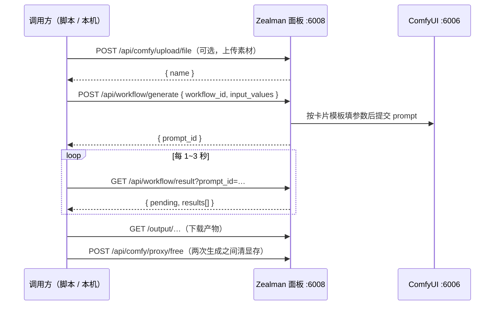

# 云端ComfyUI · Zealman 工作流 API

> [!abstract] 一句话
> 把 ComfyUI 工作流存成一张「API 卡片」，之后只要改几个参数就能远程调用：**提交 → 拿 prompt_id → 轮询 → 下载结果**。参数写成 `"节点ID:字段名": 值`，比如 `"57:image"` 换角色图、`"63:video"` 换原视频。这是把 ComfyUI 当成「生成接口」用的核心一层。

## 1. 地址与约定

| 项 | 说明 |
| --- | --- |
| BASE_URL | Zealman 控制面板地址：实例 6008 端口经 AutoDL「自定义服务」暴露的公网地址（形如 `https://<panel-host>:8443`）；本机实例的地址在服务器 `/root/面板地址.txt` |
| ComfyUI 本体 | 跑在实例内 `127.0.0.1:6006`，由面板托管启停【实测】 |
| 鉴权 | 文档里所有调用都**不带任何鉴权**，见 [[#6. 安全]] |
| 文件参数 | 三种写法：① 公网 https URL；② `data:*;base64,...`（默认上限约 50MB）；③ 先调上传接口，把返回的 `name` 填进去 |

## 2. 核心流程



## 3. 执行与查询（5 个接口）

### 3.1 提交任务 `POST /api/workflow/generate`

```json
{
  "workflow_id": "example-workflow.json",
  "input_values": {
    "12:image": "https://example.com/in.png",
    "21:audio": "https://example.com/in.mp3",
    "33:text": "一只在沙滩上奔跑的小狗，电影感"
  },
  "client_id": "my-app-001"
}
```

返回 `{ success, prompt_id, client_id, number }`，只负责入队，不等跑完。

- `workflow_id` 必须是已经在面板「API 生成」页导入并保存的卡片。
- `input_values` 的 key 是 `节点ID:字段名`；节点 ID 就是 ComfyUI 工作流 JSON 里节点的 `id`。
- `client_id` 可选，用于 WebSocket 进度推送。
- MiniMax 多参考工作流（U9 / U17 等）有个特殊行为：通过 API 调用时，没传的 `ref_image` / `ref_video` / `ref_audio` 槽位会自动填空白占位。
- ==本接口不会自动清显存==。连续跑重模型时，在两次 generate 之间自己调一次 `/api/comfy/proxy/free`，否则容易「第一次成功、第二次 OOM」。

### 3.2 取结果 `GET /api/workflow/result?prompt_id=…`

```json
{
  "success": true,
  "pending": false,
  "prompt_id": "d1e7a2b8-…",
  "results": [
    { "type": "image", "url": "/output/2025/zealman_00001.png", "filename": "zealman_00001.png" },
    { "type": "video", "url": "/output/2025/zealman_00001.mp4", "filename": "zealman_00001.mp4" },
    { "type": "text",  "text": "模型返回的提示词文本" }
  ]
}
```

- `pending: true` 还在跑，`false` 结束；失败时带 `error`。建议 1–3 秒轮询一次。
- `results` 按节点输出顺序；`url` 前面拼 BASE_URL 即可下载。

> [!warning] prompt_id 只活在内存里
> prompt_id 对应 ComfyUI 进程内存中的 history，不落盘。ComfyUI 一重启（关机、崩溃、手动重启）就查不到；单机最多保留约 10000 条。更坑的是：查不到时接口仍返回 `pending: true, results: []`，和「还在跑」无法区分。**结果一出来就立刻下载保存。**

### 3.3 原始 history `GET /api/comfy/proxy/history?prompt_id=…`

直接转发 ComfyUI 自身的 history，含每个节点的输出与报错。排查「哪个节点报错」时用，平时用 3.2。

### 3.4 下载产物 `GET /output/{subfolder}/{filename}`

面板用静态托管直接暴露 ComfyUI 的 output 目录，可直接放进 `` / `<video>` 的 `src`。

### 3.5 读输入与临时文件 `GET /api/comfy/view?filename=…&type=input&subfolder=…`

`type` 可选 `input` / `temp` / `output`，默认 `input`；用来预览刚上传的素材或中间产物。

## 4. 文件上传（2 个接口）

| 接口 | 说明 |
| --- | --- |
| `POST /api/comfy/upload/file` | **推荐**。multipart，字段名 `file` / `image` / `video` / `audio` 任选其一；`overwrite=true` 可覆盖同名。返回 `{ name, subfolder, type: "input" }`，`name` 填进 `input_values` |
| `POST /api/comfy/upload/image` | 旧接口，只收 `image` 字段、只收图片 |

```bash
curl -X POST "$BASE_URL/api/comfy/upload/file" -F "file=@/path/to/S07.mp4" -F "overwrite=true"
```

## 5. 工作流配置 CRUD（5 个接口）

「API 卡片」= 一份 **ComfyUI API 格式**的 prompt（节点 ID → `{class_type, inputs}`），外加一份 `_api_config`（哪些参数开放、表单默认值、中文标签）。

| 方法 | 路径 | 作用 |
| --- | --- | --- |
| GET | `/api/workflow/list` | 列出全部卡片：`id`、`name`、`mtime`、`run_count`、`last_run_at`、`last_prompt_id` |
| GET | `/api/workflow/config/{id}` | 读一张卡片：`workflow_template`（可直接喂给 ComfyUI）+ `api_config` |
| POST | `/api/workflow/save` | 新建或覆盖卡片（同名即覆盖）；面板「导入工作流」走的就是它 |
| POST | `/api/workflow/rename` | `{ oldId, newId }`，同时迁移用量统计；`newId` 已存在返回 400 |
| DELETE | `/api/workflow/{id}` | 删除卡片并清掉用量统计 |

保存卡片的请求体：

```json
{
  "workflow_id": "example-workflow.json",
  "workflow_template": {
    "1": { "class_type": "LoadImage", "inputs": { "image": "input.png" } }
  },
  "api_config": {
    "enabledParams": { "1:image": true },
    "formValues": {},
    "customLabels": { "1:image": "上传图片" }
  }
}
```

> [!tip] 从界面工作流到 API 卡片
> ComfyUI 界面保存的 `.json`（如 `/root/ComfyUI/user/default/workflows/K视频-人物替换/K05-….json`）是**界面格式**：`nodes[]` 带 `widgets_values`。卡片要的是 **API 格式**。最省事的办法是在面板「API 生成」页导入，它会转换并保存；也可以在 ComfyUI 界面里用「导出（API）」再调 `/api/workflow/save`。

## 6. 安全

> [!danger] 面板 API 没有鉴权
> 导出的文档里，76 个接口的调用示例都不带任何密码、Token 或签名，文中也没有一处提到鉴权【文档】。面板地址在公网上，谁知道地址，谁就能用你的显卡跑任务、删产出、停 ComfyUI。**面板地址不要外传，不要写进会同步或分享出去的地方。**是否真的完全无鉴权，还没有实测【空白】。

## 原始资料

- [[zealman-api-docs-2026-09-29T08-46-30.html|Zealman API 文档（2026-09-29 从面板导出，面板地址已隐去）]]：HTML，点开用浏览器查看；未隐去的原件在 `~/Downloads/`
- [[zealman-api接口说明.html|Zealman API 文档（服务器 /root 自带版本）]]

## 相关

- [[云端ComfyUI · 总览]]
- [[云端ComfyUI · Zealman 控制面板 API]]：显存清理、ComfyUI 启停、产出管理
- [[云端ComfyUI · Zealman 并发 API]]：多台机器批量跑同一张卡片
- [[云端ComfyUI · 批量换人方案]]：用这层接口跑 ref105 九段
