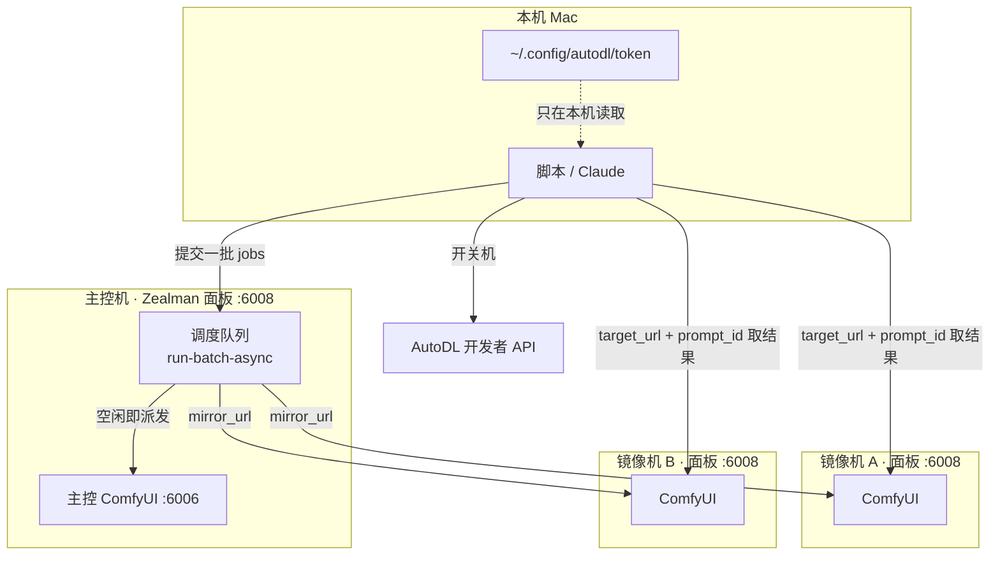

# 云端ComfyUI · Zealman 并发 API

> [!abstract] 一句话
> 把多台 AutoDL 实例（「镜像机」）加上当前这台「主控机」当成一个**算力池**：提交一批任务，调度器自动把任务派给空闲的机器，忙时排队、失败重试，结果按机器取回。34 个接口分五组：实例管理、镜像机 ComfyUI 控制、输入素材、任务调度、集群资产。

## 1. 角色与概念

| 概念 | 含义 |
| --- | --- |
| 主控机 | 调用方访问的那台面板（BASE_URL）。本机任务不传 `target_url` 就在主控的 ComfyUI 上跑 |
| 镜像机 | 另一台跑着 Zealman 镜像的 AutoDL 实例；它自己也有一个 6008 面板 |
| `mirror_url` | 镜像机面板的公网地址，`"https://" + snapshot.service_6008_domain` |
| 需要 Token 的 | 只有「AutoDL 实例管理」一组（开关机、建删机器）；镜像机控制和任务调度只要 `mirror_url` |
| 本地路径输入 | 文件参数除了 URL、base64、上传后的 name，还能填主控机白名单目录里的绝对路径，默认 `/root/并发` 及子目录（环境变量 `CONCURRENT_LOCAL_INPUT_DIRS` 可扩展）；服务端会读取并上传到目标 ComfyUI |



图中「开关机」走本机的 `autodl.py`，而不是面板的 `/api/concurrent/instance/*`，原因见 [[#8. 安全与使用建议]]。

## 2. 完整批跑流程（文档示例的 7 步）

1. 准备面板地址与 AutoDL Token。
2. `instance/list` 列实例，挑几台 `shutdown` 的当镜像机。
3. `instance/power_on` 有卡开机。
4. 每 5 秒轮询 `instance/snapshot`，直到出现 `service_6008_domain`，拼成 `mirror_url`。
5. `mirror/start` 在各镜像机上启动 ComfyUI（可指定插件档位；要换档位先 `mirror/stop`）。
6. `run-batch-async` 提交一批 jobs，拿 `run_id`。
7. 每 2 秒查 `run-batch-status`；结束后对每个完成的 job，用 `target_url + /api/workflow/result?prompt_id=` 取结果并自行下载。

## 3. AutoDL 实例管理（11 个，需要 Token）

| 方法 | 路径 | 说明 |
| --- | --- | --- |
| GET | `/api/concurrent/self-uuid` | 从主机名推断本机实例 ID（`autodl-pro-xxx` → `pro-xxx`），**不需要 Token** |
| POST | `/api/concurrent/instance/list` | `{ token, page_index, page_size }`；返回 `instance_uuid`、`status`、`gpu_name`、`service_6008_domain` |
| POST | `/api/concurrent/instance/create` | `{ token, gpu_spec_uuid, req_gpu_amount, expand_system_disk_by_gb, instance_name }`；默认用 **Zealman 公共镜像应用的 latest 版**开一台干净的镜像机，不会带上你这台的自定义模型和数据。要带自定义内容，得先走 AutoDL「打包成镜像」再传 `application_uuid` / `application_version`。建好还要 `power_on` |
| GET | `/api/concurrent/instance/status?token=&instance_uuid=` | 轻量状态：`shutdown` / `running` / `starting` 等 |
| GET | `/api/concurrent/instance/snapshot?token=&instance_uuid=` | 完整快照，含 `service_6008_domain` |
| POST | `/api/concurrent/instance/power_on` | `{ token, instance_uuid }`，默认有卡开机、开始计费 |
| POST | `/api/concurrent/instance/power_off` | 关机，停止计费，数据保留 |
| POST | `/api/concurrent/instance/release` | 释放（销毁），必须先关机，数据不可恢复 |
| POST | `/api/concurrent/schedule-shutdown` | 预约定时关机：`{ token, instance_uuids, shutdown_time: ISO8601, release_after_shutdown }`；同一时刻只保留一份预约，重复提交会覆盖 |
| GET | `/api/concurrent/schedule-shutdown` | 查预约：`active`、`shutdown_time`、`remaining_ms`、`instance_count` |
| DELETE | `/api/concurrent/schedule-shutdown` | 取消预约 |

这些接口是 [[云端ComfyUI · AutoDL 应用实例 API]] 的一层转发。文档称「Token 仅在内存中转发到 AutoDL 官方 API，不写入服务器文件」【文档】，未核实【空白】。

## 4. 镜像机 ComfyUI 控制（9 个）

本质是把请求转发到镜像机自己的 `/api/comfy/*`（见 [[云端ComfyUI · Zealman 控制面板 API]]）。

| 方法 | 路径 | 说明 |
| --- | --- | --- |
| POST | `/api/concurrent/mirror/start` | `{ mirror_url, plugin_profile?, plugin_series? }`；只代表命令已发出，要轮询 `comfy-status` |
| GET | `/api/concurrent/mirror/plugin-profile?mirror_url=` | 该机可选的插件档位、系列与当前档位；面板太旧返回 404 |
| GET | `/api/concurrent/mirror/comfy-status?mirror_url=` | 同 `/api/comfy/status`，建议 2–5 秒查一次 |
| POST | `/api/concurrent/mirror/interrupt` | 中断该机当前任务 |
| POST | `/api/concurrent/mirror/free` | 清显存与内存（固定全清） |
| POST | `/api/concurrent/mirror/stop` | 停 ComfyUI 进程，不影响 AutoDL 计费 |
| GET | `/api/concurrent/mirror/versions?mirror_url=` | 可切换的 ComfyUI 版本；`wheelsReady=false` 的不要选 |
| POST | `/api/concurrent/mirror/switch-version` | `{ mirror_url, version }`；必须先停 ComfyUI，否则返回 `{ code: 2, needStop: true }`；切完仍是停止态 |
| GET | `/api/concurrent/probe?mirror_url=` | 连通性综合检查：面板可达 + ComfyUI 是否启动 |

> [!warning] 两个坑
> 1. 镜像机开机后会按自己 `config.json` 的设置自启 ComfyUI。此时调 `mirror/start` 只返回 `already_running: true`，**指定的插件档位不生效**。要换档位必须先 `mirror/stop` 再 `mirror/start`。另一种做法是把默认档位写进镜像配置（面板「系统设置 → 启动设置」）。
> 2. 一台机器精简插件后只能跑所选系列，派发其他系列会因缺节点失败；机器分工要和 jobs 派发一致。

切版本的顺序：`mirror/stop` → `mirror/switch-version` → `mirror/start`。

## 5. 输入素材管理（4 个）

素材落在主控机 `/root/并发/{image,video,audio}`，文件名规范化为 `{type}_{YYYYMMDD-HHMMSS}_{rand}{ext}`，预览地址 `/concurrent-input/{type}/{filename}`。

| 方法 | 路径 | 说明 |
| --- | --- | --- |
| GET | `/api/concurrent/input-assets?type=all\|image\|video\|audio` | 列出素材；每项的 `localPath` 可直接填进 `input_values` |
| POST | `/api/concurrent/input-assets/upload` | multipart：`file` + `type`；扩展名须与 type 一致；单文件上限 10GB |
| DELETE | `/api/concurrent/input-assets` | `{ paths }`，必须是 `/root/并发` 下的绝对路径，服务端校验防越权 |
| DELETE | `/api/concurrent/input-assets/clear/:type` | 清空某一类素材 |

## 6. 任务调度（8 个）

| 方法 | 路径 | 说明 |
| --- | --- | --- |
| POST | `/api/concurrent/generate` | 同步并发提交一组任务；每个 job 可指定 `target_url`（空 = 本机主控） |
| POST | `/api/concurrent/run-batch` | 同步批跑：队列调度 + 失败重试，**阻塞到全部结束**，耗时长 |
| POST | `/api/concurrent/run-batch-async` | **推荐**。格式同上，立即返回 `run_id` |
| GET | `/api/concurrent/run-batch-status?run_id=` | `status`：queued / running / completed / cancelled / error；`results[]` 每项含 `status`、`stage`、`progress`（0–100）、`retry_count`、`target_url`、`prompt_id` |
| POST | `/api/concurrent/run-batch-cancel` | `{ run_id }`；已开始的跑完，未开始的不再调度 |
| GET | `/api/concurrent/poll?mirror_url=&prompt_id=` | 代理查询某镜像机单个任务的 history |
| GET | `/api/concurrent/result?mirror_url=&prompt_id=&…` | 主控把镜像机产出拉回 `/root/ComfyUI/output/concurrent/` 并登记；`workflow_id` 可过滤掉中间预览节点 |
| GET | `{target_url}/api/workflow/result?prompt_id=` | **无主控推荐**：直接去跑这个任务的镜像机取结果，自己下载保存 |

批跑请求体（示例；`/root/并发/…` 下的文件要先用第 5 节的上传接口传上去）：

```json
{
  "workflow_id": "example-workflow.json",
  "plugin_series": ["K"],
  "targets": ["https://镜像机A面板", "https://镜像机B面板"],
  "jobs": [
    { "id": "S01", "input_values": { "57:image": "/root/并发/image/hero.jpg", "63:video": "/root/并发/video/S01.mp4" } },
    { "id": "S02", "input_values": { "57:image": "/root/并发/image/hero.jpg", "63:video": "/root/并发/video/S02.mp4" } }
  ]
}
```

- 调度：空闲机器立即接下一个 job，全都忙时排队；扩容后未开始的任务会被新机器接管。
- `targets` 可选，不传用全部可用镜像机。
- ==每台镜像机上都要先有同名工作流卡片==。文档提到可以用 `/api/workflow/files/update` 同步，但这个接口不在文档的接口列表里【空白】。
- 带上 `plugin_series` / `plugin_profile`：调度器拉起或自愈重启机器时按这个档位启动，否则会变回全部插件。
- 结果的 prompt_id 同样只活在各台镜像机的内存里，机器或 ComfyUI 重启即失效，要及时下载。

上面示例里的 `57:image`、`63:video` 是 K05 影视二创工作流的真实节点 ID，见 [[云端ComfyUI · 实例与工作流清单#K05]]。

## 7. 集群资产（2 个）

| 方法 | 路径 | 说明 |
| --- | --- | --- |
| GET | `/api/concurrent/assets` | 主控登记的全部集群产出（只返回本地文件仍在的）：来源机器、prompt_id、workflow_id、预览 url |
| POST | `/api/concurrent/record-local` | 本机任务完成后，把产出复制到 `/root/ComfyUI/output/concurrent/` 并登记 |

## 8. 安全与使用建议

> [!danger] 实例管理接口要把 AutoDL Token 交给面板
> - 这一组接口要求在请求体或**网址参数**里带 Token（如 `instance/status?token=…`）。放在网址里的 Token 容易留在代理、日志和浏览器历史里。
> - 面板本身没有鉴权（见 [[云端ComfyUI · Zealman 工作流 API#6. 安全]]），别人知道面板地址就能调这些接口；如果面板里存着 Token，风险直接扩大到你的 AutoDL 账号。
>
> **我们的做法**：不在面板「机器管理」里填 Token。开关机、查状态用本机的 `autodl.py`（Token 只留在本机）；批量分发只需要各台镜像机的 `mirror_url`，用不到 Token。定时关机改用 AutoDL 控制台自带的定时关机，或本机脚本跑完即 `off`。

## 原始资料

- [[zealman-api-docs-2026-09-29T08-46-30.html|Zealman API 文档（2026-09-29 从面板导出，面板地址已隐去）]]：HTML，点开用浏览器查看；未隐去的原件在 `~/Downloads/`
- [[zealman-api接口说明.html|Zealman API 文档（服务器 /root 自带版本）]]

## 相关

- [[云端ComfyUI · 总览]]
- [[云端ComfyUI · AutoDL 应用实例 API]]
- [[云端ComfyUI · 批量换人方案]]
