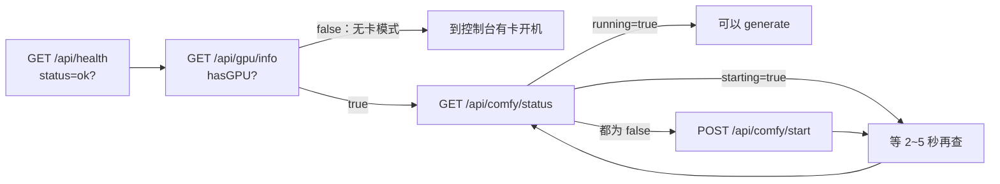

# 云端ComfyUI · Zealman 控制面板 API

> [!abstract] 一句话
> 管这台机器本身的 31 个接口：**面板和显卡状态、ComfyUI 启停与插件档位、显存清理、产出与素材管理**。跑生成前的自检顺序是：面板活着 → 有显卡 → ComfyUI 已就绪。

## 1. 自检 + 自动启动 ComfyUI



- 启动接口立即返回，要轮询 `status` 直到 `running=true`；建议每 3 秒一次，最多等 60 秒。
- 启动时带 `useProxy: true, proxyType: "network_turbo"`，会先 `source /etc/network_turbo`（AutoDL 学术加速），解决拉模型、装依赖的网络问题。

## 2. 面板状态与硬件（7 个，全部 GET）

| 路径 | 返回 |
| --- | --- |
| `/api/health` | `{ status: "ok", timestamp, uptime }`，最轻的存活探针 |
| `/api/external-url-6008` | 本面板的 AutoDL 公网地址（只在 AutoDL 容器内有效） |
| `/api/gpu/info` | `hasGPU` 与 `gpus[]`（型号、显存总量、已用）；`hasGPU=false` 是无卡模式，跑生成会立刻失败 |
| `/api/gpu/profile` | 显卡名、数量、显存、算力版本、驱动、架构（blackwell / hopper / ada / ampere）、本机内存限额、宿主机内存；结果按硬件指纹缓存，`?force=1` 重测。NVFP4 权重只有 blackwell 有原生算子 |
| `/api/hardware/info` | CPU / 内存 / 磁盘综合信息 |
| `/api/disk/size` | 系统盘与数据盘的总量、已用、剩余（GB） |
| `/api/disk-usage` | 按目录（模型 / 输出 / 缓存）的占用明细 |

## 3. ComfyUI 启停与状态（11 个）

| 方法 | 路径 | 说明 |
| --- | --- | --- |
| POST | `/api/comfy/start` | 启动；已在运行返回 `alreadyRunning: true`。可选插件档位，见下 |
| POST | `/api/comfy/stop` | 停止（pkill ComfyUI 进程） |
| GET | `/api/comfy/status` | `{ running, starting, reason, port: 6006, listen, url }` |
| GET | `/api/comfy/queue-status` | `busy=true` 表示有任务在跑或排队 |
| GET | `/api/comfy/version` | 从安装目录读版本号，ComfyUI 没启动也能查 |
| GET | `/api/comfy/external-url` | 6006 端口（ComfyUI 原生网页）的公网地址 |
| GET | `/api/comfy/check-port/{port}` | 端口是否被占用（一般查 6006 / 6008） |
| POST | `/api/comfy/kill-port/{port}` | 强杀占用端口的进程，解决「端口已占用」 |
| GET | `/api/comfy/logs` | SSE 实时日志流，浏览器用 `EventSource` 接 |
| GET | `/api/comfy/plugin-profile` | 可选插件档位、工作流系列、当前生效档位 |
| GET | `/api/comfy/plugin-availability` | 当前档位下哪些系列能跑（轻量，派发前预检） |

**状态三阶段**：`running=true` 可以生成；`running=false, starting=true` 启动中；两个都是 `false` 才需要主动启动。`reason` 取值 `ready` / `starting` / `process_not_found`。

### 3.1 插件档位：只加载要用的插件

```json
{ "useProxy": true, "proxyType": "network_turbo", "pluginProfile": "minimax-h3", "pluginSeries": ["U"] }
```

- 镜像装了上百个插件。按工作流系列字母（K、P、U…）只保留需要的，其余目录临时改名成 `*.disabled`，启动更快、显存更省。文档示例是保留 54 个、禁用 97 个。
- `pluginProfile` 取自 `plugin-profile` 的 `presets[].id`；`pluginSeries` 是系列字母数组，两者同时传以 `pluginSeries` 为准；填 `all` 或不传就是全部插件。
- 精简后只能跑所选系列，其他工作流会报缺节点；重新以 `all` 启动即还原。
- 判断能不能跑某个工作流：取文件名首字母（`K05-…` → `K`），命中 `plugin-availability` 返回的 `series` 或 `workflowPrefixes` 即可。

## 4. 清理显存与内存 `POST /api/comfy/proxy/free`

```json
{ "unload_models": true, "free_memory": true }
```

- `unload_models` 卸载模型权重、释放显存；`free_memory` 清空执行缓存（CLIP、VAE 等中间结果）；都不传视为全清。
- 面板自己在「API 生成」页每次运行前、并发队列每个任务开跑前、U 系列快捷生成前后都会调一次。**远程脚本连续调用时要自己调。**
- 坑：HTTP 200 只代表 ComfyUI 记下了清理标志，真正卸载发生在下一轮循环；队列排空后不会自动再清，显存会一直占着。

## 5. 产出与素材管理（12 个）

| 方法 | 路径 | 说明 |
| --- | --- | --- |
| GET | `/api/images` | 递归列出 output 目录全部产出（图、视频、音频），含相对路径、大小、修改时间 |
| GET | `/api/input-assets` | 列出 ComfyUI input 目录的素材 |
| DELETE | `/api/images/delete` | `{ paths: [...] }` 批量删产出 |
| DELETE | `/api/input-assets/delete` | `{ paths: [...] }` 批量删输入素材 |
| POST | `/api/outputs/clear` | 清空 output；`recursive: true` 连子目录一起删 |
| POST | `/api/input/clear` | 清空 input；`recursive` 同上 |
| POST | `/api/images/zip` | `{ paths }` 打包成 zip 立即返回 `zipPath`；不传 `paths` 打包 output 根目录全部图片视频 |
| POST | `/api/assets/package/jobs` | 异步打包任务，`range` 可用 `preset: today / week / month` 或 `startDate` / `endDate` |
| GET | `/api/assets/package/jobs` | 打包任务列表 |
| GET | `/api/assets/package/jobs/{id}` | 单个任务进度 |
| GET | `/api/assets/package/files` | 已生成的 zip 列表（含下载链接） |
| DELETE | `/api/assets/package/files/{id}` | 删一个 zip |

> [!warning] 清空和删除接口同样没有鉴权
> `outputs/clear`、`input/clear`、`images/delete` 都是不可恢复的删除，而整个面板没有鉴权（见 [[云端ComfyUI · Zealman 工作流 API#6. 安全]]）。跑出来的片子要及时下载回本机。

## 原始资料

- [[zealman-api-docs-2026-09-29T08-46-30.html|Zealman API 文档（2026-09-29 从面板导出，面板地址已隐去）]]：HTML，点开用浏览器查看；未隐去的原件在 `~/Downloads/`
- [[zealman-api接口说明.html|Zealman API 文档（服务器 /root 自带版本）]]

## 相关

- [[云端ComfyUI · 总览]]
- [[云端ComfyUI · Zealman 工作流 API]]
- [[云端ComfyUI · Zealman 并发 API]]：镜像机的 `mirror/*` 接口就是把本页接口转发到远端
