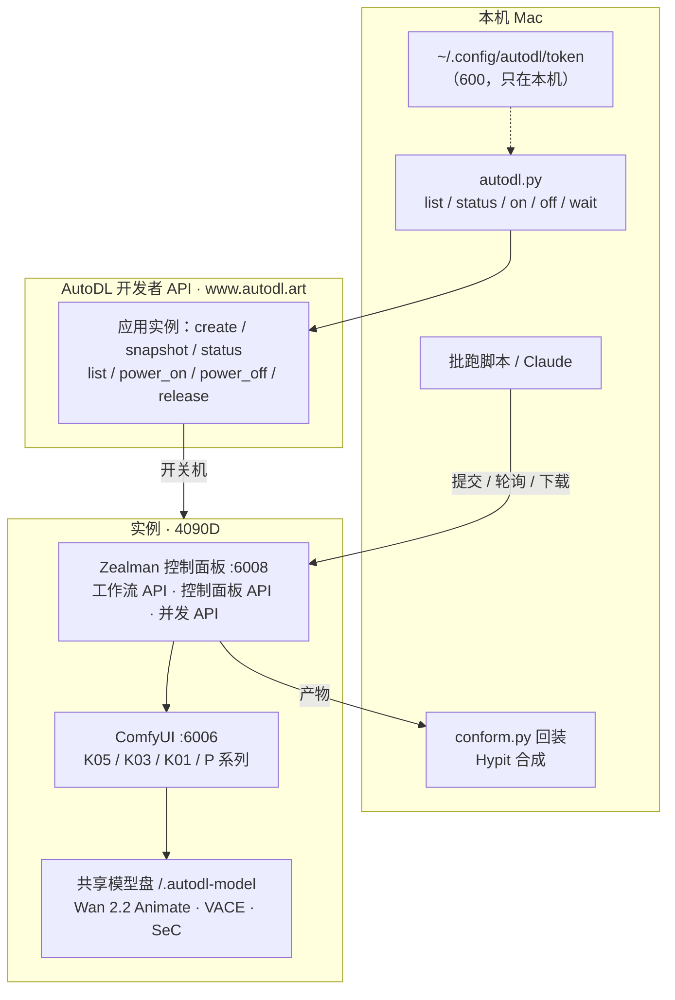

# 云端ComfyUI · 总览

> [!abstract] 一句话定位
> 用 **AutoDL 上租的显卡 + 预装好的 Zealman ComfyUI 镜像**，把开源视频模型（Wan 2.2 Animate、VACE 等）变成可以用程序调用的生成服务：本机脚本负责开关机，面板 API 负责提交任务和取结果，多台机器还能组成算力池批量跑。它补上了研究里一直缺的一块——==自己掌握算力和模型，参考视频生视频不再受平台限制==。

## 1. 为什么是研究的重要一步

2026-09-29 的 ref105 重制（换人换景、动作一比一）走到了闭源平台的边界：

1. 方舟 Seedance 2.5 的视频编辑模式能力够，但输入里只要有写实人脸就会触发隐私拦截；写实 AI 定妆图可以走私域素材库（`asset://`）解决，原剧演员的片段则不能作为参考输入。
2. 用户的问题因此变成：参考视频生视频能不能用自己部署的模型？答案是能——开源的 Wan 2.2 Animate（换人保动作）、Wan 2.1 VACE（姿态 / 深度控制，可换人换景）都能做【文档】。
3. 用户随即提供了一台 AutoDL 4090D 实例，上面的 Zealman 镜像已经装好这些模型和「影视二创」「动作迁移」工作流【实测】。

从此研究多了一条路线：**闭源平台出片**（Seedance，画质高、有审核）和**自有算力出片**（ComfyUI + 开源模型，可控、不经平台审核）并行。后者不改变版权判断：用谁的画面做参考，成片的权利问题都一样。

## 2. 架构：三层接口

| 层 | 管什么 | 笔记 |
| --- | --- | --- |
| AutoDL 应用实例 API | 机器的开、关、查、释放；计费开关 | [[云端ComfyUI · AutoDL 应用实例 API]] |
| Zealman 工作流 API | 把 ComfyUI 工作流存成「API 卡片」，改参数远程调用 | [[云端ComfyUI · Zealman 工作流 API]] |
| Zealman 控制面板 API | 面板与显卡状态、ComfyUI 启停与插件档位、清显存、产出管理 | [[云端ComfyUI · Zealman 控制面板 API]] |
| Zealman 并发 API | 多台机器组成算力池，批量派发、排队、重试、取结果、定时关机 | [[云端ComfyUI · Zealman 并发 API]] |

## 3. 关键数字

| 项 | 值 | 证据 |
| --- | --- | --- |
| AutoDL 应用实例接口 | 7 个；本机脚本实现其中 4 个（list / status / on / off） | 【文档】【实测】 |
| Zealman 面板接口 | 工作流 12 个 + 控制面板 31 个 + 并发 34 个 | 【文档】 |
| 实例 | 4090D 24GB，128 核，503GB 内存，系统盘剩 16GB，模型在只读共享盘 | 【实测】 |
| 镜像 | Zealman ComfyUI v9.31：ComfyUI v0.34.0、PyTorch 2.12.1+cu130、CUDA 13.0 | 【文档】 |
| 换人主力工作流 | 09-29 设想 K05；09-30 实测改为 **首帧精修（Qwen-Image-Edit 2511）+ Bernini rv2v + K01 换头** | 【实测】 |
| 实测通过 | AutoDL `list`、`status`；SSH 密钥登录；ComfyUI 在 6006 运行；经隧道脚本提交约 150 个任务；Hypit 自有 H3 provider | 【实测】 |
| ref105 全片 v1 | 79 个镜头、85.76 秒；约 33 个换干净、13 个部分、27 个几乎未改、4 个原片占位；零平台费用 | 【实测】 |
| 未实测 | AutoDL 开关机、面板 API 卡片调用、K05 出片 | 【空白】 |

## 4. 安全与凭证纪律

> [!danger] 四条规矩
> 1. **AutoDL Token 只放本机文件**（`~/.config/autodl/token`，权限 600），由用户自己用 `read -rs` 写入；不进聊天、不交给面板。拿到 Token 的人能开机器扣钱，还能读出所有实例的 root 密码。
> 2. **不调 snapshot**：它返回实例 root 密码，Claude Code 自动模式以「凭证落地」拦截；SSH 和面板地址直接用已知值。
> 3. **面板没有鉴权**：面板地址等于这台机器的遥控器，谁知道地址谁就能跑任务、删产出。地址只放服务器 `/root/面板地址.txt`，本分区不写。
> 4. **SSH 用密钥**：`~/.ssh/autodl_ed25519`；root 密码不记录，出现过的旧密码应改掉。

这几条都是 2026-09-29 实际遇到后定下的：Token 和 SSH 密码都曾被明文贴进对话；开隧道、读密码、改自己权限三类操作都被自动模式拦下过。

## 5. 本分区笔记

| 笔记 | 类型 | 内容 |
| --- | --- | --- |
| [[云端ComfyUI · AutoDL 应用实例 API]] | 速查 | 7 个接口的参数与返回、GPU 规格 ID、`autodl.py` 用法、实测的三个坑 |
| [[云端ComfyUI · Zealman 工作流 API]] | 速查 | 提交、轮询、下载、上传、API 卡片的增删改查；prompt_id 只在内存 |
| [[云端ComfyUI · Zealman 控制面板 API]] | 速查 | 自检流程、ComfyUI 启停与插件档位、清显存、产出管理 |
| [[云端ComfyUI · Zealman 并发 API]] | 速查 | 主控 + 镜像机算力池、批跑调度、定时关机、Token 风险 |
| [[云端ComfyUI · 实例与工作流清单]] | 实测记录 | 实例配置、镜像、K / P 系列工作流、K05 与 K03 的节点、模型文件 |
| [[云端ComfyUI · 批量换人方案]] | 设计（已被取代） | ref105 九段怎么跑 K05、试跑要回答的五个问题 |
| [[云端ComfyUI · 工作流全目录解读]] | 实测记录 | 22 个分类约 250 个工作流；换人四套技术（Wan Animate / SCAIL-2 / Bernini / H3 打斗）的原理与适用；模型文件核对 |
| [[云端ComfyUI · 工作流转 API 与脚本提交]] | 速查 | 浏览器 `graphToPrompt` 转 API、只启用某分支、改参数套路、`comfy.py`、踩坑、重启 ComfyUI、实测耗时 |
| [[云端ComfyUI · ref105 三路线对照试验]] | 实测记录 | 同三个镜头比较 Bernini / SCAIL-2 / H3 打斗：动作一比一最稳的是 Bernini |
| [[云端ComfyUI · 首帧精修与 Bernini 全片重制]] | 实测记录 | S01 到全片 v1 的完整过程、逐镜头质检、「Bernini 照抄原片」的五项排查、提升方向与 H3 重生成路线对比 |

## 6. 与其他子分区的关系

- [[灰模管线 · 总览|04 灰模预演管线]]：灰模给闭源模型供给机位精度，走 `reference_video`；本分区的 Wan Animate / VACE 用姿态、深度作为控制，是开源侧的同一件事。
- [[Hypit · 总览|02 Hypit]]：Hypit 负责读懂参考片、切段、回装、合成；本分区负责中间的生成。ref105 重制正是两者串联。
- [[灰模管线 · 方舟 API 参数表]]：闭源侧的接口对照。方舟私域素材库录入工具 `tools/ark_asset_upload.py` 也在同一天跑通，用来让写实 AI 角色通过 Seedance 审核。

## 7. 原始资料与备份

所有原文都在本分区 `_附件/原始资料/`，可以直接点开：

| 原文 | 来源 | 被哪篇引用 |
| --- | --- | --- |
| [[AutoDL 应用实例 API 原文]] | 用户在对话中贴出（待保存） | [[云端ComfyUI · AutoDL 应用实例 API]] |
| [[zealman-api-docs-2026-09-29T08-46-30.html\|Zealman API 文档（面板导出版）]] | `~/Downloads/`，面板地址已隐去 | 三篇 Zealman API |
| [[zealman-api接口说明.html\|Zealman API 文档（服务器自带版）]] | 服务器 `/root/` | 三篇 Zealman API |
| [[zealman镜像说明]] | 服务器 `/root/` | [[云端ComfyUI · 实例与工作流清单]] |
| [[K视频-人物替换]]、[[P视频-动作迁移]] | 服务器 `/root/工作流说明/` | [[云端ComfyUI · 实例与工作流清单]] |
| [[K05-影视二创-WorkFisher多人版.json]]、[[K03-影视二创-Wan影视二创.json]] | 服务器 ComfyUI 工作流目录 | [[云端ComfyUI · 实例与工作流清单]]、[[云端ComfyUI · 批量换人方案]] |

2026-09-29 追加本分区前，分区总览、研究地图、🏠 总索引三个文件的原版备份在库外：`~/Q大师的记忆宫殿_backup_20260929_追加06前/`。

## 8. 下一步

> [!note] 2026-09-30 更新
> 09-29 列的「K05 存卡片 → S07 试跑」已由实测路线取代：先做了三路线对照试验，再用首帧精修 + Bernini 跑完全片 v1。详见 [[云端ComfyUI · 首帧精修与 Bernini 全片重制]]。

1. 拿 S02（7 个镜头、11.6 秒）做 A/B：A = 现有流程 + 「先改原片」（SAM3 去斗笠、浅蓝袍调黑）；B = 精修首尾帧 + H3 重新生成。用户看完再定全片路线。
2. 切镜头改用 TransNetV2 或 0.12 阈值 + 人工合并；首帧改取镜头内最清楚的一帧。
3. 加自动质检（视觉模型判断斗笠/袍色、人脸相似度），不合格自动 cfg_chain 重跑。
4. 把首帧精修与 Bernini 包成 Hypit provider capability，用 build-record 固定满意镜头，最后在 Hypit 合成字幕、音乐、音效。
5. 实测 `autodl.py on / off`，把「开机 → 批跑 → 下载 → 关机」串成一条命令。
