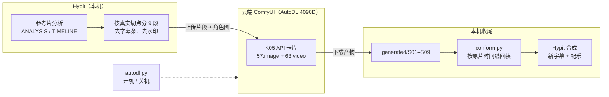

# 云端ComfyUI · 批量换人方案

> [!warning] 2026-09-30：本方案已被取代
> K05（Wan Animate 骨架驱动）在 S01 上跟丢、双脸、袍子不重画。实测后改走 [[云端ComfyUI · ref105 三路线对照试验|三路线对照]] → [[云端ComfyUI · 首帧精修与 Bernini 全片重制|首帧精修 + Bernini]]。本篇保留作为设计记录。

> [!abstract] 一句话
> 把 Hypit 拆好的九段参考视频，交给云端 ComfyUI 的 K05 影视二创工作流逐段换人，结果回到本机按原片时间线装回去。**这套方案还没有实跑过**，第一步是拿最短的一段 S07（5.3 秒）测动作还原度、多人时换的是谁、背景是否保留原片，以及耗时。

> [!warning] 版权
> 用影视片段做参考，成片的动作编排、机位和剪辑都照搬原片。无论在云平台还是自有算力上生成，公开发布前都要自己判断版权风险。换成自有角色后演员的肖像问题基本消除，但原片的编排和画面结构仍属于原作。

## 1. 分工



| 环节 | 谁做 | 工具 |
| --- | --- | --- |
| 拆解参考片、切段、去水印 | Hypit + ffmpeg | 已完成，见交付包 |
| 开机 | 本机脚本 | `autodl.py on` + `wait … running` |
| 上传素材 | 面板 API | `/api/concurrent/input-assets/upload` 或 `/api/comfy/upload/file` |
| 保存 K05 卡片 | 面板「API 生成」页导入 | 一次性 |
| 批量换人 | 面板 API | `run-batch-async`，9 个 job |
| 取回产物 | 本机脚本 | `{target_url}/api/workflow/result` → 下载 |
| 关机 | 本机脚本 | `autodl.py off` |
| 回装与合成 | `conform.py` + Hypit | 交付包 README 已写明 |

## 2. 输入

交付包 `~/Desktop/ref105重制-交付包/`（项目内另有一份 `~/hypit-projects/productions/ref105-remake/export/`）：

| 段 | 时长 | 镜头数 | 内容 |
| --- | --- | --- | --- |
| S01 | 8.30 s | 12 | 立局：正反打、反握剑、俯拍独立、台阶对峙、冲锋 |
| S02 | 11.57 s | 7 | 交锋；俯拍「圈」构图（被围） |
| S03 | 11.40 s | 9 | 大全景群战 |
| S04 | 13.17 s | 17 | 俯拍「圈」（冲杀），刀锋贴脸 |
| S05 | 13.23 s | 12 | 快切：见血、踢飞、倒地 |
| S06 | 6.57 s | 5 | 红水缸、收尾几击 |
| S07 | 5.33 s | 6 | 风暴眼静止特写 → 踩水 → 水花白闪 |
| S08 | 7.67 s | 12 | 余波：满地倒敌，持剑而立 |
| S09 | 8.53 s | 2 | 剑尖拖血 → 俯拍「圈」（全倒）升起旋转 |

角色图：`characters/图片1_主角.jpg`（K05 的 `57:image`）。反派头目与配角群要不要分别替换，取决于 K05 多人模式怎么选人【空白】。

## 3. 批跑请求（草案）

```json
{
  "workflow_id": "K05-影视二创-WorkFisher多人版.json",
  "plugin_series": ["K"],
  "jobs": [
    { "id": "S07", "input_values": { "57:image": "/root/并发/image/<主角图>.jpg", "63:video": "/root/并发/video/<S07>.mp4" } }
  ]
}
```

- 先只放 S07 一个 job 试跑；满意后再放全部 9 个。
- 只有一台机器时不传 `targets`，就在主控上排队跑；想加速就再开镜像机，每台都要先有同名卡片。
- 两次生成之间调 `/api/comfy/proxy/free`（批跑调度器会自动调）。

## 4. 试跑要回答的问题

| 问题 | 为什么重要 |
| --- | --- |
| 动作、镜头、剪辑点还原到什么程度 | 这是用户要「一比一」的核心 |
| 多人画面里换的是谁：只换主角，还是所有人都变成参考图 | 群战段 S02–S05 最关键；如果全员被换成主角，需要改用 K03 逐人点选，或分多次替换 |
| 背景是否保留原片 | 保留原片意味着场景没换，要再接 K01 的「换背景」分支 |
| 出片帧率和时长 | K05 默认 16 帧重采样；`conform.py` 能统一帧率和时长，但要确认没有丢段 |
| 单段耗时 | 决定要不要开镜像机并行，以及总租用成本 |

## 5. 现状

- ✅ 交付包、`conform.py`、`autodl.py`、面板 API 文档都已就绪。
- ✅ 实例在线、K05 工作流与模型已在机器上【实测】。
- ⬜ K05 还没存成 API 卡片。
- ⬜ 还没有试跑任何一段【空白】。

## 原始资料

- [[K05-影视二创-WorkFisher多人版.json]]：本方案用的工作流原件
- 交付包 `~/Desktop/ref105重制-交付包/`（README、分段表、提示词、`conform.py`）

## 相关

- [[云端ComfyUI · 总览]]
- [[云端ComfyUI · 实例与工作流清单#K05]]
- [[云端ComfyUI · Zealman 并发 API]]
- [[Hypit · 总览]]：参考片分析与切段的方法论来源
