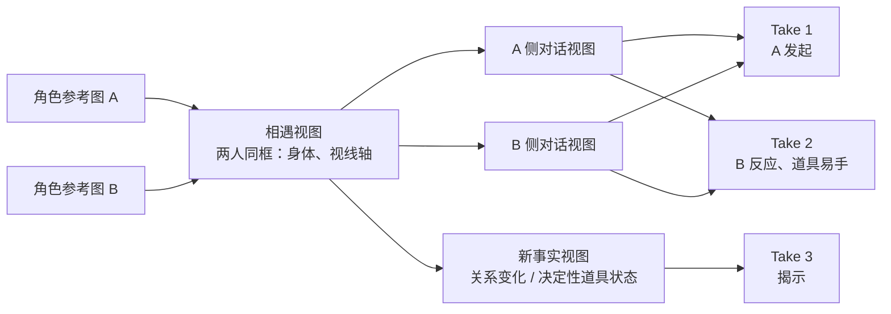
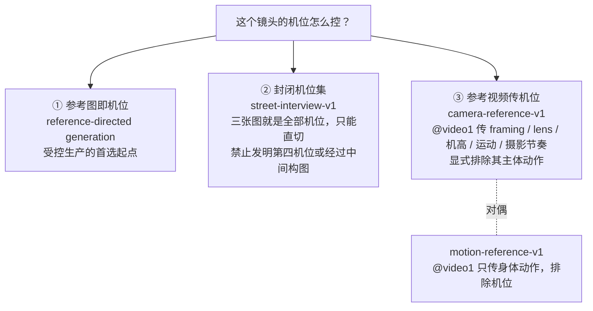
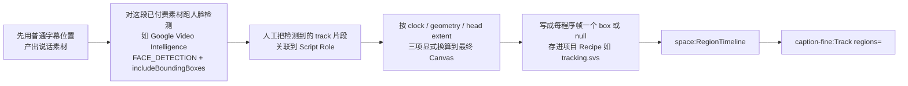

# Hypit · Playbooks 与短剧

> [!abstract] 一句话
> playbooks 是 Hypit 的「导演知识层」：22 个文件、全是散文体的判断原则，不给一行代码、一个硬数字或一张运镜词汇表；镜头控制被设计成「参考图即机位 / 封闭机位集 / 参考视频传机位」三条路，而短剧是七个 format 里唯一刻意不配 Prompt Kit、不配示例工程的格式。

## 1. 结构：两个尺度

| 尺度 | 回答什么 | 文件 |
| --- | --- | --- |
| format（整片级） | 谁扛论点、注意力怎么走、靠什么收束 | talking-head、short-drama、two-person-podcast、street-interview、ranking-listicle、presenter-led-explainer、narration-led-demo（7 篇） |
| craft（可跨格式复用的单点导演问题） | 字幕、B-roll、参考关系、声音、图形构成…… | b-roll、captions、caption-tracking、generated-dependencies、graphic-compositions、image-direction、motion-graphics、screen-demonstrations、sound-mix、video-direction、voice-and-performance、voice-direction（12 篇） |

另有 `index.md` 与 craft 下的 2 个 examples 页，共 22 个文件、2597 行（精读口径）。与 `creation/`（理解与意图）和 `production/`（Source、Run、Build 机制）并列。【源码】

### 七篇 format 共享一个稳定骨架

1. 一段定义「这是哪种整片级关系」的开头，并立刻说明它能与哪些别的 format 组合；
2. 第一个小节总是**先建立可复用的视觉前提**（talking-head 一张图扛全片、podcast 主持人图派生搭档图、街采三视图、ranking 板面初始状态、short-drama 关键图）；
3. 中间讲「一个 Take 内部怎么指挥」（谁发起、谁反应、何时切、道具怎么交接）；
4. 一个「各层分工」小节（口播 / 字幕 / 图形 / B-roll 各干什么）；
5. 结尾必有一段 review 判据。

七篇里**没有一篇从「写分镜」开始**，全都从「先做出一张（或几张）能反复用的图」开始。每篇都在自我限权：format 不是项目必须声明的类别（index.md:67-68）；三视图限制是那个 Kit 的设计而非对所有街采的限制（street-interview.md:26-27）；新的短剧形态可以用不同方式组合这些关系（short-drama.md:83-85）。【源码】

## 2. short-drama.md 全部要点

全文 85 行，逐节归纳（行号为 557497b 原文）：

### 2.1 定位（1-6）

短剧是**表演主导**的叙事：人物不只传递信息，他们的欲望、反应、行动、关系与环境让一个事件引出下一个。这是「rich A-roll」。家庭场景、安排好的相遇、播客对话、街采，只要人的事件承载故事，都能用这种戏剧形状。

### 2.2 给每一段一个戏剧任务（8-23）

- 从 Treatment 的因果运动出发导演：有人想要什么、另一个人改变了它的意义、一个动作造成后果、一个揭示改变观众的理解；台词、沉默、反应、肢体小动作都能承载这种运动。
- **Segment 不是镜头**：

> [!quote] short-drama.md:14-17
> A Segment is a performable dramatic passage, not a required camera shot or speaker turn. One Segment can contain several people and cuts; several generated Takes can also reuse the same camera views when the passage is better produced in parts.

- 先量 Script 了解说话密度，再给预期的停顿、反应与动作留时间；所选视频模型支持的请求长度约束「能一起生成什么」，但**不定义故事的场次**。度量归 script-and-time.md，请求长度如何影响可表演段落归 video-direction.md。

> [!important] 语义结构与剪辑结构被故意解耦
> 台词或语速一改，所有依附语义锚点的字幕 / 音效 / 图形跟着动，不需要重排镜头表。对做短剧的人，这意味着「先列镜头号」在 Hypit 里是反模式。

### 2.3 建立故事需要的机位（25-57）

- 当作品依赖可识别的人物、共享世界、调度或构图时，**参考条件生成是强起点**；关键图可以确立角色，也可以确立角色在场景中的完整故事视图，或两者都要。
- **不配 Kit 是明确选择**：

> [!quote] short-drama.md:29-31
> Direct images and Takes in natural language for the current dramatic intention. Free direction suits the variety of dramatic scenes; a reusable Prompt Kit becomes useful when repeated productions reveal a stable prompt relationship worth preserving.

- 后面的视图从「握有所需事实的图」派生：角色图把身份带进一个确立新地点与戏剧状态的视图；两人同框的共享视图先确立身体、视线轴与相遇，再给近景；一张故事图把服装、道具或空间关系带进下一张；用户提供的图已经表达了预期角色与镜头时可直接用。
- 同一地点里，少量视图就能支撑很多 Take。客厅对话里「每一侧对话各一张图」往往就够，适度的重构图、表演与机位变化在视频里完成；只有当新视图必须确立重要事实（关系变化、决定性道具状态、承载剧情的空间部分）时才值得再生一张图。
- 「要建立哪些视角」与「要一起生成哪段表演」是**两个独立决定**：一个 Take 可以在多个镜头或地点间移动，一个视图也可以引导多个 Take。**图像依赖图跟随视觉依赖，而不是跟随地点数或剪辑数。**



*示意：依据 short-drama.md:33-52 的规则绘制；判断标准是「这张图带着什么事实进入下一张」，不是一镜一图。*

### 2.4 让每台机位以不同方式看同一个世界（59-69）

- **背景承载故事**：揭示亲密或地位、解释两人为何在一起、支撑喜剧反差、埋一个有用的物件、让新场景一眼可读。要像指导人物一样有信念地指导它的氛围，而不是把空间留给模型生成通用场景。
- 同一地点的相关视图共享让它可辨认的事实（氛围、材质、色板、社会场景、空间关系），但每台机位各自看见这个地方合理的另一部分：一台揭示一个角色周围的区域，另一台揭示其搭档周围的另一区。

### 2.5 让表演承载事件（71-85）

- 动作指导要保住因果与注意力：**谁发起、谁注意到、什么东西易手、一个反应在回应什么、为什么注意力或镜头此刻移动**。一瞥、打断、不回应、转身，只有在改变戏剧关系时才重要。
- 字幕、字体、MG、特效、B-roll 可以让事件更锋利，但不能取代它的人的脊梁：短信可以揭示信息、插入镜头可以证明角色看见了什么、图形可以让结局可读。即使画面被另一层盖住，A-roll 表演和它的声音仍要有意义。
- **唯一的验收判据**：观众应当知道谁在行动、什么变了、为什么下一个视图或场景接在这里。

### 2.6 相邻 Take 直接拼接，不做交叉溶解

voice-and-performance.md 明确点名这条适用于「ordinary creator speech, podcast turns, interviews and short drama」：消耗时长的 crossfade 会吃进两边表演各自确立的词窗口，边界处可能出现两人同时说话；要求某个 Take 首尾保持人造的半秒静默，既违背 `hypit measure` 的尺寸逻辑，也违背说话视频模型「用整个请求片段去表演这句台词」的行为。有意的打断、叠话走 Timeline 的显式 Take 位置（支持 gap 与 overlap）；视觉上的叠化属于拥有该行为的视觉组件。「视觉层可以随便跨缝，语音时间不能被动。」【源码】voice-and-performance.md:62-80

## 3. 全仓没有运镜词汇表

精读者在整个 playbooks 目录穷举检索 dolly / truck / crane / pan / tilt / zoom / push in / orbit / handheld / steadicam / tracking shot / rack focus / 焦段，命中只有两类：image-direction 示例里的景别词（vertical medium half-body shot、low-angle），以及一句反向约束（face points straight toward the lens, with no head tilt or rotation）。没有任何一处在教「怎么描述一次推轨」。【源码】命中位置 craft/examples/image-direction.md:35,56,72,88,104,120；craft/image-direction.md:56；craft/screen-demonstrations.md:28；craft/examples/conversation-images.md:138,141；formats/talking-head.md:21

## 4. 镜头控制的三条路



- video-direction.md 的「生成关系」表：文字导演的视频（世界与动作不依赖既有视觉身份、构图或运动参考）/ 首尾帧视频（镜头必须从某张图开始或结束）/ 参考导演的视频（图、视频或音频引导身份、世界、音色、动作或镜头语言，而不声明字面端点）。「Reference-directed generation is the strong starting point for controlled Hypit production」；尾帧只在「到达那张确切的图」本身是预期动作的一部分时才用。【源码】video-direction.md:226-238
- 「Seedance 2 Mini at 720p is the usual starting point for generated performances, balancing capability and cost.」【文档】video-direction.md「Choose the generation relationship」
- 真正可枚举的运镜词在 Prompt Kit 的 `.svs` 数据文件里：speaker-v1 的 `camera-motion` 只有 `none`（hold a steady fixed framing）与 `subtle-punch-in-return`（一次推进再退回）两档；broll-v1 的 `camera-language` 有 `reference-locked` / `selfie-vlog` / `handheld-follow` / `push-reveal` / `product-macro` 五档。说话人镜头只给两档是一个很强的品味主张：在带口型与身份约束的镜头上，当前模型可控的运镜上限就这么多；B-roll 没有口型压力才放开到五档。Kit 原文见 [[Hypit · 模型接入与 Seedance#9. @image1 与 @video1：每个参考负责什么|Kit 全文]]。

## 5. video-direction：输入责任表

指挥生成模型的核心不是 prompt 模板，而是这张表——七种输入各自只负责一件事：【源码】video-direction.md:191-203

| 输入 | 只负责 |
| --- | --- |
| 人物与场景参考图 | 外观、场景、构图、要保持的物理状态 |
| 产品 / 界面等事实参考 | 需要连续或精确的可见事实 |
| 源视频参考 | 表演、物理或机位关系中「其时序应引导新镜头」的部分 |
| 反复使用的声音参考 | 说话人预期的声音身份（模型支持时） |
| Script 台词 | 可见表演的确切词句、预期发音与说话轮次 |
| Prompt Kit 或 Recipe | 适合这类作品的可复用 prompt 关系 |
| 段落导演 | 态度、声音表达、注意力、身体互动、镜头行为与有动机的剪辑 |

紧跟表格的一句是全页最硬的约束：

> [!quote] video-direction.md
> Prompt prose does not create a media edge, and a reference does not explain which fact it should preserve.

散文不会自动变成一条媒体依赖边，参考图自己也不会说明它该保住哪个事实，两者必须在 Source 里同时显式存在。这解释了为什么 Hypit 不满足于「把一切塞进一个长 prompt」。

### 5.1 prompt 的写法

「先给一句可表演的关系，再补少数决定落点的细节」，反对给每个短语都配手势。官方范例：

```text
She is venting to a friend with affectionate exasperation at how overpriced this is. At the price,
her eyebrows rise and her open palm turns upward with an incredulous vocal accent. Let the final
compliment land with a teasing smile in her voice.
```

判据：「A detail earns its place when it clarifies a judgment, reveals a response or preserves an important physical relationship.」talking-head.md:50-53 给了反面：对一个调侃型主持人，「amused disbelief + 一个心知肚明的眼神 + 一个收着的甩手」比逐肢体动画计划更有用。【源码】video-direction.md:75-87

### 5.2 两条对抗生成模型特性的硬规则

1. **比喻会变成实物**：「Capable video models can turn figurative wording into literal objects, events or transformations.」凡是不希望出现在画面里的东西，措辞必须换成具体可见的语言（视线、手势、运动、镜头行为、剪辑）。
2. **「说的内容」与「演的动作」分离**：说话人可以在谈论物体、数量、变换或想象中的演示，镜头只记录他在参考场景里的表演；引号里的句子只用来定位一次声音重音或一个手部节拍。一句泛泛的 no-text 指令压不住一个含糊的「把它演示出来」的邀请——**负向指令压不住正向歧义**。【源码】video-direction.md:143-160

### 5.3 反「AI 表演套路」

不要夸张情绪、不要持续运动、不要用手指精确比数字（street-interview.md:64-66、video-direction.md:168-170）；talking-head.md:79-82：静态表情、机械重复的手势或全程高强度，即使每个要求的词都在，也会毁掉结果。

## 6. image-direction：四段式

| 段 | 作者决定什么 |
| --- | --- |
| Capture | 摄影语言；Kit 提供经过测试的手机视频措辞，作者不动 |
| Person | 这是谁、为什么值得看、哪几个外观选择让他特别 |
| Shot | 在做什么、对谁说、镜头怎么遇见他的脸、身体与周围 |
| Setting | 在哪里、什么色板、哪些可见细节让这地方像有人住 |

参考图已确立人或地点时，person 与 setting 槽可以整段省略。两个观念：有能力的画师有自己的视觉习惯，「一个人坐在桌前」等于把脸、造型、场景全交给模型的默认联想；少数决定性笔触撑起整张画。另有「七问清单」作为找高价值决策的方法，但明确不是七个必填句。examples/image-direction.md 的五张人像是同一段 Capture 文字加不同 Person / Shot / Setting 的实证（成品图为外链，精读者未下载查看）。【源码】image-direction.md:15-40、74-87

## 7. 字幕系统（导演视角）

字幕的三层结构、文本与时间分家、书写系统表与 karaoke 轴已在 [[Hypit · 词锚定机制#5. 字幕：文本与时间彻底分家|词锚定机制 §5]] 展开，这里补 playbook 的判断：

- 「rather than prescribing a fixed Cue length or one caption look」——不给 Cue 字数、不给字幕时长（captions.md:34-36、74）。
- 中英混排时 Fine 的 `word-gap` 只作用于作者写的分隔符，中文 / 拉丁或数字 / 字母交界不会自动产生空格。
- 分组要保住互相依赖的词：名字、否定、冠词 + 名词、介词 + 宾语、动词短语、数量 + 单位。

### 字幕跟头：一个带外部测量的回路

字幕跟随说话人头部**不是默认能力**，触发条件被收紧为「用户的参考片肉眼可见在用跟头字幕，或用户明确要求」——画面里有张脸本身不构成理由。【源码】caption-tracking.md:1-6、88-89；captions.md:176-179



```text
heads.default {
  frame-count: 3;
  tracks: [
    {"id":"GUEST","regions":[[0.12,0.09,0.20,0.26],null,[0.13,0.10,0.20,0.26]]}
  ];
}
```

```xml
<space:RegionTimeline id="heads" within={vertical} recipe={tracking.heads.default}/>
<caption-fine:Track id="captions" document={story.caption}
  timeline={speech.timeline} regions={heads}>
  <caption-fine:Use style={caption-style}/>
</caption-fine:Track>
```

四个硬约束：检测器的 track ≠ 人物身份（一个剪辑点会把同一人切成多条 track，合拍镜头里有多个人，选「第一张脸」或「最大的脸」会把嘉宾的字幕挂到采访者头上）；Fine 每个 Role 每帧只接受一个 region；`null` 不是「没测到」而是「这一帧隐藏该 Role 的字幕」，Fine 不会自己编造缺失的框；全程复用已付费的媒体。【源码】caption-tracking.md:32-117

![[s2-example-nice-ride-strip.png|720]]
*「NICE RIDE」参考片四帧：字幕（YOURS? / A LAMBORGHINI? / AND / SIX FIGURES.）跟着说话人头部移动，顶部 emoji 揭示板随三个 Moment 依次翻开。README 称人脸框来自 Google Video Intelligence 与 YOLOv8 AnimeFace。来源：README 内嵌视频 666ad535-…，本地抽帧*

## 8. 代码渲染 vs 生成素材的边界

判断依据写在 graphic-compositions.md，**按作品走、不按元素类型走**：【源码】graphic-compositions.md:54-76

```text
Use authored text, exact fonts, geometry and state when wording, alignment, timing, data or repeated
visual relationships need control. Use supplied, found or generated media for photographs, artwork,
textures, product imagery and other material whose picture is itself the content. A real screenshot
or finished graphic can remain media; recreating every pixel as a component is not automatically useful.

The boundary follows the work. A sign photographed in a scene belongs to that scene. A score that
must change on a spoken answer is editable graphic state.
```

三条反直觉补充：一张真实截图或做好的图形可以就是素材；公众熟知的图标、人物、meme、地标只要职能是「被认出来」，见多识广的图像模型可以直接画；「Provenance alone does not make one image more visually truthful than another」。真正要求权威素材的条件是：确切的当前措辞、数据、UI、私有身份或特定品牌资产本身就是证据。

![[s2-example-daily-creatine-strip.png|720]]
*「DAILY CREATINE」参考片四帧：分屏访谈与区分说话人的卡拉 OK 字幕（高亮词 ONE / A DAY / GOD / ASK）是代码渲染的图形，人物表演与场景是 Seedance 生成的素材。来源：README 内嵌视频 22df72b8-…，本地抽帧*

## 9. B-roll、声音与表演

- **B-roll 的三种时间分开**：生成请求的时长、素材自身的播放跨度、它在成片里的显示窗口；「the generation request's duration does not set its display duration」。反对为了填满 Selection 冻帧或变速——two-person-podcast 的判例：三场景蒙太奇以原速完整播一遍，Selection 可以略长于片段，播完让底层画面回来，搭档的声音可以先于画面回来（一个 J-cut）。【源码】b-roll.md:27-81；two-person-podcast.md:84-93
- **两种 B-roll 关系**：「精确对应」用于论断的含义依赖某张画面在那一刻可见；「跨若干画面的一个视觉念头」用于习惯、历史、过程或态度。narration-led-demo.md:44-49 的判词：给旁白里每个名词配一张泛图 produces activity without proof。
- **配音与表演**：Voice Design 或用户提供的音频 → 一份被接受的 Voice Reference（普通 audio Resource）→ 同时供给可见 A-roll 与纯音频 A-roll，是同一资源的两种用法；新角色建议用约 5 秒干净自然的语音做 designed sample。三问分离：此刻说话人是否不在画面里 / 声音来自被覆盖的可见 A-roll 还是纯音频 A-roll / 这一段是可见表演主导还是独立旁白主导——不要因为 B-roll 恰好挡住了可见表演就把它当成纯音频 A-roll。【源码】voice-and-performance.md:104-137
- **声音素材**：Hypit 不自带 BGM、音效或环境声素材库，只提供准备、放置与混音的方式（sound-mix.md:28-31）。

## 10. 全线拒绝硬性数字

不给 Cue 字数（「A fixed word or character count cannot make that choice」）、不给字幕时长、不给镜头时长、不给剪辑频率。所有时长都从 `hypit measure` 的实测语速 + 所选模型支持的区间里推出来（short-drama.md:19-23、video-direction.md:280-298）。风格名是创作方向而非渲染器或组件类型（motion-graphics.md:31-33）；参考片提供的是要理解的外观与行为，不是强制的实现方式（presenter-led-explainer.md:99）。

## 11. 设计取舍

| 取舍 | 代价 | 收益 |
| --- | --- | --- |
| 不做运镜词汇表，镜头控制走三条路 | 放弃分镜表式的精确机位描述 | 不跟模型的运镜理解力硬碰 |
| 说话人运镜压缩到两档 | 表达受限 | 承认带口型镜头的可控上限 |
| Segment 是语义段落不是镜头 | 没有现成镜头编号可依 | 改台词、改语速时下游自动跟随 |
| 字幕文本与时间彻底分家 | 音频一改就要重对齐 | 纯视觉改版复用已付费媒体 |
| 短剧不配 Kit、不配示例工程 | 拿不到现成骨架 | 主动承认「模板化会伤害短剧」 |
| caption-tracking 设为可选回路 | 多一道外部检测与人工关联 | 不把昂贵易错的步骤强加给所有有脸的片子 |
| 拒绝硬性数字 | 无法按规则机检 | 时长跟着实测语速与模型区间走 |

> [!question] playbook 读者声明的未读部分
> production/ 与 creation/ 基本没读；caption-fine README 与真实字段名未核对；examples/ 下的实际工程都没打开（presenter-led-explainer.md:142-155 指向的 complex-explainer 是一个 137 秒、17 个 Take 的完整成片，带 CRAFT-NOTES.md，是验证上述说法的最好材料）；podcast-v1、call-v1 未读，street-interview-v1 只读了 1-40 行；「word anchoring / 词锚定」这个词本身在 playbooks 里没有出现，是读者把 CaptionDocument、逐字 karaoke 时间与每帧 region 数组合起来理解的。【空白】

> [!note] 用户对这一篇的定位
> 2026-09-23 用户明确：Hypit 与自己做的「高水平精度制作的精品剧」是分开的两件事，「一种是复刻，另一种是高水平精度的制作的精品剧，我只是让你了解学习，不用对比」。所以本篇只陈述 Hypit 的做法，不与灰模预演管线对表。

---
相关：[[Hypit · 词锚定机制]] · [[Hypit · 模型接入与 Seedance]] · [[Hypit · Skill 组织方式]] · [[灰模管线 · 同类产品与开源方案]]
