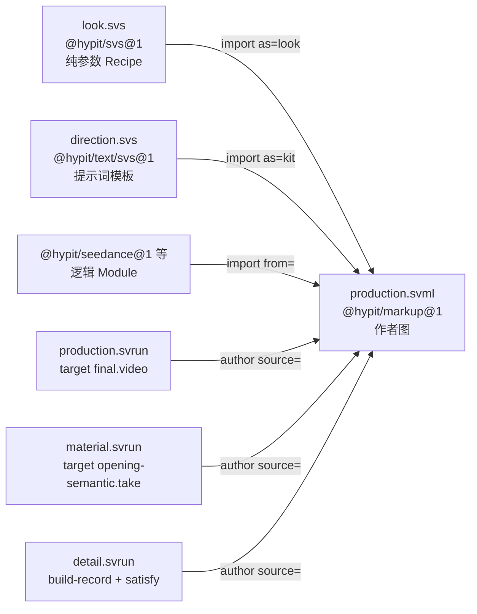

# Hypit · SVML 语言

> [!abstract] 一句话
> SVML 不是「视频 DSL」，而是一门**只有整值引用、没有表达式的静态图声明语言**：`.svml` 声明图（谁产出什么、连到谁），`.svs` 声明不进图的纯参数值，`.svrun` 声明这次执行要哪个 Output、用哪些已有值替代上游；三者由文件首行的 Header 而不是后缀决定解析器。

![[s2-svml-live-preview.png|720]]
*README 演示图的一帧：左侧 SVML 源码（`<script>` 里的 `@ronaldo`、`@greek-god` 等语义标记，下方 `<item source=broll-3.webp during={script.selection.greek-god}/>`），右侧是对应的实时渲染画面。原 GIF 为 1080×738、20 秒、9.9MB，超过 8MB，故用 ffmpeg 抽取第 6 秒一帧。来源：github.com/user-attachments/assets/981c28e8-ddab-4164-85bc-03b5d71275dc*

> [!info] 证据口径
> 本篇 file:line 来自 2026-09-22 对 commit `9c9918d` 的五路静态精读【源码】；2026-09-29 在 `557497b`（0.2.16）上抽查 `markup/src/syntax.ts:14`、`script/src/parser.ts:76/84` 等行号仍一致。标【实测】的是本机 `hypit check` 结果。

## 1. 三种文件其实是三种 Frontend

后缀没有解析权威：「There is no suffix dispatch and no default parser.」（packages/source/README.md:11）。文件第一行的 Header 选定解析器，解析后 Header 被替换成等长空白，保证后续源码偏移不变。【源码】packages/source/src/header.ts:42-80

```ts
// header.ts:53
const match = /^<\?svml[ \t]+using=(['"])([^'"\r\n]+)\1[ \t]*\?>$/u.exec(raw);
```

| Header | 惯用后缀 | 声明什么 |
| --- | --- | --- |
| `<?svml using="@hypit/markup@1"?>` | `.svml` | 作者图：Record、Component、Fragment 以及它们之间的边 |
| `<?svml using="@hypit/svs@1"?>` | `.svs` | 通用 Recipe：不进图的纯参数值 |
| `<?svml using="@hypit/text/svs@1"?>` | `.svs` | TextTemplate（提示词模板，即 Prompt Kit） |
| `<?svml using="@hypit/run-markup@1"?>` | `.svrun` | 执行选择：Target、Candidate、Satisfy |

同一个 `.svs` 后缀挂两个完全不同的 Frontend，产出的 Record 也完全不同。【实测】少写 Header 时 `hypit check` 直接报：

```text
× Command failed
  SOURCE_HEADER_MISSING
  bad2.svml:1:1: Source must begin with <?svml using="..."?>
```



*同一份作品可以挂多个 Run：先只出素材、再只出成片、再只渲染 30–90 帧，作品本身一个字不改。*

## 2. 花括号里只能是一条扁平路径

属性值只有两种形态：带引号的字符串字面量，或 `{path}` 整值引用。正则直接卡死，没有算术、函数、条件、插值，也不是 JavaScript、不是属性访问链。【源码】packages/markup/src/syntax.ts:14、84-91

```ts
// syntax.ts:14
const REFERENCE = /^[A-Za-z_][A-Za-z0-9_.:-]*(?:\.[A-Za-z_][A-Za-z0-9_.:-]*)*$/u;

// syntax.ts:84-91
if (quote === "{") {
  const close = source.text.indexOf("}", start + 1);
  if (close < 0) fail(source, "MARKUP_REFERENCE", "Unclosed reference attribute.", start);
  const path = source.text.slice(start + 1, close).trim();
  if (!REFERENCE.test(path)) fail(source, "MARKUP_REFERENCE", `Invalid reference "${path}".`, start);
  return { value: { kind: "reference", path }, end: close + 1, ... };
}
fail(source, "MARKUP_ATTRIBUTE", "Attribute values must be quoted strings or whole-value references.", start);
```

【实测】写 `within={canvas + 1}` 时：

```text
MARKUP_REFERENCE: Invalid reference "canvas + 1". (bad3.svml:5:36)
```

> [!warning] `prompt={direction}` 与 `prompt="direction"` 完全不同
> 前者是一条图边，后者是一个字符串字面量。任何「计算」都必须变成图里的一个节点：拼字符串走 `text:Render`，算时间走 temporal 投影。整个 parser 只有 271 行。【源码】markup/src/syntax.ts:66-90、243-259

### 点号不是属性下钻

`{story.segment.opening.dialogue}` 里的点号**不是**逐级取属性，而是一个字面上含点号的扁平 Record id。Script Surface 解析时直接造出 `story`、`story.caption`、`story.segment.<id>`、`story.segment.<id>.dialogue`、`story.segment.<id>.speech`、`story.selection.<id>`、`story.moment.<id>` 这一批 Record；解析引用就是一次 Map 查表。【源码】packages/script/src/surface.ts:84-128

```ts
// markup/src/frontend.ts:186-194 —— 三张扁平表的顺序查找
const resolvedReference = (path: string): SurfaceResolvedReference | undefined => {
  const imported = importedReferences.get(path);   // 1. 导入的公开绑定
  if (imported !== undefined) return imported;
  const record = recordsById.get(path);            // 2. 之前声明的 Record
  if (record !== undefined) {
    return { path, ref: { kind: "record", id: record.id }, type: record.type, record };
  }
  return componentReferences.get(path);            // 3. 之前声明的组件输出
};
```

所以输出路径是每个包自己的词汇：`gpt:Image id="portrait"` 发布 `{portrait.image}`（它把 outputs 写成 `{ image: "portrait.image" }`），而 `media:Image id="logo"` 只发布 `{logo}`。markup/README.md:38 明说「There is no universal `.image` or `.track` suffix」——必须用 `hypit vocabulary <package>` 或包 README 查。【源码】gpt-image/src/surface.ts:185；media/src/surface.ts:99-105

## 3. 引用解析的两阶段规则

| 阶段 | 能看见什么 | 顺序是否重要 |
| --- | --- | --- |
| Markup 解码期 | 导入的公开绑定 + **之前**声明的 Record + **之前**声明的组件输出 | 重要：必须先声明后引用 |
| Elaborator 链接期 | 先收齐全部 exports，再解析输入 | 无意义：组件可以引用后面的组件 |
| 执行期 | —— | 只看图依赖与被 demand 的 Output，与 XML 顺序无关 |

这解释了文档里一句「declaration order has no meaning」（elaborator/README.md:13-15）与另一句「Name declarations before the structured Surfaces that resolve their inputs」并存的矛盾：讲的是不同阶段。作者按更严的那条（先声明）写。【源码】markup/README.md:43-48

### 四层环检测，全部显式报错

| 层 | 错误码 | 位置 |
| --- | --- | --- |
| Source import 环 | `SOURCE_IMPORT_CYCLE` | elaborator/src/source.ts:432-453 |
| Author component 环（报错打印完整环路） | `AUTHOR_COMPONENT_CYCLE` | elaborator/src/author.ts:221-254 |
| Fragment 内部 operation 环 | `FRAGMENT_CYCLE` | elaborator/src/fragment.ts:236-259 |
| 最终 BuildPlan 拓扑校验 | `PLAN_CYCLE` | core/src/plan.ts:467 |

没有任何「自动打断环」的兜底。SVML 是严格 DAG，求值既不是惰性也不是响应式，是一次性拓扑排序后按需执行。【源码】

## 4. 命名空间：两套互不相干的地址

| 写法 | 选的是什么 | 说明 |
| --- | --- | --- |
| Header `using="…"` | Frontend | 决定用哪个解析器 |
| `<import from="@hypit/xxx@1"/>` | 逻辑 Module ABI | `as=` 给 tag 加前缀（`<seedance:TextVideo>`）；不写 `as` 则裸用（如 `<script>`） |
| `<import source="./x.svs"/>` 或 `source="@hypit/gpt-image-kits/phone-ugc-v1"` | 另一个 SourceUnit | alias 给它的公开绑定加前缀 |

- `@1` 是作者接口版本，与 npm 包版本另算；物理包名由逻辑地址剥掉 `@版本` 和子路径推出，所以一个 npm 包可提供多个逻辑 Module（`@hypit/text` 同时提供 `@hypit/text@1` 与 `@hypit/text/svs@1`）。【源码】package-loader-node/src/loader.ts:171-180
- 标签作用域是 per-source 的 Map，撞名报 `MARKUP_SURFACE_COLLISION`；正文里用了没导入的标签报 `MARKUP_UNKNOWN_SURFACE`。【源码】markup/src/frontend.ts:99-111、239-240
- Source import **不是文本包含**，不暴露对方的私有图标识；alias 也**不重命名** Narrative 身份——两份都叫 `story` 的 Script 仍然冲突。【源码】markup/README.md:31-34

```ts
// package-loader-node/src/loader.ts:171-180 —— 逻辑地址 → 物理包名
// "@hypit/text/svs@1" -> "@hypit/text"
// "@hypit/gpt-image-kits/phone-ugc-v1" -> "@hypit/gpt-image-kits"

// markup/src/frontend.ts:108 —— alias 决定 tag 前缀
const tag = request.alias === undefined ? declaration.tag : `${request.alias}:${declaration.tag}`;
```

## 5. SVS：看着像 CSS，行为是一堆独立命名常量

```ts
// svs/src/parser.ts:10-12
const RULE     = /^[a-z][a-z0-9_-]*(?:\.[a-z][a-z0-9_-]*)+/u;  // 至少两段
const PROPERTY = /^[a-z][a-z0-9-]*/u;
const SHEET_ID = /^[a-z][a-z0-9_-]{0,63}$/u;
```

- 规则路径至少两段（`media.cover` 合法，`cover` 不合法）；每条属性以 `;` 结尾。
- `null` / 布尔 / 有限数字 / 裸词是标量；以 `[` 或 `{` 开头走严格 JSON；`8f`、`250ms`、`50%` 在 SVS 里**只是字符串**，由消费方解释。
- **无继承、无级联**：`caption.base` 与 `caption.guest` 毫无关系，公共值只能复制。
- **Recipe 里不能出现图引用**：媒体、字体、语义范围必须留在 Source 里做显式边。【源码】svs/src/parser.ts:139-192、254-265；svs/README.md:29-36

Skill 自带示例的 `look.svs`：

```text
<?svml using="@hypit/svs@1"?>
<sheet version="1">
  media.performance { stack-order: 0; fit: cover; }
  text.title { size: 54; weight: 700; stack-order: 20; }
  film.main { background: #18212A; }
</sheet>
```

以 `import as="look"` 导入后，规则引用写成 `{look.media.performance}`。

> [!bug] 文档与实现的一处真实出入
> `docs/quickstart/styles.md:29` 说「`<sheet>` 的 `id` 属性成为顶层命名空间」。实际上 `@hypit/svs@1` 只用**规则路径**做 record id，sheet 的 `id` 被解析、被正则校验，但**从未进入 record id 或 export 名**；仓库自己的测试 `<sheet version="1" id="studio">` 里的规则 `card.answer` 被引用为 `${alias}.card.answer`，中间没有 `studio`。唯一用 sheet 级名字的是 `@hypit/text/svs@1`，而它取的是规则 `text-template.<id>` 里的 `<id>`（examples 里两者恰好同名，容易误导）。照 quickstart 写会把引用路径写错一层，以 `source-syntax.md:88` 与实现为准。【源码】svs/src/frontend.ts:16-25；svs/test/source-closure.test.ts:165、182；text/src/frontend.ts:20-31

## 6. `.svrun`：执行选择的七种声明

顺序被强制：Header → `<svrun>` → **恰好一个** `<author>` → Fragment `<import>` → `<target>` 与 Candidate 声明。【源码】run-markup/README.md:5-43

| 元素 | 作用 |
| --- | --- |
| `<author source="…">` | 必需，指向 Author Source |
| `<target output="…">` | 要变成真实产物的公开 Output，可多个 |
| `<file>` | 本地字节做零输入 Candidate |
| `<build-record id build output>` | 历史 Build 的某个具名 Output |
| `<value>` | JSON 里的类型化值 |
| `<fragment>` | 计算出的值 |
| `<satisfy output candidate>` | 用 Candidate 替换某个逻辑 Output 的来源 |

```xml
<?svml using="@hypit/run-markup@1"?>
<svrun version="1">
  <author source="./production.svml"/>
  <target output="detail.video"/>
  <build-record id="kept-take" build="bld_..." output="opening-semantic.take"/>
  <satisfy output="opening-semantic.take" candidate="kept-take"/>
</svrun>
```

- `build-record` 的 `output` 是历史 Result 里的名字；`satisfy` 的 `output` 是当前图里的位置，两者可以不同名——「Hypit 永远不会猜测两个名字代表同一份作者意图」。【文档】docs/zh/quickstart/run.md
- **复用永不自动发生**：重跑同一个 Run、名字没变、prompt 没变，都不会自动复用；删掉一个 `satisfy` 就把那个 Output 交还给原始计算，可能重新产生付费请求。【文档】authoring.md:136-137
- Runtime Profile、凭据、Provider 选项都不是 Run 语言的一部分。

## 7. 时间与空间是两条互不相干的轴

### 7.1 Clock / Timeline / Take

- **Clock** 只是一个有理帧率，在任何素材存在之前声明（`program:Clock` / `time:Clock`），被 Normalize 与 Timeline 共用。
- **Timeline** 持有全片时间范围 + 放置好的 Take：`at` 省略时首个为 0、其后为 `previous.end`；`end` 省略为 `content.end`（所有 Take 的最大结束）。【源码】timeline-author/src/program.ts:66-72
- **Take** 的 `source` 只接受 `SemanticTake`，不接受任意图片 / 视频 / 音频——任何带话的素材都必须先 Normalize 再对齐才能上轨。
- Timeline **不选画面、不做转场、不出声音**：两个重叠的 Take 只意味着「两个源都可用」，不会自动叠化。
- **span-authority 不属于 Timeline，属于 `pipeline:Normalize`**：决定归一化时哪条流定时长（video 四舍五入、audio 向上取整），有视频流时必须选 `video`。【源码】media-execution/src/execute.ts:256-267

```ts
// media-execution/src/execute.ts:256-267
if (video !== undefined && selection.spanAuthority !== "video") {
  throw new Error("A synchronized visual currently requires video span authority; "
    + "use audio authority only for audio-only media");
}
const frameCount = selection.spanAuthority === "video"
  ? roundPositive(scaledNumerator, scaledDenominator)   // 视频：四舍五入
  : ceilPositive(scaledNumerator, scaledDenominator);   // 音频：向上取整
```

### 7.2 Canvas / Frame

「Give layers to the canvas, rather than the canvas to layers」（system.md:8）。Canvas 只给像素尺寸与坐标基（左上原点，x 右 y 下），**不含任何中央图层列表**；绘制层级在每个 Present 自带的 `stacking.order` 上，Film 子元素顺序不决定层级。【源码】film/README.md:17-19、49-51

```xml
<!-- right/bottom 是边缘位置，不是内缩（spatial.md:22-31） -->
<space:Canvas id="canvas" width="1080" height="1920"/>
<space:Frame id="full"    within={canvas} left="0%" top="0%"  right="100%" bottom="100%"/>
<space:Frame id="content" within={full}   left="6%" top="8%"  right="94%"  bottom="90%"/>
<space:AnchoredFrame id="label" within={content}
  x="50%" y="85%" width="80%" height="12%" anchor="center"/>
<space:AspectFrame  id="photo" within={content}
  x="100%" y="0%" width="45%" aspect={photo-size} anchor="top-right"/>
```

中间 80% 要写 `left="10%" right="90%"`；百分比在 x 轴用父宽、y 轴用父高，`within=` 改变参照矩形。Frame 定目标矩形，Recipe 里的 `fit` + `frame-x/y` + `content-x/y` + `fit-offset` + `fit-constraint` 定源图怎么摆进去：位置 = frame.x + frame.w × frame-x − contentW × content-x + fit-offset-x。【源码】spatial/README.md:11-44

> [!question] 实测与文档的一处待解
> 精读引用文档称 `left="10%" right="10%"` 会「解析成零宽而被拒」。【实测】2026-09-29 用 `hypit check` 校验这样一个 Frame，结果是 `✓ Source is valid`。拒绝可能发生在 plan / 编译更后的阶段，也可能文档表述不准。【空白】

### 7.3 Track / Style / Use 三分

| 概念 | 承载什么 |
| --- | --- |
| Track | 一条贡献，绑定内容源（`document=` / `timeline=` / `canvas=`） |
| Style | 一份完整呈现方案（Recipe + 字体 + Frame 等真实图边） |
| Use | 一次带时间窗（可选 `role=` 过滤）的选择 |

规则：「源码顺序里最后一个匹配的 Use 获胜，整体替换 Style，属性不合并」；无 `during` 的 Use 是全局基调。Caption、Performance、Sound 三家一致。【源码】caption-presentation.md:42-46；performance.md:29-32

```xml
<!-- examples/interview/reference.svml:283-292 -->
<caption-fine:Style id="caption-boy-style"  recipe={recipes.caption.boy}  font={caption-font}/>
<caption-fine:Style id="caption-wife-style" recipe={recipes.caption.wife} font={caption-font}/>

<caption-fine:Track id="captions" document={story.caption} timeline={speech.timeline}>
  <caption-fine:Use style={caption-boy-style}/>              <!-- 无时间窗 = 全局基调 -->
  <caption-fine:Use role="WIFE" style={caption-wife-style}/> <!-- role 过滤，与时间正交 -->
</caption-fine:Track>
```

![[s2-component-previews.png|720]]
*官方组件包自带的预览图拼版（10 个 Track / Surface）：caption-fine、ranking 的 TierBoard 与 TopThree、media-track、typography-track、comment-sticker、deck-track 的 DepthStack、screen-overlay、interview-emoji-reveal、timeline-author。每个都是一个可在 SVML 里 import 的组件。来源：仓库 packages/*/preview/*.png，本地拼版*

## 8. 两个可以照抄的完整骨架

### 8.1 最短作品：纯动画，无语音无生成（26 行）

```xml
<?svml using="@hypit/markup@1"?>
<svml>
  <import as="time"   from="@hypit/timeline-author@1"/>
  <import as="spatial" from="@hypit/spatial@1"/>
  <import as="film"   from="@hypit/film@1"/>
  <import as="render" from="@hypit/render-hyperframes@1"/>
  <import as="chat"   from="@example/chat-scene@1"/>
  <import as="style"  source="./chat.svs"/>

  <time:Clock    id="animation-clock" frame-rate="30"/>
  <time:Timeline id="animation" clock={animation-clock} end="8s"/>
  <spatial:Canvas id="canvas" width="540" height="960"/>

  <chat:Scene id="conversation" timeline={animation.timeline} canvas={canvas} during="program">
    <chat:Message id="question" at="0.5s" text="Are we ready to launch?"/>
  </chat:Scene>

  <film:Film id="main" canvas={canvas} timeline={animation.timeline} appearance={style.film.main}>
    <film:Track source={conversation.track}/>
  </film:Film>
  <render:Video id="final" composition={main.composition} timeline={animation.timeline}/>
</svml>
```

【源码】examples/semantic-composition/chat.svml:1-26。证明 Script / WhisperX / SemanticTake 全是可选的：纯动画用零 Take + 显式 `end` 的 Timeline 即可。`@example/chat-scene` 是示例目录 `packages/chat-scene` 里的项目组件，需要先构建。

### 8.2 最短带语音的作品（Skill 自带，73 行）

```xml
<?svml using="@hypit/markup@1"?>
<svml>
  <!-- 13 个 import 略：sound / performance / script / text / seedance / pipeline / whisperx
       / time / space / program / fonts / typo / film / render，以及 look.svs 与 direction.svs -->
  <script id="story">
    <opening><HOST>Here is @{proof}the useful part.@{/proof}</opening>
  </script>
  <space:Canvas id="canvas" width="720" height="1280"/>
  <program:Clock id="clock" frame-rate="30"/>
  <space:Frame id="full" within={canvas} left="0%" top="0%" right="100%" bottom="100%"/>
  <space:Frame id="title-frame" within={canvas} left="8%" top="12%" right="92%" bottom="30%"/>

  <text:Value id="direction">
    A close, naturally lit phone-video view of a presenter in a workshop.
    HOST is the presenter, speaking to the camera with relaxed confidence.
  </text:Value>
  <text:Render id="prompt" template={kit.performance}>
    <text:Set name="direction" text={direction}/>
    <text:Set name="dialogue" text={story.segment.opening.dialogue}/>
  </text:Render>
  <seedance:TextVideo id="performance" model="mini" prompt={prompt}
    duration="5" aspect-ratio="9:16" generate-audio="true"/>
  <pipeline:Normalize id="performance-media" source={performance.video} clock={clock}
    video="primary-moving" audio="default" span-authority="video"/>
  <whisperx:SemanticTake id="opening-semantic" narrative={story}
    segment={story.segment.opening} media={performance-media.media} language="en"/>
  <time:Timeline id="speech" clock={clock}>
    <time:Take source={opening-semantic.take}/>
  </time:Timeline>
  <!-- sound:Track、performance:Track、typo:Track（during={story.selection.proof}）、film:Film 略 -->
  <render:Video id="final" composition={main.composition} timeline={speech.timeline}/>
  <render:Video id="detail" composition={main.composition} timeline={speech.timeline}
    start-frame="30" end-frame-exclusive="90"/>
</svml>
```

【文档】skills/hypit/references/production/examples/production.svml:1-73（此处节选）。它把一条台词 → 提示词模板 → Seedance 生成 → 归一化 → WhisperX 对齐 → Timeline → 呈现 → 渲染整条接起来；`typo:Area … during={story.selection.proof}` 就是「标题挂在词上」。对比 interview 例子的 324 行可以看出：多出来的全部是素材准备与呈现，骨架不变。【实测】这份示例去掉字体层后 `hypit check` 通过（14 个 Outputs），`hypit plan` 列出 8 个请求，见 [[Hypit · 使用流程#3.3 实测：同一份作品，三种 Run，请求数不同|使用流程 3.3]]。

## 9. 设计取舍一览

| 取舍 | 代价 | 收益 |
| --- | --- | --- |
| 放弃通用表达式，`{}` 只能整值引用 | 极其啰嗦（interview 例子光拼提示词就上百行 `text:Value` + `text:Set`） | 整张图可类型检查、可缓存，任意节点可被 Run 的 Candidate 整体替换 |
| Header 而不是后缀选解析器 | 每个文件多一行样板 | 不存在默认解析器，一个后缀可挂多个 Frontend |
| 解码期先声明后引用、链接期与顺序无关 | 两阶段规则不一致 | Surface 在解码时就能检查内联 Recipe 的内容 |
| Timeline 只接受 SemanticTake | 管线更长 | Timeline 里每一帧都带可查询的词级证据 |
| Timeline 不选画面、不做转场 | 最简单的叠化也要显式写 Style 或场景组件 | 素材层与呈现层彻底解耦 |
| Canvas 不持有图层树 | 「这一层在上面吗」要去各组件 Recipe 查 | 组件可自由重叠、跨出画布、共享运动 |
| SVS 拒绝继承与级联 | 公共值要复制 | 一条 Recipe 的值永远只有一个来源 |
| Recipe 里不允许图引用 | .svs 与 .svml 像在描述同一件事的两半 | SVS 永远退化不成第二套 DSL，也不藏付费依赖 |
| span-authority 暴露给作者 | 每次 Normalize 多写一个属性 | 「视频比音频长 3 帧听谁的」成为显式决定 |
| 复用必须显式 `satisfy` | 要手抄 Build id | 既不静默花钱，也不用旧结果悄悄盖掉改动 |
| Use 替换而非合并 | 改一个颜色也要复制整份 Recipe | 任意时刻「现在用哪份方案」唯一确定 |
| alias 不重命名 Narrative 身份 | 不能靠别名隔离 | 一部作品里「哪份台词是权威」没有歧义 |

【源码】SVML 精读 design_decisions 全部 13 条的归纳。

---
相关：[[Hypit · 词锚定机制]] · [[Hypit · 编译与渲染链路]] · [[Hypit · 使用流程]] · [[代码渲染 · Remotion skills]]
