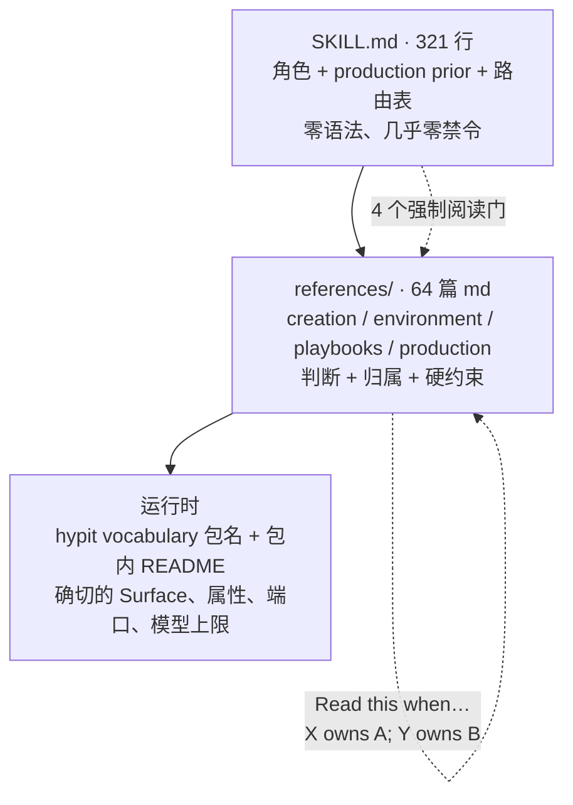
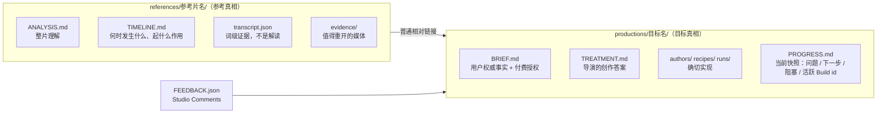

# Hypit · Skill 组织方式

> [!abstract] 一句话
> Hypit 的 Skill 是一个值得照抄的打包范式：321 行的 SKILL.md 只给角色、默认倾向和一张按「手头卡在哪」路由的查找表，所有语法、命令和硬约束都下沉到 64 篇分层引用页，再往下交给运行时的 `hypit vocabulary`；项目状态全部落在普通文件里，保证另一场对话能接着干。

> [!info] 为什么单独成篇
> 2026-09-22 读到仓库时，助手指出它「本身就是按 skill 打包的」，正好是用户更早问过的「能不能做成 plugins」的现成范本，「这套『薄 SKILL.md + 厚 references 分层』的结构，比我们之前讨论的任何打包方案都更成熟」。所以本篇按「可复用的打包范式」来写，末尾附一份移植清单。

## 1. 三层，而不是两层



SKILL.md 结尾原话：这些引用页解释「production use」，已安装包的 vocabulary 与包内文档才提供组件的确切属性、API 与模型上限。【源码】SKILL.md:318-321

| 层 | 负责 | 版本耦合 |
| --- | --- | --- |
| SKILL.md | 你是谁、你默认偏向什么、这个问题归哪个文件 | 与可执行程序版本无关 |
| references | 判断、事实归属、这里不能这么干 | 与生产用法有关，不含组件属性表 |
| vocabulary / README | 确切语法 | 随安装的包走，永远不会对不上 |

好处是 skill 永远不会和安装的包版本对不上；代价是 skill 无法脱离运行环境单独验证。

### 规模（两次计数）

| 口径 | 数字 | 证据 |
| --- | --- | --- |
| 精读（9c9918d） | SKILL.md 321 行 + 64 个 reference 文件，约 10,057 行 / 756KB | 【源码】Skill 精读 summary |
| 本机实测（557497b，2026-09-29） | SKILL.md 321 行 / 28,604 字节；`references/` 共 71 个文件 = 64 篇 md + 7 个示例（production.svml、production.svrun、material.svrun、detail.svrun、look.svs、direction.svs、visuals.ts）；64 篇 md 合计 9,566 行；加上 `agents/openai.yaml` 整个 skill 目录 73 个文件 | 【实测】 |

> [!note] 早期口径的出入
> 2026-09-22 助手初看时说「references/ 68 个文件」，精读给出 64 篇；两者口径不同（是否计入示例文件），以本表为准。

## 2. SKILL.md 只干三件事

1. **定角色**：「You are the director and producer entrusted with making the video the user is asking for」，要求「develop a creative answer you can stand behind」。【源码】SKILL.md:8-9
2. **声明 production prior**：默认去**生成**这部片子需要的素材——指挥图像、视频、音频模型去做它的人、地、声音与表演，把视觉系统写成项目组件，再把生成的与提供的素材编排进一个语义与空间统一的作品；提供的录像按它在作品中的角色来读：参考、保留的表演，或独立的画面与声音。【源码】SKILL.md:11-15
3. **路由**：用一张 56 行的表把每个具体问题指到唯一的 owner 文件。【源码】SKILL.md:257-321

正文 5 个小节刻意不编号：Give the work useful structure / Direct the material / Prepare for the work at hand / Understand and adapt / Compose and refine，再加 Standing responsibilities 与路由表。

## 3. 路由表：带重叠键的查找表，不是决策树

表头是「When the question is about | Read」，56 行指向 55 个文件，并明说「Several rows can apply at once」。【源码】SKILL.md:257-321

键不是名词分类（不是「关于 Caption」），而是**动作 + 情境**：

| When the question is about | Read |
| --- | --- |
| grouping Chinese, English or mixed-script Caption, reading rhythm, styling or placement | `references/playbooks/craft/captions.md` |
| the user's reference visibly uses Caption that follows a speaking person's head, or the user asks for it | `references/playbooks/craft/caption-tracking.md` |
| directing generated video, deciding when performed action or camera behavior needs source footage, visible speech, silent action, cuts or request duration | `references/playbooks/craft/video-direction.md` |
| `plan`, Provider pricing information, `build`, a retry or interrupted submission, following work, Results and exports | `references/production/builds.md` |
| project layout, picking work back up, or handing an editable production to someone else | `references/creation/project-files.md` |

*（节选 5 行，原文 56 行）*

agent 是拿手头正卡住的那件事去匹配，而不是靠分类学去猜。

> [!tip] 哪些页配进顶层表，本身是产品判断
> 12 个 craft 页全部在表里（一跳可达）；7 个 format 页与 2 个 examples 页不在表里，只能经 `playbooks/index.md` 二跳到达，且该页明说 format「is not a category the project must declare」。理由：craft（字幕节奏、B-roll、参考关系）是每部片都会撞上的局部难题；format（口播 / 短剧 / 双人播客 / 榜单）是整体形态，一跳可达会诱导 agent 在还没看懂素材前就把片子塞进模板。【源码】playbooks/index.md:68-69

## 4. 顶层零禁令，禁令密度逐层递增

对 SKILL.md 全文做大小写不敏感的 `must|never|always|cannot|mandatory` 检索，只命中 2 处，且都是普通措辞（「required generation capabilities」「do not depend on」）。按目录统计 `do not|never|must|cannot`：【源码】

| 层 | 禁令命中数 |
| --- | --- |
| SKILL.md | 2（偶然措辞） |
| creation/ | 9 |
| environment/ | 27 |
| playbooks/ | 32 |
| production/ | 59 |

顶层写成「职位说明书」而不是规章：顶层给「你是谁、你默认偏向什么」，底层给「这里不能这么干」。禁令一旦写进顶层就会变成 agent 每次都要背的负担；下沉后只有真正走到那一步的人才承担它。

## 5. 四个强制阅读门

SKILL.md 里真正的硬门槛只有 4 条，全是「做 X 之前必须先读 Y」，3 条用粗体：【源码】SKILL.md:63、100-107

| 门 | 必须先读 |
| --- | --- |
| 写或改一个图像 prompt 前 | `image-direction.md` 与所选 Kit |
| 选或改一个音色前 | `voice-direction.md` |
| 写或改视频 prompt、表演 Recipe 或动作前 | `video-direction.md` 与所选 Kit 的措辞与选项 |
| 实现一个新视觉系统前 | `component-design.md` |

理由写得非常明确：

> [!quote] SKILL.md:102-104
> This is empirical knowledge of how the image model responds, including capture wording and high-leverage casting and composition anchors; general prompting fluency does not reliably supply it.

**强制阅读只用在「LLM 的先验会出错」的地方，其余全部靠路由表按需触发。** 这是整套分层机制里最值得记住的判据。门还要求把发现「carry into the actual prompt」，并同样适用于继承来的 prompt 与 Recipe。

## 6. 四类引用页按「事实的种类」划分，不按阶段

| 类 | 管什么 | 篇数（557497b） |
| --- | --- | --- |
| `creation/` | 意图：用户想要什么、我的创作答案、项目记忆 | 5 |
| `environment/` | 机器与钱：装什么、连哪家、凭据路由、本地准备 | 4 |
| `playbooks/` | 创作判断：craft 局部 × format 整体 | 22（含 index 与 2 个 examples） |
| `production/` | 语法与执行：Source / Run / Build、Timeline / Canvas、组件、Studio、评审 | 33 篇 md + 7 个示例文件 |

原文两处明说「不是阶段」：production/index.md:3-4「These groups locate knowledge; they are not stages that every task must complete.」；SKILL.md:207「Environment, creation and production are rooms to revisit whenever the current question leads there.」不是瀑布，是四个可反复进出的房间。

## 7. 每个文件自带路由元信息

64 篇 md 里 49 篇以字面量「Read this when…」开头声明进入条件，紧接着声明邻居的归属（「X owns A；Y owns B」）；references 里 `own/owns` 出现 406 次。【源码】

```text
# Choose and connect model services

Read this when the work needs model access, the user brings an API key or deployment, or a selected
service cannot fulfill the request. This page owns the connection decision and project extension
path. [Profile](profile.md) owns configuration, credentials and routing; [local tools](local-tools.md)
owns local preparation. Material Craft owns what the generated or transformed media should do.
```

*environment/model-and-provider.md:1-6*

这让路由在没有顶层表的情况下也能工作：agent 从任意叶子进入，读完前 6 行就知道走没走错房间。鲁棒性来自每个文件自带元信息，而不是靠顶层索引不出错。

「一个事实只有一个 owner」贯穿全套：工作流按「哪个事实变了就改哪个文件」定义，brief.md:81-93、review.md:155-162、authoring.md:204-216 是同一张「变更 → 归属」表的三个投影。

## 8. 文件即记忆

SKILL.md 把它写成 standing responsibility 而不是建议：

> [!quote] SKILL.md:237-243（节选）
> **Files are the memory.** Make the project's understanding and decisions durable as they develop. … Keep these files current enough for another conversation to continue the work.



- 每个文件一个职责，而且是**当前真相的快照，不是日志**：「Rewrite these files when the current truth changes. They are not logs.」PROGRESS.md 没用了可以删。【源码】project-files.md:133-158
- **Brief 与 Treatment 是一条权限边界，不是文档拆分**：`BRIEF.md` 只记只有用户才有权威提供的事实（可以短到一句话），并且是付费授权的存放处；`TREATMENT.md` 是 agent 的创作答案，用导演语言写，明确不写包名、元素属性、Provider 选择、Build 顺序、Result id。分工判据：日常的选角、美术、镜头、字幕处理、组件设计、prompt 与实现归 agent；目标、隐私事实、价值取舍、交付物、花钱权归用户。铁律：「Brief changes only when the user's truth changes」。【源码】brief.md:6-13、31-32、34-41、43-60、93

```text
> Faithfully recreate this reference, but replace the presenter with the cat in `assets/miso.jpg` and
> the product with Hypit.
```

*brief.md 给的一句话 Brief 示例*

- **参考与目标在目录层面强制隔离**：一个参考可服务多个目标，靠普通相对链接关联，不做中心索引。直接防的是「把参考的秒数当成目标的秒数」这个克隆最常见的错。【源码】project-files.md:78-125
- 上下文压缩后的恢复顺序写死了：先读 Brief、Treatment、参考档案、Source、Recipe、Run 与 PROGRESS.md，再查 Build Result 与 Runtime 状态，「loss of conversation context is not a reason to submit the same paid work again」。

## 9. 其余 standing responsibilities

| 条目 | 内容 | 出处 |
| --- | --- | --- |
| Speak aloud | 边做边说具体发现、正在塑造作品的选择与交付进度；区分「问题」（需要用户做选择）与「进度更新」（不需要）；长时间准备、生成、渲染时说明卡在哪 | SKILL.md:37-42 |
| Money | 付费前确立账户、覆盖的工作与预算，记在 Brief；「Account setup establishes access; the agreement establishes spending authority」 | SKILL.md:213-218 |
| Existing work | 复用服务于当前委托；跨 Build 复用必须显式选择；失败的 Build 里也可能有可用 Output | SKILL.md:219-226 |
| Execution | 一个 Build 是一次执行尝试；关掉 `--follow` 只是观察者离开 | SKILL.md:227-230 |
| Secrets | 凭据由 `hypit auth` 与所选 Store 管理，只报告配置状态 | SKILL.md:231-233 |
| Evidence and reading | 写清一张网格、一帧、一段片或转写**显示了什么**，把解读标成解读；没有支撑的判断保持未知 | SKILL.md:234-236 |
| Project ownership | 保留无关的 Source、Recipe、Run、素材与项目包；在拥有它的源头修改 | SKILL.md:244-248 |
| Done means watched | 亲自看、听实际交付物，对照 Brief / Treatment / 参考关系判断，并把可编辑工程在 Studio 里给用户看 | SKILL.md:249-255 |

environment 四篇的共同主题是「把容易混为一谈的状态拆开」：installed / selected / prepared / running 是四个事实；Skill、可执行文件、视频项目是三条独立的生命周期。用大量否定式事实句纠偏，例如「Installing a Model describes requests; it does not grant service access. Having a key grants only whatever the issuing service permits」。profile.md:134 还有一条很克制的安全规则：「A read failure never migrates a secret or falls back to another Store」。【源码】local-tools.md:30-33；distribution.md:12-22；model-and-provider.md:33-34

## 10. 多宿主适配的最小做法

- 仓库里 `.claude/skills` 与 `.codex/skills` 两套并列，另有给 OpenAI 侧用的 `agents/openai.yaml`，刻意做成多宿主。
- `agents/openai.yaml` 只有 4 行展示元数据，不含任何行为配置：

```yaml
interface:
  display_name: "Hypit"
  short_description: "Direct and deliver videos from references or briefs"
  default_prompt: "Use $hypit to make or revise the video from my brief and any supplied references."
```

- 触发完全靠 SKILL.md frontmatter 的 description 一句话，里面同时塞进场景词（briefs, references or supplied material）与技术词（SVML/SVS/SVRun authoring and Runtime or credential setup）：

```yaml
description: Direct and produce videos with Hypit, primarily through generated media and authored components while incorporating briefs, references or supplied material; includes SVML/SVS/SVRun authoring and Runtime or credential setup.
```

【源码】agents/openai.yaml:1-4；SKILL.md:3

## 11. 设计取舍

| 取舍 | 代价 | 收益 |
| --- | --- | --- |
| SKILL.md 彻底不含语法 | agent 读完写不出一行 .svml，首轮多几次文件读取 | 对可执行文件版本变化免疫（distribution.md:104 要求按文档含义显式改项目，不猜迁移） |
| 知识推到三层 | skill 不能离线自证正确 | 包升级不会让 skill 变错 |
| 用散文而非清单写判断 | 不可机检、不可回归测试，SKILL.md 单文件约 28KB | 能覆盖作者没枚举到的情况 |
| 组织轴选「事实的归属」 | 没法按 1..N 线性读完 | 断点续做与评审后的精准修复 |
| format 页不进顶层表 | 可能错过有用的整体形态 | 不会先塞模板再看素材 |
| 顶层零禁令，只给角色 + 强先验 | 约束力弱 | 撑得住「develop a creative answer you can stand behind」 |
| 只设 4 个强制阅读门 | 其余可能漏读 | 不把每次对话变成背诵 |
| 出声讲是一等义务 | 话多 | 长时间生成期间用户不掉线 |
| 状态全落普通文件 | 要手工维护、会腐烂 | 交接只需拷贝目录（project-files.md:178-207 列了完整交接清单） |
| 浏览器评审与导出编码解耦 | 要向用户解释两个界面 | 拿不定主意时不产生编码成本 |
| 付费授权放在 Brief、Hypit 不算总价 | agent 每次手算解释 | 估价责任与不确定性必须说出口 |

## 12. 移植清单：做一个同结构的 skill 时照着核对

> [!example] 从 Hypit 抽出来的可复用范式
> 1. SKILL.md 只写**角色、默认倾向、路由表**；语法与 API 一律不进顶层。
> 2. 路由表的键写成「动作 + 情境」，允许多行同时命中；只把「每次都会撞上」的页放进顶层表。
> 3. 禁令放在最靠近执行的那一层；顶层用正面的角色描述。
> 4. 强制阅读门只设在「模型的通用先验会出错」的地方，并写明理由。
> 5. 引用页按「事实的种类」分目录，而不是按流程阶段。
> 6. 每个叶子页开头写「Read this when…」与邻居归属，让任意入口都能自我定位。
> 7. 确切语法交给运行时可查询的来源（本例是 `hypit vocabulary` 与包 README），避免 skill 与版本脱节。
> 8. 用户权威事实与 agent 创作答案分成两个文件，花钱的授权写进用户那一份。
> 9. 所有决定落盘，文件是当前真相的快照而不是日志，写明断点续做的读取顺序。
> 10. 「完成」定义成「亲自看过交付物」，而不是命令返回成功。

> [!question] Skill 精读读者声明的未读部分
> 12 个 craft 页正文只读了每页前 6 行；7 个 format 页与 2 个 examples 页正文未读（后由 playbook 读者补上，见 [[Hypit · Playbooks 与短剧]]）；production/ 40 个文件只完整读了 index、system、authoring、studio、review 与 builds.md 的 78-197 行；没有验证 skill 提到的任何 CLI 命令在代码里真实存在（本笔记的命令已在 2026-09-29 由 `hypit --help` 实测补证，见 [[Hypit · 安装与使用方法]]）。【空白】

---
相关：[[Hypit · 使用流程]] · [[Hypit · Playbooks 与短剧]] · [[Opus5.5 Skill · 总览]] · [[Claude Code 技能全览]] · [[ovf · 插件化分析]]
