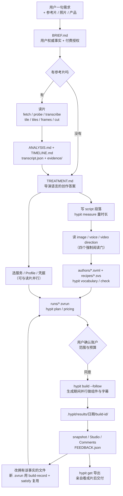
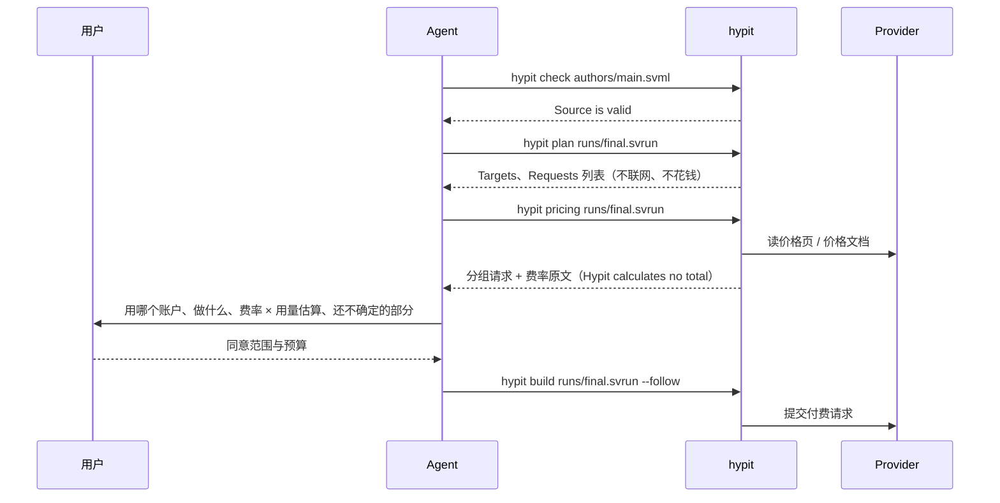

# Hypit · 使用流程

> [!abstract] 一句话
> 从用户一句需求到成片，Hypit 的流程是「Brief 固化用户意图 → 读懂参考片 → Treatment 写创作答案 → 写 Script 并量时长 → 写 .svml/.svs/.svrun → plan 与 pricing 在花钱前看清请求 → 用户授权后 build → 生成期间并行做组件字幕 → Studio / Comments 评审 → 显式复用改到满意 → 导出并亲自看成片」，每一步都落到磁盘上的具体文件。

## 1. 全景图



这张图把官方 quickstart 的五步（装 Skill / 提供参考 / 选服务 / 确认费用 / 看成片）与 Skill 精读拼出的完整链路合在一起。【文档】docs/zh/quickstart.md；【源码】Skill 精读 key_finding 8（SKILL.md:117-209、builds.md:86-89、authoring.md:57-70）

> [!tip] 三个刻意的并行与分离
> 1. 「Develop components, Recipes and semantic arrangement while generation runs」——生成是异步的，组件活填进等待窗口（SKILL.md:181-183）。
> 2. `plan` 与 `pricing` 只读、不建 Build、不花钱，只有 `build` 花钱。
> 3. 浏览器评审与导出编码是两件事（SKILL.md:200-201）：评审可以先于编码，用户说「导出」本身就是交付决定。

## 2. 推荐的项目目录

Skill 的 project-files 引用页给出「参考真相与目标真相分开」的目录（【文档】references/creation/project-files.md:78-125）：

```text
project/
├── references/
│   └── <reference>/
│       ├── source.*
│       ├── ANALYSIS.md
│       ├── TIMELINE.md
│       ├── transcript.json
│       ├── evidence/
│       ├── PROGRESS.md          # 只在理解进行中存在
│       └── drafts/
├── productions/
│   └── <target>/
│       ├── BRIEF.md
│       ├── TREATMENT.md
│       ├── PROGRESS.md
│       ├── authors/
│       ├── recipes/
│       ├── runs/
│       ├── assets/
│       └── drafts/
├── assets/                      # 多个目标共享的输入
├── packages/                    # 多个目标共享的项目 Author 包
├── hypit.runtime.json
└── package.json
```

quickstart/run.md 给的是单个作品的简化版（`authors/ recipes/ runs/ assets/ kits/ packages/ output/ hypit.runtime.json hypit.results.json .hypit/`），并强调「这只是方便人整理内容的推荐，绝不是强制的项目格式」——Hypit 只服从 import、`<author source>`、CLI 参数和 `get --to` 里明写的路径。外部项目通常把 `.hypit/` 与 `output/` 加进 `.gitignore`。【文档】

## 3. 逐步详解：命令与每一步的产出文件

| # | 步骤 | 真实命令（均出自官方文档 / Skill / `--help`） | 产出文件 |
| --- | --- | --- | --- |
| 0 | 定项目边界、选 Runtime | `hypit paths`；`hypit runtime init` 或 `hypit runtime use hypit.runtime.json` | `hypit.runtime.json`、`.hypit/runtime` |
| 1 | 固化用户意图 | 无命令，Agent 写文件 | `productions/<target>/BRIEF.md` |
| 2 | 取参考片 | `hypit media fetch <url> --to <video.mp4>`（首次可先 `hypit media prepare-fetch`） | `references/<ref>/source.mp4` |
| 3 | 探测与转写 | `hypit media probe <file>`；`hypit transcribe references/ad/source.mp4 --language en --to references/ad/transcript.json` | `transcript.json` |
| 4 | 看片（整体↔细节往返） | `hypit media tile … --every 1 --transcript … --to evidence/opening.jpg`；`hypit media tiles … --every-frame --columns 4 --rows 3 --cell 480 --transcript … --to evidence/list-motion`；`hypit media cut … --label-time --to evidence/list-change.mp4`；`hypit media frames … --at 6.9,7.3,7.8 --label-time --to evidence/list-frames`；`hypit media boundaries <file>` | `evidence/` 下的网格图、片段、帧 |
| 5 | 写理解 | Agent 写文件 | `ANALYSIS.md`（整片理解）、`TIMELINE.md`（何时发生什么、对观众起什么作用） |
| 6 | 写创作答案 | Agent 写文件 | `TREATMENT.md`（导演语言，不写包名、属性、Provider、Build 顺序） |
| 7 | 选服务与凭据（可并行） | `hypit auth status hypihub.default`；`hypit auth login hypihub.default`；`hypit programs prepare --endpoint …`；`hypit doctor --endpoint …` | Profile 的 endpoints / bindings |
| 8 | 写台词并量时长 | `hypit measure authors/main.svml --segment <id> --language en`；或 `hypit measure --text "…"` | `authors/*.svml` 中的 `<script>` |
| 9 | 读导演知识 | 读 image-direction / voice-direction / video-direction 与所选 Kit | —— |
| 10 | 写作品源码 | `hypit vocabulary <package>` 查确切 Surface；`hypit check authors/main.svml` | `authors/*.svml`、`recipes/*.svs` |
| 11 | 写执行意图 | Agent 写文件 | `runs/images.svrun`、`runs/takes.svrun`、`runs/final.svrun` |
| 12 | 花钱前看清请求 | `hypit plan runs/final.svrun`（`--verbose` 看图与 Candidate）；`hypit pricing runs/final.svrun --json` | —— |
| 13 | 谈定付费范围 | Agent 按费率 × 用量算给用户看，用户同意后写进 Brief | `BRIEF.md` 的付费授权 |
| 14 | 提交生成 | `hypit build runs/final.svrun --title first-cut --follow` | `.hypit/results/<UTC-date>/<build-id>/{result.json, files/, values/}` |
| 15 | 观察 / 排查 | `hypit status <build-id> --watch`；`hypit logs <build-id> --lines 80`；`hypit activity --verbose`；`hypit cancel <build-id>` | —— |
| 16 | 查产物 | `hypit builds`；`hypit inspect <build-id>`；`hypit history hook-take.video` | —— |
| 17 | 看画面 | `hypit snapshot --studio <url> --at-frame 30,60 --to drafts/review-1`；`hypit studio --run runs/final.svrun` | PNG 帧与网格；`FEEDBACK.json`（Comments） |
| 18 | 修改与复用 | 改拥有这个事实的文件；新 `.svrun` 里写 `<build-record>` + `<satisfy>`；再 `hypit build` | 新的 Build 与 Result |
| 19 | 导出交付 | `hypit get <build-id> --output final.video --to output/final.mp4` | `output/final.mp4` |

【文档】命令逐条出自 docs/zh/quickstart/run.md、docs/zh/guide/runtime.md、references/creation/reference-video.md:94-152；`snapshot` 与 `media` 的参数形态以 2026-09-29 `hypit help snapshot` / `hypit help media` 输出为准【实测】。

![[s2-quickstart-1-measure.png|640]]
*官方快速开始视频第 2 步中的一帧：Claude Code 里 Agent 先写好 Script，再用 `measure --text` 按目标语速量两段台词（显示 42 pronunciation units · en · normal pace）。来源：storage.googleapis.com/hypit-public-assets/quickstart/2026-09-10/clone_a_video_with_your_product.mp4（第 8 秒）*

### 3.1 读参考片的纪律

- 读片工具只暴露「需要的尺度」：`probe` 拿时长、尺寸、帧率与音轨；`cut` 存片段；`frames` 抽指定时刻；`tile/tiles` 排时间标注的帧网格，可带词；`boundaries` 找突变候选；`fetch` 用固定版本的 yt-dlp 把链接存成本地文件。【文档】reference-video.md:94-101
- `--transcript` 把词贴在画面**下方**，所以原片自己的字幕与 MG 仍然可见；`--around "某句话"` 可以直接定位到那句台词。
- 采样有洞：「Samples establish what appears at their times, with gaps between them」——稀疏总览会漏掉短事件，要在关键区间加密采样。【文档】reference-video.md:130-133
- 目标片不许抄参考片的秒数（script-and-time.md:244-245），参考只提供**关系**，详见 [[Hypit · 词锚定机制#6. 参考片只提供关系，不提供秒数|参考片只提供关系]]。

### 3.2 花钱前的三道闸



- 「Account setup establishes access; the agreement establishes spending authority」——登录成功与价格输出都不等于同意花费。【文档】SKILL.md:216-217；quickstart/run.md「查询所选 Run 的费用信息」
- 授权记在用户拥有的 `BRIEF.md` 里，不在配置里。

### 3.3 实测：同一份作品，三种 Run，请求数不同

在 scratchpad 里复制 Skill 自带的 `references/production/examples/`（production.svml 73 行 + look.svs + direction.svs + 三个 .svrun），删掉需要 Inter 字体上游包的标题层后，不带 Runtime 执行 `hypit plan`：【实测】2026-09-29

| Run | Target | Requests | 说明 |
| --- | --- | --- | --- |
| production.svrun | `final.video` | **8** | seedance-2-mini ×1、normalize-media、inspect-media、project-speech-evidence-audio、whisperx-alignment、render-visual、render-timeline-audio、mux-program-media |
| material.svrun | `opening-semantic.take` | **5** | 只到对齐好的语义 Take 为止，渲染三件套被裁掉 |
| 自写 reuse.svrun | `final.video` + `<file>` 候选 `satisfy` 掉 `performance.video` | **7** | **Seedance 请求消失**，其余照常；输出多一行 `Run choices 1` |

```text
$ hypit plan nofont.svrun
✓ Build plan is valid
  Run       nofont.svrun
  Targets   final.video
  Requests  8
  ...
  @hypit/seedance#seedance-2-mini
      ×1  prompt 29 words · resolution 720p · aspectRatio 9:16 · duration 5 · generateAudio · no webSearch  performance:generate
Pass --runtime <profile> to see the Endpoint and price page behind each request.
```

这组数字直接印证了「省钱是编译期保证的，不是运行时跳过」：`satisfy` 之后被替换的那条生成分支在 plan 里就不存在了。机制见 [[Hypit · 编译与渲染链路#5. 显式复用：.svrun 与 satisfy|显式复用]]。

### 3.4 提交之后

- Worker 拥有执行：`--follow` 和 `status --watch` 只是观察者，关终端、Ctrl-C 都不会取消 Build；要停用 `hypit cancel <build-id>`，远程取消尽力而为。【文档】docs/zh/guide/runtime.md
- 每次 `build` 都是新 Build id、新 Result 目录，即使源码一字没改；失败的尝试保持失败，已完成的 Output 保留，靠新 Run 显式复用。【文档】quickstart/run.md 第 4 步
- 失败 Build 里也可能有可用产物：「Project Results can contain useful Outputs even from failed Builds」（SKILL.md:223-224）。
- 断线或上下文被压缩后：先读 Brief、Treatment、参考档案、Source、Run、PROGRESS.md，再查项目 Result 与 Runtime 状态——「loss of conversation context is not a reason to submit the same paid work again」。【文档】project-files.md「Resume from present facts」

![[s2-quickstart-3-plan-build.png|640]]
*官方快速开始视频第 4 步中的一帧：Agent 先确认「Build plan is valid · Requests 17」，说明只有两条托管请求（12 秒 Take $0.54、一张 1K 静帧 $0.03）落在已同意的额度内，然后才 `build` 提交并拿到 Build id。来源：storage.googleapis.com/hypit-public-assets/quickstart/2026-09-10/check_the_quote_and_approve.mp4（第 7 秒）*

## 4. 评审与修改

### 4.1 两个浏览器界面

```bash
cd /path/to/my-video
hypit studio --run build.svrun      # 默认请求端口 5179；网址末尾加 #comments 进入评论视图
```

| 界面 | 用途 | 持久化 |
| --- | --- | --- |
| Studio | 时间线（Segment / Word / Selection / Moment 与组件轨道）、Inspector 改组件公开属性、Source 编辑写回 .svml/.svs/.svrun | 直接改源文件，编译失败会恢复原文件 |
| Comments | 大播放器 + 按时间留言，点评论回到对应帧 | 工作区根的 `FEEDBACK.json` |

两个界面都不编码视频、不提交导出 Build。【文档】docs/zh/quickstart/preview.md

`FEEDBACK.json` 的一条记录形如（Skill 精读摘录）：

```json
{"comments":[{"id":"opening-title","run":"runs/render.svrun","at":1.5,
"text":"Give the title a softer pink and a stronger offset shadow.","resolved":false}]}
```

评论保留的是**被评审时的秒数**，不会随新的语义时间漂移。【文档】studio.md:99-100

![[s2-quickstart-4-studio.png|720]]
*官方快速开始视频第 5 步中的一帧：Studio（localhost:5179）左侧 Source 显示 main.svml 的 import 与 script，中间 HyperFrames 预览，右侧 Properties，底部时间线分 Semantic、performance、Speech Audio、titles、Tier Board、Reveals 等轨道。来源：storage.googleapis.com/hypit-public-assets/quickstart/2026-09-10/watch_the_finished_video.mp4（第 16 秒）*

### 4.2 改哪里：「变更 → 归属」

工作流不是按阶段定义的，而是按「哪个事实变了就改哪个文件」定义的（brief.md:81-93、review.md:155-162、authoring.md:204-216 是同一张表的三个投影）。「Brief changes only when the user's truth changes」；设计本身要变时改 Treatment；实现细节改 authors/recipes/runs。机制与复用边界表见 [[Hypit · Skill 组织方式]] 与 [[Hypit · 编译与渲染链路#5. 显式复用：.svrun 与 satisfy|显式复用]]。

### 4.3 「完成」的定义

SKILL.md 的 standing responsibility「Done means watched」：必须亲自看、听实际交付物，对照 Brief、Treatment 与参考关系判断表演、声音、清晰度、视觉层次、时机、角色与是否适合发布；交付编码后的视频时要检查那个文件本身；能打开 Studio 时，把可编辑工程也展示给用户。【文档】SKILL.md:249-255

## 5. 官方三条样片（README 自述）

![[s2-example-goat-debate-strip.png|720]]
*「GOAT DEBATE」参考片四帧：20 秒足球梯队榜，Seedance 2 Mini 720p A-roll + GPT Image 2 立绘与 B-roll + 与声音同步的 Ranking 榜单 + 色块卡拉 OK 字幕。README 标总成本 $1.15。来源：README 内嵌视频 github.com/user-attachments/assets/f573bdac-…，本地抽帧*

![[s2-example-daily-creatine-strip.png|720]]
*「DAILY CREATINE」参考片四帧：18 秒播客片段，分屏访谈布局与区分说话人的卡拉 OK 字幕，含一次产品交接时刻。README 标总成本 $1.07。来源：README 内嵌视频 22df72b8-…，本地抽帧*

![[s2-example-nice-ride-strip.png|720]]
*「NICE RIDE」参考片四帧：26 秒街采，字幕跟随说话人头部（人脸框来自 Google Video Intelligence 与 YOLOv8 AnimeFace），顶部是与声音同步的 emoji 揭示板。README 标总成本 $1.09。来源：README 内嵌视频 666ad535-…，本地抽帧*

每个示例都附三个克隆变体（换主持人、翻转排名、换语言等），源码在 `examples/{ranking-football,podcast,interview}/`，变体写成 `swap-*.svml` + `swap-*.svrun`。成本数字是厂商自述，仓库里没有产生它们的计价代码。【空白】未实测

---
相关：[[Hypit · 安装与使用方法]] · [[Hypit · Skill 组织方式]] · [[Hypit · 词锚定机制]] · [[Hypit · 编译与渲染链路]] · [[ovf · 全链路工具包]]
