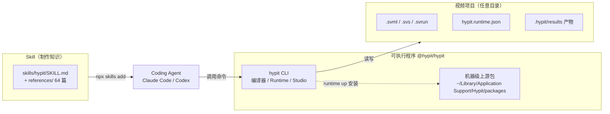

# Hypit · 安装与使用方法

> [!abstract] 一句话
> Hypit 由三样互相独立的东西组成：Agent 读的 **Skill**、可执行程序 **`@hypit/hypit`**、你自己的**视频项目**；本机两样已装好（Skill + CLI 0.2.16），但渲染引擎、Runtime Profile、凭据都还没准备，目前只能做离线的检查、规划与测量。

![[s2-hypit-social-preview.png|640]]
*hypit-ai/hypit 的 GitHub 社交预览图（2026-09-29 抓取，图上显示 22 contributors / 17k stars / 2k forks）。来源：opengraph.githubassets.com*

## 1. 三样东西，三条生命周期

官方文档反复强调这三者分开安装、分开更新：「Skill 提供制作知识，`hypit` 包提供可执行工具」「程序和 Skill 分别更新」。【文档】docs/zh/quickstart.md、docs/zh/guide/skill.md



| 部件 | 装在哪 | 怎么更新 | 说明 |
| --- | --- | --- | --- |
| Skill | Agent 的 skills 目录 | 由安装渠道（skills CLI）更新 | 只是知识，不带任何生成额度 |
| 可执行程序 | 全局 npm 包 `@hypit/hypit` | 由它自己的包管理器更新 | 「你无需克隆 Hypit 仓库」 |
| 视频项目 | 任意目录 | 普通文件，自己管 | 「Your video project can live anywhere」 |

> [!warning] 装好不等于能用
> Skill 的 environment 引用页专门拆开四个事实：installed / selected / prepared / running 各是一回事；「A binary on disk is not necessarily the selected executable; a Profile declaration does not install resources」。【文档】skills/hypit/references/environment/local-tools.md:30-33。本机状态正好是这句话的活例子，见第 3 节。

## 2. 官方安装步骤

### 2.1 装 Skill

```bash
npx skills add hypit-ai/hypit -g
```

这是 README、quickstart、agents.md 三处一致给出的唯一安装命令。【文档】README.md「Install once」一节。

### 2.2 可执行程序与版本核对

官方说法是 Agent 首次使用时会检查 `hypit` 可执行程序并协助准备。已有安装时的核对命令：

```bash
hypit version --check                    # 新版才有；核对 npm latest 与发布说明
hypit --version                          # 旧版没有 version --check 时用
npm view @hypit/hypit@latest version
```

【文档】docs/zh/quickstart.md 第 1 步。要求 Node.js 22.15+、pnpm 10.33（README 徽章）；pnpm 只在开发 Hypit 仓库本身时需要。

### 2.3 为项目选择 Runtime（第一次在某个项目里跑之前）

```bash
hypit paths                          # 看项目边界与状态目录
hypit runtime init                   # 写入起始 hypit.runtime.json 并选中它（不安装、不登录、不执行）
hypit runtime use hypit.runtime.json # 已有 Profile 时直接选
```

项目边界的判定规则：显式 `--workspace` 优先；否则取当前目录向上最近的 `package.json`；都没有就以当前目录为项目。「Source 文件名和 Runtime 配置都不决定这个边界」。【文档】docs/zh/guide/runtime.md

起始 Profile 提供 HypiHub 托管生成与 WhisperX，以及本地媒体处理与渲染。一个只配本地媒体处理的最小 Profile：

```json
{
  "format": "hypit.runtime-local@1",
  "dataRoot": ".hypit/runtimes/local",
  "credentials": {},
  "endpoints": {
    "media.local": { "use": "@hypit/provider-media-local" }
  },
  "bindings": {}
}
```

多个 Endpoint 能提供同一能力时，必须用 binding 显式指定，例如：

```json
"bindings": {
  "@hypit/whisperx@1#whisperx-alignment": "whisperx.local"
}
```

### 2.4 按需准备服务与凭据

```bash
hypit runtime up --endpoint media.local        # 安装所选上游包、准备本地程序、启动 Worker
hypit runtime status
hypit programs prepare --endpoint media.local  # 只准备资源，不启动 Worker
hypit programs status --endpoint media.local
hypit doctor --endpoint media.local            # 读配置、跑 Provider 诊断，不提交生成
hypit auth status hypihub.default
hypit auth login hypihub.default               # 选择 HypiHub 后才需要
hypit packages install @fontsource-variable/inter@5.3.0   # check/plan 缺上游包时会给出精确命令
```

- `runtime up` 不登录、不启动托管服务；`build` 不做任何安装准备，依赖未就绪会在提交前失败。【文档】docs/zh/quickstart/run.md
- 只有 Profile 选择 WhisperX、OpenCV 等本地 Python 程序时，才需要先装 [`uv`](https://docs.astral.sh/uv/)。【文档】同上
- 凭据只存引用，绝不写进 Source、Run、Profile 源文件或提交内容；`doctor` 只验证存在、不打印秘密值。【文档】同上

![[s2-quickstart-2-auth-received.png|640]]
*官方快速开始视频第 3 步「选择你想使用的服务」中的一帧：`hypit auth login` 走 HypiHub OAuth，浏览器回到本机回调后显示 Authorization received。来源：storage.googleapis.com/hypit-public-assets/quickstart/2026-09-10/log_in_to_hypit_or_bring_your_own_key.mp4（第 13 秒）*

## 3. 本机实际状态（2026-09-29 实测）

> [!success] 已就绪
> | 项 | 实测结果 |
> | --- | --- |
> | Skill | `~/.agents/skills/hypit/`（`~/.claude/skills/hypit` 是指向它的软链接）。`~/.agents/.skill-lock.json` 记录 source=`hypit-ai/hypit`、installedAt=`2026-09-28T16:01:40.852Z`。与仓库 557497b 的 `skills/hypit/` 用 `diff -rq` 对比**完全一致**；共 73 个文件，SKILL.md 28,604 字节 |
> | CLI | `@hypit/hypit@0.2.16`，装在 nvm 的 Node v24.13.1 全局目录，包体 138M。`hypit version --check` 显示「npm latest: 0.2.16 (matches installed)」 |
> | 离线命令 | `hypit --help`、`hypit measure`、`hypit check`、`hypit plan`（不带 Runtime）、`hypit vocabulary` 均可正常运行 |
>
> 会话记录里的来历：2026-09-28 16:19 助手发现 skill 列表里「刚出现了 hypit」，判断是用户自己装的，不是助手装的。

> [!danger] 未就绪（要渲染成片前必须补上）
> | 项 | 实测结果 |
> | --- | --- |
> | 机器级状态目录 | `~/Library/Application Support/Hypit` **不存在**，说明从未执行过 `runtime init/up` 或 `packages install` |
> | 渲染引擎 | `hypit packages status @hyperframes/engine@0.7.101` → `Ready false`，「cannot locate installed package @hyperframes/engine」；`hypit vocabulary` 里 `@hypit/provider-hyperframes-local` 标为 unreadable |
> | S3 结果仓 | `@hypit/build-result-s3` 缺 `@aws-sdk/client-s3@3.1103.0`（只在选 S3 仓库时才需要） |
> | Runtime Profile | 未选择（`hypit paths` 显示 Runtime Profile not selected） |
> | 凭据 / 生成账户 | 未配置；WhisperX 本地服务未准备 |
> | 字体上游包 | 示例 production.svml 用到 `fonts:Stack family="inter"`，`check` 报需先 `hypit packages install @fontsource-variable/inter@5.3.0` |
>
> 实测时刻意**没有**执行任何会写入机器状态或联网下载的准备命令（runtime up / packages install / auth login），只做只读探测。【实测】

## 4. 在 Agent 里怎么用

README 给的两种起手式：【文档】README.md「Use the Hypit skill」

```text
/hypit Clone this video: /path/to/video.mp4, and replace the ranking content with a comparison of Hypit (official website: hypit.ai) with other AI video products.
```

```text
/hypit Make a ranking video that puts Hypit in S tier.
```

中文 quickstart 的写法：

```text
/hypit 参考这个视频：/path/to/video.mp4。
把产品换成 Hypit（hypit.ai），保留抓人的开场和 Ranking 呈现方式。
```

确认预算后的授权句式（官方示例）：

```text
用我的 HypiHub 账户完成这条视频，按我们确认的预算推进，开始吧。
```

> [!tip] 克隆只是入口之一
> README 原话的意思是：克隆是最快的进入方式而不是唯一方式，也可以从模板开始，或直接描述想要的视频让 Agent 从零写 workflow；生成模型也是可选的，字幕、动效、代码渲染画面可以不调任何生成模型就编译成片。【文档】README.md「Hypit」一节

完整的逐步流程、每一步的命令与产出文件见 [[Hypit · 使用流程]]。

## 5. CLI 全命令速查（hypit --help 实测，0.2.16）

| 分组 | 命令 | 作用 |
| --- | --- | --- |
| Authoring | `check <source>` | 校验一份 Author 或 Run 源文件 |
|  | `plan <run-source>` | 列出选中的工作，不执行 |
|  | `pricing <run-source>` | 读取所选 Provider 的当前价格材料（不算总价） |
|  | `build <run-source>` | 提交 Build；`--follow` 只是观察 |
| Results | `builds` / `history <output>` | 列出 Result；按 Output 名跨 Build 查找 |
|  | `logs <build-id> [--lines n]` | 读取保存的执行阶段与诊断 |
|  | `status <build-id> [--watch]` | 当前工作与 Result 事实 |
|  | `inspect <build-id>` / `get <build-id> --output <name> --to <path>` | 查看 / 导出一个 Output |
|  | `result edit <build-id>` | 给 Result 加标题、注释、高亮 |
| Runtime | `doctor [profile]` | 诊断所选外部环境 |
|  | `runtime init\|use\|unset`、`runtime up\|status\|logs\|down` | 选择 Profile；准备并管理本地 Runtime |
|  | `programs prepare\|up\|status\|down` | 只管理声明的外部程序 |
|  | `packages install\|status` | 机器级固定版本上游包 |
|  | `activity [--watch]`、`cancel <build-id>`、`paths` | 活跃 Build；撤回；状态路径 |
|  | `auth status\|login\|logout` | Endpoint 凭据 |
| 创作工具 | `transcribe` | 用所选 Profile 的 whisperx-alignment Endpoint 求词级时间（一次请求，无 Build） |
|  | `measure` | 纯本地估算台词时长，不花钱 |
|  | `snapshot` | 从已编译的 HyperFrames HTML 或 Studio 精确抓帧 |
| Studio | `studio --run <build.svrun>` | 浏览器里打开可编辑作品（默认端口 5179） |
| 准备 | `media probe\|cut\|frames\|tile\|tiles\|boundaries\|fetch\|prepare-fetch` | 本地读片工具，无网络、无项目状态（fetch 除外） |
|  | `capture screenshot\|run\|install-browser` | 抓网页做素材 |
|  | `vocabulary [<package>]` | 打印已安装包能写哪些 Surface、属性、端口、示例 |

实测过的两条离线命令输出：

```text
$ hypit measure --text "Here is the useful part. SVML removes that editing loop." --language en
3.043s
  14 pronunciation units · en · 4.6 units/s (normal)

$ hypit measure --text "把动效组件化，以后就能直接复用。" --language zh
2.667s
  14 pronunciation units · zh · 5.25 units/s (normal)
```

【实测】语速常数与精读结论一致（en normal 4.6 音节/秒、zh normal 5.25），见 [[Hypit · 模型接入与 Seedance#8. duration 与 hypit measure|duration 与 hypit measure]]。

`hypit vocabulary` 实测列出 82 个已安装包。带模型的包与模型 id：

| 包 | 模型 |
| --- | --- |
| `@hypit/seedance` | seedance-2 / seedance-2-fast / seedance-2-mini / seedance-2.5 |
| `@hypit/seedream` | seedream-5-lite |
| `@hypit/gpt-image` | gpt-image-2 |
| `@hypit/nano-banana` | nano-banana-2 / nano-banana-pro |
| `@hypit/grok-imagine` | grok-imagine-video / grok-imagine-video-1.5-preview |
| `@hypit/minimax-h3` | minimax-h3 |
| `@hypit/pixverse` | pixverse-c1 / pixverse-v6 |
| `@hypit/wan` | wan-2.7-image / wan-2.7-image-pro |
| `@hypit/elevenlabs-speech` | eleven_ttv_v3 |
| `@hypit/fishaudio-speech` | voice-clone / voice-design-1 |
| `@hypit/mimo-speech` | mimo-v2.5-tts-voiceclone / mimo-v2.5-tts-voicedesign |
| `@hypit/volcengine-matting` | matte-portrait-video |

> [!note] 与初查报告的出入
> 初查（2026-09-22/23，基于 README 与官网）把 Veo 3.1、Kling 列进「已集成模型」，并说「Seedance 2.5 尚未接入」。实测的包清单里**没有** Veo 与 Kling 的模型包（它们只出现在 README 对合作方 HiAPI 的介绍文字里），而 **Seedance 2.5 已是独立 Capability**。以代码与 vocabulary 为准。详见 [[Hypit · 研究札记#7. 材料之间的矛盾与更正|材料矛盾]]。

## 6. 费用与许可

- **Hypit 本身免费**：README 写明没有席位费、按次渲染费或额外水印；模型服务按你选的服务计费。「安装 Skill 或程序并不附带生成额度」。【文档】
- **HypiHub 定价**（初查调研员 B 抓取，未二次复核）：Starter $9.90/月（1,800 credits）/ Pro $39.90/月（10,000）/ Ultra $99.90/月（27,000）+ 企业档；充值包 2,000/$15、5,000/$35、10,000/$65、20,000/$130；示例 Seedance 2.0 约 20.9 credits/秒。【空白】未复核，来源 https://hypit.ai/commercial/pricing/
- **许可证不是标准开源**：「Apache-2.0 with conditions」，禁止未授权的多租户 / SaaS 化、禁止以商业获利为目的再分发、禁止移除用户可见界面上的 Hypit 名称与 LOGO；自用（含公司内部商用、为单个客户做项目）允许；生成的视频等产物归用户。【文档】https://github.com/hypit-ai/hypit/blob/main/LICENSE（初查全文拉取）。GitHub API 的 license 字段为 NOASSERTION。

> [!question] 装到能出片还差什么（待办，未执行）
> 1. 在一个项目目录里 `hypit runtime init`，按作品需要改 Profile；
> 2. `hypit runtime up`（会安装 `@hyperframes/engine@0.7.101` 等上游包并启动 Worker）；
> 3. 选 HypiHub 或自带 Key 的 Provider，`hypit auth login <endpoint>`；
> 4. 需要本地 WhisperX 时先装 uv，再 `hypit programs prepare`；
> 5. 用官方示例或 [[Hypit · 使用流程]] 里的最小工程跑一次不调生成模型的纯代码渲染片，验证「10GB 依赖」差评与本机渲染耗时。【空白】

---
相关：[[Hypit · 使用流程]] · [[Hypit · 编译与渲染链路]] · [[Hypit · 模型接入与 Seedance]] · [[Claude Code 技能全览]]
