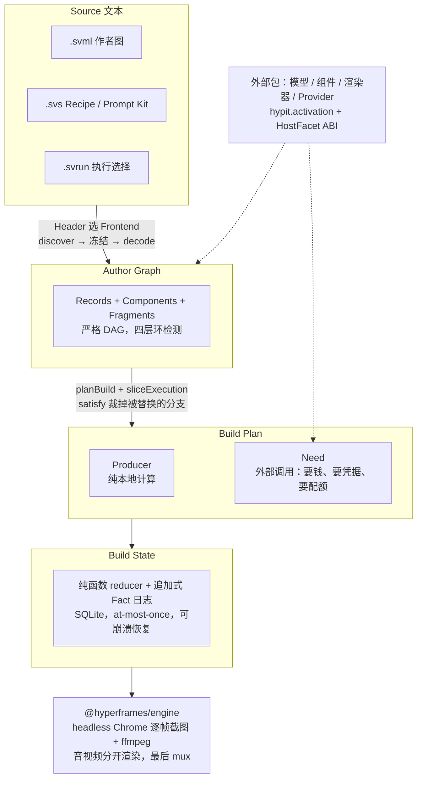
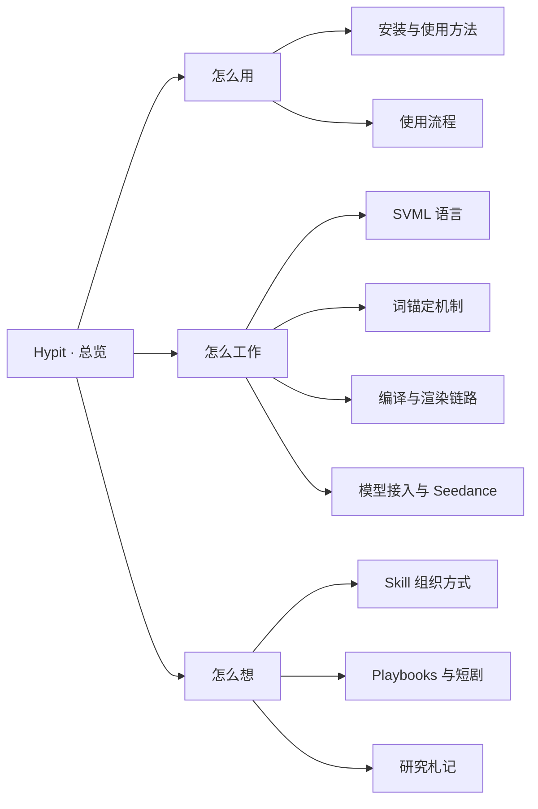

# Hypit · 总览

> [!abstract] 一句话定位
> Hypit 是给 AI coding agent（Claude Code / Codex）用的「视频编排语言 + 编译器 + 运行时」：丢一条爆款短视频进去，agent 把它逆向成一份可复跑、可批改的 SVML 工作流（A-roll、B-roll、逐词字幕、特效），再换脸、换词、换素材批量出变体——本质是一台**复刻机**，核心发明是「时间锚定在词上，不锚定在秒上」。

![[s2-hypit-logo.svg|320]]

![[s2-hypit-social-preview.png|640]]
*hypit-ai/hypit 的 GitHub 社交预览图，2026-09-29 抓取。来源：opengraph.githubassets.com*

## 关键数字

| 项 | 值 | 证据 |
| --- | --- | --- |
| 主仓 | [hypit-ai/hypit](https://github.com/hypit-ai/hypit)，TypeScript，官网 [hypit.ai](https://hypit.ai) | 【实测】gh api |
| Stars / Forks / Watchers | 17,185 / 2,052 / 33（2026-09-29）；一周前 09-23 为 13,823 / 1,625 / 28 | 【实测】 |
| 创建 / 最近 push | 2026-07-29 / 2026-09-28 | 【实测】 |
| npm | `@hypit/hypit` 0.2.16（2026-09-26），共 32 个版本，首发 2026-08-18 | 【实测】npm view |
| 规模 | 122 个包的 pnpm monorepo；Node.js 22.15+ | 【源码】【实测】 |
| Skill | SKILL.md 321 行 + 64 篇引用页（另 7 个示例文件） | 【实测】 |
| 已接入模型包 | Seedance 2 / 2-fast / 2-mini / 2.5、Seedream、GPT Image 2、Nano Banana、Grok Imagine、MiniMax H3、PixVerse、Wan、三家语音、WhisperX 等 | 【实测】hypit vocabulary |
| 聚合网关 Provider | TokenDance、Monid、HypiHub（自家）、HiAPI、BeatAPI、Pollo | 【源码】 |
| 官方样片成本 | $1.15 / $1.07 / $1.09（README 自述，仓库里无计价代码） | 【文档】【空白】 |
| 许可 | Apache-2.0 加条件：禁多租户 SaaS、禁商业再分发、禁摘 LOGO；自用与单客户交付允许 | 【文档】 |
| 本机状态 | Skill 与 CLI 0.2.16 已装；渲染引擎、Runtime Profile、凭据未准备 | 【实测】 |

## 四层抽象

编译器本体完全不认识「视频」：所有领域能力都是外部包，通过 `package.json` 的 `hypit.activation` 与字符串 ABI 注册进来。「哪些步骤要花钱」在编译期就类型可见，所以 `hypit plan` 能在花钱之前列出全部请求。详见 [[Hypit · 编译与渲染链路]]。

## 本子分区结构

## 导航

| 笔记 | 一句话 |
| --- | --- |
| [[Hypit · 安装与使用方法]] | Skill / CLI / 项目三样分开装；官方安装与 Runtime 准备命令；CLI 全命令速查；本机 2026-09-29 实测状态与待办 |
| [[Hypit · 使用流程]] | 从一句需求到成片的 19 步，每步的真实命令与产出文件；花钱前三道闸；同一作品三种 Run 的 plan 实测（8 / 5 / 7 个请求） |
| [[Hypit · SVML 语言]] | 三种文件即三种 Frontend；`{}` 只能整值引用；扁平 Record id；两阶段解析；SVS 与 `.svrun`；时间与空间两条轴；两份可照抄的骨架 |
| [[Hypit · 词锚定机制]] | 七步链条与 anchor id 拼法；六种 affinity；Script 全语法；时间表达式；字幕文本与时间分家；「参考片只提供关系」 |
| [[Hypit · 编译与渲染链路]] | 五段编译、插件 ABI、Producer / Need、Fact 日志、显式复用、7 步成片 Fragment、浏览器截图渲染、「64 个 Chromium」的真相、四层进程 |
| [[Hypit · 模型接入与 Seedance]] | 模型包与 Provider 包两个半边；Seedance role 全集与单测；2.5 与 2.x 的 port 差异与互斥约束；六个网关；`@image1` / `@video1` 与 camera / motion reference Kit |
| [[Hypit · Skill 组织方式]] | 薄 SKILL.md + 厚分层 references + 运行时 vocabulary 的三层范式；路由表；四个强制阅读门；文件即记忆；移植清单 |
| [[Hypit · Playbooks 与短剧]] | 导演知识层；short-drama 全部要点；无运镜词汇表与三种镜头控制路径；输入责任表；字幕跟头回路；代码渲染与生成的边界 |
| [[Hypit · 研究札记]] | 研究时间线与用户决定；复刻机视角；与 Opus 5.5、horizon、Remotion 的关系；热度成色；赛道玩家；材料矛盾；各路未读部分 |
| [[Hypit · 自有 H3 Provider 接入]] | 本人编写的 `@local/provider-comfy-h3`：把 `@hypit/minimax-h3` 请求翻译成自有 AutoDL ComfyUI 的 U 系列 H3 工作流；三种模式映射、17k+5 帧截时长、轮询竞态修复、build-record 固定镜头 |
| [[Hypit · 实测：蓝V教程换讲解员]] | 用真实抖音教程测试 Hypit：H3 生成新讲解员、标题/字幕/9 箭头 1 红圈全挂在词上；exit 动画渲染 bug、Paint 顺序等七个坑；结论「词锚定是真正的杠杆」 |
| [[Hypit · 通用复刻骨架 remake-kit]] | 视频复刻 Hypit 线的通用骨架：切镜头→按段落（4–15 秒一次 H3 请求）→空 Segment 放回原切点→原声；AutoDL 市场 Provider 估价/账本/固定镜头；ref105 整片一遍约 ¥6.4 |
| [[Hypit 线 · S01 按 Hypit 方法复刻（实测与评估）]] | 按 Skill 完整方法重做 S01：逐帧读片→手写 SVML（13 空 Segment 按原切点帧、字幕条）→原片占位预览→4 组 H3→逐镜选段拼装；生成 ¥1、Claude 折合 $13；评估：结构层稳、倒握等细节动作与色调是短板、Claude 成本主因是长上下文 |
| [[Hypit 复刻管线 v2 · 元认知复盘与证据关卡]] | **当前复刻流程**：Hypit Skill 方法整理成 11 道证据关卡（每关写明放行证据）+ 8 条元认知守则；ref105 会话 71 条失误经独立核对（2 驳回、44 夸大已改写），归 9 类模式 |
| [[Hypit 线 · 视频复刻工作流程 SOP]] | ~~已废弃，见 v2~~ 每部复刻片的标准流程：开工口令模板、11 步（立项→读片→切镜分段→定角色→反推提示词→组装校验→估价→试跑→全片→审片迭代→交付），用户只在 4 个检查点出现 |

## 关键结论

1. **一切锚定在词上**。Script 里没有时间码，`@{name}` 只选相邻词边界上的 anchor id，WhisperX 对齐后才翻译成帧；换词、换配音、换语言，挂在词上的画面事件自动跟着走。→ [[Hypit · 词锚定机制]]
2. **DSL 只做命名与连线**。`{}` 里只能是扁平路径，没有表达式；任何计算都得变成图里的节点。代价是啰嗦，换来整张图可静态分析、可被 Run 整体替换。→ [[Hypit · SVML 语言]]
3. **省钱是编译期保证的**。没有隐式缓存，复用只能在 `.svrun` 里显式 `satisfy`；被替换的生成分支在 plan 里就消失了（本机实测 8 → 7 个请求）。→ [[Hypit · 编译与渲染链路]]
4. **生成模型是可选项**。字幕、动效、榜单等代码渲染画面在 headless Chrome 里逐帧截图，不调生成模型；渲染器是外部 `@hyperframes/engine`，不是自研。
5. **Seedance 的 role 只有五个字符串**：`first_frame`、`last_frame`、`reference_image`、`reference_video`、`reference_audio`；首帧与参考图 / 视频 / 音频两两互斥；参考视频只能给 URL。→ [[Hypit · 模型接入与 Seedance]]
6. **没有降级、没有计价**：多家都能做就报 ambiguous 要求显式 binding，不支持就硬失败；Hypit 只摆出费率原文，总价由 agent 算给用户看、用户授权后才 build。
7. **镜头控制不靠词汇表**：参考图即机位、封闭机位集、参考视频传机位；说话人镜头只给「不动」和「推一下再回来」两档。→ [[Hypit · Playbooks 与短剧]]
8. **Skill 是可照抄的打包范式**：顶层只给角色与路由，禁令下沉，强制阅读只设在模型先验会出错的地方，状态全落普通文件。→ [[Hypit · Skill 组织方式]]
9. **它是一台复刻机**：词锚定、批量变体、机位迁移、format 有 Kit 而短剧没有，都是「复刻」这个第一性目标的推论。→ [[Hypit · 研究札记#2. 读懂它的钥匙：这是一台复刻机|复刻机视角]]
10. **热度打折看**：一周 star 涨近 10 倍、watcher 比例 0.2%、awesome-list 全是自荐、唯一非营销反馈是「10GB 依赖」差评；版本几天一发，现在做交付底座有风险。

> [!important] 用户对这条研究线的决定
> - 2026-09-22：「先全都读透，不用着急动。等我后面的指令」——研究定位为纯理解，不提方案、不写代码。
> - 2026-09-23：「不用互斥，这本身就是分开的，一种是复刻，另一种是高水平精度的制作的精品剧，我只是让你了解学习，不用对比」——本子分区只陈述 Hypit 自身，不与灰模预演管线对表。
> - 2026-09-28：把「Hypit 的所有相关内容、使用方法、使用流程与研究」收进本知识库分区。

## 与其他子分区的交叉

| 去向 | 关系 |
| --- | --- |
| [[Opus5.5 Skill · 总览]] · [[Opus5.5 Skill · 视频与动效]] | Hypit 本身就是一个视频类 Agent Skill；Opus 5.5 生态里的代码渲染视频 skill 与它同处一个赛道 |
| [[代码渲染 · 总览]] · [[代码渲染 · claude-horizon-animation]] · [[代码渲染 · Remotion skills]] | 与 horizon 渲染原理相同（seek + 截图 + ffmpeg）、抽象层完全不同；Remotion 位于两者中间 |
| [[代码渲染 · Opus5.5 与代码渲染视频]] | Opus 5.5 最能发挥的是 Hypit 里代码渲染与逐帧审查那一半 |
| [[ovf · 总览]] · [[ovf · 设计理念]] | 同为海外社媒视频生成方向；参考视频只能给公网 URL 与 ovf「白模临时上传」是同一物理约束的两种应对 |
| [[灰模管线 · 总览]] · [[灰模管线 · 方舟 API 参数表]] · [[灰模管线 · 同类产品与开源方案]] | Seedance port 表与 role 全集是方舟 API 的一手取证；按用户决定两条线分开研究 |
| [[Claude Code 技能全览]] | 本机已装的 hypit skill 在技能清单中的位置 |

---
上级：[[AIGC创意工具设计 · 总览]]
