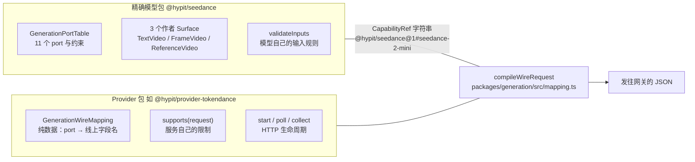
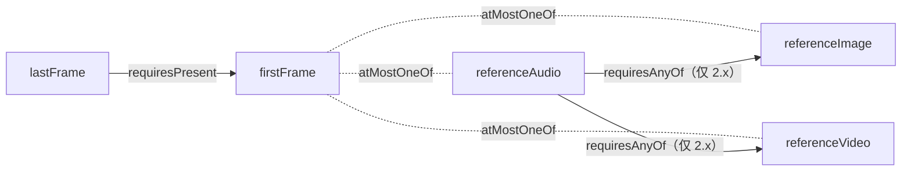
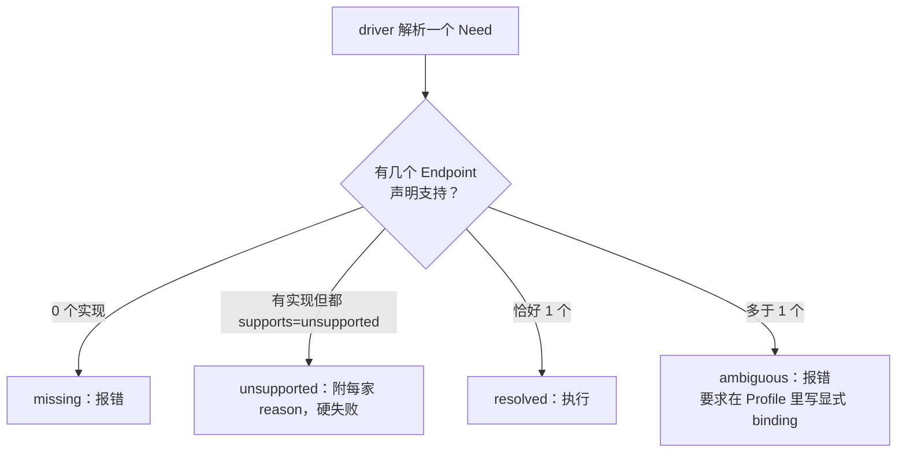

# Hypit · 模型接入与 Seedance

> [!abstract] 一句话
> Hypit 把「模型吃什么」与「某家服务怎么收」切成两个永不互相 import 的半边：精确模型包只声明一张 port 表与作者 Surface，Provider 包只声明一张纯数据的字段映射加自己的 HTTP 生命周期；Seedance 的真实 role 只有五个字符串，被单测锁死，而「每个参考负责什么」不靠 API 字段、靠提示词里的 `@image1` / `@video1` 位置记号。

## 1. 两个半边与 CapabilityRef



- 模型包**完全不含** URL、HTTP、凭据；Provider 包**不含**能力定义。Provider 的 `package.json` 里 `@hypit/seedance` 只在 devDependencies。注释原话：「A mapping is data, not code, and it references its Capability by name. A Provider package therefore never imports a model package」。【源码】generation/src/mapping.ts:15-60；provider-tokendance/package.json:16-20
- 设计取向是「**不统一能力，只统一命名转译**」：能力差异留在模型的 port table 里，服务差异留在 Provider 的 `supports()` 里。

```ts
export type GenerationWireMapping = {
  /**
   * The exact Capability implemented, named as data. Binding the module version
   * here keeps a port change visible: a mapping written for one model version
   * cannot silently serve another.
   */
  readonly capability: CapabilityRef;
  readonly result: "audio" | "image" | "video";
  readonly routes: readonly GenerationWireRoute[];
  readonly fields: Readonly<Record<string, GenerationFieldMapping>>;
  readonly constants?: Readonly<Record<string, CanonicalValue>>;
};
```

字段映射只有 6 种形态：`value`（原样标量）、`string`（转字符串）、`valueArray`、`url`（单个媒体解析成 URL）、`urlArray`、`itemObject`（媒体写成带 URL 与附加字段的对象）。

守门员是 `assertMappingCoversPorts`：每张 mapping 必须覆盖模型的**每一个** port；媒体 port 必须解析成 URL 形态；`url` 形态的 port 的 `maxItems` 必须为 1；非 optional 的 itemField 必须被映射；两个 port 不能写同一个线上字段；routes 必须恰好以一条无条件路由结尾。每个 Provider 的测试第一条就是跑它。【源码】generation/src/mapping.ts:186-248；provider-tokendance/test/routes.test.ts:17-22

## 2. Seedance 的 role 全集（被单测锁死）

> [!important] 五个值，原样
> `first_frame`、`last_frame`、`reference_image`、`reference_video`、`reference_audio`

它们是 Ark（字节 ModelArk）`content` 数组里每个 item 的 `role` 字段；item 的 `type` 只有四种：`text` / `image_url` / `video_url` / `audio_url`，URL 嵌在与 type 同名的键里。**首帧 / 尾帧不是独立字段，而是 role 不同的普通 item。** 顺序固定：text 在最前，然后 first_frame、last_frame，再按 image → video → audio 铺开 reference_*。【源码】provider-tokendance/src/routes.ts:97-125（monid 完全同构：provider-monid/src/routes.ts:81-103）

```ts
function contentItem(type: "image_url" | "video_url" | "audio_url", url: string, role: string) {
  return { type, [type]: { url }, role };
}

/** Ark and MiniMax both take one `content` array of typed, role-tagged items. */
function contentArray(input: Record<string, unknown>) {
  const first = input.first_frame;
  const last = input.last_frame;
  return [
    { type: "text", text: input.text },
    ...(typeof first === "string" ? [contentItem("image_url", first, "first_frame")] : []),
    ...(typeof last === "string" ? [contentItem("image_url", last, "last_frame")] : []),
    ...strings(input.reference_image).map((url) => contentItem("image_url", url, "reference_image")),
    ...strings(input.reference_video).map((url) => contentItem("video_url", url, "reference_video")),
    ...strings(input.reference_audio).map((url) => contentItem("audio_url", url, "reference_audio")),
  ];
}
```

单测断言锁定了完整请求体形状：

```ts
// provider-tokendance/test/routes.test.ts:24-37
test("Seedance frame requests become Ark content items with roles", async () => {
  const request = sealSeedanceRequest("seedance-2-mini", {
    prompt: ["turn"], firstFrame: [{ role: "image", artifact: image, fields: { personReference: true } }],
    resolution: ["720p"], aspectRatio: ["adaptive"], duration: [5], generateAudio: [true], webSearch: [false],
  });
  const body = await route(SEEDANCE, "seedance-2-mini").prepare(request as unknown as CanonicalValue).compile(resolve);
  assert.deepEqual(body, {
    model: "seedance-2.0-mini",
    content: [
      { type: "text", text: "turn" },
      { type: "image_url", image_url: { url: "data:image/png;base64,AQID" }, role: "first_frame" },
    ],
    resolution: "720p", ratio: "adaptive", duration: 5, generate_audio: true,
  });
});
```

- `model` 用服务侧 id（`seedance-2.0-mini`），`resolution` / `ratio` / `duration` / `generate_audio` 平铺在顶层。
- `generate_audio: false` 时该键**仍然存在**（只有 BeatAPI 会删）。
- web search 不是布尔字段，而是 `tools: [{type:"web_search"}]`；`web_search:false` 在 Ark 路径上直接不出现。【源码】routes.ts:115-125

> [!note] Hypit 自己类型系统里的 role 是「模态」
> `export type GenerationMediaRole = "image" | "video" | "audio";`（generation/src/ports.ts:13-15）。`first_frame` 这类语义 role 只活在各家 Provider 的映射表里，由 **port 名 → 字段名**决定（`firstFrame → first_frame`），模型层压根不知道这个字符串。换一家网关就可能换名字。【源码】provider-tokendance/src/mapping.ts:13-28

## 3. 三个 Surface，没有 ImageVideo

| 标签 | 形态 | 特点 |
| --- | --- | --- |
| `seedance:TextVideo` | 纯 prompt | 唯一暴露 `web-search` 的形态；不接受子元素 |
| `seedance:FrameVideo` | 必填 `first-frame`，可选 `last-frame` | 每一帧都要写 `*-person-reference` |
| `seedance:ReferenceVideo` | 一到多个 `<seedance:Reference image\|video\|audio=…>` 子元素 | 每个 Reference 恰好三选一 |

三者共用 `model / prompt / duration / resolution / aspect-ratio / generate-audio` 属性和同一个 component 实现；输出只暴露 `<id>.video`（远端返回的 GeneratedVideoSet 保持原子，再取第一个有序成员）。「文生视频 / 首尾帧 / 多模态参考」三条互斥的调用路径在模型层就做成了互斥约束，而不是运行时判断。【源码】seedance/src/index.ts:195-324；seedance/src/fragment.ts:14-37

【实测】`hypit vocabulary @hypit/seedance`（0.2.16）给出的默认值与范围：`resolution` 默认 `720p`、`aspect-ratio` 默认 `9:16`、`generate-audio` 默认 `false`；`model` 接受 `standard | seedance-2 | fast | seedance-2-fast | mini | seedance-2-mini | 2.5 | seedance-2.5`；`aspect-ratio` 可选 `1:1 | 4:3 | 3:4 | 16:9 | 9:16 | 21:9 | adaptive`。官方示例：

```xml
<seedance:TextVideo id="take-hook" model="mini" prompt={direction} duration="5" generate-audio="true"/>

<seedance:FrameVideo id="bridge" model="fast" prompt={direction} duration="5"
  first-frame={first.image} first-frame-person-reference="true"
  last-frame={last.image} last-frame-person-reference="false"/>

<seedance:ReferenceVideo id="hook-take" model="mini" prompt={hook-prompt} duration="8"
  resolution="720p" aspect-ratio="9:16" generate-audio="true">
  <seedance:Reference image={presenter} person-reference="true"/>
  <seedance:Reference audio={voice}/>
</seedance:ReferenceVideo>
```

## 4. port 表：2.5 与 2.x 的确切差异

四个变体的 capability 名是 `seedance-2` / `seedance-2-fast` / `seedance-2-mini` / `seedance-2.5`。代码注释专门解释 2.5 为什么不是 2.x 的别名：「Its public request definition widens prompt/reference capacities and duration independently, so it receives its own exact Capability while reusing the same three author Surfaces.」【源码】seedance/src/index.ts:24-32、99-121

| port / 约束 | seedance-2.x（standard / fast / mini） | seedance-2.5 |
| --- | --- | --- |
| prompt 上限 | 20,000 字符 | 30,000 字符 |
| referenceImage | ≤ 9 | ≤ 30 |
| referenceVideo | ≤ 3 | ≤ 10 |
| referenceAudio | ≤ 3 | ≤ 10 |
| firstFrame / lastFrame | 各 ≤ 1 | 各 ≤ 1 |
| duration | 整数 4–15 | 枚举 `-1`（自动）或 4–30 |
| 分辨率 | standard 有 1080p 与 4k；fast / mini 只有 480p / 720p | 480p / 720p / 1080p |
| 参考音频必须搭一个视觉参考 | 强制 | **取消** |
| 图 + 视频 + 音频加权总数 ≤ 12 | 强制 | **取消** |

```ts
// seedance/src/index.ts:33-89（节选）
{ name: "prompt", value: { kind: "text", maxChars: is25 ? 30_000 : 20_000 }, minItems: 1, maxItems: 1 },
{ name: "referenceImage", value: { kind: "media", accepts: ["image"], itemFields: PERSON_REFERENCE_FIELDS }, minItems: 0, maxItems: is25 ? 30 : 9 },
{ name: "referenceVideo", value: { kind: "media", accepts: ["video"], itemFields: PERSON_REFERENCE_FIELDS }, minItems: 0, maxItems: is25 ? 10 : 3 },
{ name: "referenceAudio", value: { kind: "media", accepts: ["audio"] }, minItems: 0, maxItems: is25 ? 10 : 3 },
{ name: "firstFrame", value: { kind: "media", accepts: ["image"], itemFields: PERSON_REFERENCE_FIELDS }, minItems: 0, maxItems: 1 },
{ name: "lastFrame",  value: { kind: "media", accepts: ["image"], itemFields: PERSON_REFERENCE_FIELDS }, minItems: 0, maxItems: 1 },
requires: [
  { kind: "atMostOneOf", ports: ["referenceImage", "firstFrame"] },
  { kind: "atMostOneOf", ports: ["referenceVideo", "firstFrame"] },
  { kind: "atMostOneOf", ports: ["referenceAudio", "firstFrame"] },
  { kind: "requiresPresent", port: "lastFrame", needs: ["firstFrame"] },
  ...(is25 ? [] : [
    { kind: "requiresAnyOf" as const, port: "referenceAudio", anyOf: ["referenceImage", "referenceVideo"] },
    { kind: "weightedTotal" as const, weights: { referenceImage: 1, referenceVideo: 1, referenceAudio: 1 }, maximum: 12 },
  ]),
]
```

### 互斥约束



- 参考图 / 参考视频 / 参考音频都与首帧**两两互斥**；尾帧必须有首帧——所以「首尾帧」与「多模态参考」是二选一的两条路，不存在「既给首尾帧又给参考视频」。
- 2.x 要求参考音频不能单独出现、必须搭一个视觉参考，且三类参考加权总数 ≤ 12；2.5 两条都取消了。「这是外部很难查到的行为差」。
- 这些约束对灰模预演「首帧图 + 灰模参考视频」一类组合的影响，归档在 [[灰模管线 · 方舟 API 参数表]] 与 [[灰模管线 · 闭源模型控制能力调研]]。

### person-reference 与参考音频格式

- `person-reference` 是 Seedance Surface 上**每个图像 / 视频参考的强制布尔**（含 `first-frame-person-reference` / `last-frame-person-reference`），没有默认值、没有自动人脸检测，音频必须省略它。缺失时报错原文：「… is required for this visual reference; set true if it contains a person, false otherwise」。【源码】seedance/src/surface.ts:148-153
- 但它在 TokenDance、Monid、HiAPI、BeatAPI 上**根本不发出去**（注释：接受声明但不传输，协议里没有这个字段）；只有 HypiHub 在**上传文件**时把它作为 `is_person_reference` 带上，走的是 `resourceFields`（资源传输侧字段）通道而不是生成 body。同时 Hypit 规定「supplied field must reach the service, including an explicit false」——不能静默丢，只能显式声明「接受但不传输」。【源码】provider-hypihub/src/upload.ts:392、422；generation/README.md:31-45
- 参考音频的模型层硬拒绝：`audio/mp4` 与 `audio/x-m4a` 直接报错，必须先转 WAV 或 MP3（`media:ExtractAudio` 产出 WAV）。这条写在模型包的 `validateInputs` 里，对所有 Provider 生效；服务自己的限制则写在 Provider 的 `supports`。【源码】seedance/src/validation.ts:5-16

## 5. 真实端点：六个聚合网关

Hypit 不直连火山方舟，也不直连 BytePlus，接的是六个网关；但 TokenDance / Monid 的注释都明写 ModelArk / BytePlus ModelArk，协议形状是 Ark 的原样透传，所以上面的 role 表可以直接迁到方舟原生 API 上。【源码】各 provider.ts 的 baseUrl 行

| 网关 | 默认 baseUrl | 提交 / 轮询 | 备注 |
| --- | --- | --- | --- |
| TokenDance | `https://tokendance.space/gateway` | `POST /ark/v3/generations/tasks`；`GET /ark/v3/generations/tasks/{id}`；图像 `POST /ark/v3/images/generations`（同步） | Ark 透传；另有 `/minimax/v2/video_generation` |
| Monid | `https://api.monid.ai` | `POST /v1/run` + `GET /v1/runs/{runId}` | endpoint 参数如 `/v1/video/seedance-2.5`，service=`bytedance` |
| HypiHub（自家） | `https://hypit.ai/v1` | `POST /v1/videos` | 唯一有 `readPricing`：`GET /v1/pricing?model=<model>` |
| HiAPI | `https://api.hiapi.ai` | `POST /v1/tasks` | 按输入形态拆三个 model id；提交带 `Idempotency-Key` |
| BeatAPI | `https://api.beatapi.io` | `POST /v1/videos/tasks` | 首尾帧合并成一个有序 `images` 数组 |
| Pollo | `https://pollo.ai/api/platform` | 路径即 model，如 `/v1/generation/minimax/minimax-h3/video` | 不做 Seedance；只接受公网 URL 参考 |

```ts
// provider-tokendance/src/provider.ts
const paths = {
  "ark-video": { submit: "/ark/v3/generations/tasks", task: (id: string) => `/ark/v3/generations/tasks/${encodeURIComponent(id)}` },
  "minimax-video": { submit: "/minimax/v2/video_generation", task: (id: string) => `/minimax/v2/query/video_generation/${encodeURIComponent(id)}` },
} as const;
const client = new TokenDanceClient(apiBaseUrl(options.baseUrl ?? "https://tokendance.space/gateway"), requestTimeoutMs, options.fetch ?? globalThis.fetch);
```

### 同一个 Seedance，四种字段名

| 网关 | prompt | 参考媒体 | 首尾帧 | 画幅 | 时长 |
| --- | --- | --- | --- | --- | --- |
| TokenDance / Monid | `text` | `reference_image / reference_video / reference_audio` | `first_frame / last_frame` | `ratio` | `duration`（再折进 content 数组） |
| HypiHub | `prompt` | `reference_image_urls / reference_videos / reference_audios` | `first_frame / last_frame` | `aspect_ratio` | **`seconds`** |
| HiAPI | `prompt` | `reference_image_urls / reference_video_urls / reference_audio_urls` | `first_frame_url / last_frame_url` | `aspect_ratio` | `duration` |
| BeatAPI | `prompt` | `reference_images / videos / audios` | 合并成 `images` 数组 | —— | —— |

【源码】provider-hypihub/src/mapping.ts:16-31；provider-hiapi/src/mapping.ts:17-29；provider-beatapi/src/mapping.ts:18-30、routes.ts:75-86。因为「a mapping cannot write one wire field from two ports」，BeatAPI 的合并只能写成 routes.ts 里的后处理：

```ts
function normalize(mapping: GenerationWireMapping, input: Record<string, unknown>): Record<string, unknown> {
  const { name } = mapping.capability;
  const frames = [input.first_frame, input.last_frame].filter((item): item is string => typeof item === "string");
  delete input.first_frame;
  delete input.last_frame;
  if (frames.length > 0) input.images = frames;
  if (input.web_search === false) delete input.web_search;
  if (name === "seedance-2-mini" && input.generate_audio === false) delete input.generate_audio;
  if (name === "nano-banana-2" && input.output_format === "jpg") input.output_format = "jpeg";
  return input;
}
```

### 路由与拒绝

- `routes[]` 按「哪些 port 出现」选服务侧 model id，最后一条必须无条件兜底。HiAPI 把同一个 seedance-2.5 capability 拆成三个 URL：

```ts
routes: [
  { model: "seedance-2.5/reference-to-video", whenPresent: ["referenceVideo"] },
  { model: "seedance-2.5/image-to-video",     whenPresent: ["firstFrame"] },
  { model: "seedance-2.5/image-to-video",     whenPresent: ["referenceImage"] },
  { model: "seedance-2.5/image-to-video",     whenPresent: ["referenceAudio"] },
  { model: "seedance-2.5/text-to-video" },
],
```

- `supports(request)` 在任何上传 / 提交之前拒绝：TokenDance「Seedance 2.5 有首帧时 aspect-ratio 只能 adaptive」；BeatAPI「seedance-2-mini 不出音频」「seedance-2 不能 1080p + 参考图」「2.5 不接受 duration=-1」；Monid「Seedance 端点没有 web search 字段」。【源码】provider-tokendance/src/routes.ts:72-95；provider-beatapi/src/routes.ts:45-72；provider-monid/src/routes.ts:72-78

## 6. 参考媒体怎么传

| 协议 | 图片 | 音频 | 视频 | 其他 |
| --- | --- | --- | --- | --- |
| Ark（TokenDance） | 内联 `data:<mime>;base64,…`，< 30MB | 内联，≤ 15MB | **只能给 URL** | JSON body ≤ 64MB |
| MiniMax | 先 `POST /minimax/v1/files/upload`（purpose=`video_generation_input`） | 同左 | 同左，≤ 50MB | 引用为 `mm_file://{file_id}`，保留 7 天 |

没配 `publicAssetUrl` 回调时，**带参考视频的请求会在提交前失败**。「参考视频只能给公网 URL」直接影响任何本地预演素材能否送进 Seedance——必须先有可公开访问的托管。【源码】provider-tokendance/src/routes.ts:32-42；provider.ts:86-146

```ts
export const tokenDanceMediaLimits: Readonly<Record<TokenDanceProtocol, TokenDanceMediaLimits>> = {
  "ark-video": { image: 30 * MB, audio: 15 * MB, body: 64 * MB },
  "ark-image": { image: 30 * MB },
  "minimax-video": { image: 30 * MB, video: 50 * MB, audio: 15 * MB },
};
```

这与 ovf 里「白模临时上传、1 小时失效」是同一个物理约束的两种应对，见 [[ovf · 全链路工具包]]。

## 7. 没有降级、没有缓存、没有计价



- **降级**：没有自动挑一家、没有失败后换厂商。scheduler 用 `build.attempted` 保证一个 command 一个 Build 只跑一次；只有轮询阶段对瞬时错误（EndpointTransportError / HTTP 429 / 5xx）退避重试**同一个**远端任务。HypiHub README 写死「Runtime bindings never switch from a user's own Provider to HypiHub after a key, quota or transport failure」。【源码】driver-node/src/registry.ts:195-231；runtime/src/scheduler.ts:141、210、222；endpoint-kit/src/index.ts:529-541
- **缓存**：没有内容寻址缓存，也没有自动复用；唯一的服务端幂等是 HiAPI 的 `Idempotency-Key`。异步任务续接靠 Provider 在 `start` 里 `checkpoint({handle, receipt})` 把 taskId 落库。【源码】provider-tokendance/src/provider.ts:194-197
- **计价**：全仓没有任何计价代码。`EndpointPricing` 只有 `{kind:"page", url}` 与 `{kind:"local"}` 两种；CLI 帮助写死 `Hypit calculates no total.`（cli/src/output.ts:836）。README 的 $1.07–$1.15 是作者手算的示例总价。【源码】

### 统一生命周期

异步生成统一为 `start` / `poll` / `collect` 三段（图像类 `lifecycle:"immediate"` 单段）。Provider 只负责提交、判状态、下载并 `context.resources.put(bytes, mediaType)`，返回类型化的 `GeneratedVideoSet`；不选目录、不写项目路径、不做重试调度。默认 `requestTimeoutMs = 300s`、`operationTimeoutMs = 30min`，超时只结束本地观察，明确记录远端结果未知：

```ts
if (Date.now() - handle.startedAt > maxOperationMs) {
  return { status: "failed", receipt, failure: { code: "TOKENDANCE_OPERATION_TIMEOUT", message: `TokenDance task ${handle.taskId} exceeded this Provider's operationTimeoutMs (${maxOperationMs}); remote outcome is unknown` } };
}
```

【源码】provider-tokendance/src/provider.ts:184-244

## 8. duration 与 hypit measure

`duration` 是作者写死的字面量，图里**没有任何节点**会算它。README 原话：「Nothing in the graph computes it, so a Build plan is complete before it starts」。配套的 `@hypit/estimate` 是完全离线、无 Provider 的 CLI（`hypit measure`），按语言数音节 / 汉字再除以语速（en normal 4.6 音节/秒，zh normal 5.25），产出一个数字让作者自己填进 `duration="8"`。【源码】seedance/README.md:16-19；estimate/README.md:5-48。【实测】本机 `hypit measure` 输出的 units/s 与此一致，见 [[Hypit · 安装与使用方法#5. CLI 全命令速查（hypit --help 实测，0.2.16）|CLI 速查]]。

## 9. @image1 与 @video1：每个参考负责什么

「每个参考负责什么」**不是**通过结构化 role 表达，而是通过 prompt 里的位置化记号 `@image1` / `@image2` / `@video1` / `@audio1` / `@audio2`——按作者写的 Reference 子元素顺序编号。Seedance Kits 全部以此为契约。【源码】seedance-kits/kits/*.svs；seedance-kits/README.md

### camera-reference-v1 与 motion-reference-v1（全文）

```text
<?svml using="@hypit/text/svs@1"?>
<sheet version="1" id="camera-reference-v1">
  text-template.camera-reference-v1 { separator: paragraph; }
  text-template.camera-reference-v1.block.subject { kind: fixed; order: 10; text: "Use @image1 as the subject and preserve the subject's identity, outfit, and physical features."; }
  text-template.camera-reference-v1.block.transfer { kind: fixed; order: 20; text: "Replicate @video1's camera framing, lens choice, camera height, movement, and photographic rhythm, applying that camera language to the subject from @image1 in a coherent setting."; }
  text-template.camera-reference-v1.block.exclude { kind: fixed; order: 30; text: "Do not copy @video1's subject pose or body action. Let the subject move naturally for the transferred camera treatment."; }
  text-template.camera-reference-v1.block.direction { kind: slot; order: 40; slot: direction; optional: true; label: "ADDITIONAL DIRECTION:"; }
</sheet>
```

```text
<?svml using="@hypit/text/svs@1"?>
<sheet version="1" id="motion-reference-v1">
  text-template.motion-reference-v1 { separator: paragraph; }
  text-template.motion-reference-v1.block.subject { kind: fixed; order: 10; text: "Use @image1 as the subject and preserve the subject's identity, outfit, and physical features."; }
  text-template.motion-reference-v1.block.transfer { kind: fixed; order: 20; text: "Replicate the body motion, gestures, and pose dynamics from @video1 exactly. The subject from @image1 performs that motion in their own setting."; }
  text-template.motion-reference-v1.block.exclude { kind: fixed; order: 30; text: "Do not copy @video1's camera framing or lens. Let the camera move naturally to capture the transferred action."; }
  text-template.motion-reference-v1.block.direction { kind: slot; order: 40; slot: direction; optional: true; label: "ADDITIONAL DIRECTION:"; }
</sheet>
```

两者是一对对偶：camera-reference 只迁移机位、镜头、机高、运动与摄影节奏，明令不抄 `@video1` 的人物姿态与动作；motion-reference 只迁移身体动作，明令不抄机位与镜头。它们承认了同一件事：**机位是一种时间性行为，文字和静帧都传不了，只能用另一段影像去传。**

### Kit 全表（seedance-kits README）

| import 后缀 / 模板 | 参考关系 | 文本槽 |
| --- | --- | --- |
| `speaker` / `speaker-v1` | 单个可见说话人：`@image1` 人物与场景，`@audio1` 其音色 | 必填 `dialogue`；可选 `action` |
| `broll` / `broll-v1` | 无声视觉小故事，图按作者参考顺序出现 | 必填 `story` |
| `podcast` / `podcast-v1` | 两个固定视角：图 1/2 是 A/B，音频 1/2 是各自音色 | `dialogue`；可选 `action` |
| `call` / `call-v1` | 图 1 是 A 主画面 B 小窗，图 2 反过来；音频 1/2 为 A/B | `dialogue`；可选 `action` |
| `street-interview` / `street-interview-v1` | 图 1/2/3 为采访者 A、嘉宾 B、共享街景机位；音频 1/2 为 A/B；A 拿麦 | `dialogue`；可选 `action` |
| `motion-reference` / `motion-reference-v1` | 图 1 主体；视频 1 身体动作 | 可选 `direction` |
| `camera-reference` / `camera-reference-v1` | 图 1 主体；视频 1 机位、镜头、运动、摄影节奏 | 可选 `direction` |

### Prompt Kit 是纯数据模板，不是模型包装器

Kit 是 `@hypit/text/svs@1` 的 TextTemplate：模板根用空行拼接有序 block，block 只有四种 kind——`fixed`（固定文本）、`slot`（渲染期接入的 Text 边，可 optional、可带 label）、`axis`（按标量参数取同名 choice）、`variant`（`when-param-*` 条件全满足才出现）。标量优先级：模板 `default-*` < Recipe（.svs）< 显式 `<text:Param>`；Text 用 `<text:Set>` 替换、`<text:Append>` 追加。渲染结果是一条普通 Text Output，可以单独当 Run Target 跑出来检查而不调用模型。它不能创建媒体边、不能执行后处理、不碰输出尺寸。【源码】production/prompt-kits.md:101-155；seedance-kits/README.md:87-91

```text
text-template.speaker-v1 {
  separator: paragraph;
  default-composition-stability: soft-locked;
  default-camera-motion: none;
  default-edit-rhythm: continuous-take;
  default-performance: natural-explainer;
  default-gesture: natural;
}
text-template.speaker-v1.block.camera-motion { kind: axis; order: 40; parameter: camera-motion; }
text-template.speaker-v1.choice.camera-motion.none { text: "CAMERA: hold a steady fixed framing."; }
text-template.speaker-v1.choice.camera-motion.subtle-punch-in-return {
  text: "CAMERA: use one subtle push-in on the most important phrase, then return smoothly to the original framing.";
}
```

说话人镜头的运镜只有这两档；broll-v1 的 `camera-language` 有五档：`reference-locked` / `selfie-vlog` / `handheld-follow` / `push-reveal` / `product-macro`。【源码】speaker-v1.svs:43-55；broll-v1.svs:37-42

> [!info] 代码层确认：没有 camera port
> 全仓 `GenerationPortTable` 里没有任何名为 camera 的 port；唯一出现的 `camera` 是 Text Template 的一个提示词参数（`<text:Param name="camera" value="handheld"/>`，text/src/manifest.ts:112）。Hypit 的机位控制上限是「一句英文」级别。【源码】

## 10. 已接入的模型（实测清单）

以 2026-09-29 `hypit vocabulary` 为准：Seedance（4 个变体）、Seedream 5 lite、GPT Image 2、Nano Banana 2 / Pro、Grok Imagine video 与 1.5 preview、MiniMax H3、PixVerse C1 / V6、Wan 2.7 image / pro、ElevenLabs `eleven_ttv_v3`、Fish Audio voice-clone / voice-design-1、MiMo v2.5 TTS、火山引擎 matte-portrait-video、WhisperX。完整表见 [[Hypit · 安装与使用方法#5. CLI 全命令速查（hypit --help 实测，0.2.16）|CLI 速查]]。【实测】

> [!warning] 与初查结论的矛盾
> 初查（2026-09-22/23）称「Seedance 2.5 尚未接入，只有 open issue #333」。精读（9c9918d）与实测都显示 **seedance-2.5 已是独立 Capability**，TokenDance、Monid、HiAPI、BeatAPI 的 Provider 都支持；issue #333 讲的是「Provider for the Higgsfield API (Seedance 2.0 and 2.5)」，即通过 Higgsfield 接入，而不是 Seedance 2.5 本身。以代码为准。

## 11. 设计取舍

| 取舍 | 代价 | 收益 |
| --- | --- | --- |
| 模型包与 Provider 包互不 import | 每加一家网关手抄一张字段表 | 模型 port 变动不会静默串味 |
| 宁可硬失败不降级 | 一家不支持就停 | 不悄悄缩短时长、丢参考、改分辨率 |
| 不做隐式缓存 / 去重 | 改一行要手写 satisfy | 不会以为复用了其实重新烧钱 |
| 不算总价 | 每次由 Agent 手算解释 | 估价的不确定性必须说出口 |
| duration 必须是字面量 | 先跑 measure 再手填 | plan 开跑前就是完整的 |
| person-reference 强制、无默认 | 全体作者多写一个属性，哪怕 Provider 不传 | 永不猜测 |
| Prompt Kit 是纯数据 | 参考职责只能靠 `@image1` 记号表达 | 任何模型的 prompt port 都能消费 |
| 2.5 单独建 Capability | 多一份 port table 逻辑 | 2.x 的上限不污染 2.5 |
| 一张 mapping 不许两个 port 写同一字段 | 合并类脏活只能写成 routes.ts 后处理 | 数据表保持干净 |
| 资源传输字段与生成 body 字段分通道 | 多一条通道 | person-reference 这类上传期元数据有正式位置 |
| 超时只结束本地观察 | 远端可能还在跑 | 绝不声称远端已取消，保留 taskId 作凭据 |

> [!question] 模型接入层读者声明的未读部分
> pollo / hiapi / beatapi / monid / hypihub 的 `provider.ts` 完整 HTTP 传输（错误语义、轮询字段、结果路径）只转述 README；hypihub 的 oauth.ts 与分片上传未读；model-kit 的 `defineExactModelModule` 实现未读；gpt-image / seedream / nano-banana 等的 port table 未逐个读；`services/`（WhisperX 的 Python 服务）完全没看；call-v1.svs 与 street-interview-v1.svs 后半未读；没有运行过任何测试，tokendance 那条 role 断言是读到的测试源码而非跑绿的结果。【空白】

---
相关：[[Hypit · 编译与渲染链路]] · [[Hypit · Playbooks 与短剧]] · [[灰模管线 · 方舟 API 参数表]] · [[灰模管线 · 闭源模型控制能力调研]] · [[ovf · 全链路工具包]]
