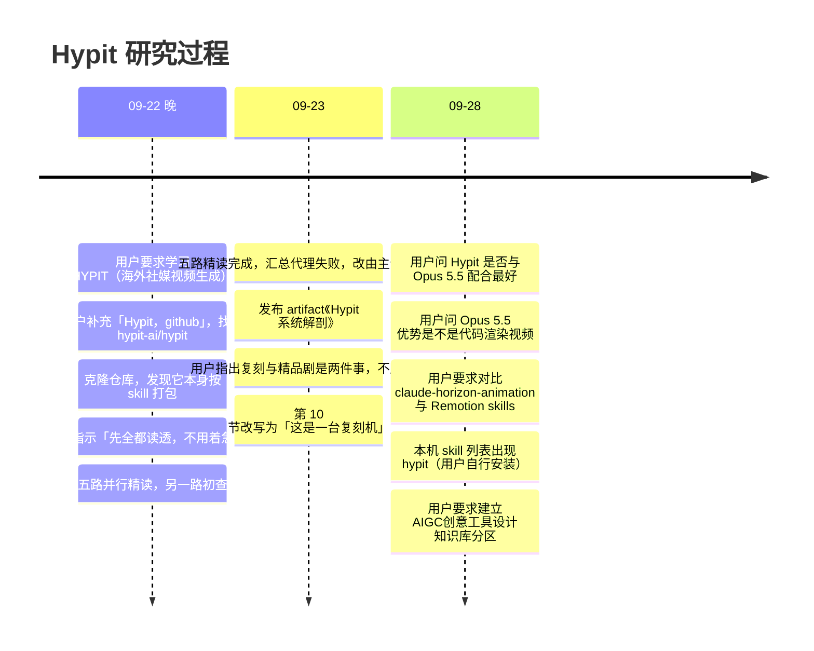

# Hypit · 研究札记

> [!abstract] 一句话
> 这篇记录 Hypit 研究的来龙去脉与横向判断：它是一台「复刻机」而不是精品剧生产线；官方对模型中立，Opus 5.5 最能发挥的是其中代码渲染与逐帧审查那一半；它与 claude-horizon-animation 渲染原理相同但抽象层完全不同；热度要看 release 节奏而不是 star 数；以及各份材料之间的矛盾与每位读者没读到的地方。

## 1. 研究时间线与用户决定



| 时间 | 会话行 | 事件 | 用户决定 / 原话 |
| --- | --- | --- | --- |
| 2026-09-22 21:09 | 1315 | 用户：「先看看这个仓库最近更新了什么？第二个任务学习一下HYPIT，github或者websearch，海外社交媒体视频生成的」 | —— |
| 21:12 | 1387 | 用户补充「Hypit，github」 | 把检索收窄到 GitHub |
| 21:13–21:16 | 1407–1450 | 找到 hypit-ai/hypit（13.8k star），克隆，读 SKILL.md 与 production.svml，给出初步判断 | —— |
| 21:19 | 1455 | —— | **「先全都读透，不用着急动。等我后面的指令」** |
| 21:20 | 1460–1471 | 派出五路精读：SVML 语言本体 / Skill 组织与创作流程 / 格式与工艺 playbook / 代码架构 / 模型接入层；统一硬约束「只回答它是什么、怎么工作，不准提方案，论断带文件:行号，读不懂写未读到」 | —— |
| 21:50 | 1532 | 五路完成；汇总代理挂掉，主会话自己合成 | —— |
| 2026-09-23 10:58 | 1759–1786 | 发布 [Hypit 系统解剖](https://claude.ai/artifact/TDwifnKx3ifM6bFQ7ddssY)（12 节，五路合计 94 条关键发现、64 条设计取舍） | —— |
| 19:08 | 1797 | —— | **「不用互斥，这本身就是分开的，一种是复刻，另一种是高水平精度的制作的精品剧，我只是让你了解学习，不用对比」** |
| 19:09 | 1802–1820 | artifact 第 10 节从「与我们已有判断的事实对照」改为「读懂它的钥匙：这是一台复刻机」（Version 2，链接不变） | —— |
| 2026-09-28 08:22 | 1839 | 用户：「这个hypit是不是跟Claude opus5.5 来配合最好」 | —— |
| 08:30 | 1887 | 用户：「opus 5.5 优势不是代码渲染视频吗」 | —— |
| 10:24 | 1938 | 用户：「看看这个claude horizon animation，remotion的skill我们也有很多。这个和hypit有什么区别」 | —— |
| 16:19 | 2153 | 助手发现 skill 列表里出现 `hypit`，判断是用户自己装的 | —— |
| 16:40 | 2158 | 用户要求建立本分区，其中第 2 项：「Hypit的所有相关内容，使用方法，使用流程。还有你做的研究」 | —— |

> [!note] 初次读完时的判断（09-22 21:16，保留原意）
> 当时的结论是：Hypit 是「给 AI agent 用的视频编译器」，最值钱的设计是按词锚定；它已经在用 Seedance、画幅同为 9:16；它本身是组织得最好的 skill，正好是「能不能做成 plugins」的现成范本；它有 `playbooks/formats/short-drama.md`；但「全仓没有任何 3D、previz、灰模、相机控制、Blender 的内容」，是纯 2D 合成。另记了一条线索：`feezzz/ai-short-drama-hypit`（0 star，可能只是个人实验）。

## 2. 读懂它的钥匙：这是一台复刻机

Hypit 的自我描述是「Clone any viral video with AI agents」。用户在 09-23 点出「复刻」与「高水平精度的精品剧」是两件分开的事之后，把「复刻」当成第一性目标，前面所有看起来古怪的设计都归位了：

| 设计 | 复刻这件事要求它这样 |
| --- | --- |
| **时间挂在词上，不挂在秒上** | 复刻的核心动作是**换词**——换产品、换主体、换卖点。台词一改，画面事件必须自动跟着走，否则每个变体都要重排时间轴 |
| **一条命令出 100 个变体** | 复刻的价值在**量**，不在单条的精度。所以复用被做成显式的 `satisfy` 边而不是缓存——作者要精确控制变体之间哪些重跑、哪些原样搬过去 |
| **没有 camera port；说话人镜头只给两档运镜** | 复刻的机位**来自参考片本身**，不需要自己发明。所以答案是 `camera-reference-v1`（把机位整段迁移过来），不是一套运镜词汇表 |
| **format 有 Kit，short-drama 没有** | talking-head、街采、榜单、播客都是**可复刻的形态**，值得固化成模板；戏剧不可复刻，所以只给判断原则不给骨架 |
| **字幕文本与时间彻底分家** | 换皮肤是最高频的变体操作；分家之后纯视觉改版可以复用已付费的媒体与对齐结果 |
| **代码渲染的图形不调生成模型** | 榜单、比分、UI、动效在变体之间要精确可控且反复改，交给模型生成既贵又不稳 |
| **读参考片的工具链特别厚** | `probe / cut / frames / tile / tiles / boundaries / fetch`，还能把 transcript 的词贴在帧网格下面——复刻的前半程全是「读懂原片」 |

*来源：artifact《Hypit 系统解剖》Version 2 第 10 节（会话第 1803 行 Edit）。*

> [!success] 最见功力的一条
> 读参考片时明确**禁止**把参考的秒数抄进目标：「Do not copy a reference timestamp into the target or preserve an incidental lead/lag unless that offset itself is part of the design」（script-and-time.md:244-245）。参考片提供的是**关系**（某个 reveal 回答了某句话），目标的秒数由新表演对齐后自己长出来。这是「复刻」和「照抄」的分界线，也是整套词锚定存在的理由——如果允许抄秒数，就不需要 anchor、不需要 WhisperX、不需要那套 M:N 动态规划。它把这条产品原则一路贯彻成了语言设计。

README 自己也说「cloning a video is the fastest way in, not the only one」，可以从模板或一句描述开始，见 [[Hypit · 安装与使用方法#4. 在 Agent 里怎么用|用法]]。

## 3. 与 Opus 5.5 的关系

### 3.1 「是不是跟 Opus 5.5 配合最好」——官方没这么说

2026-09-28 重新拉取仓库（HEAD 已从精读时的 `9c9918d` 前进到 `557497b`，9 月 26 日）后检索：【源码】

```text
README.md:51        Hypit gives AI agents (Claude Code, Codex...) a language and system...
quickstart.md:12    A Coding Agent that can use skills, such as Claude Code or Codex.
guide/agents.md:12  Claude Code and Codex are common starting points.
```

opus / sonnet / gpt-5 / gemini 全仓检索零命中。它点名的是**宿主**（Claude Code、Codex），不是模型；`.claude/skills` 与 `.codex/skills` 两套并列，还有 `agents/openai.yaml`——刻意做成多宿主。

它的设计确实很吃模型能力。下表是当时基于源码的**推断**，不是官方说法：

| 设计 | 对模型的要求 |
| --- | --- |
| SKILL.md 零硬规则，只给角色和倾向，要求「develop a creative answer you can stand behind」 | 判断力；弱模型拿到没有禁令的职位说明会不知道边界 |
| 约 1 万行 references，按「手头卡在哪」路由 | 长上下文 + 有纪律的按需检索 |
| SVML 极不宽容：只能扁平引用、先声明后引用、每个包输出路径名不同、要查 `hypit vocabulary` | 精确的代码生成，查文档再写 |
| 读参考片靠 `hypit media tiles` 出帧网格，词贴在画面下方 | 视觉理解，并把画面和台词对上 |
| 4 个强制阅读门，理由是「general prompting fluency does not reliably supply it」 | 愿意承认自己的先验不可靠 |
| 「Hypit calculates no total」，总价要 agent 按费率 × 用量算 | 算账谨慎，不跳过授权 |

结论分两层：「越强的模型跑它效果越好」这个判断比较有把握；「Opus 5.5 配合最好」**没有依据**——仓库里没有跨模型对比数据或推荐配置，Codex 同样是一等入口。回答者本身就是 Opus 5.5，更不该替自己下这个结论；唯一靠谱的办法是同一个 Brief 在两边各跑一遍看成片。【空白】

### 3.2 「Opus 5.5 优势不是代码渲染视频吗」——半对

Claude Code 自带的 Anthropic 开发者文档（claude-api skill 的 `shared/model-migration.md`，「Capability improvements versus Claude Opus 5」一节）只列了四项相对 Opus 5 的提升，没有「代码渲染视频」这一条：【文档】

| 官方强项 | 原文要点（节选与转述） |
| --- | --- |
| Agentic coding and code review | 最大的实测提升在真实代码库里的多步工作；默认 `medium` effort 就追平或超过 Opus 5 的 `high`，步骤更少、token 约少一半；代码审查抓到更多 bug、误报更少 |
| Knowledge work | 更可靠的分析员，远比 Opus 5 少说输入不支持的数字或引用；`medium` 下长分析交付优于 Opus 5 的 `high`，输出 token 约少 40% |
| Communication and writing | 汇报更直白，少术语、少套话 |
| Charts, diagrams, screenshots, and computer use | 每个 effort 档读图都更准；Anthropic 测试中即使 `low` 读图表也比 Opus 5 最高档准，每张图输出 token 约为十分之一；对依赖位置而非文字的含义（箭头连哪两个框、两版图改了什么）读得更准；截图驱动的多步 computer use 在默认 effort 下达到 Opus 5 更高 effort 才有的成功率 |

同一文档还写：按每个已解决任务算更便宜，每 token 价格比 Opus 5 低 20%（缓存读取低 60%）；前端设计方面，一句「avoid a generic AI look」只会把一种默认换成另一种，要点名具体要避免的样式。

「代码渲染视频」是发布之后社区玩出来、传得最广的方向，由上面两项官方强项叠加而成。社区帖子（Eric Buess 在 X 上）的意思是：Opus 5.5 不能直接生成图像或视频，但能写出画图、做动画、剪辑的代码，大家在试这条路能走多远。【文档】社区来源，非官方文档


搜索摘要里提到的案例（只看了摘要，未逐个打开验证）：有人用 Claude Code + Opus 5.5 做了一条 3 分钟的 AI 简史，约 7400 行 React / TypeScript 跑在 Remotion 上（[Danny Stuart](https://dannystuart.substack.com/p/claude-code-opus-remotion-agentic-promo-video)、[daily.dev](https://daily.dev/posts/claude-opus-5-5-generates-motion-design-and-visual-scenes-entirely-in-code-yqmdx7qnw)）；还有人把「Opus 5.5 发布视频风格的动画」做成了 skill（[claude-horizon-animation](https://github.com/misbahsy/claude-horizon-animation)）。【空白】

### 3.3 放回 Hypit：两半拼起来的成片

| 一半 | 内容 | 谁决定质量上限 |
| --- | --- | --- |
| 代码渲染 | 字幕、动效、榜单、比分、界面组件，全是 HTML / CSS / SVG 在 headless Chrome 里逐帧截图，不调生成模型 | 正好吃 Opus 5.5 的强项；`hypit snapshot` 与「Done means watched」就是那个「看自己的帧再改」的回路 |
| 生成素材 | 人物、表演、B-roll 由 Seedance、GPT Image 等生成 | 导演式 prompt 的功力与视频模型本身；Opus 5.5 只是指挥，不是画师 |

准确的说法是：**Opus 5.5 最能发挥的是 Hypit 里代码渲染的那一层，以及对成片的逐帧审查；生成素材的质量上限仍在 Seedance 那边。** 更多 Opus 5.5 生态见 [[代码渲染 · Opus5.5 与代码渲染视频]] 与 [[Opus5.5 Skill · 视频与动效]]。

## 4. 与 claude-horizon-animation、Remotion 的对比

2026-09-28 读完 [misbahsy/claude-horizon-animation](https://github.com/misbahsy/claude-horizon-animation) 后的第一句纠正：**它不是 Remotion 做的，也不用任何生成模型**。它由三个 skill 组成，每个 skill 就是一种固定片型，各自带一个专门写的渲染引擎：`horizon-reel`（Claude 发布片那种「穹顶地平线」快切拼贴，8–20 秒，用大都会 / 芝加哥艺术学院 / NASA 的真实公版图 + 程序绘制的粉笔蜡笔画）、`sketch-to-sim`（铅笔草图 → 木头模型 → Rapier 240Hz 物理，音效从真实碰撞合成）、`lab-explainer`（three.js 实验台，屏幕上每个数字由真实方程算出）。README 原话「none uses an image or video model」。它的例子片是社区作者仿 Anthropic 发布片风格做的，不是官方出品。详见 [[代码渲染 · claude-horizon-animation]]。

| | claude-horizon-animation | Hypit |
| --- | --- | --- |
| 本质 | 三份**风格配方**，引擎本身就是风格 | 一门**视频语言** + 编译器 + 运行时 |
| 能做什么片 | 只能做这三种样子 | 任意片型：口播、访谈、榜单、播客、短剧…… |
| 生成模型 | 一个不用，skill 规则明令禁止用图像模型生成或修图 | 核心依赖（Seedance、GPT Image、WhisperX） |
| 真实性来源 | 真照片 + 真物理 + 真方程 | 生成的人物、表演、B-roll |
| 时间怎么写 | 毫秒写死在 `film.json`（`"dur": 480`） | 挂在词上，源码里一个时间码都没有 |
| 一部片的描述 | 一个 `film.json` / `film.js` | `.svml` + `.svs` + `.svrun` 三件套 |
| 声音 | 默认静音，或从模拟碰撞合成 | 配音、词级对齐、混音一整套 |
| 渲染 | 自写约 150 行：`playwright-core` 开 Chromium → `window.seek(ms)` → 截图 → 管道喂 ffmpeg | 外部 `@hyperframes/engine` + 四层进程 + SQLite 事实日志 |
| 规模 | 约 5.5k 行，SKILL.md 每个 66–83 行 | 122 个包 |

**一句话：horizon 是把一种品味固化成引擎，Hypit 是一台不认识「视频」是什么的通用生产机器。** horizon 的引擎知道什么叫「一个穹顶地平线镜头」，Hypit 的编译器只知道节点和边。

共同点反而更有意思：

- **渲染原理完全一样**：headless Chromium 里按时间 seek、逐帧截图、ffmpeg 编码，都是确定性的。
- **都把「看」写进了流程**：horizon 先出一张每镜一帧的 stills 总览图看过再渲，渲完在快切点附近抽帧查空帧；Hypit 是 `hypit snapshot` 加「交付前必须亲自看成片」。
- **对参考片的态度一致**：horizon 是「呼应参考片的结构和质感，不抄它的画面、标语、配乐、落版」；Hypit 是「不抄参考片的时间码，只取关系」。
- **分发方式一样**：都是 `npx skills add`，Claude Code 与 Codex 通吃；horizon 还多一份 Claude Code plugin 清单，可以 `/plugin install` 一次装三个。

Remotion 在两者中间：它是通用框架，能做什么片取决于写什么 React 组件——比 horizon 通用，但没有 Hypit 那层编译、编排与生成模型调度。本机七个 remotion skill 里，`remotion-director` 是创作流程向导，`remotion-kickstart` 是项目模板，`remotion-tts` 是中文通用指南带配音，`remotion-api-reference` 是 29 条规则，`remotion-3d-ticker` / `remotion-vinyl-player` / `remotion-transitions` 是单个组件配方。horizon **刻意没用 Remotion**：三个片型需要的 canvas 程序绘制、Rapier 物理、three.js 景深，Remotion 帮不上什么忙，反而多一层 React 开销。详见 [[代码渲染 · Remotion skills]]。

## 5. 仓库活跃度与热度成色

### 5.1 两次快照

| 指标 | 2026-09-23（初查，gh api） | 2026-09-29（本次实测） |
| --- | --- | --- |
| Stars / Forks | 13,823 / 1,625（汇总稿写 1,627） | **17,185 / 2,052** |
| Watchers / Open issues | 28 / 19 | 33 / 17 |
| 最后 push | 2026-09-21 | 2026-09-28T08:54:48Z |
| npm 最新版 | 0.2.12（首发 2026-08-18，29 个版本） | **0.2.16**（2026-09-26，共 32 个版本） |
| License 字段 | Other | NOASSERTION |
| 贡献者 | 15（未验证） | 社交预览图显示 22 |

仓库创建于 2026-07-29；org Hypit.AI 创建于 2026-04-06，共 3 个公开仓库（hypit、hypitoken——Go 写的面向 Claude / Codex 的多租户 LLM API 网关 + 计费，34 star、.github）。topics 含 agentic-ai、compiler、dsl、markup-language、plugin-system、video-clone 等 20 个。【实测】

### 5.2 commit 流

2026-09-20 ~ 09-21（初查实测）：rponeawa 与 overlordkim 连发 0.2.10 → 0.2.12，内容是 provider 轮询、异步任务状态、PixVerse 渲染分辨率等基础设施补漏，以及把 BeatAPI、Watcha 的 launch-partner 链接改成 referral 链接、两天两次更新中文微信群二维码。

2026-09-23 ~ 09-28（本次实测，节选）：

```text
2026-09-28  rponeawa     docs: update the Chinese WeChat group QR to group 10
2026-09-26  rponeawa     chore(release): prepare @hypit/hypit 0.2.16
2026-09-26  rponeawa     fix(cli): resolve packages status the way a Build resolves (#361)
2026-09-25  overlordkim  chore(release): prepare @hypit/hypit 0.2.15
2026-09-25  overlordkim  perf: localize build and render working sets
2026-09-24  rponeawa     feat(studio): add a light theme that follows the browser (#353)
2026-09-23  rponeawa     fix(oauth): return sign-in through the hosted callback page (#349)
2026-09-23  kapelame     fix: round mux duration to the PCM sample boundary (#339)
```

初查从 commit 流读出的三件事：两天连发三个版本全是基建补漏 → 现在直接依赖它做交付有版本风险；大量 commit 是改成返佣链接 → 变现不只靠自营网关，还有聚合商导流分成；微信群码高频更新 → 中文团队、集中拉新期。GitHub Releases 显示 2026-09-16 到 09-21 五天内从 v0.1.13 连发到 v0.2.12（约 15 个版本）。

### 5.3 打折信号

1. **一周涨近 10 倍**：AlphaSignal 2026-09-15 报道时约 1.3k star，09-23 实测 13.8k；Trendshift 显示 09-15 登全语言日榜第 1（中等可信）。
2. **Watcher / Star 比例异常**：28 / 13,823 ≈ 0.2%（健康项目通常 3–10%）；Fork / Star 11.8% 也偏高 → star 更可能来自集中推广。
3. **贡献极度集中**：rponeawa（836 commits）+ overlordkim（510 commits）约占 96%，其余多为 1–4 次提交（单一来源，未验证）。
4. **awesome-list「收录」全是自荐且未合并**：`awesome-ai-video-models#9`、`awesome-seedance#16`、`best-of-ai#359` 均由同一账号 BeiXiao 在 09-16~17 提交、标题模板一致。
5. **官网「这些团队都在用」**罗列 Google、Microsoft、Meta、NVIDIA、OpenAI、Anthropic、阿里、字节、腾讯、北大、清华等 logo，无任何案例或背书，按市场宣传对待。
6. **唯一一条非营销口径的反馈是差评**：`liangdabiao/video-clone-lite`（09-21 建）在仓库描述里吐槽 hypit 要装 10GB 各种奇怪依赖、效果一般，所以重写了轻量版。【空白】本机未实测安装代价
7. themenonlab.blog、riffkit.ai、aiidelist.com 一批「Hypit AI Review」带明显 SEO / 联盟营销特征。

**结论：判断热度看 release 节奏与 issue 质量，不要看 star。** GitHub 搜 hypit 共 24 个仓库，衍生生态包括独立备份、本地精剪 skill（love05021103-ctrl/hypit-local-video-skill）、定制变体（wang8mao-tech/clone-sheep）、短剧方向尝试（feezzz/ai-short-drama-hypit，0 star）。

### 5.4 身份、团队与同名排雷

- 官方公开身份仅限：6 个 org 成员（laurunshen、wjsoj、rponeawa、overlordkim、koyoshi0630、cccyd2003-qwq）、邮箱 official@hypit.ai、X @hypitai、Discord、Telegram。有中文 README、中文官网 /zh/、微信群二维码——**团队疑似中国背景，官方从未自述，此为推断**。
- 查不到：Product Hunt 产品页、App Store / Google Play、公司 LinkedIn、法人实体、融资新闻或投资方。
- **同名排雷**：Crunchbase / PitchBook / Tracxn 上叫「Hypit」的是 2015 年伦敦的社交 / 地点发现 App（hypit.co，创始人 William Keisner，已 deadpooled，HN 贴 https://news.ycombinator.com/item?id=10498492），切勿把它的数据安到这个项目头上；「Hypic」是字节的修图 App；`hypit.io` 是第三方导流站，官方只认 `hypit.ai`。

### 5.5 许可与变现

| 条款 | 要点 | 含义 |
| --- | --- | --- |
| 多租户禁止 | 未经书面授权不得运营多租户环境或以 hosted / managed / SaaS 向第三方提供；一个 workspace = 一个 tenant，两个组织外主体各持一个就算多租户，收不收费都算 | 包进对外 SaaS = 违约 |
| 商业再分发禁止 | 不得销售、收费授权或以商业获利为目的捆绑分发 Hypit 及衍生作品；fork / 改 / 发布源码须同许可且不得商业获利 | 不能作为产品组件卖给客户 |
| LOGO 不可摘 | CLI、run report、manifest 等用户可见界面上的名称与版权不得移除 | 白标不可行 |
| 明确允许 | 自建自跑、本组织自用（含商业用途）、为客户做项目、单租户部署 | 自用与单客户交付没问题 |
| 产出归属 | 视频、音频、图像、manifest 完全归用户 | 片子随便用 |

npm 早期 0.0.1 为 Apache-2.0，0.1.0 起改为「SEE LICENSE IN LICENSE」（协议收紧）。变现在自营网关 HypiHub（定价见 [[Hypit · 安装与使用方法#6. 费用与许可|费用与许可]]，未复核）与聚合商返佣。

## 6. 赛道玩家清单（初查，2026-09-22/23）

> [!warning] 可信度
> 除 Hypit 本身外，下表数字与描述大多来自单一来源或带联盟推广性质的文章，**均未实测**；签约或引用前以官网为准。

**开源 / agent 原生**

| 项目 | 体量 | 定位 | 链接 |
| --- | --- | --- | --- |
| Hypit | 17.2k（09-29 实测） | 爆款逆向 + 词锚定 + 批量变体 | https://github.com/hypit-ai/hypit |
| OpenMontage | 约 29.4k（未验证） | AGPL-3.0，2026-06 发布；12 条流水线、100+ 工具、700+ agent skill，选题→成片全流程，渲染在 Remotion 与 HyperFrames 间择一；GitHub 上大量同描述镜像，注意辨认原仓 | https://github.com/calesthio/OpenMontage |
| HyperFrames | HeyGen 开源 | 纯渲染层：HTML / CSS / GSAP + headless 浏览器逐帧 + FFmpeg；渲染思路与 Hypit 同源，但没有克隆、词锚定与批量编排 | https://github.com/heygen-com/hyperframes |
| blockout | Apache-2.0 桌面应用（未验证） | 灰模摆场 + 机位 / 走位，导出 video + depth pass + stills + prompt；自称「只求无歧义不求好看」 | https://github.com/wassermanproductions/blockout |
| CozyClay | 浏览器内（未验证） | 零安装开源 3D previs | https://cozyclay.org/ |
| SamurAIGPT / AI-Faceless-Video-Generator | 早期 | 脚本 + 配音 + 说话人脸，Hypit 之前那代「拼装式」方案 | https://github.com/topics/faceless-video |

**商业 SaaS 头部（面向人）**：Higgsfield（2026-01 估值 13 亿美元，Marketing Studio URL→成片，旗舰模型 DOP-1，约 $9–$65+/月；https://sacra.com/c/higgsfield/）；LTX Studio（Lightricks，2024-02 推出，LTX-2.3 原生竖屏 1080×1920、单段最长 20 秒，$35/月起；https://en.wikipedia.org/wiki/LTX_Studio）。

**UGC 广告批量层**：Arcads、Creatify（2026 新增 Batch Variant Generation）、MakeUGC（$99 API 档 + 白标）、Topview AI、Icon（参考 https://www.hyperfx.ai/blog/arcads-vs-creatify-vs-higgs-field-vs-hyper-2026，低可信度）。

**无脸自动化流水线**：AutoShorts.ai、FacelessClip、Faceless.so、Kineclip、InVideo AI、Fastlane（唯一原生直发 TikTok / Reels / Shorts 的）。技术门槛低、同质化严重。

初查还指出：官网、docs、README 全文**没有任何 TikTok / Reels / Shorts 上传或投放集成**，Hypit 的终点是渲染出文件。灰模预演一侧的同类对照见 [[灰模管线 · 同类产品与开源方案]]。

## 7. 材料之间的矛盾与更正

| # | 说法 A | 说法 B | 裁决 |
| --- | --- | --- | --- |
| 1 | 初查：`\|\|` 是「分词断点」 | 官方 Script 文档：`\|\|` 是 **Caption Cue Break** | 以官方为准，见 [[Hypit · 词锚定机制]] |
| 2 | 初查：「Seedance 2.5 尚未接入，只有 issue #333」 | 精读与实测：`seedance-2.5` 是独立 Capability，四家网关支持 | 以代码为准；#333 讲的是通过 Higgsfield API 接入 |
| 3 | 初查把 Veo 3.1、Kling 列为已集成模型 | `hypit vocabulary` 无对应模型包；它们只出现在 README 对 HiAPI 的介绍里 | 以 vocabulary 为准 |
| 4 | 初查把 Nano Banana、Seedream、Grok Imagine 标为「未验证」 | vocabulary 实测都有对应包 | 已证实 |
| 5 | README：「concurrently rendered in 64 headless Chromium processes」 | 源码无常量 64，自动上限 `min(cpu−2, 内存/2/1.5GiB)`，示例 profile 配 `workers: 2` | README 数字是他们自己机器上的结果 |
| 6 | README 每条样片标 $1.07–$1.15 | 全仓无计价代码，CLI 写死「Hypit calculates no total.」 | 作者手算的示例总价，未实测 |
| 7 | quickstart/styles.md:29：`<sheet id>` 成为顶层命名空间 | 实现与测试：sheet id 从不进入 record id | 以实现为准，见 [[Hypit · SVML 语言]] |
| 8 | 09-22 助手初看：references 68 个文件 | 精读：64 个 reference 文件；实测 71 个 = 64 md + 7 示例 | 口径不同，以实测为准 |
| 9 | 引用文档：`left=right` 的 Frame 会被拒 | 实测 `hypit check` 通过 | 【空白】可能在更后阶段拒绝 |
| 10 | 会话中把「Opus 5.5 不能直接生成图像或视频」接在官方能力表之后讲 | 该句出自社区帖子（Eric Buess）与搜索摘要，不在官方迁移文档里 | 本篇已标明来源 |
| 11 | 初查定位：Hypit 与我们的灰模管线「互补不竞争」，并做了对表 | 用户 09-23：两者是分开的两件事，只学习、不对比 | 按用户决定，对比已撤下（下方存档） |

> [!abstract]- 已撤下的原第 10 节「与我们已有判断的事实对照」（存档，折叠）
> 这一节在 2026-09-23 10:58 的 Version 1 里存在，19:09 按用户「不用对比」的决定整体替换为「这是一台复刻机」。原表逐行对照了灰模预演 spec 与 Hypit 源码：L2 档「首帧图 + 灰模参考视频」与 `atMostOneOf: [referenceVideo, firstFrame]` 冲突；role 取值由五个值的单测锁定；Seedance 2.5 参考位拆开是 image ≤30 / video ≤10 / audio ≤10 且取消加权总数 12；参考视频只能给 URL；全仓无 camera port。这些是 Seedance 本身的事实，归档在 [[灰模管线 · 方舟 API 参数表]] 与 [[灰模管线 · 闭源模型控制能力调研]]，本分区不再做对表。

## 8. 五路读者声明的未读部分

五路精读都只做了静态阅读，**没有执行过 hypit check / plan / build、没装依赖、没跑测试**（本分区的实测部分是 2026-09-29 另行补做的）。各路自报的边界：

| 读者 | 没读或只读了一部分 |
| --- | --- |
| SVML 语言本体 | 各 Surface 的 `surface.ts` 属性校验没逐个读（media-track:Item、performance:Use、caption-fine:Style、audio-track:Item、screen:Flash 的完整属性表只能转述文档）；elaborator 的 source.ts 只读了环检测段，别名冲突、私有标识 hygienic 化、asset 解析折叠未读；fragment.ts 的展开与 hygienic 命名只读了 README；script/parser.ts 只读了 anchor 相关 70-100 与 770-830，Dual Text、`\|\|`、postfix 属性、CJK 分词的实现未读；script/edit.ts（Studio 写回标记插入点）只扫了签名；speech-alignment 的 M:N 动态规划算法未读；caption-fine 的 schedule.ts / render.ts 未读；`hypit vocabulary` 输出格式未看（已由本次实测补上）；production/ 下 media、builds、rendering、studio 等十余页未读；examples/complex-explainer 没有 .svml；未验证 `@example/chat-scene` 包（后查到在 `examples/semantic-composition/packages/chat-scene`） |
| Skill 组织与创作流程 | 12 个 craft 页只读前 6 行；7 个 format 与 2 个 examples 页正文未读；production/ 40 个文件只完整读了 index、system、authoring、studio、review 与 builds.md 78-197 行；未验证任何 CLI 命令真实存在；「全仓没有 3D / previz / 相机控制」是任务给定前提，未独立复核；没读 packages/ 实现与 examples 样例 |
| 格式与工艺 playbook | production/ 与 creation/ 基本没读；caption-fine README 与真实字段名未核对，spatial 的 RegionTimeline 数据行为未读；examples/ 四个成片工程都没打开（complex-explainer 是 137 秒、17 个 Take、带 CRAFT-NOTES.md 的完整成片）；podcast-v1、call-v1 未读，street-interview-v1 只读 1-40 行；image-direction 示例的成品图是外链，没下载看；「词锚定」一词在 playbooks 里没出现，是读者自己的映射 |
| 代码架构 | `@hyperframes/engine` / `producer` 无源码，只能从调用点反推；Studio 13,076 行只读了 README 与两个文件开头，源码回写与时间轴编辑只看了文件名；作者域组件包基本没读实现；Provider 只深读 hyperframes-local；media-execution 与 media-pipeline 的 ffmpeg 参数未逐条读；store-sqlite 只读 DDL；build-result 家族只看了 grep；core/graph.ts 与 link.ts 只读导出名；199 个测试文件一个没打开；hyperframes/src/text.ts 与 browser-program.ts 未读 |
| 模型接入层 | pollo / hiapi / beatapi / monid / hypihub 的 provider.ts 完整 HTTP 实现未读；hypihub 的 oauth.ts 与分片上传只 grep 了两处；model-kit 的 `defineExactModelModule` 实现未读；gpt-image、seedream、nano-banana、grok-imagine、wan、volcengine-matting、各 speech 包的 port table 未逐个读（minimax-h3 与 pixverse 读了）；image-transform、image-compose、background-removal、raster、whisperx 只读 README；services/ 目录完全没看；runtime-local 的 executor / worker 未读完，重试结论可能不完整；docs/ 与大部分 examples 未读；$1.07–1.15 没穷举非 .ts 文件 |

## 9. 仍然开放的问题

> [!question] 待实测（初查给出的「实测口径」下一步，状态 2026-09-29）
> 1. ~~只读一份文件就能拿走 80% 的价值：打开 `examples/interview/reference.svml`~~ —— 已通过五路精读与本分区完成。
> 2. **实测安装代价**：验证「10GB 依赖」差评，记录磁盘占用、Node / Python 依赖冲突、首次跑通耗时；要求在隔离目录跑，不污染现有 Claude Code 环境。【空白】本机目前只有 CLI 包体 138M，渲染引擎与 WhisperX 尚未准备
> 3. **实测一条最小成片**：用官方示例跑一条不调生成模型的纯代码渲染片，验证渲染并发在本机的真实表现与单条耗时。【空白】
> 4. 同一个 Brief 在 Claude Code（Opus 5.5）与 Codex 两边各跑一遍，才能回答「谁配合更好」。【空白】
> 5. 精读的 file:line 基于 `9c9918d`；本分区在 `557497b` 上抽查过关键行号仍一致，但未全量复核。

---
相关：[[Hypit · 总览]] · [[代码渲染 · claude-horizon-animation]] · [[代码渲染 · Opus5.5 与代码渲染视频]] · [[Opus5.5 Skill · 视频与动效]] · [[灰模管线 · 同类产品与开源方案]]
