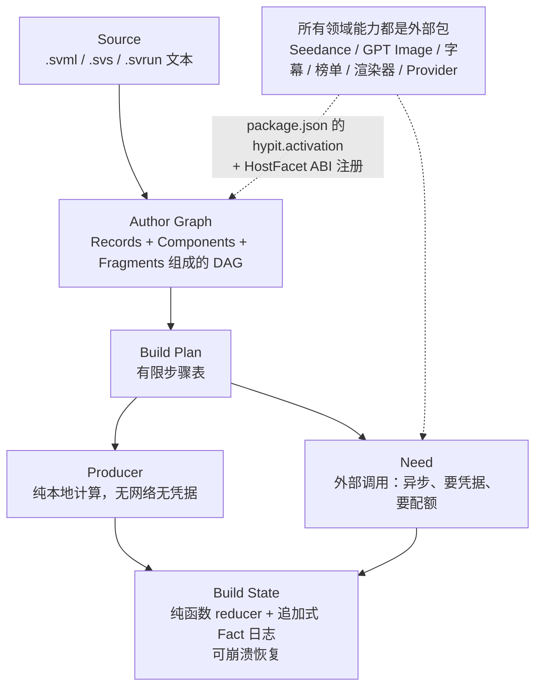
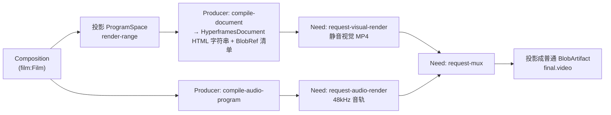
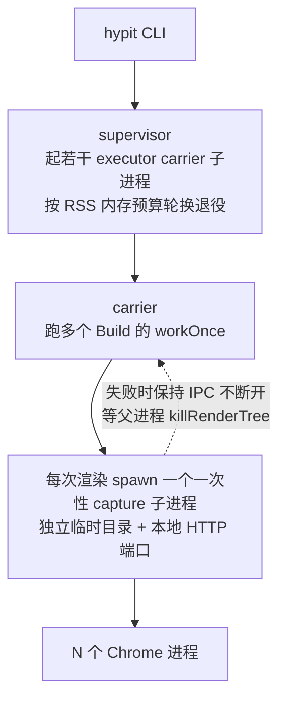

# Hypit · 编译与渲染链路

> [!abstract] 一句话
> Hypit 是一个 122 包的 pnpm monorepo，本质是「把 XML 方言编译成依赖图、再把图调度执行成视频」的编译器加运行时，编译器本体完全不认识「视频」；渲染不是自研引擎，而是外部 `@hyperframes/engine` 开 headless Chrome 逐帧截图、ffmpeg 编码，音频走完全独立的链路最后 mux。

## 1. 四层抽象



> [!tip] Producer / Need 二分是整个产品的经济学基础
> 「哪些步骤要花钱」在编译期就是类型可见的，不是运行时才发现。所以 `hypit plan` 能在花一分钱之前列出所有要发的请求、缺哪个 Provider、哪个请求不被支持。driver 的 `#classify` 把命令分成 executable 或 blocked，blocked 带原因：`missing-producer` / `missing-endpoint` / `unsupported-endpoint-request` / `ambiguous-endpoint`。【源码】packages/driver-node/src/driver.ts:166-245

```ts
// driver-node/src/driver.ts（节选）
const resolution = this.endpoints.resolve(command.need);
if (resolution.status === "missing") return { blocked: { command: command.id, reason: "missing-endpoint", ... } };
if (resolution.status === "unsupported") return { blocked: { ..., reason: "unsupported-endpoint-request" } };
if (resolution.status === "ambiguous") return { blocked: { ..., reason: "ambiguous-endpoint" } };
return { executable: { command, endpointId: registration.id, ... } };
```

Runtime Profile（`hypit.runtime.json`）只绑定 capability → endpoint，作者源码里完全不出现服务商名字。

## 2. 五段编译

入口在 `bin/hypit.mjs`。【源码】packages/compiler-node/src/compiler.ts:125-191；packages/elaborator/src/source.ts:428-588

```text
parseSourceHeader      # 读 <?svml using=...?> 决定 Frontend
discoverClosure        # 递归发现 import，冻结包闭包（只读头，不执行包代码）
Surface.decode         # 包自己的 TS 把 XML 元素变成 Records / Components / Fragments
hygienizeSource        # 给所有 id 加 source 前缀防撞
link                   # 校验 Module 闭包
elaborateAuthorGraph   # 把 Fragment 展平成 Operation DAG
planBuild              # 从 target 反向需求遍历
sliceExecution         # 裁掉没选中的候选分支
defineBuild → reducer 循环
```

```ts
// compiler-node/src/compiler.ts（节选）
const discovered = await discoverClosure(entry, this.#options.frontends, workspace);
const closure = this.#options.modules.createClosure(
  discovered.flatMap((unit) => unit.discovery.modules),
);
const compilation = await compileSourceClosure({
  entry, closure, frontends: this.#options.frontends,
  discover(source, frontend) { /* 用冻结的 discovery，不再跑第二次 */ },
  resolveSource: workspace.resolveSource,
  admitRecord: this.#admitRecord,
});
```

「发现—冻结—解码」两趟：discover 只读 import 头、不执行包代码，确定包集合后才真正 decode。这让包的安装解析与编译彻底分离——没装包时也能先知道缺哪些包。【实测】这正是本机看到的行为：`hypit check` 在解码前就报出「@fontsource-variable/inter is needed by this authored font. Install it once with: hypit packages install @fontsource-variable/inter@5.3.0」。

## 3. 插件系统：activation 入口 + 字符串 ABI

`<import from="@hypit/seedance@1"/>` 的解析路径：`physicalPackageName` 剥掉 `@1` 得到 `@hypit/seedance` → Node 解析算法从项目根 / Distribution 根定位目录 → 读 `package.json.hypit.activation` → 动态 import → 断言 default 导出的 `format === "hypit.node-package@1"` → 取出 modules / components / hostFacets。【源码】package-loader-node/src/loader.ts:102-122；markup/src/host-facet.ts:14、107-115；seedance/src/activation.ts:14-36

```ts
// packages/markup/src/host-facet.ts
export const markupSurfaceHostFacetAbi = "hypit.markup-surface-host@1";
export function installMarkupSurfaceHostFacets(facets, registry) {
  for (const facet of facets) {
    if (facet.abi !== markupSurfaceHostFacetAbi) continue;
    registry.register(facet.implementation as RegisteredSurface);
  }
}
// packages/seedance/src/activation.ts
export const hypitPackage = {
  format: "hypit.node-package@1" as const,
  modules: [{ manifest: seedanceManifest }],
  components: [seedanceComponent],
  hostFacets: [seedanceDefinition.hostFacet, createMarkupSurfaceHostFacet({...})],
};
```

- 没有插件注册表、没有中心配置文件；一个包声明自己提供什么，宿主只按 ABI 字符串过滤，不认识的 facet 原样忽略。所以同一个包能同时给编译器、运行时、Studio 三个宿主供货。
- `@hypit/*` 的解析强制走 Distribution root，注释写「同名的项目依赖绝不能悄悄替换它正在用的工具 ABI」——项目无法 patch 官方包，换来 ABI 稳定。【源码】package-loader-node/src/loader.ts:90-100
- XML 标签的命名空间只是 import 别名的词法拼接（`as="seedance"` + tag `TextVideo` → `<seedance:TextVideo>`），不用 xmlns，编译期可静态检查。见 [[Hypit · SVML 语言#4. 命名空间：两套互不相干的地址|SVML 命名空间]]。

## 4. Core：不可变 Definition + 追加 Fact

执行状态 = 不可变 Definition + 追加式 Fact 日志；BuildMachine 只是两者的一次性视图。`evaluate()` 先算出 Fact 但不改内存，等 `Store.append` 落盘成功才 `commit()`。调度「每轮重算所有可跑命令」：已发出的 + 所有结果缺失的 Need + 所有输入齐备的 pending step；一轮下来一个命令都没有就判 `BUILD_DEADLOCK`。【源码】core/src/reducer.ts:195-251；core/src/machine.ts:44-59

```ts
evaluate(result: CommandResult): BuildFact | undefined {
  if (this.#proposal !== undefined) throw new Error(`Build result ... has not been durably applied`);
  const admitted = admitBuildResult(this.#state, result);
  this.#proposal = { fact: admitted.fact, state: admitted.state };
  return admitted.fact;
}
/** Advance memory only after BuildStore.append has committed the proposed Fact. */
commit(): void { this.#state = this.#proposal.state; this.#proposal = undefined; }
```

这就是它敢在中途崩溃后恢复的原因：AI 生成调用很贵，必须保证 at-most-once。持久化用 `node:sqlite`（Node 内置实验特性，`bin/hypit.mjs:14-19` 专门屏蔽了那条警告），共 10 张表：builds / build_facts / operations / command_executions / build_catalog / submissions / executions / capacity / resource_waits / rates。`hypit_build_facts` 的 `UNIQUE(build_id, command_id)` 落实 at-most-once；`hypit_rates` 是令牌桶、`hypit_capacity` 是占用式配额，两者由同一个 `acquireCapacity` 接口区分（有 `periodMs` 就是速率，没有就是并发占用）。【源码】store-sqlite/src/store.ts:974-1056；runtime/src/capacity.ts:1-24

## 5. 显式复用：.svrun 与 satisfy

**没有增量编译，也没有内容寻址缓存。** Resource ID 是 `randomUUID` 不是内容哈希；每次 CLI 调用创建全新 Build id，注释写死「never reclaim a previous Build」。Build 内部唯一的去重是图节点 identity：同一个 Operation id 只 plan 一次。【源码】cli/src/main.ts:385-387；resource-store-fs/src/store.ts:90；core/src/plan.ts:196-199

```ts
// packages/cli/src/main.ts
// One CLI invocation is one execution instance. Source and Plan identity
// remain in Core; they never reclaim a previous Build.
id: createPublicBuildId(),
// packages/resource-store-fs/src/store.ts
const resource = `res_${randomUUID()}` as ResourceId;
```

唯一的跨 Build 复用是 `.svrun` 里显式的 `<build-record>` / `<file>` / `<value>` / `<fragment>` 候选加 `<satisfy>`。它不是配置文件，是和 `.svml` 平级、由 `planBuild` 同时消费的第二张图（Run Graph）。`satisfy` 之后 `sliceExecution` 把那条上游分支整个裁掉，所以被替换的 Seedance 调用根本不会发生——**省钱是编译期保证的，不是运行时跳过**。【源码】run-markup/src/syntax.ts:225-280；core/src/plan.ts:404-417

```xml
<!-- examples/ranking-football/swap-effect-banana/reuse.svrun:1-10 -->
<svrun version="1">
  <author source="./swap-effect-banana.svml"/>
  <target output="final.video"/>
  <file id="ronaldo-banana" type="@hypit/artifact@1#BlobArtifact"
        from="./reused/ronaldo.mp4" media-type="video/mp4"/>
  <satisfy output="ronaldo-take.video" candidate="ronaldo-banana"/>
  <satisfy output="messi-take.video" candidate="messi-banana"/>
</svrun>
```

> [!success] 实测：satisfy 让 Seedance 请求在 plan 里消失
> 2026-09-29 对 Skill 自带示例（去掉字体层）不带 Runtime 执行 `hypit plan`：Target 为 `final.video` 时 **8** 个请求；加一个 `<file>` 候选 `satisfy` 掉 `performance.video` 后变成 **7** 个，`@hypit/seedance#seedance-2-mini` 那一行不见了，输出多出 `Run choices 1`；Target 改为 `opening-semantic.take` 时只剩 **5** 个（渲染三件套被裁掉）。详见 [[Hypit · 使用流程#3.3 实测：同一份作品，三种 Run，请求数不同|使用流程 3.3]]。【实测】

Skill 的 authoring 引用页给了一张「本次改什么 → 保留什么 / 重算什么」的边界表（authoring.md:131-179，节选）：

| 本次改动 | 通过 Candidate 保留 | 重算或重新请求 |
| --- | --- | --- |
| 字幕外观、MG、特效或合成 | 现有媒体与 Script 身份、时序仍适用的 SemanticTake | 改动的视觉系统与渲染 |
| Moment / Selection 位置变了，口播 token 与 Take 不变 | 已接受的 SemanticTake 与其他素材 | 当前 Script 引用、投影与呈现 |
| Cue 分组、词属性或只改显示侧 Dual 文字 | 已接受的 SemanticTake | 当前 CaptionDocument 与其呈现 |
| 只需换部分 B-roll 图 | 现有表演、音色与其他仍有用的媒体 | 刻意替换的图与其下游合成 |
| 换主持人但论证仍成立 | 不受影响的 B-roll、图标、音乐 | 新主持人图、受影响的表演、归一化、语义时序与下游 |
| 新台词需要新表演 | 不受影响的 Take 与仍有用的输入 | 改动的表演及由它推出的时序 |

## 6. 成片链路：写死在 render-hyperframes 里的 7 步 Fragment



```ts
// packages/render-hyperframes/src/fragment.ts:17-73（节选）
{ id: "compile-document", producer: hyperframesProducers.compile,
  inputs: { composition: input("composition"), space: operation("render-range") },
  result: { kind: "output", name: "document" } },
{ id: "request-visual-render", producer: renderHyperframesProducers.requestVisual,
  inputs: { document: operation("compile-document") }, result: { kind: "need", name: "visual" } },
{ id: "request-audio-render", producer: mediaPipelineProducers.renderAudio,
  inputs: { plan: operation("compile-audio-program") }, result: { kind: "need", name: "audio" } },
{ id: "request-mux", producer: mediaPipelineProducers.mux,
  inputs: { visual: operation("request-visual-render"), audio: operation("request-audio-render") },
  result: { kind: "need", name: "media" } }
```

音视频是两条完全独立、各自可验证的链路，最后强制走一次 mux Need。README 明说这样设计是为了「改音频永远不可能靠偷偷改 HyperFrames 的 HTML 实现」——把架构约束做成了图结构。【源码】render-hyperframes/src/fragment.ts:39-59。【实测】plan 输出里对应的三行正是 `render-hyperframes#render-visual`、`media-pipeline#render-timeline-audio`、`media-pipeline#mux-program-media`。

## 7. 渲染器：浏览器截图，不是自研合成管线

真正驱动 Chrome 的是外部 npm 包 `@hyperframes/engine` 和 `@hyperframes/producer`（钉在 `0.7.101`，仓库内无源码）。Hypit 只做三件事：起本地文件服务器托管 staged 项目、用 CDP 逐帧截 PNG、最后跑一次 ffmpeg。【源码】provider-hyperframes-local/src/opaque-capture.ts:82-118；pnpm-lock.yaml:4832、4842

```ts
await page.evaluate(async t => { await (window as any).__hf.seek(t); }, time);
// ...等待 seek 完成、LUT、图片 decode、fonts.ready
const result = await cdp.send("Page.captureScreenshot", {
  format: "png", optimizeForSpeed: true, fromSurface: true,
  captureBeyondViewport: options.captureBeyondViewport ?? false,
  clip: { x: 0, y: 0, width: options.width, height: options.height,
          scale: options.deviceScaleFactor ?? 1 },
});
```

- 渲染能力边界 = Chrome 的渲染能力边界：CSS / SVG / WebGL / canvas 全部可用；每帧至少一次 CDP 往返加一次完整页面合成，这是性能天花板。
- **视频素材在页面里根本不「播放」**：编译器把每个 `<video>` 写成带 `data-hypit-start-frame` / `end-frame` / `source-frame` / `source-rate` / `source-fps` 的精确帧标记；渲染前用 ffmpeg 把需要的源帧窗口解成 PNG 目录，再用引擎的 `createVideoFrameInjector` + 自定义 `FrameLookupTable` 注入给 slot。ffmpeg 一共出现在三处：源帧解码、最终 H.264 编码、输出 ffprobe 校验。【源码】sampling.ts:20-52；capture.ts:87-172
- 时间不是秒而是有理数帧，源帧用 BigInt 算，任意 seek 到中间都可复现：

```ts
export function sourceFrameAt(slot: VideoSlot, frame: number): number {
  const a = slot.sourceFrame; const r = slot.sourceRate;
  const value = Number((a.numerator * r.denominator
    + BigInt(frame - slot.startFrame) * r.numerator * a.denominator)
    / (a.denominator * r.denominator));
  assert(Number.isSafeInteger(value) && value >= 0, "...");
  return value;
}
```

> [!warning] 本机现状
> `@hypit/provider-hyperframes-local` 依赖的 `@hyperframes/engine@0.7.101` 在本机 **Ready false**，所以目前不能渲染成片。【实测】见 [[Hypit · 安装与使用方法#3. 本机实际状态（2026-09-29 实测）|本机状态]]。

## 8. 「64 个并发 Chromium」是算出来的

README 每个样片都写「concurrently rendered in 64 headless Chromium processes」，但全仓没有常量 64。并发是三层嵌套：① Runtime 层 `LocalBuildScheduler` 按 capacity 配额启动 Command；② Endpoint 层每个 Provider 声明 `defaultConcurrency` 与可选 `browserCapacity`；③ 单次渲染内部 N 个独立 Chrome 进程从内存 batch 队列抢活，每 batch 约 1 秒帧数。【源码】concurrency.ts:9-31；render.ts:68-70；runtime/src/scheduler.ts:171-191

```ts
export function autoWorkerLimit(cpu = availableParallelism(), memory = hostMemory()): number {
  // Chrome 的光栅面、解码媒体、JS 堆各在独立进程。留一半内存和两个 CPU 给宿主。
  const byMemory = Math.floor(memory / 2 / (1.5 * 1024 ** 3));
  return Math.max(1, Math.min(Math.max(1, cpu - 2), byMemory));
}
// 自动模式先开一半，再靠吞吐比较决定加 / 减
this.target = automatic ? Math.max(1, Math.ceil(limit / 2)) : limit;
```

自动上限 = `min(cpu − 2, 内存 / 2 / 1.5GiB)`。要跑到 64 个需要约 66 核 + 192GB 内存（64 × 1.5GiB × 2）；仓库 examples 的 profile 实际只配 `workers: 2`。README 的数字是他们自己渲染机器上的结果，不是默认值。自适应并发刻意不跨调用学习：样本随本次渲染消亡，不建性能数据库。【源码】concurrency.ts:16-19

## 9. 进程模型四层



Chrome 会开自己的进程组，Node 的 `child.kill()` 管不到；所以子进程在失败时故意保持 IPC 连接，让父进程先发现并杀掉整棵进程树，避免留下孤儿 Chrome。README 也承认 SIGKILL / OS 硬杀时无法保证清理。【源码】runtime-local/src/supervisor.ts:25-54；capture-process.ts:22-56；capture-worker.ts:11-25

```ts
const finish = (value: { type: "completed" } | { type: "failed"; error: string }) => {
  // Failure can leave descendants behind. Keep the owner connected until it has
  // discovered and stopped that tree, rather than orphaning it by exiting first.
  if (value.type === "failed") { report(value); return; }
  releaseCaptureExitCleanup();
  process.send?.(value, undefined, undefined, (error) => { ... if (process.connected) process.disconnect(); });
};
```

## 10. Studio 与另一套浏览器

- **Studio 不走 Build**：Vite dev server + 自写 web UI，直接在浏览器里渲染同一份 HyperframesDocument 的 HTML；只执行确定性 Producer 与 Runtime 标记 `transient: true` 的 Need（Provider 自己声明「这个调用不花钱、无副作用」）。预览与成片共用同一个编译产物，「所见即所得」是结构性保证。`hypit snapshot --studio` 从 Studio 的端点取当前文档去抓图。【源码】studio/src/execute.ts:16-35；endpoint-kit/src/index.ts:211-217
- **browser-capture 是另一套**：`hypit capture screenshot / run` 用 `puppeteer-core` + `@puppeteer/browsers` 自管的 Chrome for Testing 抓参考网页，README 明说它不依赖 Hypit Core / Runtime / Provider；渲染用的 Chrome 版本由 provider 的 `hypit.renderBrowser.version = 152.0.7928.2` 钉死。两套版本、两套缓存目录。【源码】browser-capture/README.md:1-16；provider-hyperframes-local/package.json:12-14

## 11. 122 个包分九族

| 族 | 代表包 |
| --- | --- |
| ① 编译内核 | core、protocol、elaborator、markup、compiler-node、compiler-markup-node、source、run、run-markup、svs、validation |
| ② 运行时 | runtime、runtime-local、runtime-kit、runtime-host-node、driver-node、store-sqlite、workspace*、package-loader-node |
| ③ CLI / Studio | cli、video-cli、studio + 12 个 *-studio 伴生包 |
| ④ 合成 IR | composition、visual-ir、hyperframes、program-space、spatial、timeline、temporal、film |
| ⑤ 媒体执行 | media、media-pipeline、media-execution、raster、image-* |
| ⑥ 作者域组件 | script、speech、caption、caption-fine、typography-track、media-track、audio-track、deck-track、ranking、comment-sticker、screen-overlay、narrative、performance、text、fonts-open |
| ⑦ 模型包 | seedance、gpt-image、nano-banana、seedream、wan、pixverse、grok-imagine、minimax-h3、mimo-speech、elevenlabs-speech、fishaudio-speech、whisperx、yt-dlp |
| ⑧ Provider | provider-hypihub / hiapi / monid / pollo / tokendance / beatapi / media-local / hyperframes-local / whisperx-local / image-opencv-local |
| ⑨ 基础设施 | credential-store ×4、resource-store ×2、build-result ×4、endpoint-kit、model-kit、author-kit、component-kit、generation、artifact、transport-aws-lambda |

真正的「框架」只有 ①② 两族；⑥⑦⑧ 全是可替换的内容包，都走同一套 activation 协议。最大的三个包是 studio（约 13k 行）、cli（9.2k）、runtime-local（7.8k），全在宿主侧。【源码】packages/ 目录；package.json:188-289。【实测】2026-09-29 `ls packages | wc -l` = 122；`hypit vocabulary` 列出 82 个已安装包。

## 12. 设计取舍

| 取舍 | 代价 | 收益 |
| --- | --- | --- |
| DSL 只做命名与连线 | 作者无法在 SVML 里抽象，复用下沉到 TS 包或 .svs | 编译期零求值、完全静态可分析、精确 source range 溯源供 Studio 点选编辑（frontend.ts:195-222 的 retainElementProvenance） |
| 浏览器截图当渲染器 | 每帧一次 CDP 往返 + 完整合成，每 Chrome 预算 1.5GiB | CSS/SVG/字体/canvas/WebGL 全套；预览与成片同一份 HTML |
| 音视频物理隔离后强制 mux | 多一次 mux 与两套验证 | 改音频在架构上不可能靠偷改 HTML 实现 |
| 放弃内容寻址与自动增量 | 改一行提示词默认重跑全图 | 不必读完整文件算哈希（支持流式写入），语义可预测，复用意图进 git |
| 外部调用提升为一等图节点（Need） | 模型包要写两遍：Surface 解析 + Fragment 拓扑 | plan 阶段列出全部付费请求 |
| Definition + 追加 Fact，先落盘再推进内存 | 状态要 JSON 序列化，hydration 造成内存尖峰（worker.ts:167-177 专门串行化） | 生成调用 at-most-once，崩溃可恢复 |
| 每次渲染一次性子进程 + 独立临时目录与端口 | 同项目连续渲染会重复解码源帧 | 进程级隔离，崩溃不污染其他渲染 |
| 自动 worker 上限保守 | 默认跑不满机器 | 不卡死开发机，容器里安全 |
| 插件用字符串 ABI 而非继承 / 中心注册表 | 类型安全靠 `as` 断言 | 新增一类宿主不用改任何已有包 |
| Studio 可调哪些 API 由 Provider 自声明 transient | 信任 Provider 作者 | Studio 完全不认识任何具体服务商 |

> [!question] 精读声明的未读部分
> `@hyperframes/engine` / `producer` 无源码，Chrome 启动参数、页面 runtime、seek 协议只能从调用点反推；Studio 13,076 行只读了 README、compile.ts 与 execute.ts 开头；作者域组件包基本没读实现；Provider 只深读了 hyperframes-local；store-sqlite 只读了 DDL；199 个测试文件一个没打开；没有执行过任何 build。【空白】完整清单见 [[Hypit · 研究札记#8. 五路读者声明的未读部分|未读清单]]。

---
相关：[[Hypit · SVML 语言]] · [[Hypit · 模型接入与 Seedance]] · [[Hypit · 使用流程]] · [[代码渲染 · Opus5.5 与代码渲染视频]]
