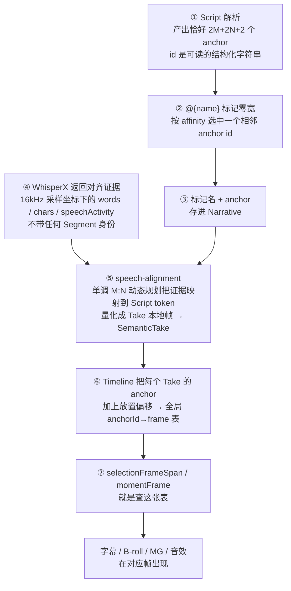
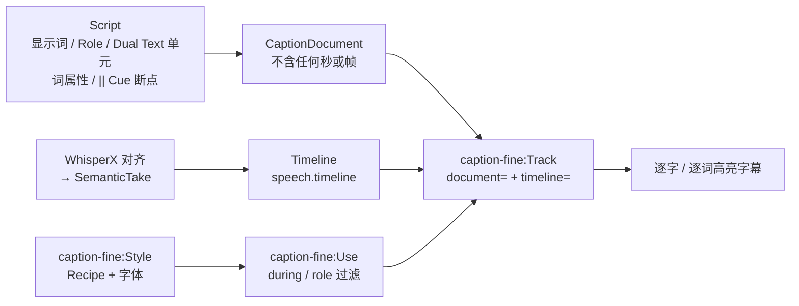

# Hypit · 词锚定机制

> [!abstract] 一句话
> Hypit 的 Script 里一个时间码都没有：语义标记 `@{name}` 只在「相邻词边界」上选一个结构化的 anchor id，等 WhisperX 把真实表演对齐成帧之后，Timeline 再把 anchor 翻译成帧——所以改词、换配音、换表演，只要 token 身份不变，所有挂在词上的画面事件自动跟着走。

这是 Hypit 与所有「时间轴编辑器」的分界线，也是它敢喊「1 command, 100 variants」的技术底座。README 的说法是画面、字幕、B-roll、特效「all anchored to words instead of seconds」。【文档】README.md

![[s2-svml-live-preview-grid.png|720]]
*README 演示 GIF 的四帧拼版（第 1 / 6 / 11 / 16 秒）：左栏 Script 里高亮的 `@ronaldo`、`@/ronaldo`、`@greek-god` 等标记随播放逐个点亮，下方 `broll-track` 的 `<item … during={script.selection.greek-tragedy}/>` 让 B-roll 出现在对应词区间，右栏实时画面中字幕与梯队榜同步变化。来源：github.com/user-attachments/assets/981c28e8-…（9.9MB GIF，本地抽帧拼版）*

## 1. 七步链条



【源码】script/src/parser.ts:76-86、770-822；narrative/src/types.ts:98-131；speech-evidence/src/index.ts:4-40；speech-alignment/README.md:8-16；speech/src/types.ts:12-40；timeline/src/location.ts:20-81

### anchor id 的确切拼法

```ts
// script/src/parser.ts:76-86
function segmentAnchorId(segmentId, edge) { return `segment:${segmentId}:${edge}`; }
function tokenId(segmentId, i)            { return `segment:${segmentId}:token:${i + 1}`; }
function tokenAnchorId(segmentId, i, edge){ return `${tokenId(segmentId, i)}:${edge}`; }
// 另有固定的 "program:start" / "program:end"（parser.ts:798、819）
```

M 个 token 各两端、N 个 Segment 各两端、再加 Program 首尾，所以一份完整 Script 恰好 `2M + 2N + 2` 个有序语义锚点。官方 Script 文档也这样写。【文档】docs/zh/quickstart/script.md「Selection」一节

### 全局 anchor → frame 表

```ts
// timeline/src/location.ts:20-28
export function semanticAnchorFrames(track: Timeline): ReadonlyMap<string, number> {
  return new Map([
    ["program:start", 0] as const,
    ...timelineSpans(track).flatMap(({ item, startFrame }) =>
      item.take.anchors.map((a) => [a.identity, startFrame + a.frame] as const)),
    ["program:end", timelineFrameCount(track)] as const,
  ]);
}
```

> [!note] Segment 与 Selection 走的是两条路
> `during={story.segment.X}` 走的是**已放置 Take 的跨度**（`segmentFrameSpan` 找 Take），而 `during={story.selection.X}` 走的是 anchor 表。【源码】timeline/src/location.ts:36-57

> [!question] 未读到的部分
> speech-alignment 的 `local.ts` 与 `locate.ts` 里那套单调 M:N 动态规划的**具体算法没有读**，上面第 ⑤ 步只转述了 README:8-16。【空白】

## 2. 六种 affinity：停顿归谁

| 写法 | 类型 | 吸附方向 | 选中的 anchor |
| --- | --- | --- | --- |
| `@{name}` | Selection 起点 | 右吸（默认） | 下一个词的开始 |
| `@{~name}` | Selection 起点 | 左吸 | 上一个词的结束 |
| `@{/name}` | Selection 收尾 | 左吸（默认） | 上一个词的结束 |
| `@{/name~}` | Selection 收尾 | 右吸 | 下一个词的开始 |
| `@{name!}` | Moment | 右吸 | 下一个词的开始 |
| `@{~name!}` | Moment | 左吸 | 上一个词的结束 |

```ts
// script/src/parser.ts:770-789 —— affinity 如何选 anchor
if (inside) {
  if (affinity === "left") {
    return boundary.tokenIndex > inside.tokenStart
      ? tokens[boundary.tokenIndex - 1]!.endAnchorId   // 上一个词的结束
      : inside.startAnchorId;                          // 退回 Segment 起点
  }
  return boundary.tokenIndex < inside.tokenEndExclusive
    ? tokens[boundary.tokenIndex]!.startAnchorId       // 下一个词的开始
    : inside.endAnchorId;                              // 退回 Segment 终点
}
// Segment 之外：左吸取前一个 Segment 的 end，否则 "program:start"；
//               右吸取后一个 Segment 的 start，否则 "program:end"。
```

- 两个相邻画面之间的**词间停顿归前一个画面还是后一个画面**，完全由 affinity 决定——这正是剪辑点的实际含义。
- 最外侧切口仍用 affinity 区分：第一个 Segment 前的 `@{~id}` 选 Program start，`@{id}` 选首 Segment start；末 Segment 后的 `@{/id}` 选末 Segment end，`@{/id~}` 选 Program end。「对齐后它们可能落在同一帧，但作者身份并不相同」。【文档】script.md
- Selection **不是嵌套标签**：可重叠、可交叉、可跨 Segment，只有 anchor 顺序校验（end 不得早于 start）。每个名字只有一对开闭标记。
- Selection 与 Moment 共用一个命名空间，名字匹配 `[a-z][a-z0-9_-]{0,63}`。【源码】narrative/src/identity.ts:76-85
- 标记不能切开语音 Token，也不能插到它与附着标点之间：应写 `@{beat!}“测试”`，不能写 `“@{beat!}测试”`；`@{beat!}` 是 Moment，`@{part}!` 则是区间首后跟正文感叹号。【文档】script.md

```xml
<!-- 交叉而非嵌套的两个 Selection（script.md） -->
<demo>
  <HOST> @{a}One @{b}two@{/a} three.@{/b}
</demo>
```

【实测】2026-09-29 在本机用 `hypit check` 校验一份只含 Script 的最小源（`<HOST> Here is @{proof}the useful part.@{/proof} @{beat!}Watch this.`）→ `✓ Source is valid`；`hypit measure probe.svml --segment opening --language en` → `1.739s`（8 pronunciation units）。标记不贡献任何发音单元。

## 3. Script 语法全貌

`<script>` 以**散文为先**：不含时间码、不引用媒体、不设样式、不携带生成参数；管线里其他组件都读 Script，Script 本身不读任何东西。【文档】docs/zh/quickstart/script.md

| 构造 | 写法 | 要点 |
| --- | --- | --- |
| Segment | `<opening>…</opening>`，标签名即 id | 顶层、不可嵌套；可自闭合 `<pause/>`（有结构无词元，不代表静音或默认时长）；名字 `[a-z][a-z0-9_-]{0,63}`，`script` 保留 |
| Role Cue | `<ALICE> What time is it?` | 无关闭标签，延续到下一个 Role Cue 或 Segment 结尾；一个 Segment 全用或全不用；1–32 字符；不是讲者实体、不选音色 |
| Dual Text | `<SVML \| semantic video markup language>` | 左侧进字幕投影，右侧进 dialogue / speech 投影；两侧词数可不同（N:M 对齐单元） |
| 只说不显示 | `< \| um>` | 说出但永不显示为字幕 |
| 显读一致锁成一个单元 | `<组件化\|>`、`<Git Hub\|>` | 字幕一个完整单元，口播里每个字仍各自保留时间 |
| Caption Cue Break | `\|\|` | 字幕 Cue 分界，只能位于完整对齐单元之间，不能写进 Dual Text |
| 扁平词属性 | `really{emphasis,keyword} important{brand}` | 不嵌套、不表达时间，由 Caption 家族决定怎么呈现 |
| 注释 | `<!-- … -->` | 不进任何投影 |
| 转义 | `\@` `\<` `\\` `\|` | 普通文本里单个 `\|` 是字面量，未转义的 `\|\|` 才是 Cue Break |

三种文本投影：

| 投影 | `<ALICE> What time is it? <BOB> It's 8:30.` 的输出 | 谁用 |
| --- | --- | --- |
| dialogue | `ALICE: What time is it?` / `BOB: It's 8:30.` | 给视频模型 Prompt（带 Role 前缀），如 `{story.segment.hook.dialogue}` |
| speech | `What time is it?` / `It's 8:30.` | 纯口播文本 |
| caption | 同 speech，但是一份 `CaptionDocument` | 字幕（不含任何秒数或帧数） |

英文按词拆分；汉字、平假名、片假名按**字符级** lexical unit 拆分，所以中文不会被当成一个巨大的词。标点不是口播 token，不获得独立时间窗，Dual Text 后的句号会吸附到前一个显示词。【文档】script.md「CaptionDocument 的组成」

> [!bug] 初查对 `||` 的误读
> 初查报告（2026-09-23）把 interview 示例里的 `||` 描述为「显式标注**分词断点**」。官方 Script 文档与 `script-syntax` 的定义是 **Caption Cue Break**：决定字幕一屏一屏怎么切换，不决定分词。`<2012 | twenty twelve>` 则是 Dual Text（显示 2012、读作 twenty twelve），初查称之为「数字读法映射」，含义一致。本篇以官方定义为准。

### 真实例子：街采三段式

```xml
<!-- examples/interview/reference.svml:30-54（节选） -->
<script id="story">
  <manifest-rule>
    <BOY>Hey yo! || Is this || Lamborghini || yours?
    <WIFE>Mmm hmm.
    <BOY>Give me || three rules || to make your || first million.
    <WIFE>OK || the || first one || is || @{manifest!} Manifest.
    ...
  </manifest-rule>
  <real-estate-rule>
    ...
    <WIFE>@{real-estate!} Real estate. || Buy || the || building, || and || charge || everyone || rent.
  </real-estate-rule>
  <bitcoin-rule>
    <BOY>Wait what?
    <WIFE>@{bitcoin!} Bitcoin. || I || pressed || the || wrong || button || in <2012 | twenty twelve> || and || made || six figures.
    ...
  </bitcoin-rule>
</script>
```

三个 Moment（`manifest!`、`real-estate!`、`bitcoin!`）同时驱动三样东西：音效 `at={story.moment.manifest} for="20f"`、emoji 揭示板 `<emoji:Item id="manifest" … at={story.moment.manifest}/>`、闪屏 `<screen:Flash … at={story.moment.manifest} for="8f"/>`（reference.svml:275-307）。翻成西班牙语的克隆变体里，同名 Moment 挂在新的词上——`@{manifest!} Manifestar.`、`@{real-estate!} Bienes raíces.`、`@{bitcoin!} Bitcoin.`，读法映射变成 `<2012 | dos mil doce>`——下游 `at={story.moment.*}` 一行不改（swap-lang.svml:35、44、51、210-232），所以「三段式反转仍然落在原来的拍点上」。该变体还用了一行 `<adjust:Anchor at={story.moment.aja} frame="63"/>`（swap-lang.svml:185，来自 `@hypit/semantic-take-adjust`）对单个锚点做手工帧校正。【源码】

## 4. 时间表达式：每个接收方自己的小语法

`{}` 引用之外，时间写在**属性字符串里**，由 `@hypit/temporal-markup` 解析。【源码】temporal-markup/src/index.ts:154-196、337-360

```ts
// temporal-markup/src/index.ts:180-196
export function parseTemporalInstant(value: string, label: string) {
  const trimmed = value.trim();
  const refs = ["program.start","program.end","selection.start","selection.end",
                "segment.start","segment.end","moment.cue"] as const;
  for (const ref of refs) {
    if (trimmed === ref) return { ref };
    const match = new RegExp(`^${ref.replace(".","\\.")}\\s*([+-])\\s*(.+)$`,"u").exec(trimmed);
    if (match !== null) {
      const offset = parseTemporalDuration(match[2]!, `${label} offset`);
      return { ref, offset: match[1] === "-" ? negate(offset) : offset };
    }
  }
  return { ref: "absolute", at: parseTemporalDuration(trimmed, label) };
}
// index.ts:155  /^(\d+)(?:\.(\d+))?(f|ms|s)$/u
```

- 只认 7 个 ref，后面**最多一个** `+` / `-` 偏移；时长只认 `\d+(\.\d+)?(f|ms|s)`，`f` 与 `ms` 必须整数、`s` 可带小数。
- Window 必须**四选一**：`during` / `at`+`for` / `until`+`for` / `start`+`end`，混写直接报错。
- `during="program"` 是唯一合法的字面值；`during={…}` 才是引用。
- 看到 `instant="moment.cue + 8f"` 不要以为是通用表达式，它只是这一个属性的私有格式。

## 5. 字幕：文本与时间彻底分家



字幕系统是三层加一条铁律。【文档】playbooks/craft/captions.md:43-48、183-195

| 层 | 决定什么 |
| --- | --- |
| Family | 结构性视觉语言与调度行为：均匀流动的词、独立排布的短语、贴在说话人身上的形状，或别的作者关系 |
| Recipe 与解析后的 Style | 该 Family 内一套连贯处理 |
| Parameters | 位置锚点、可用宽度、换行、字体、描边盒子、当前词响应、Cue 运动、reveal、lead / tail / handoff |

铁律：Script 拥有显示词与结构，发布的 CaptionDocument 里没有秒或帧；Caption 才把这份真相接到真实 Timeline 上。直接后果（captions.md:50-52）：

- 换个**纯视觉皮肤**可以通过 Run 复用同一批语义与媒体输出，不用重新生成、不用重新付费；
- 只要**音频、语速或剪辑**变了，词时间就变，必须重新对齐。

原文还有一句定义性主张：共同的类型化关系才让结果成为 Caption，官方渲染器不是它的定义。

### 书写系统是一等公民

| 书写 | 分组与呈现 |
| --- | --- |
| 英文 | 保住有用的短语，含冠词、否定、名字或数量 |
| 中文 | 复合词、名字、修饰语及其对象放在一起；完整短分句能放下就共享一个 Cue；反复的小字组会把意义和画面都切碎 |
| 韩文 | 保留作者写的空格（`3개월` 和 `3 개월` 是两种拼写），语法短语一起读 |
| 中英混排 | 整体读短语；一个拉丁品牌名或数字可能占好几个汉字宽 |

英文的最小计时单元通常是一个词，中文是单个汉字，所以中文天然拿到逐字高亮；明确拒绝给固定字数：「A fixed word or character count cannot make that choice.」【文档】captions.md:68-87

### 出现与变色是两组正交的轴

| 轴 | 取值 | 含义 |
| --- | --- | --- |
| `karaoke` | `current` / `trail` | 只高亮当前单元 / 已说过的保持高亮 |
| `karaoke-transition` | `step` / `wipe` | 整个单元在开始时一次激活 / 在字形内部扫过 |
| `atom-reveal` | `all` / `on-start` / `typewriter` | 整条先全显 / 逐个已说单元出现 / 单元内逐字形出现 |

「Making a Cue longer changes its reading group, not its character timing.」——把 Cue 写长只改变阅读分组，不改变逐字时间。【文档】captions.md:89-114。字幕跟头的外部测量回路见 [[Hypit · Playbooks 与短剧#字幕跟头：一个带外部测量的回路|字幕跟头]]。

> [!question] 字段名未核对
> `word-gap`、`max-words-per-line`、`atom-reveal`、`karaoke-transition`、lead/tail/handoff 等字段名只来自 playbook 的描述，`packages/caption-fine` 的 README 与 `schedule.ts` / `render.ts` 未读，确切计算方式与取值未核对。【空白】

## 6. 参考片只提供关系，不提供秒数

Skill 在 `creation/script-and-time.md:244-245` 写了一条禁令：

> [!quote] 原文
> Do not copy a reference timestamp into the target or preserve an incidental lead/lag unless that offset itself is part of the design.

参考片提供的是**关系**（某个 reveal 回答了某句话），目标的秒数由新表演对齐后自己产生。这是「复刻」和「照抄」的分界线，也是整套词锚定存在的理由：如果允许抄秒数，就不需要 anchor、不需要 WhisperX、不需要那套 M:N 动态规划。这个视角在研究中被称为「复刻机」，见 [[Hypit · 研究札记#2. 读懂它的钥匙：这是一台复刻机|复刻机视角]]。

## 7. 代价与收益

| | 内容 |
| --- | --- |
| 收益 | 换词、换配音、换演员、换语言不动下游任何一行；Timeline 里每一帧都带可查询的词级证据；纯视觉改版复用已付费媒体 |
| 代价 | 任何「某事什么时候发生」的问题，都必须先跑完 Normalize + WhisperX 对齐才能回答，开发回路变长且要花钱（script/README.md:236-238：「No timestamps or display Styles enter the Script value.」） |
| 代价 | 六个 affinity 符号要记；Selection 失去嵌套结构校验，错配的开闭标记只能靠 anchor 顺序发现 |
| 兜底 | 纯动画不需要 Script：作者声明的时钟与时长同样可用（`time:Timeline end="8s"`），见 [[Hypit · SVML 语言#8.1 最短作品：纯动画，无语音无生成（26 行）|最短作品]] |

---
相关：[[Hypit · SVML 语言]] · [[Hypit · Playbooks 与短剧]] · [[Hypit · 研究札记]] · [[代码渲染 · claude-horizon-animation]]
