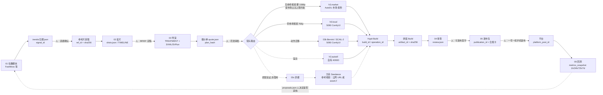
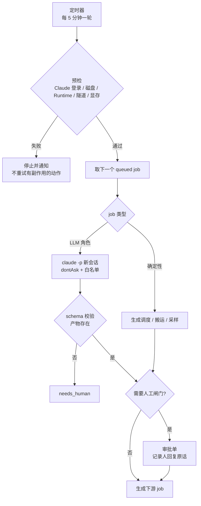
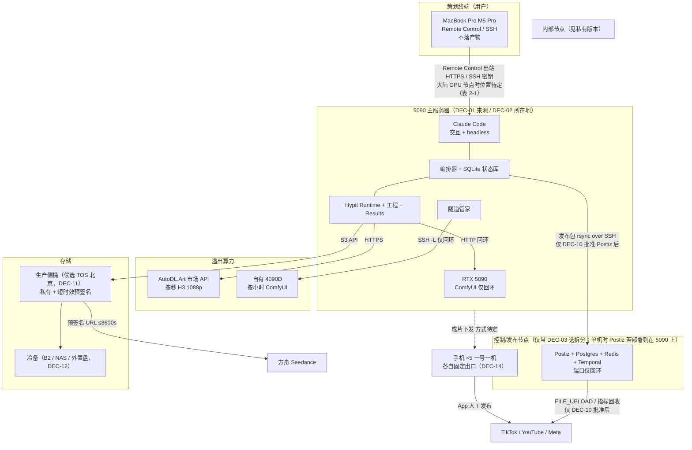
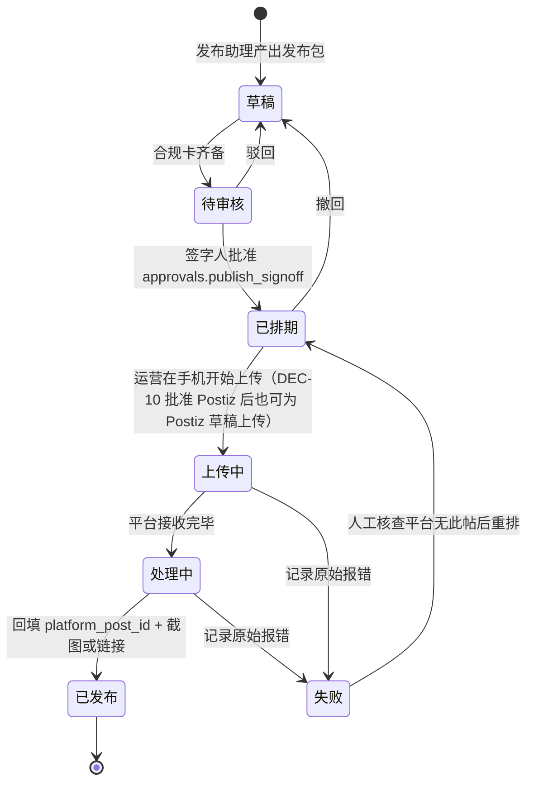
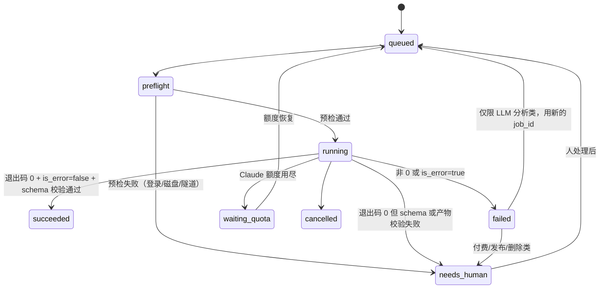
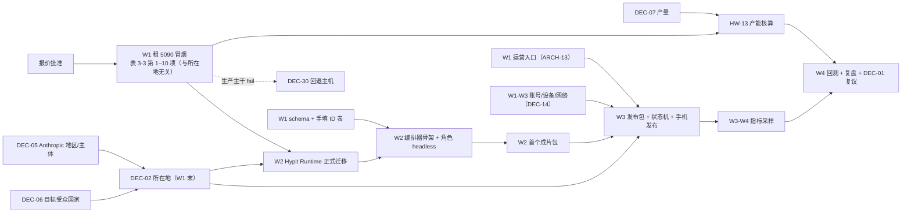

# 管线骨架实施 Spec（条目化）

> **公开版说明**：本文件为公开仓库版本，涉及内部网络、VPN 与基础设施细节的条目已替换为"见私有版本"，条目编号保持一致。完整版保存在团队私有知识库。


> **文档状态**：修订版 v0.2，2026-10-13；2026-10-22 追加 v0.3 决策更新（见下）。在草案 v0.1（保存在私有知识库）基础上，按三路核查（V1 事实、V2 可行性、V3 元认知）逐条复核后修订，修订记录见文末「附录：核查与修订记录」。仍未经用户审定，不能作为开工依据。
> **来源**：本文汇总了 7 路调研：R1 仓库现状、R2 基础设施、R3 存储、R4 网络、R5 多代理、R6 元认知、R7 5090 服务器；另外参考了外部报告《海外社媒开源方案与Hypit接入评估-2026-10-12》（下文记为 EXT）。如果旧假设与「用户补充前提」（下文记为 UPDATE）或 R7 冲突，以 UPDATE 和 R7 为准。
> **公开仓库提示**：本文件放在公开 fork 里。全文不写实例 ID、主机名、IP、SSH 端口、面板地址和令牌值，需要指代时一律用占位符。
> **条目格式**：`**ID** 要求/决定 —— 理由〔出处〕｜等级【结论等级】（依据【依据等级】）｜验收：做完后拿什么证明｜负责：…｜状态：已具备 / 待做 / 待用户拍板`。两种等级的含义见 CONV-02；括号省略时表示两者相同。依赖服务器所在地的条目在 ID 后标「〔分支：大陆/海外〕」（ARCH-10）。
> **负责人缩写**：开发A 负责数据接入、存储与回测；开发B 负责 Hypit 衔接、发布与运维，分工见 EXT:85；运营A 负责游戏/IP 与品牌；运营B 负责短剧与本地化；用户即策划本人；Claude agent 指在服务器上运行的 Claude Code 会话。


## v0.3 决策更新（2026-10-22，用户确认）

- **DEC-01 已定：5090 来源 = 自购**。服务器是公司办公室的一台自购工作站：
  - 硬件：RTX 5090 32GB，驱动 595.79 / CUDA 13.2；Core Ultra 7 270K Plus 24 核；128GB DDR5；单块 2TB NVMe（C 盘约 407GB，D 盘约 1.5TB）；有线网口当前跑 1Gbps；
  - 系统：Win11 专业版宿主，已装 WSL2 + Ubuntu-24.04（WSL 内 nvidia-smi 正常）、Docker Desktop（GPU 容器已由用户在本机实测通过）。
  - 以上均为 2026-10-21【实测】。
- **DEC-02 已定：所在地 = 大陆（公司内网）**。表 2-1 及各条目里的「〔分支：大陆/海外〕」一律取**大陆分支**。DEC-05（Claude Code 运行时的地区与主体条款）仍待法务确认，优先级不变。
- **由此改变的设计**【推断】：
  1. **运行环境**：管线运行在 WSL2 Ubuntu-24.04 里，Windows 只作宿主。原文写 systemd 的地方，先核实 WSL 是否启用了 systemd（`/etc/wsl.conf`），未启用时按 U-36 用替代守护；
  2. **远程限制**：已知部分操作（如 `docker pull`、MSI 安装）通过 SSH 远程执行会因缺登录会话而失败，需要在本机操作，或改用 WSL 内的原生方案，W1 冒烟时确认；
  3. **存储无冗余**：单块 NVMe，3-2-1 备份（STO-10）变成必做项；
  4. **5090 兼容清单（HW-05）**：在这台机器上逐项冒烟，GPU 任务一次只跑一个重任务；
  5. **远程访问**：只在公司内网可直连；离开内网的访问方式另定（NET-15、DEC-29）。
- **W1 冒烟清单**（取代原"租一台 5090 冒烟"）：
  - WSL 内 PyTorch（cu128 以上）调用 GPU；
  - Hypit CLI（Node 24）与 Runtime；
  - ComfyUI，及 03b 的 Bernini 工作流；
  - WhisperX；
  - Blender 无头渲染；
  - PromptHMR 的 CUDA 扩展编译；
  - headless Chrome（HyperFrames）。

  每项记录【实测】结果和耗时。


---

## 0 目的、范围、非目标、术语表

### 0.1 目的

- **GOAL-01** 把「缝合项目」从「本机 Mac 加人工高强度纠偏、跑通单条」推进到「固定工作流/程序，由一台 RTX 5090 主服务器执行，Claude Code 作为服务器上的 agent 运行时」。 —— 理由：这是 UPDATE 提出的新前提；ref105 复刻的 4 天会话（2026-09-28 至 10-01，覆盖 S01 以及 9/30 的 Bernini 全片等工作）共有 105 条用户消息，其中纠偏条数没有统计〔R6·E07；`stages/04-review/证据关卡-v2.md:9、14`〕｜等级【推断】（依据【实测】，只对消息总数成立）｜验收：第 4 周复盘表里的「每条成片的用户纠偏次数」和「无人值守触发成功的阶段数」（PLAN-14）｜负责：用户｜状态：待做
- **GOAL-02** 从第一条已发布视频开始，每条都带完整追溯链：signal_id→brief_id→build_id→artifact_id→publication_id→platform_post_id→metrics_snapshot。 —— 理由：外部报告把「证据可追溯」列为首期成功标准〔EXT:62、97〕；如果不记 ID，三个月后无法做归因〔R6·G15〕｜等级【推断】（依据【文档】）｜验收：每周统计 ID 链完整率，即带全链的已发布条数 ÷ 已发布条数｜负责：开发A｜状态：待做
- **GOAL-03** 策划（用户）通过 Claude Code 操作全流程，人只在表 2-2 的 7 个闸门介入：G1 选题确认、G2 BRIEF/Treatment 定稿、G3 花钱审批、G4 开 GPU、G5 可发布签字、G6 手机发布（人工执行的动作）、G7 删除。 —— 理由：平台要求发布前由人确认〔R4·N-21〕；用户偏好「花钱前先报价，等确认」；角色划分见〔R5 D4〕｜等级【推断】｜验收：G1–G5、G7 在审批表 approvals（DC-02）里留有审批人原话和时间；G6 在 publication_events 里留有操作人和设备号｜负责：用户｜状态：待做

### 0.2 范围

- **SC-01** 覆盖六个阶段的骨架：01 趋势→02 读片→03 生产（a/b/c）→04 审查→05 发布准备→06 回测，内容包括数据契约、编排、部署、存储、传输、网络、安全和运维。 ｜等级【推断】｜验收：第 1–12 章里每个阶段至少有一条可验收的条目｜负责：Claude agent｜状态：待做
- **SC-02** 给出硬件、软件、存储、网络的对比和推荐。采购、开通、付费、注册、登录都由用户本人执行或拍板。 —— 理由：用户偏好；只读纪律｜等级【推断】（依据【文档】）｜验收：第 14 章决策清单里每一项都有用户的回复原话｜负责：用户｜状态：待用户拍板
- **SC-03** 给出 4 周试点计划，与 EXT 的四周安排对齐（平台审批时间不计入工期）〔EXT:76-85〕。 ｜等级【推断】（依据【文档】）｜验收：第 13 章每周的交付物都有对应证据｜负责：用户｜状态：待做

### 0.3 非目标

- **NG-01** 不做多租户、SaaS 或收费再分发。 —— 理由：这类用途需要 Hypit.AI 商业授权；Agent SDK 不允许第三方产品提供 claude.ai 登录〔R5-20〕｜等级【推断】（依据【文档】）｜验收：许可表（SEC-09）里没有任何「对外服务」用途｜负责：用户｜状态：已具备
- **NG-02** 不做自动发布、群控、改机；平台发布由运营在一号一机的手机上完成。 —— 理由：TikTok 不接受「为自有账号批量上传的内部工具」，社区准则禁止用自动化运营多账号〔R5-45、R6·E16、EXT:70〕｜等级【推断】（依据【文档】）｜验收：编排器不调用任何会产生平台帖子的接口（包括 Postiz 的立即发布和 DIRECT_POST）；「写 Postiz 草稿」是否允许由 DEC-10 决定，批准之前编排器不持有 Postiz key；每条 publication 都记录了操作人和设备号｜负责：开发B｜状态：待做
- **NG-03** 03c 灰模（PromptHMR、SMPL/SMPL-X）不进入商用主干，只用于研发验证。 —— 理由：这些组件只许非商业使用〔R1-17〕｜等级【推断】（依据【文档】）｜验收：任何 publication 的 manifest 里都不出现 03c 路线的 artifact｜负责：开发B｜状态：已具备（仅原则已定；验收手段依赖 DC-04 manifest，尚未落地）
- **NG-04** 不修改 Hypit 本体；生成、拼装、重试不用自写脚本替代 Hypit，也不另建一套与它冲突的缓存和重试逻辑。 —— 理由：前半句是用户偏好（任务约束「不用自写脚本替代 Hypit」）；后半句另见 EXT:62（不让 Activepieces/n8n 另建一套与 Hypit 冲突的缓存、拼装和重试逻辑）｜等级【推断】（依据【文档】）｜验收：评审编排器时确认生成调度只调用 `hypit build/status/cancel`｜负责：开发B｜状态：待做
- **NG-05** （该条涉及内部网络与基础设施细节，见私有版本）
- **NG-06** 不调用 AutoDL snapshot 接口（它会返回 root 密码），不写出 Zealman 面板地址（面板没有鉴权）。 —— 理由：既有约束〔R2·HW-18、R4·N-05〕｜等级【推断】（依据【文档】）｜验收：推送前扫描（SEC-07）和代码 grep 都查不到 snapshot 调用和面板地址｜负责：Claude agent｜状态：已具备（仅原则已定；验收手段依赖 SEC-07，尚未落地）
- **NG-07** 不做付费广告的投放自动化。 —— 理由：外部报告把自然发布和广告分开处理〔EXT:74〕｜等级【推断】（依据【文档】）｜验收：没有广告 API 凭据｜负责：用户｜状态：已具备
- **NG-08** 本 spec 不对外承诺「合规」，所有合规条款都要由法务或用户确认。 —— 理由：合规判断依据的是二手转述，平台规则也会变〔R6·O4〕｜等级【推断】｜验收：每条合规条款都附官方原文链接和核对日期｜负责：用户｜状态：待做

### 0.4 前提更新对照（UPDATE 优先）

| 维度 | 旧假设（调研 R1–R6 多数按此写） | 新前提（UPDATE / R7） | 对本 spec 的影响 |
|---|---|---|---|
| 主架构 | 本机 Mac 编排，加 AutoDL 按小时租 4090D | 一台 RTX 5090 主服务器执行所有任务 | R5 D13「编排器试点放本机」作废；隧道管家从 launchd 改为服务器上的 systemd 或替代守护（目标主机 PID 1 是否为 systemd 未知，U-36）【推断】 |
| Mac 角色 | 编排节点兼产物存储 | 只做策划与远程操控终端，不承载产物 | Mac 磁盘问题不再是管线瓶颈。UPDATE 写的「只剩约 21GB」与 2026-10-13 实测（可用 98Gi，占用 90%，BL-15）不一致；Mac 只当终端是用户的决定，不受这个读数影响；回收仍由用户处理（STO-13） |
| GPU 来源 | 自有 4090D | 5090 为主，AutoDL 市场 API 和 4090D 作为溢出/备份 | 路由规则见 ARCH-05 |
| Claude 用量 | 是成本约束（S01 折算约 ¥178） | 用量充足，不是约束 | 控制上下文的理由改为「长会话会降低质量和可追溯性」 |
| 5090 来源与所在地 | — | 尚未确定 | 列为第 14 章 DEC-01、DEC-02，大陆和海外两种情况都要分析 |
| 预算 | 云服务器 ¥2,500/月 | 可能需要按 5090 方案重估 | 差额表见表 3-5、HW-23，待用户确认 |
| 人员 | 2 名运营加 2 名外包程序员 | 不变 | — |

### 0.5 证据等级与写法约定

- **CONV-01** 证据等级分五级。【实测】：在本机、仓库或文件里亲眼验证过；【文档】：官方文档或源码原文；【第三方】：非官方资料；【推断】：由已知事实推理得出；【未知】：查不到。推断性的事实判断（预测、后果、因果）不用「会、不会、一定、都会、只能、跑不了、必然」这类确定语气；这条只管事实判断，不管规范性要求（例如「agent 只能写 job 目录」是要求，不是判断）。 ｜等级【推断】（依据【文档】）｜验收：扫描「一定|都会|必然|跑不了|不会|只能|会让」（排除「不一定」），对命中的理由句和事实句逐条人工复核，结果存档｜负责：Claude agent｜状态：已具备（v0.2 已扫描并改写 ARCH-06、HW-03、DEC-02 等处，见文末修订记录）
- **CONV-02** 每个条目分两种等级。「依据等级」取理由所依据事实里最弱的那一级。「结论等级」：要求、设计、计划、决定类条目一律为【推断】（纯设计约定如命名、字段、编号、目录也是）；只有陈述现状或外部事实的条目（BL 基线、META-S 自省）结论等级等于依据等级。写法为 `等级【推断】（依据【实测】）`。 ｜等级【推断】｜验收：第 14.4 节按两种等级分别统计｜负责：Claude agent｜状态：已具备（v0.2 已按此改写全文；草案 v0.1 把要求类条目标成【实测】，属于等级虚高）
- **CONV-03** 调研结果互相矛盾时，并列写出，标「⚠待核实」，不替任何一方下结论。汇总见附录 B。 ｜等级【推断】｜验收：附录 B 的每一条都在正文里有对应位置｜负责：Claude agent｜状态：已具备
- **CONV-04** 数字统一写成「= 公式（输入值，来源）」。没有来源的输入标「假设」；涉及钱的数字由另一个 agent 独立重算〔R6·G04〕。 ｜等级【推断】｜验收：附录 C 的重算记录经过另一个 agent 独立复核｜负责：Claude agent｜状态：待做（附录 C 目前仍是起草和修订 agent 自己重算的）
- **CONV-05** 引用记法：〔R1-07〕〔R5-31〕直接对应调研条目。R2、R3、R4、R6、R7 的条目编号和本文编号会撞（例如 HW-、G-），所以在前面加前缀，写成〔R2·HW-13〕〔R3·S10〕〔R4·N-24〕〔R6·E10〕〔R6·G03〕〔R7·G58〕。〔Rx Dy〕指调研里的选项或决策，〔EXT:行号〕指外部报告。完整对照见附录 A；〔Rx Dy〕〔Rx 选项「…」〕〔Rx open〕这类记号登记在 A.9。 ｜等级【推断】｜验收：附录 A（含 A.9）能覆盖正文里的每一处引用｜负责：Claude agent｜状态：待做（A.9 只按正文用途登记，调研原文未随仓库保存，能否回查原文【未知】）

### 0.6 术语表

| 术语 | 含义 |
|---|---|
| 缝合项目 | 本 AI 短视频管线。开发仓库是公开 fork，自有内容都在 `pipeline/` 下 |
| signal | 一条趋势情报，比如某个爆款视频或话题，由 01 阶段产生 |
| brief | 一条选题卡，确定后进入 03 生产；对应 BRIEF.md |
| build / build_id | 一次 Hypit 执行，编号格式为 `bld_<UTC时间>_<随机>`；结果目录是 `.hypit/results/<日期>/<build_id>/` |
| operation / receipt | Build 中的一次 Provider 调用，以及外部任务号（例如市场任务号），记在 result.json 里 |
| artifact | 一个可交付的媒体或文件，以 sha256 标识 |
| publication | 一次把某个 artifact 发到某个账号的发布记录 |
| metrics_snapshot | 某次发布在某个采样点（1h/24h/72h/7d）的表现数据〔EXT:66〕 |
| job | 编排器里的一次任务；如果是 LLM 角色，就等于一个全新的 Claude 会话（session_id = job_id） |
| SVML / SVS / SVRun | Hypit 的创作文件、配方和 Run 文件；按「预览→生成→拼装」拆成三份 Run〔R1-05〕 |
| build-record + satisfy | 在 .svrun 里把选中的生成结果固定住，重跑时不会再花钱〔R5-29〕 |
| Provider | Hypit 的能力实现。本项目用到：`h3.market`（AutoDL.Art 市场，按秒计费）、`h3.autodl`（自有 4090D 上的 ComfyUI，走 SSH 隧道）、`h3.local`（5090 本机 ComfyUI，本文新增【推断】） |
| Runtime / Results | Hypit 运行时，包括队列、runtime.sqlite 和 Result 存储，必须整体放在一台主机上〔R1-26〕 |
| asset-root | Hypit 以只读方式引入的共享素材库，不改变 Build 身份〔R1-26〕 |
| 5090 主服务器 / GPU 节点 | 执行生成、读片、拼装的主机。如果采用拆分方案（DEC-03），只负责 GPU 计算和 Hypit Runtime |
| 控制/发布节点 | 拆分方案下运行 Postiz、状态库备份等服务的海外小主机 |
| 溢出算力 | 5090 不可用或能力不够时使用的 AutoDL 市场 API 和自有 4090D |
| 策划终端 | 用户的 Mac，通过 Remote Control 或 SSH 操作服务器，不承载产物 |
| 一号一机 | 5 个项目账号各绑 1 台手机，人工发布；公司第 6 个账号独立，不计入 |
| 关卡 | 11 道证据关卡〔R1-19〕；轻量关卡是 4 关子集（DEC-17） |
| 三轴标签 | 机制 M0–M5、质量 Q0–Q3、合规 C0–C2，见 1.1 |
| 隧道管家 | 唯一持有隧道端口的守护进程；其他会话只能使用它，不能另起隧道〔R4·N-07〕 |
| 报价单 / 审批单 | quote.json 和用户确认的原话，与 plan_hash 绑定 |
| headless | `claude -p` 非交互运行〔R5-01〕 |
| Remote Control | Claude Code 服务器模式，策划可以从 Mac 或手机操作服务器上的会话〔R7·G55〕 |
| 发布包 | 成片引用、文案、话题、AIGC 标注、账号与设备、合规卡、成本〔EXT:64〕 |
| 合规卡 | 每条成片一张，记录原声和素材授权、AIGC 标注、许可、签字人 |
| sm_120 | RTX 5090 的 CUDA 计算能力代号；所有 CUDA 扩展都要按它重新编译〔R7·G02〕 |

---

## 1 现状基线

### 1.1 判定标准（全文统一）

- **BL-00** 阶段现状一律用三轴标签描述，不再单独写「已跑通」。 —— 理由：pipeline/README 里的「已跑通」把三件事揉在了一起：流程能走完、产出能发、需要人工纠偏〔R6·E07〕｜等级【推断】｜验收：现状表每行的三个轴都附证据路径；第二个 agent 只看证据做盲评，结论一致后才写进 README〔R6·G03〕｜负责：Claude agent｜状态：待做

**表 1-1 三轴判定标准**（机制轴和质量轴来自〔R6·G03〕；合规轴的分级是本文补充的设计【推断】）

| 轴 | 级别 | 判定条件 | 必备证据 |
|---|---|---|---|
| 机制 M | M0 | 只有调研或 README | 文件清单 |
| | M1 | 人工跑通，或由人驱动脚本跑通 | 产物路径和命令记录 |
| | M2 | agent 在人工纠偏下跑通 | 会话 id 和用户纠偏条数 |
| | M3 | agent 只靠文件交接、一次跑通、零纠偏 | 会话 id，纠偏数为 0 |
| | M4 | 无人值守触发（定时或队列）跑通 | job 记录和 stream-json 日志 |
| | M5 | 连续 N 次成功率 ≥ X（N、X 由用户定，DEC-18） | N 次 job 记录 |
| 质量 Q | Q0 | 未按关卡审查 | — |
| | Q1 | 通过结构关：切点、字幕、时长、比例 | review.json |
| | Q2 | 通过作用关：动作、辨识度、运动强度 | review.json 和对比图 |
| | Q3 | 人工判定可以发布 | 签字记录 |
| 合规 C | C0 | 未评估 | — |
| | C1 | 部分齐备，并列出缺项 | 合规卡草稿 |
| | C2 | 许可表、素材和原声授权、平台规则、AIGC 标注全部齐备 | 签字后的合规卡 |

### 1.2 分阶段基线

**表 1-2 现状快照（2026-10-13）**。标签都是本文按 1.1 打的，属于【推断】，还没经过盲评。仓库里还没有任何 review.json（`find pipeline -name 'review*.json'` 排除 third_party 后为空），所以质量轴一律是 Q0；没有评估过的合规轴一律是 C0。

| 阶段 | 机制 | 质量 | 合规 | 证据 | 主要缺口 |
|---|---|---|---|---|---|
| 01 趋势 | M0 | Q0 | C0 | 只有 README〔R1-02〕 | 没有代码；FastMoss 没有视频下载接口；参考片靠人手动下载〔R6·E18〕 |
| 02 读片 | M2 | Q0 | C0 | ref-105、lanv-30s 的 ANALYSIS/TIMELINE/evidence〔R1-03〕 | 没有机器可读的 shots.json；同一部片有 4 套互不兼容的镜头结构〔R1-04〕 |
| 03a Hypit 复刻 | M2 | Q0 | C0 | S01 三份 Run，拼装 build `bld_20260930T164228307Z_3FC8269E4F`〔R1-05〕 | 只拿仓库无法复现〔R1-06〕；缺模板〔R1-12〕；四项短板：动作弱、倒握没演出、色调偏灰、跳切〔R6·E07〕；沿用原声〔R6·E17〕 |
| 03b 动作迁移 | M1 | Q0 | C0 | ref105 全片 v1，85.76s，960×480〔R1-34〕 | 不经过 Hypit、没有账本和 build_id，工作流 JSON 不在仓库〔R1-16〕 |
| 03c 灰模 | M0 | Q0 | C0 | README 和 PromptHMR 子模块〔R1-17〕 | 没有代码；只许非商业使用 |
| 04 审查 | M1 | Q0 | C0 | review_metrics.py〔R1-18〕 | 9:16 画面被压扁、默认 30fps、没有阈值和退出码；11 道关卡都只是文字〔R1-19〕 |
| 05 发布 | M0 | Q0 | C0 | Postiz 源码和 compose〔R1-20〕 | 生产未部署；Mac 本机自部署试用 2026-10-13 部署、2026-10-22 已卸载（自部署需自有 TikTok 应用，放弃），转为调研云版，未拍板（见 [postiz-local-deploy-spec.md](postiz-local-deploy-spec.md) §6）〔R1-20〕 |
| 06 回测 | M0 | Q0 | C0 | 只有 README〔R1-02〕 | 没有任何代码和 schema〔R1-23〕 |

### 1.3 基线条目

- **BL-01** 01 趋势只有 README，输出草案是 `trends/<date>.json`；FastMoss 只有 `/video/v1/search`，没有下载接口，用户协议原文还没拿到。 —— 〔R1-02、R6·E18〕｜等级【实测】｜验收：本条是基线，不需要验收｜负责：开发A｜状态：已具备（作为基线）
- **BL-02** 02 读片的产物是 MD 加零散 JSON（audio-onsets、boundaries、red-track），仓库里没有 02 产出的 shots.json，所以 03 和 04 只能读人写的 TIMELINE.md。 —— 〔R1-03〕｜等级【实测】｜验收：同上｜负责：开发B｜状态：已具备（作为基线）
- **BL-03** 同一部参考片在仓库里有 4 套互不兼容的镜头结构：shots.json（79 镜）、cuts.json（78 个帧号）、segments.json（9 段）、segs/plan.json。 —— 〔R1-04〕｜等级【实测】｜验收：DC-03 统一以后，旧结构只保留为只读样例｜负责：开发B｜状态：待做
- **BL-04** 03a S01 的「预览→生成→拼装」三份 Run 模式，加上用 4 对 build-record + satisfy 钉住生成段，可以直接拿来当骨架模板。 —— 〔R1-05〕｜等级【实测】｜验收：新工程以这个结构为模板，`hypit plan` 显示拼装阶段的生成请求为 0｜负责：开发B｜状态：已具备
- **BL-05** 03a 只拿仓库无法复现：source.mp4 和 cast/*.png 被 .gitignore 排除，Build 只在原工作区；provider-comfy-h3 的 templates/ 有意没有入库。 —— 〔R1-06、R1-12〕｜等级【实测】｜验收：SW-03 私有资产注入，加上 ART 素材清单（相对路径、sha256、大小、存放位置）以后，新机器上能跑通 check 和 plan｜负责：开发B｜状态：待做
- **BL-06** 03b 脚本经 SSH 隧道直接调 ComfyUI，产物落在本地 out/，不经过 Hypit，没有账本和 build_id。 —— 〔R1-16〕｜等级【实测】｜验收：SW-12 完成后，03b 产物能进入 manifest｜负责：开发B｜状态：待做
- **BL-07** 04 的 review_metrics.py 不管原片比例，一律缩到 320×160；默认 30fps，而 H3 是 24fps；没有阈值配置、非零退出码，也没有 build/artifact id；`--cuts` 要手填。 —— 〔R1-18、R1-19〕｜等级【文档】｜验收：见 SW-11｜负责：开发B｜状态：待做
- **BL-08** 05 Postiz 的 compose 有 8 个服务，其中 postiz 主镜像用 :latest，其余 7 个已钉版本（`docker-compose.yaml:4、138、155、173、191、206、230、243`）；端口 4007、7233、8080 没有绑定回环；`DISABLE_REGISTRATION='false'`；`STORAGE_PROVIDER='local'`。本机部署由另一个会话处理，不在本 spec 范围内；2026-10-13 起 Mac 本机试用部署已把主镜像钉到 digest、三个端口绑回 127.0.0.1，记录见 [postiz-local-deploy-spec.md](postiz-local-deploy-spec.md)。 —— 〔R1-20、R2·HW-12〕｜等级【实测】｜验收：见 SW-02｜负责：开发B｜状态：待做
- **BL-09** 05 到 06 之间没有任何代码或 schema 把 Hypit 成片和元数据交给 Postiz，也没有拉取发布数据回写的代码。 —— 〔R1-23〕｜等级【实测】｜验收：见 DC-02、DC-10｜负责：开发A｜状态：待做
- **BL-10** 现在只有三种 ID：Build id（写在 PROGRESS.md 的自由文本里）、operation id 和市场任务号（在 result.json 里）、方舟 asset_id/group_id。signal、brief、artifact、publication 都没有 ID。 —— 〔R1-45〕｜等级【实测】｜验收：见 DC-01｜负责：开发A｜状态：待做
- **BL-11** 市场账本已经在用：上限 ¥30，已记 5 笔，共 ¥1.45；提交前预扣，没拿到 task_id 就退回。账本条目里没有工程、Build 和账号字段；费用只能经 operation id 手工关联；跨进程写账本不加锁，会不会丢账没有验证【推断】。 —— 〔R1-09、R1-10〕｜等级【实测】｜验收：见 OPS-05｜负责：开发A｜状态：待做
- **BL-12** 没有单元测试；唯一的离线测试工具是假市场 `examples/market-probe/fake/server.py`，09-30 用它跑过 4 个 Build，2 个成功、2 个失败。 —— 〔R1-42〕｜等级【实测】｜验收：见 SW-10｜负责：开发B｜状态：待做
- **BL-13** Hypit 有版本漂移：本机装的是 CLI 0.2.16，用户级 Skill 是 9/29 的版本；仓库 package.json 是 0.3.1，skills 是 10/12 的版本，两边的 SKILL.md 内容不同。 —— 〔R5-26〕｜等级【实测】｜验收：见 SW-01｜负责：开发B｜状态：待用户拍板（DEC-16）
- **BL-14** 公开仓库有两处风险。第一，req-A.json 和 req-B.json（各 208,881 B）内嵌了 base64 JPEG，已经推送；图片内容没有解码查看。第二，8 个文件写死了 `~/hypit-projects` 这类个人家目录路径（不是 `/Users/...` 形式；按模式 `hypit-projects` 统计，排除 third_party、spec 目录和 .md 文件，含 package.json 的 name）；按更宽的模式 `~/hypit-projects|~/\.config|~/Desktop|\$HOME/` 统计，pipeline 下 git 已跟踪的文件命中 23 个（2026-10-13 实测）。 —— 〔R1-40、R1-41〕｜等级【实测】｜验收：见 SEC-07、SW-04；req 文件的处理方式由用户决定（DEC-21）｜负责：用户｜状态：待用户拍板
- **BL-15** 本机磁盘：2026-10-13 实测（核查时与 v0.2 修订时两次读数一致） `df -h /System/Volumes/Data` 为 926Gi、已用 798Gi、可用 98Gi、占用 90%，与 R7·G41 一致；调研中另一组读数（可用 21Gi，占用 98%〔R1-38、R2·HW-03、R3·S01、R5-39、R6·E01〕）的采集时间和差异原因【未知】，更可能是磁盘状态随时间变化，而不是测量口径矛盾（推断）。这个数会变，任何批量写入前都要重测（OPS-03）。同时 swap 已用约 81%（4753M/5888M，`sysctl vm.swapusage`）。另外，Time Machine 没有配置，没有外接盘，`~/hypit-projects` 不是 git 仓库〔R2·HW-06〕。按 UPDATE，Mac 不再承载产物，但它当前保存的生产产物只有一份。 ｜等级【实测】｜验收：本条是基线；执行前重测｜负责：用户｜状态：已具备（作为基线）
- **BL-16** GPU 现状：只有一台 AutoDL 4090D 24GB 应用实例。系统盘是 overlay 30G，09-29 时还剩 16G；`/root/autodl-tmp` 和系统盘是同一块盘。隧道要手工开，没有守护进程。`autodl.py on/off` 没有实测过，小时单价也没查到。 —— 〔R2·HW-09、HW-13、HW-14、HW-18、R2·SPOF-02〕｜等级【实测】｜验收：本条是基线｜负责：用户｜状态：已具备（作为基线）
- **BL-17** Hypit 体积基线（实测）：Hypit 复刻每成片秒约 21.1MB 工作集，竖屏讲解每成片秒约 10.3MB，动作迁移全片每成片秒约 11.9MB；`.hypit/results` 共 28 个 Build，516MB；同一产物至少存了 2–3 份。 —— 〔R1-29、R1-31~R1-34〕｜等级【实测】｜验收：表 3-4、HW-21 的容量公式以此为输入｜负责：开发A｜状态：已具备
- **BL-18** S01 的成本：Claude 折算约 ¥178（= $25.13 × 7.1，沿用调研原文汇率；按全文统一假设 7.2 重算约 ¥181），生成费 ¥1.45，相差约 123 倍（= 178.4 ÷ 1.45；原文写约 120 倍）；长上下文的缓存读取占 76%。按 UPDATE，这个数字不再当预算约束，只作为「上下文膨胀会损害质量和可追溯性」的证据。 —— 〔R6·E10、R5-23〕｜等级【文档】｜验收：AG-11 记录每个 job 的 usage｜负责：Claude agent｜状态：已具备（作为基线）
- **BL-19** （该条涉及内部网络与基础设施细节，见私有版本）
- **BL-20** 5090 没有任何实测：关于它的结论全部来自文档、第三方资料或推断，包括 sm_120 兼容性、吞吐、Zealman 镜像能否开箱可用、AutoDL 5090 实例的配额。 —— 〔R7 全部〕｜等级【未知】｜验收：HW-08 兼容冒烟清单逐项给出 pass/fail｜负责：开发B｜状态：待做
- **BL-21** 「Hypit Runtime 能整体跑在 Linux 主机上」这一点有文档支持，但没有实测，WhisperX、HyperFrames 渲染和字体都没在 Linux 上验证过。 —— 〔R1-27、R7·G30〕｜等级【文档】｜验收：5090 上跑通 check、plan、免费 preview 和一次拼装 Build｜负责：开发B｜状态：待做

---

## 2 总体架构

### 2.1 阶段与数据流



### 2.2 控制流（编排器一轮）



### 2.3 部署拓扑（来源、所在地、是否拆分均待拍板；W1–W3 默认单台 5090，DEC-03 在 W3 随 DEC-10 决定）



### 2.4 架构条目

- **ARCH-01** 采用「六阶段＋7 个人工闸门」，闸门以表 2-2 为唯一清单（GOAL-03、approvals.kind、表 10-1、表 10-2 都引用它）。闸门以外的步骤可以无人值守执行。 —— 理由：〔R5 D4、R4·N-21、EXT:60〕｜等级【推断】（依据【文档】）｜验收：G1–G5、G7 各对应一条 approvals 记录（kind 见 DC-02）；G6 手机发布对应 publication_events 里带 actor 和 device_id 的 uploading/published 事件｜负责：开发B｜状态：待做
- **ARCH-02** 代码以仓库为唯一真源。媒体、Results、凭据、私有模板都不进仓库。 —— 理由：仓库里两个 Provider 的源码和 runtime 示例与原工作区逐字节相同〔R1-13〕；仓库是公开的〔R1-01〕｜等级【推断】（依据【实测】）｜验收：`git ls-files` 里没有媒体文件，推送前扫描通过（SEC-07）｜负责：开发B｜状态：待做
- **ARCH-03** Hypit Runtime 连同工程目录和 `.hypit/results` 整体放在 5090 主服务器的本地 NVMe 上，不把 Result 存储拆到 NAS 或桶里。NAS 和桶只承担两件事：交付后整工程归档，以及提供只读素材库（`--asset-root`）。 —— 理由：Hypit 文档要求 Runtime 整体放在一台主机上，有的 Result 会转发到原 Build〔R1-26、R1-27〕｜等级【推断】（依据【文档】）｜验收：5090 上跑通一次完整的「预览→生成→拼装」（BL-21）｜负责：开发B｜状态：待做
- **ARCH-04** 编排器只做三件事：记状态、管闸门、发起调用，实现为 Python＋SQLite 状态机。生成交给 Hypit：编排器只记录 build_id，用 `hypit status <id> --json` 轮询，用 `hypit cancel` 撤销，不自己维护一套生成状态机，也不自己重试。 —— 理由：Hypit 对同一个 build+command 只允许一个 Operation，提交中断时标记为 SUBMISSION_INTERRUPTED，不会重新提交〔R5-27、R5-28〕；外部报告也要求不另建冲突的重试逻辑〔EXT:62〕｜等级【推断】（依据【文档】）｜验收：代码评审确认编排器里没有对 build 的重试分支；需要用户同意自写编排器（DEC-15，守则 8）｜负责：开发B｜状态：待用户拍板
- **ARCH-05** 镜头按以下规则路由，并按路由拆成不同的生成 Run：
  ① 带参考视频（动作参考）的镜头走 `h3.local`（5090 本机 ComfyUI，原生 768p），溢出时走 `h3.autodl`（4090D，可能开不了卡，见 HW-17）；
  ② 不带参考视频、又需要 1088p 的镜头走 `h3.market`，受 OPS-13 的市场占比上限约束，优先在闲时（北京时间 0–8 点）提交；
  ③ 动作迁移（Bernini、SCAIL-2）走 5090 ComfyUI；
  ④ 灰模、Seedance 只走研发分支。
  实现方式：每个路由对应一个 Runtime Profile（例如 local、market、autodl），同一路由的镜头放进同一个生成 Run，用 `--runtime <profile>` 提交；拼装 Run 再引用这些产物。不靠改全局 hypit.runtime.json 的绑定来切换，以免与正在运行的编排器或交互会话互相影响。
  —— 理由：市场在 plan 阶段就拒绝参考视频〔R1-07〕；本地 H3 原生只到 768p，2K 模块没有开源〔R7·G09〕；Hypit 的 binding 按 Profile 生效，一个能力在一个 Profile 里只绑一个 Endpoint，改 Profile 影响之后启动的所有 Build，`--runtime <profile>` 只覆盖一次调用〔Hypit `docs/guide/runtime.md:37-38、61-62、136-137`〕；现有示例只有一条全局绑定〔`pipeline/hypit.runtime.example.json:60-63`〕；同一个 Run 里能否混合绑定，文档没写（U-38）｜等级【推断】（依据【文档】）｜验收：shots.json 的每个镜头都有 `route` 字段；每个生成 Build 使用的 Profile 与该批镜头的 route 一致；多个 Profile 共用 dataRoot 和 Worker 的行为实测一次｜负责：开发B｜状态：待做
- **ARCH-06** 故障域：如果最终部署 Postiz（DEC-10），推荐把「GPU 计算」和「发布、数据库、编排状态」拆成两个故障域；W1–W3 按单机执行时，每天把状态库（以及已部署的 Postiz 数据库）备份到异地。 —— 理由：单台机器同时承担 GPU、Postiz、队列和编排时，GPU 节点的硬件故障可能让发布和回测一起停下；GPU 驱动故障不一定影响不用 GPU 的 Postiz 容器〔R7·G64〕；外部报告要求「关掉 GPU 不应让发布队列消失」〔EXT:91〕｜等级【推断】｜验收：故障演练（OPS-09），关掉 GPU 节点后，发布包和状态库仍然可读｜负责：用户｜状态：待用户拍板（DEC-03，W3）
- **ARCH-07** 网络分成四个互不打通的平面：①生产平面、②发布平面、③运维平面、④运营手机平面。 —— 理由：〔R4 推荐拓扑〕｜等级【推断】｜验收：NET-01 的连接表与外部端口扫描（NET-17）结果一致｜负责：开发B｜状态：待做
- **ARCH-08** 策划 Mac 只当终端，通过 Remote Control 或 SSH 操作服务器上的会话，不放模型、工程和产物。 —— 理由：UPDATE；Remote Control 只需要出站 HTTPS，不用开入站端口〔R7·G55〕｜等级【推断】（依据【文档】）｜验收：Mac 上 `~/hypit-projects` 不再增长（每周对比 du 结果）｜负责：用户｜状态：待做
- **ARCH-09** 支持两种运行模式：交互模式（策划用 Remote Control，或 SSH 加 tmux）和 headless 固定工作流模式（编排器调用 `claude -p`）。两种模式共用同一套角色定义和白名单。 —— 理由：〔R7·G53~G55、R5-04〕｜等级【推断】（依据【文档】）｜验收：同一个角色分别在两种模式下各跑一次，产物都通过 schema 校验｜负责：Claude agent｜状态：待做
- **ARCH-10** 服务器放在大陆还是海外，会改变网络、合规、存储、成本四条主链（表 2-1）。依赖所在地的条目在 ID 后标「〔分支：大陆/海外〕」，目前标了 HW-02、HW-03、HW-17、STO-01、XFER-10、XFER-12、NET-10、NET-13、NET-14、AG-01、SEC-11，等 DEC-02 定下来再收敛。 ｜等级【推断】｜验收：DEC-02 拍板后，所有「分支」条目要么删除，要么固化｜负责：用户｜状态：待用户拍板
- **ARCH-11** 确定性路径不依赖 LLM：生成调度（角色 ④）、搬运、采样、账本、发布包字段校验、预检都由编排器的确定性代码完成。Claude 运行时不可用（地区或实体条款不成立、登录过期、额度用尽）时，编排器只暂停 LLM 角色的 job（②③⑤⑥⑦⑧，以及 ① 中的 LLM 部分），其余 job 照常推进。 —— 理由：PM2（Claude 运行时前提可能不成立）；角色 ④ 本来就是确定性代码（表 10-1）｜等级【推断】｜验收：停用 Claude 凭据后跑一轮编排，确定性 job 成功，LLM job 进入 needs_human 或 waiting_quota｜负责：开发B｜状态：待做
- **ARCH-12** 768p 与 1088p 镜头混剪和超分：如果 DEC-08 选 1080×1920，`h3.local` 的 768p 原生镜头要先经超分工作流再进拼装，或与 `h3.market` 的 1088p 镜头统一缩放到交付规格。超分工作流的画质和耗时都没测过；provider-comfy-h3 有意去掉了 Zealman U17 工作流原带的 RTX 2 倍超分，注释写明「2K 与超分交给服务器上单独的超分工作流」〔`packages/provider-comfy-h3/src/provider.ts:15、260`〕。W2 在目标分辨率上做一次对比实验。 ｜等级【推断】（依据【文档】）｜验收：同一镜头的 768p 超分版与 1088p 市场版对比图，以及两者的耗时记录｜负责：开发B｜状态：待用户拍板（DEC-08）
- **ARCH-13** 运营入口：W1 就确定运营的访问路径，内容包括 ①成片的只读下载方式；②签字、回填 platform_post_id 与截图或链接、手工录入指标的表单（例如飞书多维表或共享表格，由 DEC-27 定）；③编排器定时把表单导入 SQLite，导入时校验身份：签字人必须在 DEC-19 名单内，回填人必须与 accounts.operator 一致。运营办公终端不登录服务器，也不接入手机平面。这条是 W3 发布（PUB）的前置依赖。 —— 理由：草案的表 8-1 里运营只出现在手机平面，而 DC-06、DEC-19 要求运营签字和回填，W1–W3 没有给运营定义任何访问路径（v0.2 可行性核查发现）｜等级【推断】｜验收：运营用该入口完成一次签字和一次回填，SQLite 里出现对应的 approvals 和 publication_events｜负责：开发A｜状态：待用户拍板（DEC-27）

**表 2-1 服务器所在地对各条链路的影响**

| 维度 | 放在大陆 | 放在海外（仅考虑日本/新加坡这类不在 H3 排除名单内的地区） | 证据 |
|---|---|---|---|
| TikTok/YouTube/Meta 接口 | 不能直连；自建跨境通道有合规风险 | 可以直连 | 〔R7·G61、R7·G60、R4·N-14〕【第三方】 |
| AutoDL 市场 / 方舟 | 可以直连；本机实测建连约 40ms | 需要跨境，延迟和可用性未实测；也可以用 BytePlus ModelArk 国际版，但那是另一套账号和计费 | 〔R4·N-54〕【实测】〔R7·G62〕【第三方】 |
| Claude Code 运行地点 | 中国大陆、香港、澳门都不在 Anthropic 支持列表里 | 日本、新加坡在列表里；但「实体」条款（注册地或控制方在不支持地区）仍要确认 | 〔R7·G58〕【文档】 |
| H3 本地权重 | 不在排除地域 | 美国、欧盟、英国、韩国被排除；日本、新加坡没有被排除；成片在被排除地域展示可能有风险 | 〔R7·G11〕【文档】 |
| 公开网页（Postiz、TikTok 应用页） | 需要 ICP 备案 | 不需要备案 | 〔R7·G59〕【文档】 |
| Zealman 镜像 / 现有工作流 | AutoDL 上有，可以沿用 | 没查到海外的等价镜像，需要自己搭建 | 〔R7·G07〕【文档】 |
| 32GB 5090 购买渠道 | 国行官网只卖 24GB 的 5090 D v2 | 没查到当地报价 | 〔R7·G36〕【文档】 |
| 成片送到运营手机 | 取决于手机在哪里（未知） | 同左 | 〔R3 open〕【未知】 |
| Claude Code 与编排器的实际运行位置 | 如果 GPU 节点在大陆，即使拆分也只拆出了 Postiz，Claude Code 和编排器仍在大陆，「运行地点不在支持列表」的问题没有解决：要么把 Claude Code 和编排器随控制节点放到海外（控制节点规格要按 Postiz＋编排器＋Claude 会话重估），要么判为不可行，由 DEC-05/NET-13 决定 | 可以与 GPU 同机 | 〔R7·G58〕【文档】；推理【推断】 |
| 需要出境的连接 | 5090→Anthropic（Remote Control 与 headless）；5090→海外控制节点（rsync）；非 GitHub/HF 来源的模型与依赖下载（AutoDL 学术加速只覆盖 github.com、githubusercontent.com、githubassets.com、huggingface.co，且不承诺稳定）。全部列入 NET-13 交法务判断，并补进 XFER-10 测速 | 5090→方舟、AutoDL 市场、TOS 是跨境（XFER-10 测速） | 〔R3·S07〕【文档】 |
| Remote Control 经代理或中转 | `ANTHROPIC_BASE_URL` 指向代理或网关时 Remote Control 不可用；server 模式断网约 10 分钟进程退出，跨境链路不稳时影响更大 | 同一限制，但直连时触发概率较低（推断） | code.claude.com/docs/en/remote-control【文档】 |
| 生产侧存储 | 候选 TOS 北京（DEC-11） | 【未知】，海外生产桶和方舟跨境拉取都没调研（U-34） | 〔R3 D1〕【推断】 |
| 跨境流量与带宽成本 | 跨境通道（专线或出口）费用未查（DEC-14） | 到方舟、AutoDL 市场、TOS 的跨境流量单价未查 | 【未知】 |
| 月度总成本（GPU＋控制节点＋存储） | AutoDL 包月 ¥1,598–1,710＋本地盘扩容（单价未知）＋桶约 ¥50–100＋控制节点（仅拆分时，未查） | RunPod / Vast.ai 通用单价折算 ¥1,348–6,169（未按日本、新加坡机房筛选）＋控制节点＋桶，均有未知项 | 表 3-1、表 3-5【第三方/未知】 |

### 2.5 人工闸门表（唯一清单）

**表 2-2 人工闸门**（GOAL-03、ARCH-01、DC-02 的 approvals.kind、表 10-1、表 10-2 L6 都引用本表）

| 闸门 | 内容 | 证据 | approvals.kind | 由谁 |
|---|---|---|---|---|
| G1 | 选题确认 | approvals | topic | 运营 |
| G2 | BRIEF / Treatment 定稿 | approvals | brief、treatment | 用户或运营 |
| G3 | 花钱审批（报价单） | approvals + quotes（绑定 plan_hash） | spend | 用户 |
| G4 | 开 GPU（改变计费状态） | approvals + gpu_sessions | gpu_on | 用户 |
| G5 | 可发布签字 | approvals + 签字后的合规卡 | publish_signoff | DEC-19 指定的签字人 |
| G6 | 手机发布（人工执行的动作，不是审批记录） | publication_events 的 actor、device_id、截图或链接 | —（不进 approvals） | 运营 |
| G7 | 删除（媒体、本地归档副本、Build） | approvals | delete | 用户 |

---

## 3 硬件 HW

### 3.1 5090 主服务器：来源 × 所在地

**表 3-1 来源与所在地方案对比**（汇率按 1 USD = 7.2 CNY，这是假设，R7 用的就是这个值；每月按 720 小时计）

| 方案 | 月成本（公式） | 一次性投入 | 显存 | 能否跑 Postiz compose | Zealman 镜像 | 主要约束 | 证据 |
|---|---|---|---|---|---|---|---|
| A 国内云包月（AutoDL 5090） | ¥1,598–1,710（第三方整理），不含本地数据盘扩容（单价「以每台主机显示的数据盘单价为准」，【未知】；应用实例形态系统盘 30GB、扩容 0–500GB）；可选文件存储 ≤200GB 约 ¥54（=(200−20)×0.01×30），它是同地区网络盘，默认上限 200GB，不能当工作盘 | 0 | 标称 32GB；是否为 D 版没查到 | 未知（容器根盘是 overlay） | 有 | 受大陆约束，见表 2-1 | 〔R7·G42、G43、G44、G47〕【第三方】 |
| B 国内云按量 24/7 | ¥2.59–2.93/时 × 720 ≈ ¥1,865–2,110；⚠AutoDL 官网标价 ¥2.78/时，比价站写 ¥2.93 | 0 | 同上；恒源云注明是「5090D 出货版本」 | 未知 | AutoDL 有 | 同上；按量实例关机后不保留 GPU，重开可能无卡 | 〔R7·G42〕【第三方】 |
| C 海外云 RunPod | Community $0.69×720×7.2 ≈ ¥3,577；Secure $0.99–1.19 → ¥5,132–6,169（⚠两处页面价格不一致）；均为通用单价，未按机房地域筛选 | 0 | 32GB | 否：Pod 内不能用 Docker/compose | 无 | 超出预算；单卡 Pod 配 9 vCPU、35GB 内存；美欧机房不可用于 H3（表 11-2 #5） | 〔R7·G45、G46〕【文档】 |
| D 海外市场机 Vast.ai | $0.26–0.44×720×7.2 ≈ ¥1,348–2,281（通用单价，未按机房地域筛选） | 0 | 32GB | 没查到 | 无 | 市场机，稳定性和数据安全要自己承担；美欧节点不可用于 H3 | 〔R7·G45〕【第三方】 |
| E 自购放在大陆办公室 | 摊销 ¥1,389–1,944（= 5.0–7.0 万 ÷ 36，直线摊销）＋电费 ¥288–648 ≈ ¥1,677–2,592 | 24GB 版约 5.0–5.5 万；32GB 版（非国行渠道）约 6.2–7.0 万 | 国行只有 24GB | 能（裸机） | 无，要自己搭 | 需要公网 IP、上行带宽、UPS、散热；目前是价格高位 | 〔R7·G36~G39、G49〕【推断】 |
| F 自购后放 IDC 托管 | 托管 ¥4,000＋带宽 ¥500＋摊销 ¥1,389–1,944 ≈ ¥5,889–6,444 | 同 E | 同 E | 能 | 无 | 超出预算；GeForce 许可写明不许用于数据中心部署 | 〔R7·G48、G50〕【第三方】 |
| G 海外自购、托管或独服 | 没查到可靠报价 | 没查到 | — | 能（裸机） | 无 | 需要询价 | 〔R7 open〕【未知】 |

- **HW-01** 来源：开发固化期（1–3 个月）先租不买。先用 5090 云卡把兼容清单（HW-08）和产能（HW-13）测出来，拿到「每天实际用多少 GPU 小时」再决定要不要自购。 —— 理由：2026 年显卡和内存都在涨价高点〔R7·G37、G38〕；国行正规渠道只能买到 24GB〔R7·G36〕｜等级【推断】（依据【第三方】）｜验收：W4 复盘时提交 GPU 小时账本和兼容清单结果，由用户在 DEC-01 复议｜负责：用户｜状态：待用户拍板（DEC-01）
- **HW-02** 〔分支：大陆/海外〕所在地：本文不替用户决定。决定前必须先确认 Anthropic 支持地区和实体条款（DEC-05）以及目标受众国家（DEC-06），这两项会排除部分选项。 —— 理由：见表 2-1〔R7·G58、G11〕｜等级【推断】（依据【文档】）｜验收：DEC-02 的回复里要写明依据了 DEC-05/06 的哪条结论｜负责：用户｜状态：待用户拍板（DEC-02）
- **HW-03** 〔分支：大陆/海外〕单机还是拆分：W1–W3 默认按用户原意用单台 5090；是否拆出控制/发布节点，随 DEC-10（Postiz 是否部署）在 W3 决定（DEC-03）。单机能否在同机跑 Postiz 的 8 容器 compose：RunPod Pod 文档明确不能跑 Docker〔R7·G46〕；AutoDL 等国内容器实例能否跑尚【未知】（U-07），W1 在租用实例上用 `docker info` 实测后再定；裸金属或整机虚拟机可以跑。如果拆分，控制节点规格为 4 vCPU、8GB、系统盘 50GB，另配独立的上传卷和备份卷（容量按 OPS-03 公式估算；Postiz 官方推荐磁盘为「50 GB + persistent volume for uploads」）。如果 GPU 节点在大陆，Claude Code 和编排器的位置另见表 2-1。 —— 理由：〔R7·G46、G47、G51、G64；`third_party/postiz-docs/self-host/installation/system-requirements.mdx:15`〕｜等级【推断】｜验收：DEC-03 拍板；如果选单机，在目标机上实测 `docker compose up` 能起来｜负责：用户｜状态：待用户拍板（DEC-03）
- **HW-04** 显存：开发期租 32GB 卡做基准。以后如果在大陆自购，先用 24GB 卡把同一批工作流跑一遍，确认够不够，再决定是否通过非国行渠道买 32GB。 —— 理由：现有 Bernini、SCAIL-2、H3 工作流在 24GB 的 4090D 上达到 M1/M2（人工或 agent 在人工纠偏下跑通，证据见 `cc/云端ComfyUI · 首帧精修与 Bernini 全片重制.md`）〔R7·G31〕；H3 INT8 的 DiT 约占 20GB，32GB 卡还剩约 12GB（= 32 − 20），扣除 VAE、文本编码器等组件后的余量没测〔R7·G10〕；5090 D v2 比 5090 D 慢约 10–19%（第三方数据）〔R7·G36〕｜等级【推断】（依据【第三方】）｜验收：在 24GB 和 32GB 上各跑一次 HW-08 第 5、6 项，记录峰值显存和耗时｜负责：开发B｜状态：待用户拍板（DEC-04）

### 3.2 主机规格建议

**表 3-2 5090 主服务器规格（建议值）**

| 部件 | 建议 | 依据 | 等级 |
|---|---|---|---|
| GPU | RTX 5090 32GB：GDDR7、575W、3 个 NVENC 加 2 个 NVDEC | 〔R7·G01〕 | 文档 |
| 电源 | 整机 1200–1600W（官方要求系统电源 ≥1000W，最低 850W） | 〔R7·G01〕 | 推断 |
| CPU | 核数未定。计算方式：HyperFrames 并发渲染路数 × 每路所需核数（未测）＋ Postiz 4 vCPU（同机部署时）＋编排器和 WhisperX 的 CPU 余量 | 〔R7·G25、G28、G51〕 | 未知 |
| 内存 | 128GB：14B 视频模型要做块交换，把部分权重卸载到内存；R7 的估价也按 128GB 算 | 〔R7·G14、G39〕 | 推断 |
| 模型盘 NVMe | ≥1TB（模型约 150–200GB） | 〔R7·G40〕 | 推断 |
| 工作盘 NVMe | 下限按 HW-21 公式（双盘拆分约 201GB+E，单盘单机约 451GB+E）；草案建议的 ≥2TB 只是留余量的设计取值，W2 在目标分辨率实测后再定；R7 估价按 4TB 算；模型盘与工作盘分开时，工作盘公式不再计模型 | HW-21 | 推断 |
| 网络 | 上行带宽按日传输量反推（XFER-11） | XFER-11 | 未知 |
| UPS 与散热 | 自购时必须配；规格没查 | 〔R7·G48〕 | 未知 |
| 操作系统 | Ubuntu（Claude Code 支持 20.04 及以上）；NVIDIA 驱动装 `*-open` 包 | 〔R7·G52、G04〕 | 文档 |

- **HW-05** 按表 3-2 配置主机。租用时以实例的实际配额为准，AutoDL 5090 实例的 vCPU、内存、数据盘配额目前没查到。 ｜等级【推断】｜验收：在实例上执行 `nproc`、`free -g`、`df -h`、`nvidia-smi`，输出存档｜负责：开发B｜状态：待做

### 3.3 sm_120 软件兼容清单

**表 3-3 兼容冒烟清单**（风险等级是本文的判断，属于【推断】）

| # | 组件 | 要求和做法 | 风险 | 验收用例 | 证据 |
|---|---|---|---|---|---|
| 1 | NVIDIA 驱动 | R570 及以上，必须用开源内核模块（专有模块会报「GPU not supported」） | 中 | `nvidia-smi` 能看到 5090 | 〔R7·G03、G04〕 |
| 2 | CUDA 工具链 | nvcc ≥ 12.8，旧版本编不出 sm_120 | 低 | `nvcc -V` | 〔R7·G03〕 |
| 3 | PyTorch | ≥ 2.7，用 cu128/cu129/cu130 索引（cu126 能装上，但会报错） | 低 | `torch.cuda.get_arch_list()` 里有 sm_120，并能完成一次矩阵乘 | 〔R7·G05〕 |
| 4 | ComfyUI | 推荐配 cu130 版 PyTorch；在 AutoDL 租用可以直接用 Zealman v9.31（它自称对齐 50 系，未实测） | 中 | `/queue` 返回 200，并跑通一个已有模板 | 〔R7·G06、G07〕 |
| 5 | MiniMax H3（ComfyUI ≥0.30） | INT8 剪枝模型单文件约 21GB，DiT 约占 20GB 显存；原生只到 768p（可另接超分工作流，画质和耗时未测，ARCH-12） | 中 | U17 生成一个 4s 镜头，记录峰值显存 | 〔R7·G09、G10〕 |
| 6 | Bernini / SCAIL-2 / Wan 系 14B | 用 fp8 或 int8 加块交换；NVFP4 只有 Blackwell 原生支持 | 中 | 用 rv2v 生成一个镜头，与 4090D 的耗时对比 | 〔R7·G12~G14、G31〕 |
| 7 | 注意力库 | 默认用 PyTorch SDPA；xformers 和 SageAttention 只在验证过的环境里开，并锁定 torch 版本 | 中 | 开和关各跑一次，比对输出 | 〔R7·G15〕 |
| 8 | WhisperX 3.8.6 | torch 2.8 cu128；ctranslate2 ≥ 4.6.3；GPU 模式用 float16（sm120 禁用了 INT8）；默认留在 CPU | 中 | 转写一段 30s 音频，记录显存 | 〔R7·G26~G29〕 |
| 9 | Hypit CLI 0.2.16 | Node ≥ 22.15；Linux 上凭据只能用 platform、file 或 env 方式存 | 中（Linux 未实测） | 执行一次 check、plan 和免费 preview | 〔R7·G30、R1-27〕 |
| 10 | HyperFrames | Node ≥ 22、FFmpeg、chrome-headless-shell，没有 GPU 要求 | 中（Linux 字体未测） | 跑一个拼装 Build，与 Mac 上的输出逐帧比对 | 〔R7·G25〕 |
| 11 | Blender | ≥ 4.4（Cycles 支持 RTX 50）；EEVEE/Workbench 用 EGL 无头渲染的情况未测 | 中 | 无头渲染一帧 | 〔R7·G24〕 |
| 12 | PromptHMR | 需在 torch ≥2.7+cu128 上重编 lietorch 和 droid_backends_intr（补上 sm_120）、sam2、detectron2；xformers 改用 SDPA | 高 | 编译通过，并跑通一个镜头 | 〔R7·G16~G18〕 |
| 13 | GVHMR（不装 DPVO） | 换成 cu128 版 torch | 低 | 一段视频输出 SMPL 序列 | 〔R7·G20〕 |
| 14 | Human3R | 换成 cu128 版 torch，重编 curope | 中 | 跑通 demo | 〔R7·G21〕 |
| 15 | SAM2 | 先用 `SAM2_BUILD_CUDA=0` 跑通，再设 `TORCH_CUDA_ARCH_LIST=12.0` 补编扩展 | 低 | 分割一段视频 | 〔R7·G22〕 |
| 16 | detectron2 / flash-attn | 没有 sm_120 的官方资料；flash-attn 有 nvcc 崩溃的第三方报告 | 高 | 保存编译日志 | 〔R7·G23〕 |
| 17 | torch-scatter | PyG 已出 cu128 轮子，是否含 sm_120 SASS 没查到 | 低 | 跑一个 GPU 用例 | 〔R7·G19〕 |
| 18 | NVENC | 最低驱动和 SDK 版本没查到 | 未知 | 用 `ffmpeg -c:v h264_nvenc` 编码一段 | 〔R7 open〕 |

- **HW-06** 驱动和 CUDA 基线：驱动 R570 及以上，必须用开源内核模块，CUDA 工具链 ≥12.8。所有自编译的 CUDA 扩展都要带 `-gencode=arch=compute_120,code=sm_120`。 —— 〔R7·G02~G04〕｜等级【推断】（依据【文档】）｜验收：表 3-3 第 1、2 项 pass｜负责：开发B｜状态：待做
- **HW-07** 所有 Python 环境都锁定 torch ≥2.7 和 cu128+ 索引，装完先断言 `sm_120 in torch.cuda.get_arch_list()`。按技术栈分开建环境：comfy、whisperx、greybox，避免相互降级。 —— 〔R7·G05、G15〕｜等级【推断】（依据【文档】）｜验收：每个环境的 `pip freeze` 和断言输出都存档｜负责：开发B｜状态：待做
- **HW-08** 表 3-3 是 W1 的冒烟验收清单。第 1–10 项是生产主干，必须全部 pass；第 11–17 项属于研发分支，可以 W2 以后再做；第 18 项先做调研。 —— 理由：〔R7·G16~G23〕｜等级【推断】｜验收：逐项给出 pass/fail，附日志路径｜负责：开发B｜状态：待做

### 3.4 32GB 显存分时调度

- **HW-09** GPU 租约（锁）：任何 ComfyUI 使用方——Hypit Build（整个生命周期）、03b 脚本、交互会话——都要先拿到 GPU 租约，同一时刻只发一个，重任务（14B 视频模型、H3、Qwen 编辑）因此串行。租约交接时，由持有者调用 ComfyUI 的 `POST /free`（unload_models、free_memory；在 Zealman v9.31 上是否可用待 W1 冒烟确认）卸载模型，并用 `nvidia-smi` 确认显存已释放。 —— 理由：同一个 ComfyUI 有多个入口：comfy-h3 Provider 直接 POST /prompt、并发 1、全文没有卸载调用〔`packages/provider-comfy-h3/src/provider.ts:289-291、338-341`〕；03b 脚本直连 ComfyUI〔R1-16〕；Hypit 允许多个 Build 同时推进〔`docs/guide/runtime.md:131`〕。所以编排器的单一队列看不到 Hypit Worker 内部的提交时刻，「切换前卸载」没有执行点。Zealman 工作流 API 不会自动清显存，出现过「第一次成功、第二次 OOM」〔R7·G34〕｜等级【推断】（依据【实测】）｜验收：租约日志里每次交接都有 /free 调用和释放后的显存读数；故意让 03b 脚本在没有租约时提交，被拒｜负责：开发B｜状态：待做
- **HW-10** 轻任务只在重任务空闲时上 GPU，例如 WhisperX float16（约 5–6GB）和 Human3R（约 8GB），否则走 CPU。WhisperX 默认留在 CPU，int8。 —— 〔R7·G28、G29、G21〕｜等级【推断】（依据【文档】）｜验收：同一时刻只有一个重任务，查队列日志确认｜负责：开发B｜状态：待做
- **HW-11** 超过 32GB 的任务，例如 sam-body4d 遮挡补全 5 人 90 帧需要 35–53GB，MonST3R 批量版约 33GB：先关掉补全、降低批量或分段处理，还不行就溢出到更大显存的云卡。 —— 〔R7·G35〕｜等级【推断】（依据【第三方】）｜验收：这类任务的 job 记录里写明采用了哪种降配方式｜负责：开发B｜状态：待做
- **HW-12** ComfyUI 默认关闭 torch.compile。 —— 理由：遇到新的帧数时 torch.compile 会死锁，只能重启 ComfyUI〔R2·HW-22、R7 选项「GPU 调度策略」〕｜等级【推断】（依据【文档】）｜验收：启动参数存档｜负责：开发B｜状态：待做

### 3.5 吞吐与产能

- **HW-13** 产能公式：日 GPU 小时 = Σ_条 [段数 × 每段分钟 × 分辨率系数 k_res × 候选倍数 c ＋ 其他 GPU 工序（首帧精修、换脸、超分）] ÷ 加速比 ÷ 60。
  基数全部是 4090D 在 **960×480 横版**上的实测：Bernini 每段约 3.39 分钟（= 224 ÷ 66）；ref105 全片的其他 GPU 工序（首帧精修 66 张约 20 分钟、换脸 12 段约 22 分钟，另有参考图对照实验 7 段约 32 分钟）使整片 GPU 时间为 Bernini 的 1.19–1.33 倍（= 266 ÷ 224 至 298 ÷ 224）。段数按 ref105 S02–S09 的密度折算（66 段 ÷ 77.5 秒），30 秒约 25.5 段；草案假设的 45 段高估约 1.8 倍。
  按每天 5 条、c = 1、加速比 1.3–1.8（第三方）：960×480 时约 4.8–7.4 GPU 小时/天。k_res 按像素数线性缩放（推断；注意力计算可能超线性）：720×1280（k = 2）约 9.5–14.8 小时/天；1080×1920（k = 4.5）约 21.5–33.3 小时/天，可能超过单卡一天的上限。c = 3 时生成部分再乘 3。本地 H3 原生只到 768p，1080p 交付还要加超分工序，耗时未测（ARCH-12）。
  如果全部走 H3 打斗（每镜 15–18 分钟，同样是 960×480），单条约需 3.5–5.9 小时（= 25.5×15÷1.8÷60 至 25.5×18÷1.3÷60），再乘 k_res。
  —— 〔R7·G31~G33、R2·HW-21；`cc/云端ComfyUI · 工作流转 API 与脚本提交.md` 第 8 节「实测耗时（4090D，960×480）」；`cc/云端ComfyUI · 首帧精修与 Bernini 全片重制.md:75、86、97-99`〕｜等级【推断】（依据【实测】）｜验收：W1/W2 冒烟在 DEC-08 选定的目标分辨率上各实测一个 Bernini 镜头和一个 H3 镜头，用实测值替换 k_res 和加速比后重算｜负责：开发A｜状态：待做
- **HW-14** 单卡能不能承载全部任务，取决于日产量、单条镜头数和路线配比，这三个数要由用户和运营给出（DEC-07）。在这之前，任何「一台够用」的说法都只是推断；按修订后的 HW-13，交付规格选 1080×1920 时单卡可能不够。 —— 〔R7·G33〕｜等级【推断】｜验收：DEC-07 拍板后，按 HW-13 公式算出负载率｜负责：用户｜状态：待用户拍板

### 3.6 策划 Mac 终端

- **HW-15** Mac（M5 Pro，18 核，48GB）只当终端，不再放模型和产物，也不再跑 Postiz。Colima default 属于另一个会话，禁止改动。 —— 理由：swap 已用约 79%（2026-10-13 复测约 81%），Colima 固定占 16GiB〔R2·HW-02、HW-11〕；UPDATE｜等级【推断】（依据【实测】）｜验收：管线脚本里不出现 Mac 本地的产物路径（grep）｜负责：用户｜状态：待做

### 3.7 溢出算力

- **HW-16** AutoDL 市场 API 用作 H3 1088p 的溢出通道，不接受参考视频。闲时（北京时间 0–8 点）¥0.05/s，高峰 ¥0.07/s；实测 9s 片段排队加生成约 13 分钟；账本上限 ¥30（整机共用）。以上只在 Mac 上验证过；5090 上的市场令牌要由用户重新写入（SEC-02），账本也还没迁移。 —— 〔R1-07、R1-09、R2·HW-20〕｜等级【推断】（依据【实测】）｜验收：在 5090 上执行 `market_ledger.py show`，并跑一次不花钱的 plan｜负责：开发B｜状态：待做（Mac 上已具备，5090 上待接入）
- **HW-17** 〔分支：大陆/海外〕自有 4090D 作为带参考视频任务的溢出机。平时保持关机；开机前先报价（单价要由用户在控制台查），开机由用户执行，用完出示关机证据。注意：AutoDL 按量实例关机后不保留 GPU，开机时同主机没有空闲卡就要等待，或保存镜像后迁移；API 只支持有卡开机。所以 5090 故障期间 4090D 可能开不了机，而市场不收参考视频，带参考视频的镜头和 03b 在这期间可能没有可用路径。预案：事先保存镜像并写好迁移步骤，W4 演练「4090D 无卡」场景。5090 放海外时，这条溢出链路还要跨境（表 2-1）。 —— 理由：按小时计费，`on/off` 未实测，单价没查到（第三方给的 4090 约 ¥1.61/时，未区分 D 版）〔R2·HW-17、HW-18、R6·G09〕；「关机后GPU不会预留」〔autodl.com/docs/price〕；「只能有卡开机（API 不支持无卡模式）」〔`cc/云端ComfyUI · AutoDL 应用实例 API.md:104`〕｜等级【推断】（依据【第三方】）｜验收：GPU 会话账本里每次都有开机和关机时间，以及 status 输出｜负责：用户｜状态：待做
- **HW-18** 月 GPU 费用公式 = 单价 p × 每日开机小时 h × 30。p 取 1.6–2.0 元/时（假设）时：每天 8 小时约 ¥384–480/月，24 小时常开约 ¥1,152–1,440/月。 —— 〔R2·HW-19〕｜等级【推断】｜验收：用户提供真实单价后重算｜负责：开发A｜状态：待做

### 3.8 手机 ×5 与存储设备

- **HW-19** 手机：5 个项目账号对应 5 台现有手机，一号一机；公司第 6 个账号用独立的手机和网络。手机上不装任何自动化、群控或改机工具，也不接入开发网。 —— 理由：〔R4·N-49、R6·E16〕｜等级【推断】（依据【文档】）｜验收：设备台账（accounts 表）里每个账号有且只有一台设备、一个出口｜负责：运营A、运营B｜状态：待做
- **HW-20** 存储设备：NAS 暂时不买（STO-03）。如果 Mac 需要冷备，可以考虑外置盘，但价格没调研，由用户决定。 —— 〔R3 D3、R6 D4〕｜等级【推断】｜验收：DEC-12 拍板｜负责：用户｜状态：待用户拍板

### 3.9 容量测算

**表 3-4 月增量的四种口径**（⚠这四种口径最大相差约 50 倍；规划时取上界，W2 实测后重算。每成片秒体积是在 720p 及以下实测的，目标分辨率要重测，U-40）

| 口径 | 公式 | 输入（条数和时长是假设） | 结果 | 来源 |
|---|---|---|---|---|
| ① 工作集，含 Build | 条/天 × 成片秒 × 每成片秒 MB × 30 | 5 × 30 × (10.3–21.1) | 约 46–95 GB/月 | 每成片秒体积为实测〔R1-32、R1-33〕 |
| ② 候选倍数 | 条/天 × 30 × (成片秒 × 候选倍数 × 1.7 + 50 + 30) MB | 5、30、3 | 约 35 GB/月；每天 10 条约 70 GB/月 | 〔R3·S41〕 |
| ③ 单条体积区间 | 150 条 × 0.1–1.0 GB | — | 15–150 GB/月 | 〔R6·E06〕 |
| ④ 轻量 / 重度 | 150 条 × 20–41 MB；或 150 条 × 约 1 GB | — | 3–6 GB/月；约 150 GB/月 | 〔R2·HW-23〕 |
| 固定项 | 模型 150–200 GB；Postiz ≥ 50 GB（同机部署时） | — | 一次性 | 〔R7·G40、R4·N-25〕 |

- **HW-21** 本地盘容量公式，按「单盘 / 双盘」和「单机 / 拆分」分开给。记 H = 热工作集（T_hot × 日增量上界），C = 参考片缓存，P = Postiz（只在单机且部署 Postiz 时计 50GB），M = 模型（用 Zealman 镜像时模型在只读共享盘上，不占本地盘〔R7·G08〕），E = 环境和镜像（未知）。
  ① 单盘：NVMe_min = M + H + C + P + E + 余量；② 双盘：模型盘 ≥ M，工作盘_min = H + C + P + E + 余量。
  取 T_hot = 30 天、日增量上界 5GB（= 150GB/30，按 720p 及以下的实测体积，目标分辨率要重测，U-40）、C = 51GB、M = 200GB：单盘单机约 451GB + E；单盘拆分约 401GB + E；双盘单机的工作盘约 251GB + E；双盘拆分的工作盘约 201GB + E。
  如果租 AutoDL 应用实例（Zealman 形态），系统盘 30GB、API 扩容上限 500GB，合计约 530GB，而且 autodl-tmp 与系统盘是同一块盘〔`cc/云端ComfyUI · AutoDL 应用实例 API.md:57`、`cc/云端ComfyUI · 实例与工作流清单.md:32`〕；超出 T_hot 的 Results 靠 L2 归档到桶来消化（STO-09）。AutoDL 文件存储是网络盘，不能当这里的工作盘（STO-04）。 —— 〔表 3-4〕｜等级【推断】｜验收：W2 实测日增量后重算，并写入 OPS-03 的磁盘阈值｜负责：开发A｜状态：待做
- **HW-22** 拼装 Build 有冗余：每次都会复制字体，抽出整段原声 wav（17.0MB），还有逐帧合成 JSON（单个最大 45.9MB）。所以「迭代次数」是存储预算的主要变量，要研究能否通过 Hypit 配置或 SVML 写法减少这部分。 —— 〔R1-30〕｜等级【推断】（依据【实测】）｜验收：同一工程迭代 3 次前后的 du 对比｜负责：开发B｜状态：待做

### 3.10 预算差额（与原「云服务器 ¥2,500/月」对比）

**表 3-5 月度差额**（正数表示有结余，负数表示超支；不含控制节点和溢出算力；市场 API 费用不在服务器预算里，见 OPS-13）

| 方案 | 月成本 | 差额 | 备注 |
|---|---|---|---|
| A AutoDL 包月 | ¥1,598–1,710 | +¥790~+902 | 不含本地数据盘扩容 |
| A + 本地数据盘扩容 | ¥1,598–1,710 + 本地盘费用（单价【未知】） | 待用户在目标主机页面查价 | 应用实例形态扩容上限 500GB（合计约 530GB） |
| 可选加项：AutoDL 文件存储 ≤200GB | 约 ¥54 | — | 默认上限 200GB，更大要联系客服；网络盘，IO 一般，不能当工作盘 |
| B 国内按量 24/7 | ¥1,865–2,110 + 本地盘费用 | +¥390~+635（未含本地盘） | 关机后不保留 GPU |
| C RunPod Community | ¥3,577 | 【未知】（按通用单价折算为 −¥1,077；未按日本、新加坡机房查价） | 跑不了 compose；美欧机房不可用于 H3 |
| C RunPod Secure | ¥5,132–6,169 | 【未知】（按通用单价折算为 −¥2,632~−3,669） | 同上 |
| D Vast.ai | ¥1,348–2,281 | 【未知】（按通用单价折算为 +¥219~+1,152） | 市场机；美欧节点不可用于 H3 |
| E 自购放办公室 | ¥1,677–2,592 | +¥823~−92 | 另需首付 5.0–7.0 万元 |
| F 自购放 IDC | ¥5,889–6,444 | −¥3,389~−3,944 | 另有许可灰区 |
| 加项：控制/发布节点（海外 4C/8G） | 没查到 | 待询价 | 拆分方案才需要 |
| 加项：对象存储 | 约 ¥50–100（按 500GB 存量、每月 30GB 外网流出估算） | — | 〔R3·S41〕 |
| 加项：4090D 溢出 | p × h × 30 | — | p 未知 |

- **HW-23** 预算表改成三行：「GPU 节点」「控制节点（仅拆分时）」「存储」。GPU 节点以 AutoDL 包月为候选基线，但本地数据盘扩容单价未知，基线要等用户在目标主机页面查价补齐后再定（表 3-5）。Seedance 和市场 API 计入 ¥500/月 的 API 预算，不计入服务器预算；按 OPS-13，单是市场一项就可能超过 ¥500。超支部分和首付标为待用户确认。 —— 〔R7 选项「预算口径重估」〕｜等级【推断】｜验收：用户书面确认新的预算口径（DEC-22）｜负责：用户｜状态：待用户拍板

### 3.11 扩容触发条件

- **HW-24** 满足下面任一条件，就触发扩容或溢出评审：
  ① 日 GPU 小时连续 2 周超过 20 小时（单卡上限的约 83%，阈值是设计取值）；
  ② 同一个工作流在降配后仍然 OOM 两次以上；
  ③ 任一磁盘层的可用量低于用户设定的阈值（DEC-18）；
  ④ 需要原生 1088p 以上的视频（本地 H3 原生只到 768p），或者超分质量不达标（ARCH-12）；
  ⑤ 队列积压超过 1 天。
  —— 〔R7·G09、G33；R6·G01〕｜等级【推断】｜验收：每周监控报告里有这 5 个指标｜负责：开发B｜状态：待做

---

## 4 软件 SW

### 4.1 组件清单

**表 4-1 组件清单**（「未查到」表示调研里没有出处，不在本文推断）

| # | 组件 | 版本（钉定） | 许可 | 部署位置 | 用途 | 证据 |
|---|---|---|---|---|---|---|
| 1 | Hypit CLI `@hypit/hypit` | 0.2.16（⚠仓库源码已是 0.3.1，存在漂移） | 自用和为客户服务可以；多租户、SaaS、收费再分发需商业授权 | 5090 | 生产编排、Build、拼装 | 〔R1-43、R5-26〕 |
| 2 | hypit Skill 副本 | 2026-09-29 版（与 0.2.16 配套） | 同上 | 5090 管线配置目录 | 读片和导演方法 | 〔R5-26〕 |
| 3 | Node.js | 要求 ≥22.15；Mac 实测 v24.13.1 | 未查到 | 5090 | Hypit、HyperFrames | 〔R1-43、R7·G30〕 |
| 4 | ffmpeg / ffprobe | 版本没记录 | 未查到 | 5090 | 转码、截取、审查 | 〔R1-43〕 |
| 5 | Python 3 | 版本没记录 | 未查到 | 5090 | 工具脚本、编排器 | 〔R1-43〕 |
| 6 | `@local/provider-autodl-market` | 仓库版 | 仓库 | 5090（Hypit 内） | h3.market | 〔R1-07〕 |
| 7 | `@local/provider-comfy-h3` | 仓库版；templates 不在仓库 | 模板转发授权不明 | 5090（Hypit 内） | h3.local、h3.autodl | 〔R1-11、R1-12〕 |
| 8 | ComfyUI | AutoDL 租用时用 Zealman v9.31（ComfyUI v0.34.0、PyTorch 2.12.1+cu130、CUDA 13.0）；自建时用 cu130 | Zealman 镜像禁止「二次开发后发布」 | 5090 | 生成 | 〔R2·HW-13、R7·G06、G07〕 |
| 9 | MiniMax H3 权重 | INT8 剪枝（FL2VA、Ref2VA） | H3 社区许可：美欧英韩不在适用地域；商用须标注「MiniMax H3」；年收入超过 2000 万美元须另行授权 | 5090 | 768p 生成 | 〔R7·G09~G11〕 |
| 10 | Bernini | Comfy 版权重 | 社区页标注 Apache-2.0，⚠待官方模型卡核对 | 5090 | 动作迁移 | 〔R7·G12〕 |
| 11 | SCAIL-2 | Comfy-Org 重打包版 | ⚠待核实：模型卡写 MIT，第三方写 Apache-2.0 | 5090 | 角色动画 | 〔R7·G13〕 |
| 12 | Qwen-Image-Edit 2511、Wan Animate、SAM3 等 | fp8 / int8 | 未查到 | 5090 | 首帧精修等 | 〔R2·HW-21、R7·G40〕 |
| 13 | WhisperX | 3.8.6（torch ~2.8、ctranslate2 ≥4.6.3） | 未查到 | 5090（默认跑 CPU） | 转写 | 〔R7·G26~G28〕 |
| 14 | HyperFrames | 版本没记录 | 未查到 | 5090 | 拼装渲染 | 〔R7·G25〕 |
| 15 | Blender | ≥4.4（Mac 上是 5.2） | 未查到 | 5090 | 03c 白膜渲染 | 〔R7·G24〕 |
| 16 | PromptHMR / SMPL-X | 子模块 3b566b7 | 仅限非商业 | 5090 研发分支 | 03c | 〔R1-17〕 |
| 17 | GVHMR / Human3R / SAM2 / Metric3D / detectron2 | 见表 3-3 | Human3R 为 CC BY-NC-SA；其余未查到 | 5090 研发分支 | 03c | 〔R7·G20~G23〕 |
| 18 | Postiz | 主镜像必须钉版本（现在用的是 :latest） | AGPL-3.0 | 是否部署由 DEC-10 定；部署时在 5090（单机）或控制节点（若 DEC-03 选拆分） | 发布草稿、指标回收 | 〔R1-20、R6·E04〕 |
| 19 | postgres:17-alpine / redis:7.2 / elasticsearch:7.17.27 / postgres:16 / temporalio/auto-setup:1.28.1 / temporalio/admin-tools:1.28.1-tctl-1.18.4-cli-1.4.1 / temporalio/ui:2.34.0 | compose 内已钉（`docker-compose.yaml:138–243`） | 未查到 | 同上 | Postiz 依赖 | 〔R2·HW-12〕 |
| 20 | Claude Code | Mac 上是 2.1.296；服务器上钉版本 | 消费者条款或商业条款（DEC-05） | 5090 和 Mac | agent 运行时 | 〔R5-13、R7·G52~G58〕 |
| 21 | rsync | Homebrew 3.4.1（脚本里写绝对路径） | 未查到 | Mac / 5090 | 搬运 | 〔R3·S02〕 |
| 22 | rclone | 未安装 | 未查到 | 5090 | 桶搬运 | 〔R3·S38〕 |
| 23 | croc | 未安装 | MIT | 备用 | 点对点传输 | 〔R3·S39〕 |
| 24 | cloudflared | 未安装 | 未查到 | 部署 Postiz 时，放在 Postiz 所在主机 | 只出站的 Tunnel | 〔R4·N-10、N-26〕 |
| 25 | Tailscale | Mac 已装 1.94.1，未登录 | Personal 版仅限非商用；Standard 版 $8/用户/月 | 阶段一不用 | — | 〔R4·N-11、N-32〕 |
| 26 | arkcli | 已有 skill | 未查到 | 5090 | 方舟调用 | 〔R3·S22〕 |
| 27 | 仓库 `tools/*.py` | 仓库版 | 仓库 | 每个工具单独标明运行主机 | 计费、账本、实例开关机 | 〔R1-14〕 |

### 4.2 软件条目

- **SW-01** 版本钉定：试点期固定使用 Hypit CLI 0.2.16 和与之配套的 Skill 副本，副本拷进管线配置目录。每个 job 记录这几项：CLI 版本、Skill 版本、Claude Code 版本、ComfyUI 镜像版本、torch 版本。升级前先用 ref-105 读片和 S01 的 preview 跑回归，并确认 plan 结果零差异。 —— 〔R5-26、R5 D12〕｜等级【推断】（依据【实测】）｜验收：jobs 表里有这些版本字段；回归记录存档｜负责：开发B｜状态：待用户拍板（DEC-16）
- **SW-02** Postiz 上线前要满足：镜像钉到具体 tag；4007、7233、8080 都绑定 127.0.0.1；`DISABLE_REGISTRATION=true`；Temporal UI 永远不对外开放；`.env` 文件权限 600。 —— 理由：现在的 compose 默认绑定所有网卡，并开放注册〔R1-20、R4·N-24〕｜等级【推断】（依据【实测】）｜验收：`docker compose config` 输出中端口都带 127.0.0.1；从外部做端口扫描，这几个端口都是关闭的（NET-17）｜负责：开发B｜状态：待做
- **SW-03** 私有资产注入：Zealman 模板（API-U02、U03、U17）、03b 工作流 JSON 这类转发授权不明的文件，只放在服务器的 `private/` 目录，绝不进仓库。新机器上用一个 `inject-private-assets` 步骤从 GPU 服务器导出，并写说明文档。 —— 〔R1-12、R1-16〕｜等级【推断】（依据【实测】）｜验收：新机器按说明操作后能跑通 `hypit check`；仓库里没有 templates/｜负责：开发B｜状态：待做
- **SW-04** 定义工作区根目录变量 `PIPELINE_WORKSPACE`，代码里不再写死个人路径；`pipeline/package.json` 的 name 从 "hypit-projects" 改掉。 —— 理由：现在有 8 个文件写死了 `~/hypit-projects` 这类家目录路径（BL-14）；草案的验收命令只查 `/Users/`，在动工前就已经返回空，检不出这个问题〔R1-41〕｜等级【推断】（依据【实测】）｜验收：扫描命令 `git ls-files pipeline | grep -v -e third_party -e '\.md$' | xargs grep -lIE 'hypit-projects|~/|/Users/|<用户名>'`（`<用户名>` 在本地执行时替换，不写入仓库），先在现状上跑一次，确认能报出 BL-14 的 8 个文件；改完后除白名单（脱敏样例、`hypit.runtime.example.json` 里的令牌文件路径占位）外结果为空｜负责：Claude agent｜状态：待做
- **SW-05** 数据库分三类，各管各的：编排状态库用 SQLite，单写者，表结构见 DC-02；Postiz 用自带的 Postgres；Hypit 用自己的 runtime.sqlite。对 runtime.sqlite 做 VACUUM（约 189MB 空闲页）之前，必须先 `hypit runtime down`，并由用户决定。 —— 〔R1-28、R5 D2〕｜等级【推断】（依据【实测】）｜验收：每个库都有备份脚本（STO-11）｜负责：开发A｜状态：待做
- **SW-06** 编排层选 Python + SQLite 状态机，不选 Temporal、n8n 或 Activepieces。理由：不需要 Docker；默认不做副作用重试；不会另造一套生成逻辑。如果以后迁到 Temporal，每个 activity 对应现有的一个步骤。 —— 〔R5 D2、R5-33~R5-37、EXT:62〕｜等级【推断】（依据【文档】）｜验收：用户同意自写编排器（DEC-15）；状态机代码通过单元测试｜负责：开发B｜状态：待用户拍板
- **SW-07** 以后如果引入 Temporal，所有付费或发布类 activity 必须显式设置 `maximumAttempts=1`，只读查询最多重试 3 次。 —— 理由：Temporal 的 Activity 默认无限重试〔R5-31〕；Postiz 自己就是这么设的〔R5-32〕｜等级【推断】（依据【文档】）｜验收：代码评审｜负责：开发B｜状态：待做
- **SW-08** agent 运行时用 Claude Code：headless 模式用 `claude -p`，交互模式用 Remote Control 服务器模式，具体配置见第 10 章。 —— 〔R7·G53~G55〕｜等级【推断】（依据【文档】）｜验收：AG-01 和 AG-02 的验收项｜负责：Claude agent｜状态：待做
- **SW-09** 可观测性不引入新的技术栈，只用这些：stream-json 会话日志、Hypit 的 execution.jsonl、编排器日志、SQLite 里的账本、每分钟一次 `nvidia-smi` 采样、每次 job 前查磁盘。每周汇总成报告。 —— 理由：现成机制优先〔R6·G08〕｜等级【推断】｜验收：OPS-01 的周报能从这些来源生成出来｜负责：开发A｜状态：待做
- **SW-10** 在假市场 `fake/server.py` 的基础上补回归测试，覆盖：花费上限、提交失败后退款、同一个 operation 不重复记账、两个进程同时提交时账本是否丢账。全部不花钱。 —— 〔R1-42、R1-10〕｜等级【推断】（依据【实测】）｜验收：测试全部通过，两进程并发用例给出结论；开发B 评审｜负责：Claude agent｜状态：待做
- **SW-11** review_metrics.py 做最小改造：按原片比例缩放（修复 9:16）、`--cuts` 改成从 shots.json 读取、加阈值配置和非零退出码、JSON 输出里写入 build_id 和 artifact_id、fps 从文件读取。 —— 〔R1-19、R1 选项「04 审查脚本改造范围」A〕｜等级【推断】（依据【文档】）｜验收：用 lanv 竖屏样例跑一次，比例正确；低于阈值时退出码不为 0｜负责：Claude agent｜状态：待做
- **SW-12** 03b 分两步：短期给现有脚本补一个「写 manifest」的步骤，让产物进入 ID 链，GPU 小时人工记账；中期仿照 provider-comfy-h3 包装成 Provider，模板通过 SW-03 注入。 —— 〔R1 选项「03b 包装」〕｜等级【推断】｜验收：短期：03b 产物出现在 artifacts 表里；中期：`hypit plan` 能估出价格｜负责：开发B｜状态：待做
- **SW-13** 把 11 道关卡改成一张「关卡 → 必须存在的证据文件 → 必填字段」对照表。只有反复被违反的检查（容量预检、推送前扫描、语言自检）才写成脚本，其余保留为清单。 —— 〔R6·G14、R6·O7〕｜等级【推断】｜验收：随机抽一个生产目录，必填证据文件齐全｜负责：Claude agent｜状态：待做
- **SW-14** 5090 的环境构建写成脚本，按技术栈分 conda 环境（comfy、whisperx、greybox、编排器），装完自动执行表 3-3 的断言。 —— 〔R7·G05、G15〕｜等级【推断】｜验收：在一台全新实例上执行脚本能完成构建，日志存档｜负责：开发B｜状态：待做
- **SW-15** 不引入 n8n 或 Activepieces。 —— 理由：n8n 的 SUL 许可限制对外提供服务；Activepieces 社区版有没有人工审批没查到；外部报告也要求不另建冲突逻辑〔R5-35、R5-36、EXT:62〕｜等级【推断】（依据【文档】）｜验收：组件清单里没有这两项｜负责：开发B｜状态：已具备

---

## 5 可交付产物归类 ART

**表 5-1 产物分类**（三个月总量按每天 5 条、每条 30 秒推算，即 3 个月 450 条，这是假设；凭据永远不入任何库）

| 类 | 内容 | 格式 | 命名规则 | 存放位置 | 保留期（建议，DEC-09） | 单条体积 | 3 个月总量估算 | 版权属性 | 可公开 |
|---|---|---|---|---|---|---|---|---|---|
| ART-A 参考素材 | 参考片、平台元数据快照、角色参考图 | mp4 / json / png | `assets/refs/<signal_id>/source.<ext>`，旁边放 `.sha256` | 5090 上的 asset-root（只读）；生产桶 L1 私有区 | 90 天 | 5.4–112.6 MB/部（实测 2 例〔R1-36〕） | 450 × (5.4–112.6 MB) ≈ 2.4–50.7 GB（按每条都用新参考片算，去重后会更少） | 第三方版权 | 否 |
| ART-B 读片分析 | ANALYSIS / TIMELINE / PROGRESS.md、shots.json、evidence/*.json、帧图和拼图 | md / json / jpg | `workspace/<brief_id>/analysis/` | 5090 工程目录，随工程归档；仓库只放脱敏模板和 schema | 跟随工程 | 约 5 MB（ref-105 的 evidence〔R1-36〕） | 450 × 5 MB ≈ 2.3 GB【推断】 | 含第三方画面帧 | 否（模板可以公开） |
| ART-C 生产工程 | BRIEF、TREATMENT、SVML、SVS、SVRun、quote.json、manifest.json | md / svml / json | `workspace/<brief_id>/` | 5090；交付后整个工程归档；仓库只放样例 | 归档后永久保留 | S01 工程目录 41 MB（含 drafts〔R1-32〕） | 上界 450 × 41 MB ≈ 18 GB | 脚本自有，引用了第三方素材 | 只公开脱敏样例 |
| ART-D 生成素材与 Build | H3 / Bernini 候选、遮罩、灰模渲染、`.hypit/results/*` | mp4 / json / wav | 由 Hypit 管理：`.hypit/results/<日期>/<build_id>/` | 5090 本地（活跃期）→ 生产桶 L2 | 30 天后转低频或删除；被 pin 的随工程保留 | 工作集每成片秒 10.3–21.1 MB；H3 原片每生成秒约 1.62–1.7 MB〔R1-32、R3·S03〕 | 450 × 30 × (10.3–21.1) MB ≈ 139–285 GB | AIGC 产物，含引用素材 | 否 |
| ART-E 成片 | 母版和上传版 | mp4 | `artifacts/<artifact_id>/{master,upload}.mp4` | 生产桶 L3 标准存储，另做冷备 | 永久 | 30s 的 1080×1920、4–6 Mbps 约 15–23 MB【推断】；1080p 横版母版实测码率 5.37 Mbps，折 30s 约 20 MB〔R1-35〕；720×1280 实测约 3.8 MB〔R1-33、R1-37〕 | 450 × (3.8–23 MB) ≈ 1.7–10.4 GB | AIGC，可能含原声（见合规卡） | 发布后在平台上公开 |
| ART-F 发布包 | 成片引用、标题、文案、话题、is_aigc、账号与设备、时段、合规卡、publication_id、成本 | json，成片只引用不复制 | `outbox/<publication_id>/package.json` | 5090 →（拆分时）控制节点 / 运营入口（ARCH-13） | 永久 | KB 级 | < 1 GB | 同成片 | 否（内部） |
| ART-G 表现数据 | metrics_snapshot 和原始 JSON | DB 行 / json | 写入 metrics_snapshots 表 | 状态库（默认在 5090；DEC-03 选拆分时在控制节点） | 永久 | KB 级 | < 1 GB | 平台数据，受平台条款约束 | 否 |
| ART-H 日志与账本 | stream-json 会话、execution.jsonl、编排器日志、市场账本、GPU 小时账本、permission_denials、review.json | jsonl / json | `logs/<日期>/<job_id>.jsonl`、`ledger/` | 5090，每天备份 | 会话日志 180 天（建议），账本永久 | 没测 | 【未知】 | 内部；会话里可能含素材描述和路径 | 否 |
| ART-I 凭据 | 令牌、密钥、OAuth | 文件 | 见 SEC-01 清单 | 只放在各自主机上的 600 文件 | 按到期时间 | — | — | — | 绝不入库、入桶、入日志 |
| ART-J 私有资产 | ComfyUI 模板、工作流 JSON | json | `private/comfy-templates/` | 5090 私有目录 | 用到时保留 | KB–MB | 很小 | 转发授权不明 | 否 |
| ART-K 模型权重 | H3、Bernini、SCAIL-2 等 | safetensors | `models/` | 5090 模型盘 | 用到时保留 | 每个 14–21 GB | 一次性 150–200 GB | 各模型自己的许可 | 否 |
| ART-L 汇报材料 | 立项 PDF、汇报页 | pdf / html | — | Desktop / Obsidian | — | — | — | 内部 | 不进开发仓库 |

- **ART-01** 按表 5-1 分 12 类管理产物。新产物落盘前先回答四个问题：给谁看？拿来做什么？放在哪里？保密级别和保留期是什么？ —— 理由：曾经出现过把汇报材料和开发仓库混放的失误〔R6·G05、R6·E23〕｜等级【推断】｜验收：每次提交前核对新增文件都属于「开发」类｜负责：Claude agent｜状态：待做
- **ART-02** 参考片按 signal_id 去重后集中存放，各工程用 `--asset-root` 只读引用，不各自复制一份。 —— 〔R1-36、R1-26〕｜等级【推断】（依据【文档】）｜验收：同一个 sha256 在 5090 上只出现一次（脚本检查）｜负责：开发A｜状态：待做
- **ART-03** 每个工程维护一份素材清单，记录相对路径、sha256、大小和存放 URI，并提供一个从桶里取回素材的步骤，让外包程序员能复现。 —— 〔R1-06〕｜等级【推断】（依据【实测】）｜验收：外包程序员在新环境里按清单操作，能跑通 check 和 plan｜负责：开发A｜状态：待做
- **ART-04** 规定唯一真源：活跃期以 Hypit Result 为准，交付后以桶里的归档为准。交付包按导出清单生成，不允许手工复制。 —— 理由：同一份产物现在至少存了 2–3 份〔R1-31〕｜等级【推断】（依据【实测】）｜验收：交付包里每个文件的 sha256 都能在 artifacts 表里查到｜负责：开发A｜状态：待做
- **ART-05** 归档时要带上整个工程，包括这个工程用到的所有 Build。Build 的范围包括 Output 被转发的原 Build，按 result.json 的 run.path 归类。不能只拷最新的 Build 目录。 —— 〔R1-26、R1-29〕｜等级【推断】（依据【文档】）｜验收：在一台新机器上恢复归档后，`hypit plan` 显示零生成请求｜负责：开发A｜状态：待做
- **ART-06** 读片分析、生产工程、日志里可能含有第三方画面或会话原文，默认不公开。仓库里只放脱敏后的模板、schema 和样例。 —— 理由：仓库是公开的〔R1-01、R6·E15〕｜等级【推断】（依据【实测】）｜验收：推送前扫描（SEC-07）通过｜负责：Claude agent｜状态：待做
- **ART-07** 成片的交付规格（分辨率、码率、时长）由用户和运营确定，然后统一用到 SVML 画布、review_metrics 的比例设置和存储预算里。目前复刻类成片最高 720p，还没有 1080×1920 竖屏成片；本机另有一支 1920×1080 横版母版（180 秒，码率约 5.37 Mbps，2026-10-13 `ffprobe` 实测），可作为 1080p 体积参考：30 秒约 20 MB（= 5.37 × 30 ÷ 8）。 —— 〔R1-35、R1-37、R1 选项「成片交付规格」〕｜等级【推断】（依据【实测】）｜验收：DEC-08 拍板，并写进 BRIEF 模板｜负责：用户｜状态：待用户拍板
- **ART-08** 凭据类（ART-I）只在 SEC-01 清单里登记用途、路径、权限和到期时间，不写值。 —— 〔R1-15、R6·G11〕｜等级【推断】（依据【实测】）｜验收：`ls -l` 显示权限为 600，清单里没有任何值｜负责：用户｜状态：待做

---

## 6 存储 STO

### 6.1 NAS 与对象存储对比

**表 6-1 存储方案对比**（单价取自调研当日的官方或第三方页面；「—」表示该项与此方案无关）

| 方案 | 存储单价 | 出口 / 流量 | 大陆可达 | 海外可达 | 对接 Seedance / 方舟 | 对接 TikTok | 对接 Postiz | 其他约束 | 证据 |
|---|---|---|---|---|---|---|---|---|---|
| 火山 TOS 北京 | 标准 ¥0.099/GiB/月；低频 ¥0.08（最短存 30 天） | 未查到（计费项分忙时 / 闲时） | 是，与方舟同生态 | 未测 | 预签名 URL 能否被 Seedance 拉取未实测；可以用「数据订阅」把产物自动转存进来 | 视频走 FILE_UPLOAD，不需要桶 | 不支持（Postiz 只支持 local 和 R2） | 当前 ve 凭证调 list_buckets 返回 AccessDenied | 〔R3·S17、S20、S21、R4·N-45〕 |
| 阿里云 OSS 内地 | ¥0.12/GB/月 | 闲时 ¥0.25/GB，忙时 ¥0.50/GB | 是 | — | 要公网 URL | 同上 | 不支持 | 2025-03-20 以后新开通的用户，用默认 Endpoint 调数据接口会被拒，必须用已备案域名（来自搜索摘要，未逐字核对） | 〔R3·S13、S14〕 |
| OSS 香港 + 传输加速 | — | 从大陆访问加速 ¥1.25/GB | 是（走加速） | 是 | — | — | 不支持 | 不需要备案 | 〔R3·S15〕 |
| 腾讯 COS | ¥0.118/GB/月 | 第三方称 ¥0.5/GB 起 | 是 | — | — | — | 不支持 | 默认域名受限，需要备案 | 〔R3·S16〕 |
| Cloudflare R2 | $0.015/GB-月，前 10GB 免费 | 免费 | 差（官方承认延迟和可靠性有问题），无实测 | 好 | 预签名 URL 只能用 r2.cloudflarestorage.com 域名 | PULL 方式要求验证域名，预签名域名无法验证 | 原生支持 | 需要绑卡、需要托管在 Cloudflare 的域名；有视频分发条款 | 〔R3·S08~S12、R4·N-28〕 |
| Backblaze B2 | $6.95/TB/月 | 每月免费出口为存储量的 3 倍，超出 $0.01/GB | 未知 | 是 | — | — | 不支持 | 适合做冷备 | 〔R3·S30〕 |
| AutoDL 文件存储 | 20GB 免费，超出 ¥0.01/GB/日（约 ¥0.30/GB/月） | — | 仅同地区实例可用 | — | — | — | — | 单用户默认上限 200GB，更大要联系客服；网络共享盘，IO 一般，小文件严重影响读写；连续 3 个月不登录会被清空；inode 上限 20 万；不能当 Hypit 工作盘（STO-04） | 〔R3·S05〕 |
| NAS（群晖、绿联、威联通） | 整机约 ¥2,000–3,949，每块盘另约 ¥3,000–4,000 | 无 | 局域网 | 需要内网穿透 | 没有公网 URL | — | 可以挂成 /uploads 卷 | 硬盘自 2025-09 起涨了约 46%；按估算回本约需 14 年 | 〔R3·S34~S37、S41〕 |
| 5090 本地 NVMe | 包含在主机成本里 | — | — | — | — | — | 用 local 卷 | 单盘，属于单点 | — |

### 6.2 推荐方案

- **STO-01** 〔分支：大陆/海外〕生产侧主库的选型依据是成片和归档的需求：L2 Build 归档、L3 成片与交付工程，以及 3-2-1 备份中「生产桶」这一份（STO-10）。生产主干（03a、03b）本身不需要公网 URL。5090 放大陆时，候选是火山 TOS 北京（标准 ¥0.099/GiB/月，低频最短存 30 天）；放海外时生产侧桶【未知】，海外生产桶和方舟跨境拉取都没调研（U-34）。Seedance 参考素材的临时桶属于研发分支（03c，ARCH-05④、NG-03），作为附属另行决定：Seedance 参考视频要公网 URL 或素材库 `asset://`（创建素材本身也要 URL），方舟产物 24 小时后失效；开通前先做一次小额实测（上传一张图做 CreateAsset、上传一段 ≤5 秒的视频做参考，确认 Seedance 能拉到 TOS 预签名 URL），并先报价。 —— 〔R3 D1、R3·S17、S19、S20、S21、R4·N-45〕｜等级【推断】｜验收：实测记录（请求、返回、费用）｜负责：用户｜状态：待用户拍板（DEC-11）
- **STO-02** 发布侧：Postiz 先用 local 卷。只有在需要发图片帖、需要 Meta 来拉媒体、或者要用 RunPod 视频规范化时，才上 R2 公开桶（对象 key 用随机串，7 天生命周期）。 —— 理由：视频走 FILE_UPLOAD，不需要公网 URL〔R1-22、R3·S28、R4·N-17、N-18〕｜等级【推断】（依据【文档】）｜验收：DEC-10 拍板；用 local 卷完成一次私密测试发布｜负责：开发B｜状态：待用户拍板
- **STO-03** NAS 暂时不买。等 W2 实测出每条视频的体积和月增量后再决定。以下两种情况出现时再考虑：运营需要在局域网里高速取片，或者需要离线保存版权素材原件。 —— 理由：云存储每月约 ¥50–100，NAS 一次性约 ¥1 万，按估算要十几年才能回本〔R3·S41、R3 D3、R6 D4〕｜等级【推断】｜验收：W2 容量实测报告｜负责：用户｜状态：待用户拍板（DEC-12）
- **STO-04** Hypit Results 的存储规则：活跃工程放在 5090 本地 NVMe 上，不放网络盘；共享素材通过 `--asset-root` 只读引入；交付以后整个工程连同 `.hypit/results` 一起归档。 —— 理由：工程直接跑在网络盘上不可行，Hypit 文档要求 Runtime 整体放在一台主机上〔R1-26、R1 选项「Result 存储与 NAS」〕｜等级【推断】（依据【文档】）｜验收：`hypit.runtime.json` 的 dataRoot 指向本地盘｜负责：开发B｜状态：待做

### 6.3 布局

- **STO-05** 5090 本地目录布局如下（设计）。 ｜等级【推断】｜验收：环境构建脚本（SW-14）会创建这套目录｜负责：开发B｜状态：待做

```text
/srv/pipeline/                    # = $PIPELINE_WORKSPACE
  repo/                           # 公开仓库的 clone（只有代码和脱敏样例）
  private/comfy-templates/        # 私有资产注入（SW-03），不进仓库
  hypit/                          # Hypit 工程根目录（含 .hypit/runtimes 和 .hypit/results）
    productions/<brief_id>/       # 每个选题一个工程：BRIEF、TREATMENT、SVML、manifest.json
  assets/                         # --asset-root，只读
    refs/<signal_id>/source.mp4 + .sha256
    cast/<角色>/...
  models/                         # 模型权重（放在模型盘）
  runs/<job_id>/                  # 每次角色运行的输出；agent 只能写这里
  outbox/<publication_id>/        # 发布包
  state/pipeline.sqlite           # 编排状态库
  ledger/                         # 市场、GPU 小时、Claude 用量的原始账本
  logs/<YYYY-MM-DD>/              # stream-json、编排器日志
  archive-staging/                # 归档前打包、生成 sha256 清单
```

- **STO-06** 对象存储的前缀布局按 L0–L4 分级。对象 key 里带上 artifact_id 或 signal_id，便于追溯。 —— 〔R3 D9〕｜等级【推断】｜验收：桶的列表与下面的布局一致｜负责：开发A｜状态：待做

```text
<生产桶>/
  L1-refs/<signal_id>/source.<ext>          # 私有，90 天
  L2-builds/<brief_id>/<build_id>.tar       # 归档的 Build，30 天后转低频或删除（被 pin 的随工程保留）
  L3-artifacts/<artifact_id>/{master,upload}.mp4 + manifest.json   # 标准存储，永久
  L3-projects/<brief_id>.tar + .sha256      # 交付后整个工程的归档，永久
<seedance-ref-tmp 桶>/<随机串>.mp4           # 专门给 Seedance 拉参考用，生命周期 1 天，禁止列目录
（L0 情报和清单、L4 发布记录与指标都放数据库，不进桶）
```

- **STO-07** Seedance 参考素材单独建一个桶（研发分支附属）：预签名 URL 有效期 ≤3600 秒，生命周期 1 天自动删除，禁止列目录。上传前要过「可外发」关卡：只允许白膜、自有素材或已授权素材，未授权的真人和版权片段一律不外发。 —— 理由：ngrok 曾经把原剧片段临时暴露到公网〔R4·N-41、R4 选项「Seedance 参考 URL」〕｜等级【推断】（依据【实测】）｜验收：桶策略截图；外发台账里每次外发都有用户确认的原话｜负责：开发A｜状态：待做

### 6.4 生命周期与备份

**表 6-2 生命周期规则**（保留天数是建议值，由用户拍板，见 DEC-09）

| 级别 | 内容 | 规则 | 依据 |
|---|---|---|---|
| L0 | 情报、清单、ID 链 | 存数据库，永久保留 | 〔R3 D9〕 |
| L1 | 参考片 | 私有，90 天后删除 | 〔R3 D9〕 |
| L2 | 生成中间件、Build 归档 | 30 天后转低频（低频最短存 30 天）或删除；被 pin 的随工程保留 | 〔R3·S17、D9〕 |
| L3 | 成片、交付工程 | 标准存储，永久保留，另做一份冷备 | 〔R3 D9〕 |
| L4 | 发布记录、指标 | 存数据库，永久保留 | 〔R3 D9〕 |
| tmp | Seedance 参考 | 1 天 | 〔R4 选项〕 |
| 分片 | 未完成的分片上传 | 超过 24 小时清理（`rclone cleanup`） | 〔R3·S38〕 |

- **STO-08** 生命周期规则按表 6-2 配置在桶上，不靠脚本删除。 ｜等级【推断】｜验收：桶生命周期配置导出存档｜负责：开发A｜状态：待做
- **STO-09** 归档流程：第 10 关签字后，按 ART-05 打包工程，生成 sha256 清单，上传到 L3-projects，回读校验通过后，在 manifest 里登记存储 URI。本地副本保留 T_hot 天（默认 30 天，设计值）后，经 G7 删除审批再删，编排器不自动删媒体。 —— 〔R5 D5「删除」、R6·G01〕｜等级【推断】｜验收：抽一个工程走完归档和恢复（STO-12）｜负责：开发A｜状态：待做
- **STO-10** 备份采用 3-2-1：3 份数据（5090 NVMe 工作副本、生产桶、冷备），2 种介质，其中 1 份在异地。冷备用 B2、NAS 还是外置盘，由 DEC-12 决定。 —— 理由：现在所有生产产物只在本机 SSD 上有一份〔R2·HW-06、R2·SPOF-01〕｜等级【推断】（依据【实测】）｜验收：每类 L3 对象能在 3 处都找到｜负责：开发A｜状态：待做
- **STO-11** 状态库（SQLite，用 `.backup` 导出）和 Postiz 的 Postgres（`pg_dump`）每天备份，备份放到另一个故障域。 —— 〔R7·G64、EXT:66〕｜等级【推断】｜验收：备份文件按天保存，并有校验和｜负责：开发A｜状态：待做
- **STO-12** 每月做一次恢复演练：从桶里恢复一个工程到一台干净的机器，跑 `hypit plan`，结果应为零生成请求；再恢复一份状态库，抽查 ID 链完整。 ｜等级【推断】｜验收：演练记录｜负责：开发A｜状态：待做
- **STO-13** Mac 本机磁盘回收全部由用户执行。顺序建议：先把已交付的 ref105-remake（1.0GB）和桌面交付包（221MB）归档后删除；再处理 Build 冗余；最后在 `hypit runtime down` 之后对 runtime.sqlite 做 VACUUM。另外约 190GB 空间来源不明，建议用户在系统设置里核对。按 2026-10-13 实测可用 98Gi（BL-15），这件事不再紧迫，执行前先重测。 —— 〔R1 选项「本机磁盘回收」、R2·HW-05〕｜等级【推断】｜验收：用户执行前后的 `df -h`｜负责：用户｜状态：待用户拍板（DEC-25）
- **STO-14** AutoDL 4090D 每跑完一批，就把产出拉回并清理 ComfyUI 的 input/output 目录。 —— 理由：系统盘只剩约 16G，产出和输入共用这块盘〔R2·HW-14、R1-39〕｜等级【推断】（依据【实测】）｜验收：GPU 会话结束记录里附有 `df -h` 输出｜负责：开发B｜状态：待做

---

## 7 文件传输 XFER

**表 7-1 传输链路**（带宽都没测过，耗时按公式 t(s) = 体积(MB) × 8 ÷ 带宽(Mbps) 计算，带宽取值是假设）

| 链路 | 工具 | 校验 | 断点续传 | 限速 | 预估耗时 | 证据 |
|---|---|---|---|---|---|---|
| Mac ↔ 5090（文本和小预览） | 会话走 Remote Control；文件用 rsync over SSH（Homebrew 3.4.1，写绝对路径） | `rsync --checksum`；关键文件另做 sha256 | `--partial` | `--bwlimit` | MB 级，可以忽略 | 〔R3·S02、R7·G55〕 |
| 5090 ↔ 4090D（溢出） | 单个文件用 Provider 的 `/upload/image` 和 `/view`；批量用 rsync over SSH，经隧道 | sha256 清单 | rsync `--partial` | 看实例带宽 | 1GB 在 50 Mbps 下约 164s | 〔R1-11、R2·HW-14〕 |
| 5090 → AutoDL 市场 | HTTPS POST，图片和音频以 base64 内嵌 | 无（只是请求体） | 无。失败会退款，不重新提交 | — | 最多 6 张图；大于 400KB 的图先转成长边 ≤1600 的 JPEG | 〔R1-07、R1-08〕 |
| AutoDL 市场 → 5090 | 下载 `results[].url`（短时效链接），再用 CRF14 重编码 | 下载后用 ffprobe 检查并算 sha256 | 未知 | — | 生成片约 1.62 MB/秒 | 〔R1-08、R1-32〕 |
| 5090 → 方舟（参考素材） | TOS 预签名 URL（≤3600s），或素材库 `asset://<ASSET_ID>`（创建素材本身也要 URL）；`tos://` 待实测 | 上传后用 HEAD 比对大小和 ETag | rclone 分片上传 | — | 单个视频 ≤200MB、FPS 24–60；Seedance 2.5 非编辑任务单个 2–30 秒，最多 10 个、总时长 ≤30 秒 | 〔R3·S19、S21、R4·N-44、N-45、N-46〕 |
| 方舟 → 5090（产物） | 24 小时内下载，或用 TOS 数据订阅 | sha256 | — | — | — | 〔R3·S20〕 |
| 5090 ↔ 生产桶 | rclone（S3 类型，provider 选 Other，Endpoint 为 `tos-s3-{region}.volces.com`，国内站是否适用待验证）或 tosutil | `--checksum`，加上逐分片 MD5 | 单文件不支持续传，靠分片加重试；未完成的分片 24 小时后清理 | `--bwlimit` 按时间表 | 1GB 在 50 Mbps 下约 164s | 〔R3·S18、S38〕 |
| 小文件很多的目录 | 先 tar 打包再传 | tar 包的 sha256 | — | — | 例如 03b 工程有 939 个文件 | 〔R1-34〕 |
| 5090 / 桶 → Postiz（仅 DEC-10 批准部署后） | 单机（默认）时直接用本地路径；DEC-03 选拆分时用 rsync over SSH，或用 Postiz 的 upload-from-url（源为预签名 URL） | sha256 | `--partial` | — | 30 秒成片 15–23MB，在 10 Mbps 下约 12–18s | 〔R4·N-23〕 |
| Postiz → TikTok | FILE_UPLOAD 分块（≤64MB 整块传，>64MB 按 10MB 分块）；upload_url 有效期 1 小时 | 轮询平台状态 | 无，失败不自动重发 | init 接口每个令牌每分钟最多 6 次 | 23MB 在 10 Mbps 下约 18s | 〔R1-22、R3·S25、S26〕 |
| 桶 → Meta（平台来拉取） | R2 公开桶，对象 key 用随机串 | — | — | — | — | 〔R4·N-18〕 |
| 成片 → 运营手机 | 人工操作：同一局域网时用 LocalSend，否则用网盘手动传，或其他方式（待定） | 发布前在手机上核对时长和文件名 | — | — | — | 〔R2·HW-08、R3·S39〕 |

- **XFER-01** 统一的校验规则：源端先写 sha256 清单，目的端校验通过后才能登记 artifact_id 或存储 URI；校验不一致就判为失败，不自动覆盖。 —— 〔R3 D4〕｜等级【推断】｜验收：artifacts 表里每一行都有 sha256，并有 `verified_at`｜负责：开发A｜状态：待做
- **XFER-02** 脚本里的 rsync 一律写绝对路径 `/opt/homebrew/bin/rsync`（Mac）或服务器上的绝对路径，避开 macOS 自带的 openrsync（协议 29）带来的兼容差异。 —— 〔R3·S02〕｜等级【推断】（依据【实测】）｜验收：grep 检查，脚本里没有裸写的 `rsync`｜负责：Claude agent｜状态：待做
- **XFER-03** 安装 rclone、croc、cloudflared 都要先经用户同意。 —— 理由：只读纪律，装软件需要授权〔R3·S02、R4·N-10〕｜等级【推断】（依据【实测】）｜验收：DEC-13 的回复原话｜负责：用户｜状态：待用户拍板
- **XFER-04** 文件数超过 100 的目录先 tar 打包再传（阈值是设计值）。 —— 理由：03b 工程有 939 个文件〔R1-34〕；AutoDL 文件存储有 inode 上限〔R3·S05〕｜等级【推断】｜验收：传输日志里只出现 tar 包｜负责：开发A｜状态：待做
- **XFER-05** 市场任务 collect 之后马上下载，链接有效期多长没查到。下载失败时不重新提交生成，转人工判断。 —— 〔R1-08、R5-27〕｜等级【推断】（依据【文档】）｜验收：job 记录里下载时间与 collect 时间的差值｜负责：开发B｜状态：待做
- **XFER-06** 方舟产物在 24 小时内转存；Seedance 2.5 的产物最多只能下载 100 次。 —— 〔R3·S20〕｜等级【推断】（依据【文档】）｜验收：下载时间戳减去任务完成时间小于 24 小时｜负责：开发A｜状态：待做
- **XFER-07** TikTok 视频一律走 FILE_UPLOAD，不用 PULL_FROM_URL。 —— 理由：PULL 要求先验证域名，且不允许重定向；Postiz 已经把视频的 PULL 代码注释掉了〔R3·S24、R4·N-17〕｜等级【推断】（依据【文档】）｜验收：Postiz 发布日志里出现 FILE_UPLOAD｜负责：开发B｜状态：待做
- **XFER-08** 大于 100MB 的文件不经 Cloudflare 免费 Tunnel 上传到 Postiz 网页，而是先直传到存储，再调用 upload-from-url。 —— 理由：免费版单次上传上限是 100MB〔R4·N-27〕｜等级【推断】（依据【文档】）｜验收：上传路径的代码评审｜负责：开发B｜状态：待做
- **XFER-09** 禁止用匿名公共文件床。ngrok 只作备用，每次使用前要用户确认，用完立刻关闭，并在台账里留痕。 —— 〔R4·N-41、N-42〕｜等级【推断】（依据【实测】）｜验收：外发台账（台账由 STO-07 定义，尚未建立）｜负责：Claude agent｜状态：待做
- **XFER-10** 〔分支：大陆/海外〕W1 实测这几条链路的带宽和可达性：5090 的上行和下行、5090 → 生产桶、5090 → autodl.art、5090 → 方舟、5090 → Anthropic（Remote Control 与 headless）、Mac → 5090；5090 在大陆且拆分时再加 5090 → 海外控制节点；海外方案再加 5090 → TikTok。 —— 理由：所有耗时估算都依赖带宽，而带宽一项都没测过〔R2·HW-07、R3 open〕；大陆 GPU 节点的出境连接见表 2-1｜等级【推断】（依据【未知】）｜验收：测速记录，写明时间、工具和结果（不写 IP）｜负责：开发A｜状态：待做
- **XFER-11** 上行带宽下限的计算公式：B_min(Mbps) = 日传输量(MB) × 8 ÷ (可用小时 × 3600)。例如每天 5 条成片加归档共 3.2GB（按工作集上界 3,165MB/天计），在 4 小时内传完，需要约 1.8 Mbps（= 3,165 × 8 ÷ 14,400）。 —— 〔表 3-4〕｜等级【推断】｜验收：XFER-10 实测值 ≥ B_min × 3（余量倍数是设计值）｜负责：开发A｜状态：待做
- **XFER-12** 〔分支：大陆/海外〕模型首次下载耗时的估算公式：200GB 在 100 Mbps 下约 4.6 小时（= 200 × 1024 × 8 ÷ 100 ÷ 3600），在 1 Gbps 下约 27 分钟。如果租 AutoDL 并用 Zealman 镜像，模型放在只读共享盘上，不需要下载〔R2·HW-14〕。大陆主机从 Hugging Face 以外的来源下载时，学术加速不覆盖〔R3·S07〕。 ｜等级【推断】｜验收：实际下载日志｜负责：开发B｜状态：待做
- **XFER-13** 成片送到运营手机的方式等 DEC-14 确定手机所在地和网络后再定。如果和发布服务器在同一个局域网，优先用 LocalSend，不经过公网。 —— 〔R2·HW-08〕｜等级【推断】｜验收：每次下发记录里都有方式和时间｜负责：运营A、运营B｜状态：待用户拍板

---

## 8 网络与隧道 NET

### 8.1 平面与连接

**表 8-1 四个网络平面**〔R4 推荐拓扑〕

| 平面 | 成员 | 原则 |
|---|---|---|
| ① 生产平面 | 5090、溢出 GPU、AutoDL 市场、方舟、生产桶 | GPU 服务一律只监听回环；外发素材只用短时效预签名 URL |
| ② 发布平面 | Postiz（仅 DEC-10 批准部署后；单机时在 5090 上，DEC-03 选拆分时在控制节点）、平台 API、R2 公开桶（可选） | 所在主机要能直连平台（大陆主机见表 2-1）；管理端藏在 Access 或 SSH 后面 |
| ③ 运维平面 | 策划 Mac、外包程序员、agent | SSH 密钥 + ProxyJump，账户隔离见 SEC-15；Postiz API 只经 SSH -L 访问 |
| 运营办公终端（非手机） | 运营的电脑 | 不登录服务器，只经 ARCH-13 入口取片、签字、回填 |
| ④ 运营手机平面 | 5 台手机 | 一号一机，每台固定一个出口；不接入 ①②③ |

**表 8-2 连接方式**

| 连接 | 方式 | 说明 | 证据 |
|---|---|---|---|
| 策划 Mac → 5090 会话 | Claude Code Remote Control（服务器只发出站 HTTPS，不开入站端口）；运维用 SSH 密钥 | 需要 claude.ai 完整登录，不支持 API key，setup-token 和 `CLAUDE_CODE_OAUTH_TOKEN` 都不能建立会话；server 模式断网约 10 分钟进程退出，要由 systemd 或 tmux 看门狗自动重启；`ANTHROPIC_BASE_URL` 指向代理或网关、或设了 `CLAUDE_CODE_DISABLE_NONESSENTIAL_TRAFFIC` 时不可用；未信任目录在非 TTY 下报 Workspace not trusted（AG-01） | 〔R7·G55〕【文档】 |
| 5090 内 Hypit → ComfyUI | `http://127.0.0.1:<端口>` 回环 | provider-comfy-h3 强制要求回环地址 | 〔R4·N-02〕【实测】 |
| 5090 → 4090D（溢出） | 默认只转发 ComfyUI：`ssh -N -L 127.0.0.1:16006:127.0.0.1:6006`，由隧道管家独占；面板 6008 只在需要时由人临时加 `-L 127.0.0.1:16008:127.0.0.1:6008`，用完关（SEC-16） | 不加 `-g`，SSH 只用密钥 | 〔R4·N-01、N-06、N-09〕【文档】 |
| 5090 → AutoDL 市场 / 方舟 | HTTPS 直连（大陆）或跨境（海外，未实测） | 不需要隧道 | 〔R4·N-54〕【实测】 |
| 5090 → 生产桶 | HTTPS（S3 API） | 凭据见 SEC-01 | 〔R3·S18〕【第三方】 |
| 方舟 → 生产桶 | 预签名 URL ≤3600s | 只限 Seedance 临时桶 | 〔R4·N-45〕【文档】 |
| 控制节点 → TikTok / YouTube / Meta | HTTPS 直连 | Postiz 取媒体用的是自建 undici dispatcher，HTTPS_PROXY 不一定生效【推断】 | 〔R4·N-15、N-16〕 |
| 运营浏览器 → Postiz | Cloudflare Tunnel（只出站）+ Access（邮箱 OTP），前提是域名托管在 Cloudflare | 免费层 50 人以内（第三方数据）；网页上传上限 100MB | 〔R4·N-26、N-27、N-30〕 |
| agent / 程序员 → Postiz API | SSH -L 到本地 127.0.0.1:14007 | API key 不交给 agent | 〔R4 选项、R5-44〕 |
| 程序员 → 服务器 | SSH 密钥 + ProxyJump，每人一把密钥、一个独立的非特权账户，不给 sudo；外包是否登录生产主机由 DEC-31 定（SEC-15） | 阶段一不建叠加网 | 〔R4 选项「叠加网」〕 |
| 手机 → TikTok App | 每台手机固定一个出口；出口国与账号注册地、SIM 卡所在国保持一致 | 官方关于 IP 一致性的规定没查到；依据是隐私政策的定位描述推断 | 〔R4·N-47、N-48〕 |
| （内部节点，见私有版本） | （内部网络细节，见私有版本） |  |  |

### 8.2 条目

- **NET-01** 按表 8-1 划分四个平面，平面之间不打通。 —— 〔R4〕｜等级【推断】｜验收：外部端口扫描（NET-17）加上连接表复核｜负责：开发B｜状态：待做
- **NET-02** （该条涉及内部网络与基础设施细节，见私有版本）
- **NET-03** 以下做法一律禁止：SSH 加 `-g`；AutoDL 用密码登录；调用 snapshot 接口；使用匿名文件床；未经用户确认就开 ngrok 或 Quick Tunnel；把令牌、面板地址、SSH 主机和端口写进仓库或日志。 —— 〔R4、R6·G11〕｜等级【推断】（依据【文档】）｜验收：推送前扫描规则覆盖这些模式（SEC-07）｜负责：Claude agent｜状态：待做
- **NET-04** 端口登记表（设计）：16006 → 4090D 的 ComfyUI，16008 → 4090D 的面板（仅按需临时开，SEC-16），14007 → Postiz（SSH -L），16100–16199 → 实验用临时端口，用的时候在 `~/.cache/pipeline/tunnels/<端口>.lock` 记录 PID、会话和用途；Mac 上 5000 和 7000 是系统保留端口（被 ControlCenter 占用）。5090 本机 ComfyUI 的端口另行登记。 —— 〔R4·N-12、R4 选项「隧道管家」〕｜等级【推断】（依据【实测】）｜验收：`lsof -iTCP -sTCP:LISTEN` 的结果与登记表一致｜负责：开发B｜状态：待做
- **NET-05** 隧道管家放在 5090 上，用 systemd 托管原生 ssh，参数为 `-N -o ExitOnForwardFailure=yes -o ServerAliveInterval=15 -o ServerAliveCountMax=3`，配置 `Restart=always`。其他会话只能使用这个隧道，不能自己再起。如果目标主机的 PID 1 不是 systemd（容器实例常见，【推断】；AutoDL 的 ComfyUI 由镜像 init 拉起、没有自动重启，要用 `setsid nohup` 重启〔`cc/云端ComfyUI · 工作流转 API 与脚本提交.md:100-104`〕），改用 supervisord 或镜像 start_command 加自写看门狗，并写明实例重启后如何恢复 Remote Control、隧道和编排器（U-36）。 —— 理由：R4 推荐在 Mac 上用 launchd；按 UPDATE 编排移到 Linux 服务器后，换成 systemd 是本文的推断。还发生过多个会话抢 16006 端口的事故〔R4·N-07~N-09〕｜等级【推断】｜验收：手动杀掉 ssh 后 30 秒内自动恢复；体检确认监听端口的 PID 就是管家进程；实例重启后按恢复步骤全部拉起｜负责：开发B｜状态：待用户拍板（DEC-24）
- **NET-06** 提交 GPU 任务前做隧道体检：①监听 PID 等于隧道管家；②`GET /queue` 返回 200；③列出当前队列里每个任务的归属。 —— 〔R4·N-07、R6·E13〕｜等级【推断】（依据【实测】）｜验收：job 的预检日志｜负责：开发B｜状态：待做
- **NET-07** ComfyUI 提交时的 client_id 改成带上 build_id 或 job_id（现在固定是 `hypit-<instance>`）。隧道断开后靠 prompt_id 续查；ComfyUI 重启后任务查不到（COMFY_TASK_LOST），转人工处理。 —— 〔R4·N-53、R1-11、R2·HW-22〕｜等级【推断】（依据【实测】）｜验收：`/queue` 里能分辨出每个任务的归属｜负责：开发B｜状态：待做
- **NET-08** 向 AutoDL 咨询：实例 6006 和 6008 的公网映射能不能关掉，或者能不能加鉴权。在得到答复之前，把这两个映射地址当成泄露风险管控，不写进任何笔记、日志或对话。 —— 理由：平台默认给这两个端口做了公网映射，文档没写鉴权〔R4·N-04〕｜等级【推断】（依据【文档】）｜验收：AutoDL 的答复存档｜负责：用户｜状态：待用户拍板（DEC-26）
- **NET-09** Postiz 访问控制：运营人员的浏览器走 Cloudflare Tunnel + Access；agent 和程序员走 SSH -L。这需要一个托管在 Cloudflare 的域名。 —— 〔R4 选项「Postiz 访问控制」〕｜等级【推断】（依据【第三方】）｜验收：在 Access 之外直接访问会被拒绝｜负责：开发B｜状态：待用户拍板（DEC-10）
- **NET-10** 〔分支：大陆/海外〕Postiz 节点需要能稳定直连 TikTok、Google、Meta 的 API，因此建议放在海外。如果 5090 放在大陆，发布平面宜拆出来单独放在海外（DEC-03）。 —— 理由：大陆无法直连这些平台〔R4·N-14、N-15、R7·G61〕；在大陆用代理也不一定生效〔R4·N-16〕｜等级【推断】｜验收：在节点上实测这三家 API 的连通性｜负责：开发B｜状态：待用户拍板
- **NET-11** 准备一个带 HTTPS 的公网域名，挂上服务条款和隐私政策静态页，供申请 TikTok 应用使用；回调 URI 必须是 https。 —— 〔R4·N-19〕｜等级【推断】（依据【文档】）｜验收：页面可以访问；TikTok 后台填写完成｜负责：用户｜状态：待用户拍板（DEC-10）
- **NET-12** 运营手机的网络方案：一个号、一台手机、一个固定出口；出口国与账号注册地、SIM 卡所在国一致；不频繁切换节点；公司第 6 号用独立网络。5 台手机共用一个出口有账号关联风险【推断】。具体方案要先请法务确认。 —— 〔R4·N-47、R2·HW-27、R4 选项「运营手机」〕｜等级【推断】｜验收：accounts 表里 5 个账号对应 5 个不同的 network_exit_id｜负责：用户｜状态：待用户拍板（DEC-14）
- **NET-13** （该条涉及内部网络与基础设施细节，见私有版本）
- **NET-14** 〔分支：大陆/海外〕服务器上的 Claude Code 要出站访问 Anthropic 服务。所在地和公司主体是否落在不支持地区或实体条款里，是「Claude Code 作为服务器运行时」这一方案成立的前提。GPU 节点放大陆时，只拆出 Postiz 并不能解决这个问题，Claude Code 和编排器的位置见表 2-1。 —— 〔R7·G58〕｜等级【推断】（依据【文档】）｜验收：DEC-05 的结论｜负责：用户｜状态：待用户拍板
- **NET-15** 阶段一不建叠加网，用 SSH 跳板就够了。Tailscale Personal 版官方注明仅限非商用，公司场景不合规。等 NAS 和多台服务器互联的需求明确后，再在 Tailscale Standard（5 人约 ¥288/月 = 5 × $8 × 7.2）和自建 Headscale 之间选。 —— 〔R4·N-32、N-37、R4 选项「叠加网」〕｜等级【推断】（依据【文档】）｜验收：DEC-29｜负责：用户｜状态：待用户拍板
- **NET-16** （该条涉及内部网络与基础设施细节，见私有版本）
- **NET-17** 上线前从外部对每台服务器做端口扫描：除 SSH 和 Cloudflare 回源以外，所有入站端口都应该关闭。 —— 〔R4 选项「安全基线」〕｜等级【推断】｜验收：扫描报告存档，报告里不写 IP｜负责：开发A｜状态：待做
- **NET-18** 断线重连的规则：隧道由管家自动恢复；Hypit 的轮询失败后会不会自动重试、Build 会不会因此作废，都没查到，所以 W1 要做一次断隧道实验。实验前先确认没有付费任务在跑。 —— 〔R4 open〕｜等级【推断】（依据【未知】）｜验收：实验记录｜负责：开发B｜状态：待做

---

## 9 数据契约 DC

### 9.1 追溯 ID

**表 9-1 ID 规则**（格式是本文的设计；build_id、operation_id 沿用 Hypit 的原值）

| ID | 生成者 | 格式 | 唯一性 / 去重键 |
|---|---|---|---|
| signal_id | 01 拉数脚本 | `sig_<YYYYMMDD>_<来源缩写>_<源视频ID哈希前8位>` | (platform, source_video_id) |
| ref_id | 获取参考片时生成 | `ref_<sha256前12位>` | sha256 |
| brief_id | 运营或导演 | `brf_<YYYYMMDD>_<3位序号>` | 主键 |
| job_id | 编排器 | UUIDv4，同时用作 Claude 的 `--session-id` | 主键 |
| quote_id | 编排器 | `quo_<brief_id>_<plan_hash前8位>` | (brief_id, plan_hash) |
| build_id | Hypit | 原值，例如 `bld_20260930T164228307Z_3FC8269E4F` | Hypit 保证唯一 |
| operation_id / receipt_id | Hypit / 市场 | 原值 | Hypit 保证唯一 |
| gpu_session_id | 编排器 | `gpu_<主机代号>_<开机时间>` | 主键 |
| artifact_id | 编排器 | `art_<sha256前16位>` | sha256 |
| publication_id | 发布助理 | `pub_<account_id>_<YYYYMMDD>_<2位序号>` | (artifact_id, account_id) |
| platform_post_id | 平台，由运营回填 | 平台原值 | (platform, platform_post_id) |
| snapshot_id | 回测 | `met_<publication_id>_<1h或24h或72h或7d>` | (publication_id, 采样点) |
| account_id / device_id | 用户 | `acc01`–`acc05`（公司第 6 号为 `acc06`，不计入）；`dev01`–`dev05` | 主键 |

- **DC-01** 按表 9-1 生成 ID。试点 W1–W2 编排器还没好，先用一张与 DC-02 字段相同的 CSV 或表格手工记录，后面原样导入数据库。 —— 理由：从第一条开始记 ID，手填也可以〔R6·G15〕；Hypit 自带的 ID 可以从 result.json 机读〔R1-24〕｜等级【推断】｜验收：导入脚本把手填表导入后，校验无报错｜负责：开发A｜状态：待做

### 9.2 表结构（字段级）

- **DC-02** 编排状态库用 SQLite，表结构如下（设计）。所有缺失的数据填 NULL，并在 `missing_fields` 表里登记原因（metrics_snapshots 另有自带的 missing_reason 字段），不能填 0。 —— 理由：缺失的数据必须标空并写原因，不能记为零〔EXT:97、R6·G15〕｜等级【推断】｜验收：schema 迁移脚本加单元测试；在 S01 的历史数据上回填一次｜负责：开发A｜状态：待做

```sql
-- 情报与素材
CREATE TABLE signals (signal_id TEXT PRIMARY KEY, platform TEXT NOT NULL, source_video_id TEXT NOT NULL,
  source TEXT NOT NULL /* fastmoss|youtube|rss|manual */, captured_at TEXT NOT NULL, title TEXT, url_hash TEXT,
  metrics_json TEXT, terms_status TEXT /* 数据商条款核对状态 */, status TEXT NOT NULL DEFAULT 'new',
  UNIQUE(platform, source_video_id));
CREATE TABLE refs (ref_id TEXT PRIMARY KEY, signal_id TEXT REFERENCES signals, uri TEXT NOT NULL, sha256 TEXT UNIQUE NOT NULL,
  size_bytes INTEGER, duration_s REAL, fps REAL, width INTEGER, height INTEGER,
  acquired_by TEXT NOT NULL, acquisition_method TEXT NOT NULL /* 手动保存|授权素材|自有 */, license_note TEXT, retention_until TEXT);
-- 选题与镜头
CREATE TABLE briefs (brief_id TEXT PRIMARY KEY, signal_id TEXT REFERENCES signals, ref_id TEXT REFERENCES refs,
  route TEXT NOT NULL /* 03a|03b|03c */, target_spec_json TEXT /* 分辨率/fps/时长，DEC-08 */, target_account_id TEXT,
  version INTEGER NOT NULL DEFAULT 1, approved_by TEXT, approved_at TEXT, status TEXT NOT NULL, UNIQUE(signal_id, route, version));
-- job（一次角色运行 = 一个 Claude 会话；确定性任务也记录）
CREATE TABLE jobs (job_id TEXT PRIMARY KEY, brief_id TEXT, role TEXT NOT NULL, kind TEXT NOT NULL /* llm|deterministic */,
  status TEXT NOT NULL /* 见 DC-06 */, session_id TEXT, model TEXT, cli_version TEXT, skill_version TEXT, claude_version TEXT,
  config_dir TEXT, started_at TEXT, finished_at TEXT, num_turns INTEGER, cost_usd_est REAL, usage_json TEXT,
  permission_denials_json TEXT, exit_code INTEGER, is_error INTEGER, output_dir TEXT, error_raw TEXT);
-- 报价与审批（花钱、发布、删除、开 GPU 都要审批）
CREATE TABLE quotes (quote_id TEXT PRIMARY KEY, brief_id TEXT NOT NULL, plan_hash TEXT NOT NULL, provider TEXT NOT NULL,
  seconds REAL, tier TEXT /* idle|peak */, est_yuan_low REAL, est_yuan_high REAL, formula TEXT NOT NULL,
  status TEXT NOT NULL /* draft|approved|void|executed */, created_at TEXT, UNIQUE(brief_id, plan_hash));
CREATE TABLE approvals (approval_id TEXT PRIMARY KEY, kind TEXT NOT NULL /* topic|brief|treatment|spend|gpu_on|publish_signoff|delete，对应表 2-2 的 G1–G5、G7；G6 手机发布记在 publication_events */,
  target_id TEXT NOT NULL, approver TEXT NOT NULL, quote_text TEXT NOT NULL /* 审批人原话 */, at TEXT NOT NULL, expires_at TEXT);
-- 生产（Hypit 只登记，不复制它的状态机）
CREATE TABLE builds (build_id TEXT PRIMARY KEY, brief_id TEXT NOT NULL, quote_id TEXT, run_kind TEXT NOT NULL /* preview|generate|assemble */,
  svrun_path TEXT, plan_hash TEXT, hypit_version TEXT, result_json_uri TEXT, registered_at TEXT, last_status TEXT, last_polled_at TEXT);
CREATE TABLE operations (operation_id TEXT PRIMARY KEY, build_id TEXT NOT NULL, endpoint TEXT, provider TEXT,
  receipt_id TEXT, seconds REAL, yuan REAL /* 从账本按 operation_id 取，不解析日志 */, ledger_at TEXT);
CREATE TABLE gpu_sessions (gpu_session_id TEXT PRIMARY KEY, host TEXT NOT NULL /* g5090|g4090d */, started_at TEXT, ended_at TEXT,
  hours REAL, unit_price REAL, unit_price_source TEXT, cost REAL, shutdown_evidence TEXT, approval_id TEXT);
CREATE TABLE artifacts (artifact_id TEXT PRIMARY KEY, sha256 TEXT UNIQUE NOT NULL, build_id TEXT, output_name TEXT,
  class TEXT NOT NULL /* ART-A…L */, uri TEXT NOT NULL, size_bytes INTEGER, media_type TEXT, duration_s REAL,
  width INTEGER, height INTEGER, fps REAL, storage_tier TEXT, retention_until TEXT, verified_at TEXT);
-- 审查与合规
CREATE TABLE reviews (review_id TEXT PRIMARY KEY, artifact_id TEXT NOT NULL, gate TEXT NOT NULL, verdict TEXT NOT NULL /* pass|fail|unknown */,
  evidence_uri TEXT NOT NULL, reviewer TEXT NOT NULL /* job_id 或人名 */, skeptic_verdict TEXT /* confirmed|overstated|rejected */, at TEXT);
CREATE TABLE compliance_cards (card_id TEXT PRIMARY KEY, artifact_id TEXT UNIQUE NOT NULL, audio_source TEXT, audio_license TEXT,
  materials_license_json TEXT, is_aigc INTEGER NOT NULL, models_used_json TEXT /* 含 H3 地域许可检查 */,
  likeness_check TEXT, originality_note TEXT, signed_by TEXT, signed_at TEXT);
-- 发布与表现
CREATE TABLE accounts (account_id TEXT PRIMARY KEY, platform TEXT NOT NULL, handle_alias TEXT, device_id TEXT UNIQUE,
  network_exit_id TEXT, region TEXT, operator TEXT, is_company_account INTEGER NOT NULL DEFAULT 0);
CREATE TABLE publications (publication_id TEXT PRIMARY KEY, artifact_id TEXT NOT NULL, account_id TEXT NOT NULL,
  channel TEXT NOT NULL /* phone_manual|postiz_draft（后者仅 DEC-10 批准后） */, title TEXT, caption TEXT, hashtags TEXT, is_aigc INTEGER NOT NULL,
  privacy_level TEXT, state TEXT NOT NULL /* 见 DC-05 */, scheduled_at TEXT, operator TEXT, device_id TEXT,
  published_at TEXT, platform_post_id TEXT, failure_raw TEXT, cost_total_yuan REAL, UNIQUE(artifact_id, account_id));
CREATE TABLE publication_events (event_id INTEGER PRIMARY KEY, publication_id TEXT NOT NULL, from_state TEXT, to_state TEXT NOT NULL,
  actor TEXT NOT NULL, at TEXT NOT NULL, evidence TEXT, note TEXT);
CREATE TABLE metrics_snapshots (snapshot_id TEXT PRIMARY KEY, publication_id TEXT NOT NULL, platform_post_id TEXT,
  sample_point TEXT NOT NULL /* 1h|24h|72h|7d */, captured_at TEXT NOT NULL, views INTEGER, likes INTEGER, comments INTEGER,
  shares INTEGER, avg_watch_s REAL, completion_rate REAL, fyp_ratio REAL, source TEXT NOT NULL /* manual|api */,
  raw_json TEXT, missing_reason TEXT, UNIQUE(publication_id, sample_point));
-- 统一成本账本（人民币与非人民币分列）
CREATE TABLE cost_ledger (entry_id INTEGER PRIMARY KEY, at TEXT NOT NULL, kind TEXT NOT NULL /* market|gpu_hour|claude_usage|api_other|storage */,
  ref_type TEXT, ref_id TEXT, amount REAL, currency TEXT /* CNY|USD_est|quota */, unit TEXT, source TEXT NOT NULL);
-- 缺失字段登记（DC-02 的「缺失要写原因」规则）
CREATE TABLE missing_fields (table_name TEXT NOT NULL, row_id TEXT NOT NULL, field TEXT NOT NULL,
  reason TEXT NOT NULL, recorded_by TEXT NOT NULL, at TEXT NOT NULL, PRIMARY KEY(table_name, row_id, field));
```

### 9.3 文件契约

- **DC-03** 统一用一份 shots.json，分两层：镜级以 `examples/ref105-hypit/analysis/shots.json` 为基础，补上景别、运动强度、作用、转场；段级把 segments.json 的字段并进来。帧号以参考片的 fps 为准，生成侧另外记 24fps。 —— 理由：现在有 4 套结构〔R1-04〕；24 和 30 fps 混用会让切点错位〔R1-44〕；参见〔R1 选项「shots.json」〕｜等级【推断】（依据【实测】）｜验收：`pipeline/schemas/shots.schema.json` 加校验脚本，ref-105 旧数据转换后能通过校验；开发B 评审｜负责：Claude agent｜状态：待做

```json
{ "schema": "pipeline.shots/v1", "ref_id": "ref_…", "signal_id": "sig_…",
  "fps_base": 30, "total_frames": 2664, "width": 1280, "height": 720,
  "segments": [ { "id": "S01", "in_f": 0, "out_f": 249, "shots": ["s001","s002"],
                  "content": "…", "characters": ["…"], "prompt_file": "…", "uses": ["03a"] } ],
  "shots": [ { "id": "s001", "segment": "S01", "in_f": 0, "out_f": 48,
               "source_seconds": 1.6, "generate_seconds": 4, "gen_fps": 24,
               "kind": "…", "scale": "中景", "motion_intensity": 0.7, "role": "建立冲突",
               "transition": "硬切", "route": "h3.local|h3.market|03b|03c" } ] }
```

（示例里的数值仅用于说明格式，不是实测数据。）

- **DC-04** 每个工程一份 manifest.json，作为跨阶段交接的契约。字段如下：signal_id、brief_id、ref（ref_id、sha256）、builds（build_id、run_kind、plan_hash、operations[operation_id、receipt_id、yuan]）、artifacts（artifact_id、build_id、output、sha256、size、uri、tier）、quotes、reviews、publications（publication_id、account_id、platform_post_id）、gpu_sessions、claude_jobs（job_id、session_id、usage）、versions（hypit_cli、skill、claude_code、comfy_image）。 —— 理由：〔R1 选项「manifest」A〕；Build id、operation id、receipt 都可以从 result.json 机读〔R1-24〕｜等级【推断】（依据【实测】）｜验收：`manifest.schema.json` 加校验脚本，S01 补写后能通过；开发B 评审｜负责：Claude agent｜状态：待做
- **DC-05** 费用按 operation_id 从账本归到 Build 和工程上，不解析 execution.jsonl 里的自然语言日志。 —— 理由：result.json 里没有费用字段〔R1-25、R1-10〕｜等级【推断】（依据【实测】）｜验收：S01 的 4 个生成段费用合计 ¥1.00，与账本一致｜负责：开发A｜状态：待做

### 9.4 状态机

- **DC-06** 发布状态机共 7 个状态：草稿、待审核、已排期、上传中、处理中、已发布、失败。「上传成功」不等于「已发布」，必须回填 platform_post_id 并附上证据才能进入「已发布」。 —— 〔EXT:64、EXT:66〕｜等级【推断】（依据【文档】）｜验收：任何状态跳转都写入 publication_events；不允许的跳转会被代码拒绝（单元测试）｜负责：开发A｜状态：待做



- **DC-07** job 状态机：queued → preflight → running → succeeded / failed / needs_human / waiting_quota / cancelled。退出码为 0 但 schema 或产物校验失败时，running 转 needs_human。只有 LLM 分析类 job 能整体重跑，而且要写入新的 job 目录；只读轮询可以重试；付费 build、发布、删除这三类一律不自动重试。 —— 〔R5 D2、R5-32、R5 D8〕｜等级【推断】（依据【文档】）｜验收：单元测试覆盖「付费 job 失败后进入 needs_human」｜负责：开发B｜状态：待做



- **DC-08** 报价审批状态机：draft → approved → executed。审批绑定以下内容：plan_hash、价格区间、审批人原话、有效期。执行前重新计算 plan，哈希对不上就作废（void）并重新报价。 —— 〔R5 D6、R6·G09〕｜等级【推断】（依据【文档】）｜验收：故意修改 SVML 后再执行，被拒绝｜负责：开发B｜状态：待做

### 9.5 幂等与去重

**表 9-2 幂等与去重键**

| 对象 | 去重键 | 重复时的处理 | 依据 |
|---|---|---|---|
| signal | (platform, source_video_id) | 更新 metrics_json，不新建 | 设计 |
| 参考片 | sha256 | 复用已有的 ref_id | 〔R1-36〕 |
| brief | (signal_id, route, version) | 改动时 version +1 | 设计 |
| 报价 | (brief_id, plan_hash) | 复用 | 〔R5 D6〕 |
| build | 由 Hypit 保证：同一个 build+command 只有一个 Operation | 编排器不重提交 | 〔R5-27〕 |
| 市场计费 | operation_id（账本不重复记账） | — | 〔R1-09〕 |
| artifact | sha256 | 复用 | 设计 |
| publication | (artifact_id, account_id) | 拒绝第二次发布；同一个成片发到不同账号也要签字人确认 | 〔EXT:82、R6·E16〕 |
| 发布超时 | — | 先在平台上核查是否已经发出，不直接再发一次 | 〔EXT:66〕 |
| metrics | (publication_id, sample_point) | 覆盖，保留 raw_json | 设计 |

- **DC-09** 按表 9-2 落实。 ｜等级【推断】｜验收：每一行都有一个单元测试｜负责：开发A｜状态：待做

### 9.6 交付包与合规卡

- **DC-10** 发布包必须包含以下字段：文件路径或有时限的下载地址、sha256、时长、画幅、语言、角色和素材授权记录、封面、可编辑文案、目标账号、预定时间、审核状态、实际生成成本。 —— 〔EXT:64〕｜等级【推断】（依据【文档】）｜验收：`package.schema.json` 校验通过｜负责：开发A｜状态：待做
- **DC-11** 合规卡必须包含：原声来源和授权、素材授权、is_aigc、用到了哪些模型（H3 要做地域许可检查）、真人肖像检查、原创性说明、签字人。 —— 〔R6·G12、R7·G11、R6·E17〕｜等级【推断】｜验收：没有签字的合规卡不能进入「已排期」状态（单元测试）｜负责：开发A｜状态：待做
- **DC-12** 回测采样点定为 1h、24h、72h、7d。这是业务计划，具体能拿到哪些指标以平台实际提供的时间为准；不可用的指标标空并写原因。 —— 〔EXT:66〕｜等级【推断】（依据【文档】）｜验收：metrics_snapshots 表的完整率周报｜负责：开发A｜状态：待做
- **DC-13** 所有 schema 都放在 `pipeline/schemas/` 下，配一个校验脚本 `validate.py`。编排器在晋升（promote）任何产物之前都先校验。 —— 〔R1 选项「manifest」〕｜等级【推断】｜验收：故意给一个错误样例，校验返回非 0｜负责：Claude agent｜状态：待做

---

## 10 多代理运行模式 AG

### 10.1 两种模式

- **AG-01** 〔分支：大陆/海外〕交互模式（策划）：在服务器上运行 `claude remote-control --spawn worktree`（每个会话有独立的 git worktree，并发上限默认 32），由 systemd 或 tmux 外加看门狗托管，进程退出后自动重启。策划从 Mac 或手机接入。这一模式要求在服务器上用 claude.ai 完整登录（`/login` 或 `claude auth login`），由用户本人完成。官方文档写明的限制有四条：①server 模式下断网约 10 分钟，`claude remote-control` 进程会自行退出，只放在 tmux 里不会自动恢复；②`claude setup-token` 生成的令牌和 `CLAUDE_CODE_OAUTH_TOKEN` 只能发模型请求，不能建立 Remote Control 会话；③`ANTHROPIC_BASE_URL` 指向代理或网关、或设置了 `CLAUDE_CODE_DISABLE_NONESSENTIAL_TRAFFIC` 时，Remote Control 不可用，所以跨境代理或中转方案与它不兼容；④目录未被信任时，非 TTY 环境下直接报 Workspace not trusted 退出，要先在终端里信任工作目录（家目录的信任不会保存）。 —— 〔R7·G55；code.claude.com/docs/en/remote-control 的 Requirements、Limitations、Troubleshooting 节〕｜等级【推断】（依据【文档】）｜验收：策划在 Mac 上打开服务器会话并完成一次读片；人为断网 15 分钟，网络恢复后看门狗自动拉起进程｜负责：用户｜状态：待做
- **AG-02** headless 模式（固定工作流）：编排器调用如下命令：
  `claude -p --verbose --output-format stream-json --permission-mode dontAsk --permission-prompts none --allowedTools <角色白名单> --session-id <job_id> --max-budget-usd <X>`
  `--output-format stream-json` 在 `--print` 下必须带 `--verbose`，否则直接报参数错误退出（本机 2.1.296 二进制里有字符串 "When using --print, --output-format=stream-json requires --verbose"；官方 headless 文档的示例也都带 `--verbose`）。`--max-turns` 在本机 `claude --help` 里没有列出；`--max-budget-usd` 的帮助文字是「API 调用花费上限（仅 `--print` 下生效）」。这两项在订阅登录下能否起熔断作用，W1 实测（U-37）；测不通就以编排器侧的超时和轮数计数为准。`--session-id` 必须是合法 UUID，与表 9-1 的 job_id=UUIDv4 一致。
  成败判定以 stream 最后一行 `result` 消息里的 `is_error`/`subtype` 为准，同时核对退出码和产物文件是否存在。只看 stdout 是否为空不算数。 —— 理由：未登录时 CLI 也会把内容打印到 stdout，yt-monitor 曾经把这种输出当成报告同步出去〔R5-01、R5-03、R5-04、R5-12〕；这条命令本身还没在服务器上跑过｜等级【推断】（依据【文档】）｜验收：反例：模拟未登录跑一次，job 状态必须是 failed，而且失败原因是认证、不是参数错误；正例：正常登录时状态必须是 succeeded｜负责：开发B｜状态：待做
- **AG-03** headless 的认证用 `claude setup-token` 生成一年期的 OAuth 令牌。用户本人用 `read -rs` 读入，写进权限为 600 的文件；包装脚本只在 headless 子进程的环境里注入 `CLAUDE_CODE_OAUTH_TOKEN`，Claude 不经手令牌；托管 Remote Control 的 tmux 或 systemd 会话环境里不能导出这个变量（AG-01 ②）。跑订阅任务时必须清掉 `ANTHROPIC_API_KEY`，否则会悄悄改成按 API 计费。 —— 〔R5-14、R5-15、R7·G54〕｜等级【推断】（依据【文档】）｜验收：每个 job 的预检里，`claude auth status` 输出的 authMethod 都是订阅登录；进程环境里没有 API key｜负责：用户｜状态：待做
- **AG-04** headless 会话用独立的配置目录 `CLAUDE_CONFIG_DIR=<服务器>/.claude-pipeline`，加上仓库里 `pipeline/.claude/`（agents、钉住版本的 hypit Skill 副本、白名单 settings、PreToolUse hook）。用户个人的宽授权、插件和记忆一律不继承。 独立配置里固定写 `sandbox.enabled=true`、`sandbox.failIfUnavailable=true`、`sandbox.allowUnsandboxedCommands=false`。 —— 理由：Mac 上两个用户级 settings 文件合计 365 条 allow（settings.json 227 条，含 `Bash(python3 *)`、`Bash(hypit build *)`；settings.local.json 138 条，含 `Bash(curl:*)`）；权限列表是合并生效、不是覆盖〔R5-05、R5-06、R5-10〕；默认情况下沙箱起不来时 Claude Code 会不带沙箱运行命令〔code.claude.com/docs/en/sandboxing〕｜等级【推断】（依据【实测】）｜验收：用这个配置目录跑一次 `hypit build`，结果被拒，`permission_denials` 里有记录｜负责：开发B｜状态：待做
- **AG-05** 不用 `--bare`。原因有两个：它不读订阅登录，只能用 API key；文档说它将来会变成 `-p` 的默认行为。所以脚本里要显式写出模式，每次升级 Claude Code 都要跑一遍回归。 —— 〔R5-09〕｜等级【推断】（依据【文档】）｜验收：升级回归记录｜负责：开发B｜状态：待做

### 10.2 角色表

**表 10-1 角色**（基于〔R5 D4〕；模型分配按 UPDATE 调整为「质量优先」，试点 2 周后用数据复核）

| 角色 | 输入 | 输出 | 工具权限 | 触发 | 什么时候要人 | 模型（建议） |
|---|---|---|---|---|---|---|
| ① 趋势侦察 | 确定性拉数脚本的输出（脚本持有 FastMoss key，每日调用预算在脚本里硬限制） | `trends/<date>.json`、`shortlist.json`（按 schema） | Read；只能写 `runs/<job>/`；不联网；没有 Bash | 每天定时 | 运营确认选题 | sonnet |
| ② 读片 | 参考片（ref_id、sha256）、signal_id | ANALYSIS.md、TIMELINE.md、shots.json、evidence/ | Read；只能写 job 目录；Bash 白名单只有 `hypit media boundaries\|tiles\|frames *`、`hypit transcribe *`；不联网 | 选题确认后 | 不需要（免费） | opus |
| ③ 导演 | 读片产物和已批准的 BRIEF | TREATMENT、SVML/SVS/SVRun、quote.json（含 plan 结果和计划哈希） | Read 和 Write 都限于 job 目录；Bash 只有 `hypit check\|plan\|pricing *`；任何 `hypit build` 都不给，连预览也不给 | BRIEF 批准后 | G2 BRIEF/Treatment 定稿、G3 花钱审批（表 2-2） | opus |
| ④ 生成调度 | 已批准的 quote | build_id、manifest 更新 | 确定性代码，不用 LLM | 审批单生效时 | 失败一律转人工 | — |
| ⑤ 独立审查（反驳式） | 只看产物，不看导演的推理过程 | review.json，逐关给出 pass/fail/unknown，附证据路径和反驳理由 | Read；只能写 review/；`hypit media *`；只能调固定路径的 review_metrics.py，绝不放开 `python3 *` | 拼装 Build 完成后 | 第 9–10 关的观感由人签字 | opus |
| ⑥ 发布助理 | 成片和合规卡 | 发布包：文案、话题、is_aigc=true、建议时段、publication_id | Read 和 Write 限于 outbox；不联网；不持有 Postiz key 或 MCP | 审查通过后 | G5 签字确认可发布，G6 人在手机上发布 | sonnet |
| ⑦ 回测 | metrics_snapshots、manifest | 周报、proposals.json（只提建议，不直接改配置） | Read；只能写 reports/ | 每周 | 人决定是否采纳 | sonnet |
| ⑧ 元认知审计 | 抽查各角色的结论 | audit.json：结论分为确认、过度、驳回三类，并统计 permission_denials 和熔断次数 | 只读 | 每周 | 结果交给用户 | 未定 |

- **AG-06** 按表 10-1 落地 8 个角色，上线顺序待 DEC-32（推荐 W1–W3 只上 ②③⑤，其余按 W4 复盘再加，兼顾 EXT:97 与 UPDATE，见附录 B-15）。①②⑥⑦⑧ 可以无人值守运行；③⑤ 无人值守时只出草稿；④ 只执行人已经批准的动作。角色定义写在 `pipeline/.claude/agents/*.md`，随仓库一起评审。 —— 〔R5 D4〕｜等级【推断】（依据【文档】）｜验收：每个角色在 headless 模式下跑一次，输出通过 schema 校验｜负责：Claude agent｜状态：待做
- **AG-07** 父会话必须用 dontAsk 模式，子代理嵌套深度设为 1。 —— 理由：父会话处于 auto、acceptEdits 或 bypass 模式时，子代理会继承父模式，自身的限制就不起作用了〔R5-42〕｜等级【推断】（依据【文档】）｜验收：在一个角色里故意让子代理调用白名单外的工具，被拒｜负责：开发B｜状态：待做
- **AG-08** 动态工作流只用于角色内部的扇出，例如审查时按关卡分头反驳；不用来承载跨人工闸门的主流程。 —— 理由：工作流运行中不能接收用户输入；在 -p 模式下额度用尽时，agent 会直接失败〔R5-43〕｜等级【推断】（依据【文档】）｜验收：主流程代码里没有跨闸门的工作流调用｜负责：开发B｜状态：待做

### 10.3 交接协议（文件即记忆）

- **AG-09** 每个角色每次运行都开一个全新的 `claude -p` 会话，输出写到 `runs/<job_id>/`，编排器做完 schema 校验后再晋升到工程目录。跨任务的记忆只保存在文件里：BRIEF、TREATMENT、PROGRESS、shots.json、quote.json、review.json、manifest.json。不用 `--continue` 把多个任务串成一个长会话。 —— 理由：每次请求都会把整段对话发出去；守则 6 规定一部片开一个新会话〔R5-22、R1-46〕｜等级【推断】（依据【文档】）｜验收：jobs 表里 session_id 不重复；没有 `--resume` 调用（grep）｜负责：开发B｜状态：待做
- **AG-10** 输入只给文件路径清单和 BRIEF 摘要，不把全文塞进提示词。单个任务的轮数超过阈值就主动拆开，阈值在试点中确定。 —— 〔R5 D8、R5-24〕｜等级【推断】｜验收：每个角色的 num_turns 分布图（W2）｜负责：Claude agent｜状态：待做

### 10.4 独立反驳式核查

- **AG-11** 凡是「完成、通过、一致、可发布」这类结论，都必须由不同于生产者的 agent 或人做反驳式核对：开全新会话，只读产物，不共享推理过程，结论用 schema 约束，每个「通过」都要附证据路径。技术类结论由 agent 核对，「可发布」由人签字。 —— 理由：复盘中 71 条经过核对，其中 44 条（62%）判为说过头、25 条确认、2 条驳回；按类别归档的有 69 条〔R6·E08、R6·G13、R6 D8；`metacognition_stats.json`〕｜等级【推断】（依据【文档】）｜验收：每条「完成」类结论都有对应的核对记录，记为 confirmed、overstated 或 rejected｜负责：Claude agent｜状态：待做
- **AG-12** 元认知审计每周抽查约 10% 的结论，核对证据等级和证据路径。核对人判为「过度」的条目，由人再看一遍。 —— 理由：核对人自己的准确率还没测过〔R6·O6、R5 D10〕｜等级【推断】｜验收：审计周报｜负责：用户｜状态：待做

### 10.5 越权防护（花钱、发布、删除都要人确认）

**表 10-2 七层防护**〔R5 D5〕

| 层 | 机制 | 防住什么 | 防不住什么 |
|---|---|---|---|
| L1 | 提示词约束 | — | 一切；只能作为说明 |
| L2 | `dontAsk` + 白名单（未列出即拒绝）+ `--permission-prompts none` + 独立配置目录 | 白名单外的工具 | 白名单内命令的变体 |
| L3 | 项目级 PreToolUse hook：拦截 `hypit build`、`autodl.py`、`ssh`、`curl`、`rm`、`git push` 并记录日志 | 按文本匹配的危险命令 | 绝对路径、`sh -c` 包一层（Bash 规则不是安全边界〔R5-07〕） |
| L4 | OS 沙箱：denyRead 令牌目录，配网络白名单，`failIfUnavailable=true`、`allowUnsandboxedCommands=false` | Bash 子进程读令牌、乱联网 | Read/Edit 工具和 MCP（它们在沙箱外）；无特权容器里 bubblewrap 可能起不来，开 `enableWeakerNestedSandbox` 会显著削弱隔离（AG-16）；Linux 上实际效果【未知】 |
| L5 | LLM 之外的经济闸门：Provider 账本上限、`--max-budget-usd`、审批单绑定 plan_hash | 超额花钱 | 审批本身就错了 |
| L6 | 人工闸门 G1–G7（表 2-2） | 不可逆动作 | — |
| L7 | 事后审计：permission_denials、账本、每周元认知抽查 | 及时发现越权 | — |

- **AG-13** 七层全部启用，不依赖 deny 黑名单。L4 沙箱如果在目标主机上起不来（AG-16），记为「不可用」，不能算作已启用。令牌只给 Hypit Provider 或编排器进程读，agent 会话读不到；主手段是 OS 账户隔离（SEC-15），沙箱 denyRead 是补充，600 权限挡不住同一用户下的子进程。 —— 〔R5-07、R5-08、R5 D5；code.claude.com/docs/en/sandboxing〕｜等级【推断】（依据【文档】）｜验收：在 agent 会话里尝试读令牌文件，被拒（账户层和沙箱层分别验证）；AG-16 的实验结果作为本条成立的前提｜负责：开发B｜状态：待做
- **AG-14** 删除规则：agent 的白名单里没有 `rm` 和 `git`，只能往新的 job 目录里追加写入；编排器不自动删除媒体，磁盘告急时报告给人；提交由人完成，不用 `git add -A`。 —— 〔R5 D5、用户偏好〕｜等级【推断】（依据【文档】）｜验收：白名单文件评审｜负责：开发B｜状态：待做
- **AG-15** 付费生成由「人批准、编排器执行」：执行前重新计算 plan 并比对哈希，再查账本，然后提交；失败不重新提交。AutoDL 自有实例的开关机暂时只由人操作。 —— 〔R5 D6、R6·G09〕｜等级【推断】（依据【文档】）｜验收：审批记录 approvals.kind=spend 与 builds.quote_id 一一对应｜负责：开发B｜状态：待做
- **AG-16** 在服务器上验证 Linux 沙箱：①denyRead 能不能挡住令牌目录；②在 dontAsk 下，`cat` 这类只读命令访问工作目录以外的文件会不会被放行；③沙箱里的 agent 能不能借助本地 IPC 让沙箱外的 Hypit runtime 发起付费请求；④目标容器上 bubblewrap 能否启动（官方文档：无特权容器里 bubblewrap 挂不上新的 /proc）；⑤如果只能启用 `enableWeakerNestedSandbox`，它暴露了哪些东西（官方说明它会把进程信息暴露给沙箱内命令，并显著削弱安全性）。 —— 理由：调研只覆盖了 macOS 的 Seatbelt〔R5-08、R5 open〕；容器内行为见 code.claude.com/docs/en/sandboxing｜等级【推断】（依据【未知】）｜验收：五项实验的记录｜负责：开发B｜状态：待做

### 10.6 上下文与用量控制（理由已按 UPDATE 改写）

- **AG-17** 控制上下文的理由从「省钱」改为「长会话会降低质量和可追溯性」。保留以下手段：每个任务开新会话、轮数熔断（`--max-turns` 是否可用待 U-37，不可用时由编排器计数）、`--max-budget-usd` 只作熔断阈值不作账单（订阅登录下是否生效待 U-37）、每个 job 记录 usage 和 total_cost_usd 估算值。 —— 理由：UPDATE；S01 中 76% 的成本来自长上下文缓存读取，说明上下文膨胀很严重〔R5-23〕｜等级【推断】（依据【文档】）｜验收：jobs 表的 usage 字段填写率达到 100%｜负责：Claude agent｜状态：待做
- **AG-18** 用量虽然充足，订阅仍有 5 小时窗口和周上限，而且和用户的交互会话共用；多实例并发的上限官方没公布。所以编排器要有 `waiting_quota` 状态，并错开策划的交互时段。 —— 〔R5-19、R7·G56〕｜等级【推断】（依据【文档】）｜验收：W2 用 `/usage` 记录一天的读数，并统计 waiting_quota 出现的次数｜负责：Claude agent｜状态：待做
- **AG-19** 估算每日会话量：V × (读片 1 + 导演 1–3 + 审查 1–2 + 发布 1) + 侦察 1 + 回测 1。V=5 时约 22–37 个会话/天（= 5×4+2 至 5×7+2；R5 原文写的是 22–32，这里按 R6·G04 重算后更正）。每个会话的 token 量未知。 —— 〔R5 D8〕｜等级【推断】｜验收：W2 实测的会话数和 usage｜负责：开发A｜状态：待做

### 10.7 触发、版本与条款

- **AG-20** 定时触发改用服务器上的 systemd timer（替代 R5 在 Mac 上建议的 launchd，这是本文的推断；PID 1 不是 systemd 时的替代方案见 NET-05、U-36）：01 趋势每天一次，06 回测每天或每周一次，编排器每 5 分钟一轮。每轮先做预检：`claude auth status`、各层磁盘余量、Hypit runtime 状态、隧道 PID、空闲显存，任何一项失败就停下并通知。 —— 〔R5 D3、R5-16、R5-38〕｜等级【推断】｜验收：故意让预检失败一次，确认收到通知、没有启动 job｜负责：开发B｜状态：待用户拍板（DEC-24）
- **AG-21** Claude Routines（云端）和 Desktop 定时任务都不承载本管线里任何本地或花钱的步骤。 —— 理由：Routines 拿不到本地文件、全程自主运行，会把分支推到公开仓库；Desktop 定时任务依赖 GUI，遇到权限提示会挂起〔R5-40、R5-41〕｜等级【推断】（依据【文档】）｜验收：配置里没有用到这两项｜负责：开发B｜状态：已具备
- **AG-22** 账号规则：2 名运营和 2 名外包程序员不共用用户的 Max 登录。他们需要 Claude 时，由用户在 Team/Enterprise 或各自的订阅里决定。 —— 理由：消费者条款 §2 禁止共享账号〔R5-21、R7·G57〕｜等级【推断】（依据【文档】）｜验收：服务器上的 Claude 凭据只有用户本人一份｜负责：用户｜状态：待用户拍板（DEC-05）
- **AG-23** 子代理的 hook 和 MCP 由仓库控制。每次合并上游更新时，都要审查有没有新增 `.claude/` 或 `.mcp.json`。 —— 理由：不加 `--bare` 时，`-p` 会直接执行项目里的 hooks 和 MCP，不弹信任对话框〔R5-11〕｜等级【推断】（依据【文档】）｜验收：合并清单里有这一项检查｜负责：开发B｜状态：待做

---

## 11 安全、凭据与合规 SEC

### 11.1 凭据清单（只写用途和位置，不写值）

**表 11-1 凭据清单**

| 凭据 | 用途 | 存放位置（用占位符写法） | 权限 | 到期 | 写入人 | 读取者 | 证据 |
|---|---|---|---|---|---|---|---|
| AutoDL 实例 JWT | 4090D 开关机 | `~/.config/autodl/token` | 600 | 未查到 | 用户 | autodl.py（由人触发） | 〔R1-15〕 |
| AutoDL 市场令牌 | H3 市场 | `~/.config/autodl/comfy_token` | 600 | 未查到 | 用户 | provider-autodl-market | 〔R1-15〕 |
| 市场账本 | 花费闸门（不是机密） | `~/.config/autodl/market-ledger.json` | 644 | — | Provider | 编排器 | 〔R1-15〕 |
| SSH 私钥 | 隧道和运维 | `~/.ssh/<名称>_ed25519` | 600 | — | 用户 | 隧道管家 | 〔R2·HW-09〕 |
| （内部网络配置，见私有版本） | （内部网络细节，见私有版本） |  |  |  |  |  |  |
| Claude setup-token | headless 运行 | 600 文件，通过环境变量注入 | 600 | 1 年 | 用户 | 包装脚本 | 〔R7·G54〕 |
| Claude /login 凭据 | 交互和 Remote Control | Linux 上是 `~/.claude*/.credentials.json` | 600 | 到期前 3 天告警 | 用户 | Claude Code | 〔R5-16、R7·G54〕 |
| Postiz JWT_SECRET | Postiz 内部 | `deploy/.env` | 600 | — | setup.sh 生成 | Postiz | 〔R1-20〕 |
| Postiz API key | 写入草稿（仅 DEC-10 批准后才创建） | 600 文件 | 600 | — | 用户 | 只给编排器，不给 agent | 〔R5-44〕 |
| TikTok 应用 client key/secret | 平台应用 | Postiz 的 `.env` | 600 | — | 用户 | Postiz | 〔R4·N-19〕 |
| 平台账号 OAuth 令牌 | 发布和回收指标 | Postiz 数据库 | — | 按平台规则 | 运营授权 | Postiz | 〔R6·E14〕 |
| 生产桶和 R2 的 AK/SK | 搬运 | rclone 配置文件 | 600 | — | 用户 | 搬运脚本 | 〔R3 D4〕 |
| FastMoss key | 趋势拉数 | 600 文件 | 600 | — | 用户 | 拉数脚本 | 〔R5 D4〕 |
| 火山 ve 凭证 | 方舟和 TOS | 已有，调 TOS 返回 AccessDenied | — | — | 用户 | arkcli | 〔R4·N-45〕 |
| Hypit Provider 凭据（Linux） | Provider | credential-store-platform、file 或 env 方式 | 只有属主可读 | — | 用户 | Hypit | 〔R7·G30〕 |
| ngrok authtoken | 备用 | — | — | — | 用户 | 只在每次确认后使用 | 〔R4·N-41〕 |

- **SEC-01** 按表 11-1 维护凭据清单，写明用途、路径、权限、到期时间、写入人，不写任何值。所有令牌都由用户自己写入，Claude 不经手；写入凭据的命令一开始就带上校验。 —— 〔R1-15、R6·G11、用户偏好〕｜等级【推断】（依据【实测】）｜验收：`ls -l` 的输出存档；对清单做 grep，找不到任何值｜负责：用户｜状态：待做
- **SEC-02** 多机部署时，每台机器上的凭据都由用户自己写入。换机或本机故障时，由用户重新生成或迁移凭据。 —— 理由：现在令牌只有本机一份〔R2·HW-28〕｜等级【推断】（依据【实测】）｜验收：服务器上凭据文件的属主和权限检查｜负责：用户｜状态：待做
- **SEC-03** （该条涉及内部网络与基础设施细节，见私有版本）
- **SEC-04** 绝不调用 snapshot 接口；绝不写出面板地址；SSH 只用密钥；令牌不出现在 URL 查询参数里，也不出现在日志和对话里。 —— 〔约束、R4 选项〕｜等级【推断】（依据【文档】）｜验收：推送前扫描和日志抽查｜负责：Claude agent｜状态：已具备（仅原则已定；验收手段依赖 SEC-07，尚未落地）
- **SEC-05** 用到的凭据如果有到期时间，就记入运维日历（OPS-10）：Claude setup-token 一年期，login 会提前 3 天告警，AutoDL 和平台令牌的到期时间没查到。 —— 〔R5-16、R7·G54〕｜等级【推断】（依据【文档】）｜验收：日历条目｜负责：开发A｜状态：待做
- **SEC-06** 当前用户本人账号的 Max 套餐档位（5x 还是 20x）不清楚。月度 API 赠额能不能用于 `claude -p`，Help Center 和平台文档说法冲突，⚠待核实。按 UPDATE，这项不影响主路径，只在用户想把无人值守任务迁到 API 时才需要实测。 —— 〔R5-13、R5-17、R5-18、R7·G56〕｜等级【推断】（依据【文档】）｜验收：可选，如果做就记录一次最小调用的扣费情况｜负责：用户｜状态：待用户拍板（DEC-28）

### 11.2 公开仓库

- **SEC-07** 每次推送前做内容级扫描，范围包括：`data:image`、`data:video` 形式的 base64；实例 ID、主机名、IP、端口的格式；JWT 前缀；令牌文件名；面板路径；用户名、`-Users-<用户名>` 形式的目录名、私钥所在目录名。扫描输出要留存作为证据。 —— 理由：.gitignore 只按扩展名排除，挡不住内嵌在 JSON 里的图片〔R1-40、R6·E15〕｜等级【推断】（依据【实测】）｜验收：扫描脚本对 req-A.json 能报警；每次推送都附有扫描输出｜负责：Claude agent｜状态：待做
- **SEC-08** 公开仓库里已经有两个内嵌 base64 图片的请求体（req-A、req-B），图片内容还没解码查看。可选的处理方式：A 换成占位符后重新提交（历史里仍然能看到）；B 改写 git 历史并强推（会影响已有的克隆，需要用户授权）；C 保持不动。另外，两份共 327K 的元认知 JSON 里含有会话原文，是否继续留在公开仓库，以及要不要把仓库改成私有，都由用户决定。 —— 〔R1-40、R6·E15、R6 D10〕｜等级【推断】（依据【实测】）｜验收：DEC-21 拍板，并按决定执行｜负责：用户｜状态：待用户拍板

### 11.3 合规与许可

**表 11-2 合规与许可清单**（都需要法务或用户确认，本文不对外承诺合规）

| # | 项 | 要点 | 影响 | 证据 |
|---|---|---|---|---|
| 1 | TikTok Content Posting API | 不接受「为自有账号批量上传的内部工具」；未审核的客户端只能私密发布，24 小时内最多 5 个用户；Direct Post 每个账号每天约 15 条；init 接口每分钟 6 次 | 试点期用手机原生发布 | 〔R4·N-21、R3·S26、EXT:70〕【文档】 |
| 2 | TikTok 社区准则 | 禁止用自动化运营多个账号，禁止重复内容；搬运或轻度编辑的非原创内容不进推荐 | 一号一机人工发布；原创性要过关卡 | 〔R6·E16、R4·N-49〕【文档，二手转述】 |
| 3 | AIGC 标注 | 写实类 AI 内容要标 is_aigc。Postiz 只在 DIRECT_POST 模式下传 is_aigc；在 UPLOAD 模式下，除标题外的设置都会被忽略 | 手机发布时人工打标，并在合规卡里记录 | 〔R1-22〕【文档】 |
| 4 | Hypit 许可 | 自用和为客户服务可以；多租户、SaaS、收费再分发需要商业授权 | NG-01 | 背景【文档】 |
| 5 | MiniMax H3 社区许可 | 适用地域排除欧盟、英国、韩国、美国；禁止在适用地域外使用、展示 Output；商用要显著标注「MiniMax H3」；年收入超过 2000 万美元要另行授权 | 服务器所在地、目标受众、成片标注都受影响（DEC-06） | 〔R7·G11〕【文档】 |
| 6 | PromptHMR、SMPL/SMPL-X | 仅限非商业 | 03c 只做研发 | 〔R1-17〕【文档】 |
| 7 | Human3R | CC BY-NC-SA | 同上 | 〔R7·G21〕【文档】 |
| 8 | Postiz | AGPL-3.0：修改后以网络服务形式提供时，要公开修改后的源码 | 尽量不改源码，或者把修改公开 | 〔R1-21〕【文档】 |
| 9 | Zealman 镜像 | 禁止基于镜像二次开发后发布 | 自用可以；以后对外交付要换成干净的自建环境 | 〔R2·HW-13、R7·G07〕【文档】 |
| 10 | NVIDIA GeForce 软件许可 §2.8 | 不许用于数据中心部署 | 自购后放 IDC 属于许可灰区 | 〔R7·G50〕【文档】 |
| 11 | Anthropic 支持地区与实体条款 | 支持列表不含中国大陆、香港、澳门；注册地或控制方在不支持地区的实体也包括在内 | 这是「Claude Code 作为服务器运行时」成立的前提（DEC-05） | 〔R7·G58〕【文档】 |
| 12 | Anthropic 消费者条款 | §2 禁止共享账号；§3(7) 除 API Key 或「明确许可」的情形外，禁止自动化访问。setup-token 和 `-p` 是为脚本场景提供的（推断属于明确许可） | 运营和外包不共用账号；24/7 多代理是否算「普通个人使用」没有界定 | 〔R5-21、R7·G57〕【文档】 |
| 13 | （内部网络细节，见私有版本） |  |  |  |
| 14 | ICP 备案 | 在大陆用域名对外提供网页需要备案 | Postiz 网页和 TikTok 应用页放在哪里 | 〔R7·G59〕【文档】 |
| 15 | 参考片获取 | FastMoss 用户协议原文没拿到；TikTok 条款对「下载他人视频再创作」怎么规定，也没拿到 | 参考片获取环节标为【未知】，不默认用下载工具抓取 | 〔R6·E18〕【未知】 |
| 16 | 原声 | S01 的 SVML 沿用了参考片原声 | 每条成片的合规卡都要写原声来源和授权 | 〔R6·E17〕【实测】 |
| 17 | 真人肖像 | 写实人像直接当参考图会被 PrivacyInformation 拦截；ngrok 曾经把原剧片段临时暴露到公网 | 设外发关卡（STO-07） | 〔R3·S21、R4·N-41〕【实测】 |
| 18 | Cloudflare 视频条款 | 非企业客户通过 CDN 分发视频，必须用付费服务 | 不用免费 Tunnel 或 CDN 长期分发视频 | 〔R4·N-28〕【文档】 |
| 19 | 数据商条款 | 没拿到 | 01 阶段接入前补齐 | 〔R6·E18〕【未知】 |

- **SEC-09** 每个组件进入生产路径之前，先填许可表，写清能否商用、能否为客户服务、能否做 SaaS。 —— 〔R6·G12〕｜等级【推断】（依据【文档】）｜验收：表 4-1 的许可列里没有「未查到」的项才能进入生产路径｜负责：Claude agent｜状态：待做
- **SEC-10** 每条成片配一张合规卡（字段见 DC-11），没有签字就不能排期。 —— 〔R6·G12〕｜等级【推断】｜验收：抽查已排期的发布记录，全部有签字的合规卡｜负责：运营A、运营B｜状态：待做
- **SEC-11** 〔分支：大陆/海外〕H3 的产出在用户确认目标受众国家之前，不用于面向美国、欧盟、英国、韩国受众的账号；商用成片按许可要求加上「MiniMax H3」标注。具体怎么解读许可由法务判断。 —— 〔R7·G11、R7 选项「H3 边界」〕｜等级【推断】（依据【文档】）｜验收：DEC-06 拍板；合规卡里的 models_used 字段有记录｜负责：用户｜状态：待用户拍板
- **SEC-12** 任何时候都不把「绕过审核或风控」列为选项。 —— 〔R6·G12〕｜等级【推断】｜验收：评审 spec 和代码时确认｜负责：Claude agent｜状态：已具备
- **SEC-13** 参考片获取单独作为一个环节：记录来源、授权、手工还是自动、操作人；在条款原文补齐之前，不默认用下载工具抓取。 —— 〔R6·E18、R6 D9〕｜等级【推断】（依据【未知】）｜验收：refs 表里 acquisition_method 和 license_note 填写率达到 100%｜负责：运营A、运营B｜状态：待用户拍板（DEC-20）
- **SEC-14** 许可表（表 4-1 加表 11-2）每季度复核一次；平台规则在每次发布策略调整之前复核。 —— 〔R6·O4〕｜等级【推断】｜验收：复核记录，附原文链接和核对日期｜负责：用户｜状态：待做
- **SEC-15** 主机与账户隔离：①用户个人的 Claude 凭据（`/login`、setup-token）、AutoDL 实例 JWT、市场令牌只放在外包程序员无权登录的主机或账户下；②编排器和 Hypit 用 `pipeline` 账户运行，`claude -p` 的 agent 用另一个低权限账户运行，读不到令牌文件；③外包程序员每人一个独立的非特权账户，不给 sudo，或者另开一台开发实例，不登录生产主机；④如果目标主机只能用 root 登录（AutoDL 现有实测只见到 root 登录方式，能否建非特权账户【未知】，U-39），外包就不登录这台主机，由 DEC-31 写明。 —— 理由：600 权限对 root 无效；AutoDL JWT 能开关机扣钱，还能通过 snapshot 读出所有实例的 root 密码〔`cc/云端ComfyUI · AutoDL 应用实例 API.md` 坑 3〕；现有登录方式是 `root@<AUTODL_SSH_HOST>`〔`cc/云端ComfyUI · 实例与工作流清单.md:41`〕；AG-22 要求不共用用户的账号｜等级【推断】（依据【实测】）｜验收：`id`、`sudo -l` 输出存档；分别用外包账户和 agent 账户尝试读令牌文件，都被拒｜负责：用户、开发B｜状态：待用户拍板（DEC-31）
- **SEC-16** 隧道默认只转发 ComfyUI 6006；4090D 的面板 6008 没有鉴权，只在需要时由人临时开转发，用完关闭，并在 NET-04 的端口锁里登记。 —— 理由：转发到服务器回环地址后，服务器上任何本地用户和 agent 都能访问这个无鉴权面板〔R4·N-05〕｜等级【推断】（依据【文档】）｜验收：隧道管家的默认配置里只有 6006；6008 每次开启都有登记和关闭记录｜负责：开发B｜状态：待做

---

## 12 运维 OPS

### 12.1 监控与日志

- **OPS-01** 每周生成一份监控周报，内容包括：日 GPU 小时、队列积压、各磁盘层可用量、OOM 次数、job 成败分布、waiting_quota 次数、permission_denials 次数、ID 链完整率、各类成本。数据都取自现有的文件和 SQLite，不另引入监控栈。 —— 〔R6·G08、SW-09〕｜等级【推断】｜验收：W2 起每周一份｜负责：开发A｜状态：待做
- **OPS-02** 每个 job 开始前做预检，任何一项不通过都停止并通知：①`claude auth status` 显示已登录；②各磁盘层余量高于阈值；③Hypit runtime 在线；④如果用到隧道，监听 PID 是隧道管家；⑤已拿到 GPU 租约（HW-09），并且空闲显存够本任务使用，或者当前常驻的就是同一模型族（同族连续任务不误报）。 —— 〔R5 D3、R6·G01、R4·N-07〕｜等级【推断】（依据【实测】）｜验收：故意让每一项分别失败一次，记录结果｜负责：开发B｜状态：待做
- **OPS-03** 容量分层预检：任何批量写入之前，包括 docker pull、pip/npm 安装、模型下载、hypit build、ComfyUI 批量任务、rsync 拉回，都要列出会碰到的每一层存储（5090 NVMe、AutoDL 系统盘、生产桶配额、控制节点磁盘），逐层核对：预计写入量（写出公式）加上余量，必须小于该层可用量。余量阈值由用户定；「max(10GB, 10%)」只是一个设计建议，不是实测值。 —— 理由：之前拉镜像写满了别的会话共用的 Colima 虚拟机，这是风险，目前未核实是否造成了实际损害〔R6·G01、R6·E02、R6·O8〕｜等级【推断】｜验收：写入前后各存一份带时间戳的容量表，并记录实际增量与预计值的偏差｜负责：Claude agent｜状态：待做
- **OPS-04** 日志：每个 job 的 stream-json、Hypit 的 execution.jsonl、编排器日志都放在 `logs/<日期>/` 下；会话日志保留 180 天（建议值）。报错要保存原始报错，不要只存摘要。 —— 〔EXT:66、R5-02〕｜等级【推断】｜验收：随便抽一个失败的 job，能找到它的原始报错｜负责：开发A｜状态：待做

### 12.2 成本账本

- **OPS-05** 所有成本都记到统一账本 cost_ledger 里：市场费用按 operation_id 记；GPU 小时按 gpu_session 记；Claude 用量用 total_cost_usd 估算值加 `/usage` 读数，单独作为「非人民币成本」一栏；存储费按月记；其他 API 费按调用记。每月对照「服务器 ¥2,500 / API ¥500」口径出报告；Claude 用量只记录，不计入人民币预算。 —— 〔R1-10、R6·G04、UPDATE〕｜等级【推断】｜验收：月报里每一项都能追溯到原始账本｜负责：开发A｜状态：待做
- **OPS-06** 市场账本的上限按 job 预算下调，并区分工程和月份。现在的上限是整机共用的 ¥30，与「API ¥500/月」的口径对不上。 —— 〔R1-09、R5-30〕｜等级【推断】（依据【实测】）｜验收：账本条目里有 brief_id 和月份字段，或者在编排器侧另设分账上限｜负责：开发A｜状态：待做
- **OPS-07** 01 拉数的费用规则：FastMoss 的 pagesize 大于 10 时，按 ceil(pagesize/10) 倍扣费，所以脚本把 pagesize 固定为 ≤10，每日调用预算写死在脚本里。 —— 〔R6·PM5〕｜等级【推断】（依据【文档】）｜验收：脚本代码评审，并记录每天的调用次数｜负责：开发A｜状态：待做
- **OPS-13** 市场 API 月费公式：月市场费 = 条数 × 成片秒 × 生成/成片比 × 市场占比 r × 单价。S01 实测生成/成片比为 2.4（= 20 ÷ 8.3，只算采用的 4 段）到 3.5（= 29 ÷ 8.3，含弃用首轮）。按每月 150 条、每条 30 秒、r = 1、单价 ¥0.05–0.07/秒：单遍约 ¥542–759，含弃用约 ¥786–1,101，都超过 ¥500 的综合 API 预算，而这 ¥500 还要覆盖 FastMoss 等数据商〔EXT:89〕和 Seedance。反推单遍时 r ≤ 0.66–0.92，再扣掉数据商和 Seedance 的份额。所以 ARCH-05 的路由要设市场占比上限，并优先闲时提交；账本上限目前是整机共用的 ¥30（OPS-06）。¥500 是否够，由用户在 DEC-22 确认。 —— 〔`packages/provider-autodl-market/src/provider.ts:116-117、324`；`~/.config/autodl/market-ledger.json`（5 笔、29 生成秒、¥1.45）；`stages/03-produce/hypit-remake/example-ref105-s01/PROGRESS.md:3-4`〕｜等级【推断】（依据【实测】）｜验收：月报里市场实际花费与公式预测的偏差｜负责：开发A｜状态：待用户拍板（DEC-22）

### 12.3 备份与恢复

- **OPS-08** 按 STO-10、STO-11、STO-12 执行 3-2-1 备份、每日数据库备份、每月恢复演练。 ｜等级【推断】｜验收：演练记录｜负责：开发A｜状态：待做

### 12.4 故障预案

**表 12-1 故障预案**

| 故障 | 怎么发现 | 处置 | 禁止做的事 | 证据 |
|---|---|---|---|---|
| 5090 不可用（硬件或驱动） | 预检里 nvidia-smi 失败 | 暂停 GPU 队列。不带参考视频的 H3 改用 market Profile（受 OPS-13 上限约束）；带参考视频的任务先给 4090D 报价，用户开机后改用 autodl Profile。4090D 按量关机不保留 GPU，可能开不了卡，此时按 HW-17 预案保存镜像并迁移；仍不行就等待。03b、03c 等待 | 不自动开 4090D | 〔R7·G63；autodl.com/docs/price〕 |
| 驱动或 CUDA 升级导致退化 | 升级后回归测试失败 | 回滚到钉定版本，重跑表 3-3 | 不在生产时段升级 | 〔R7·G03~G05〕 |
| ComfyUI 重启，任务丢失 | COMFY_TASK_LOST；查不到的任务也返回 `pending:true` | 本地任务台账按超时阈值判定失败，转人工判断是否重新提交 | 不自动重新提交付费任务 | 〔R1-11、R2·HW-22〕 |
| torch.compile 死锁 | 任务超时 | 重启 ComfyUI，关掉 compile | — | 〔R2·HW-22〕 |
| 第二次运行 OOM | 显存报错 | 卸载模型、确认显存已释放后再运行；仍然失败就降配 | — | 〔R7·G34〕 |
| 市场排队 | 状态一直是排队 | 每 2–3 分钟查一次；超过阈值通知人 | 不重复提交；SUBMISSION_INTERRUPTED 一律转人工 | 〔R5-27、R5-46、R2·HW-20〕 |
| 平台限流 | TikTok 返回 429；Direct Post 每天约 15 条；Postiz 的 create-post 端点每小时 90 次请求（云版 100 次；是请求数，不是帖子条数，一次请求可带多条帖子；自部署时由 `API_LIMIT` 配置，本仓库 compose 设为 30，openapi.json 也写 30，⚠待核实） | 退避等待；手机发布按账号排期 | 发布类动作不自动重试（maximumAttempts=1） | 〔R3·S26、R4·N-23、R5-32；`third_party/postiz-docs/public-api/introduction.mdx:53-58`、`stages/05-publish/deploy/docker-compose.yaml:99`〕 |
| 发布超时，不知道是否成功 | 状态不明 | 先在平台上核查是否已经发出，再决定下一步 | 不直接再发一次 | 〔EXT:66〕 |
| Claude 登录过期或令牌过期 | 预检里 auth status 失败 | 停止，通知用户重新登录或重新生成 setup-token | 不把未登录时的输出当成结果 | 〔R5-12、R5-16〕 |
| Claude 额度用尽 | job 进入 waiting_quota | 等额度恢复，错开用户的交互时段 | — | 〔R5-19、R5-43〕 |
| AutoDL 或平台令牌过期 | 返回 401 | 停止，通知用户重新写入令牌 | Claude 不经手令牌 | 〔R1-15〕 |
| 隧道断开 | 体检失败 | 隧道管家自动恢复；之后用 prompt_id 继续查询 | 会话不能自己另起隧道 | 〔R4·N-07〕 |
| 磁盘写满 | 预检发现低于阈值 | 停止新的 job，报告给人 | 编排器不自动删除媒体 | 〔R5 D5〕 |
| 方舟产物快过期 | 距完成已接近 24 小时 | 立即下载，或依靠 TOS 数据订阅 | — | 〔R3·S20〕 |
| 单点故障（单机方案） | 主机宕机 | 用异地备份恢复状态库和发布包；运营按发布包手工发布 | — | 〔R7·G64〕 |

- **OPS-09** 按表 12-1 执行。每个预案在 W4 至少演练一次，至少包括：GPU 不可用切到市场、断隧道、令牌过期。 ｜等级【推断】｜验收：演练记录（PLAN-12）｜负责：开发B｜状态：待做
- **OPS-10** 运维日历：Claude setup-token 一年到期；login 到期告警；每月预算复盘；每月恢复演练；每季度复核许可；平台规则在每次调整发布策略前复核；4090D 每次开机都要有对应的关机证据。 —— 〔R5-16、R6·G09、SEC-14〕｜等级【推断】｜验收：日历条目，以及每项的执行记录｜负责：开发A｜状态：待做
- **OPS-11** 通知渠道（命令行审批单加邮件、飞书、钉钉，三选一或组合）由用户决定。 —— 〔R5 open〕｜等级【推断】（依据【未知】）｜验收：DEC-27｜负责：用户｜状态：待用户拍板
- **OPS-12** GPU 闲置提醒：4090D 开机后如果 30 分钟没有任务（阈值是设计值），就提醒用户关机；编排器不自动开关机。5090 主机承载编排器、状态库、Remote Control 和 Hypit Runtime，不适用闲置关机规则；如果按量租用，应改为包月或常开，因为按量实例关机后不保留 GPU，可能开不回来〔autodl.com/docs/price〕。 —— 〔R5 D4 ④、R6·G09〕｜等级【推断】｜验收：提醒日志｜负责：开发B｜状态：待做

---

## 13 实施计划 PLAN（4 周）

### 13.1 周计划（对齐 EXT:76-85；平台审批时间不计入工期）

**表 13-1 4 周里程碑**

| 周 | EXT 的原定安排 | 本 spec 的开发交付 | 运营交付 | 用户拍板 | 验收证据 |
|---|---|---|---|---|---|
| W0（开工前） | — | — | — | DEC-05、06、07 先定（会排除部分选项）；DEC-01 待用户回复（推荐先租，不预设） | 决策回复原话 |
| W1 | 确认平台权限、接入 YouTube 与 RSS、统一证据数据结构；运营每个垂直领域选 10–20 个参考账号 | 开发A：落地 DC-02 表结构和手填 ID 表；核对数据源权限和条款；搭运营入口（ARCH-13）；带宽实测（XFER-10）。开发B：报价获批后租 5090 做兼容冒烟（与所在地无关），跑表 3-3 第 1–10 项，并在目标分辨率实测 Bernini 和 H3 各一个镜头（HW-13）；断隧道实验；在租用实例上查 PID 1、`docker info`、bubblewrap（U-36、U-07、AG-16）。Claude agent：SW-04 去掉硬编码路径，SEC-07 推送前扫描，SW-11 改 review_metrics，起草 schema（DC-03、DC-04），补 SW-10 回归测试。全员：工时估算（PLAN-16） | 列出参考账号清单；盘点 5 台手机的设备和网络现状；试用运营入口 | DEC-02（W1 末）、08、13、14（启动）、15、16、20、21、22、26、27、30、31、32 | 兼容清单的 pass/fail 和日志；目标分辨率的单镜耗时；schema 校验通过样例；带宽实测（XFER-10）；工时表 |
| W2 | 选题卡进入 Hypit，输出可追溯的成片包；选题都有来源，用自有素材跑通至少一个完整流程 | 开发B：DEC-02 定后把 Hypit Runtime 正式迁到 5090，按路由分 Profile 接上 h3.local（ARCH-05）和私有资产注入；03a 的预览、生成、拼装都在服务器上跑；搭编排器骨架（状态、闸门、报价单、GPU 租约）。开发A：统一账本；写 01 拉数脚本 v0（单一来源加去重），实现 signal 到 brief。Claude agent：角色 ②③⑤ 在 headless 下跑通（AG-02~AG-04） | 确认选题；准备自有素材 | DEC-09、11、12、17、18、23、24（W2 初） | 1 个成片包（manifest 字段齐全，带 sha256 和三类成本）；每条体积实测；用数据重排 pre-mortem |
| W3 | 发布草稿、排期、回执与失败恢复；先用 1 个账号验证，再扩到 5 个；不重复发布；手机原生发布后能回填 | 开发A：发布包生成、发布状态机、经运营入口回填；录入指标（手工）、制定 1h/24h/72h/7d 采样计划；开桶（经批准后）、归档、备份。开发B：随 DEC-10 决定是否上 Postiz、随 DEC-03 决定是否拆分，只有决定上才部署；做失败恢复演练 | 先用 1 个账号发布，再扩到 5 个；每条都有合规卡、在手机上发布、回填 platform_post_id | DEC-03、10、14（完成）、19（W3 首发前） | ID 链完整率；无重复发布（唯一约束生效）；1 次失败恢复演练的记录 |
| W4 | 公开表现、授权分析与落地页归因；对比人工选题与多源选题 | 开发A：06 回测周报 v0，搭四组对比框架〔EXT:95〕。开发B：已上线的角色改为无人值守（systemd timer，或 U-36 不成立时的替代）；演练故障预案（含「4090D 无卡」） | 记录采纳率、制作时间、各项指标 | DEC-01 复议（租还是买）；按复盘决定是否扩角色（DEC-32） | 4 周复盘：已发布条数、ID 链完整率、每条工时、每条三类成本、纠偏次数、GPU 小时 |

「用户拍板」列以表 14-2 的截止时间为准。不排周次的决策：DEC-04（自购决策前）、DEC-25（随时）、DEC-28（可选）、DEC-29（有需要时）。

### 13.2 条目

- **PLAN-01** 里程碑用「已发布条数」和「ID 链完整率」定义，不用「部署了几个组件」。 —— 理由：pre-mortem 里排第一的失败原因就是基础设施吞掉了全部投入〔R6·PM1〕｜等级【推断】｜验收：每周的周报里有这两个数字｜负责：用户｜状态：待做
- **PLAN-02** W0：先拍板 DEC-05（Anthropic 地区和实体条款）、DEC-06（目标受众国家）、DEC-07（产量）；DEC-02（所在地）在 W1 末前定，它只约束「Runtime 正式迁移」和发布链路。sm_120 兼容冒烟与所在地无关，报价获批即可开工（PLAN-03）。所在地定下之前，其余只做和所在地无关的工作（schema、ID 表、review_metrics 改造、推送前扫描、运营入口）。 —— 〔R7·G58、G11、G33〕｜等级【推断】（依据【文档】）｜验收：决策回复的原话｜负责：用户｜状态：待用户拍板
- **PLAN-03** W1 开发B：在国内按量租一张 5090 做兼容冒烟，先报价；按量单价 ¥2.59–2.93/时（第三方），预计用 16–32 GPU 小时（假设），费用约 ¥41–94（= 2.59×16 至 2.93×32）。AutoDL 按量实例关机后不保留 GPU，分几个班次、中间关机，可能开不回来，所以冒烟要在一个连续开机窗口里跑完；如果必须跨天保留，改用包日（单价未查，【未知】），费用重新报价。在这张卡上跑完表 3-3 第 1–10 项，并在目标分辨率上实测单镜耗时。 —— 〔R7·G42；autodl.com/docs/price〕｜等级【推断】｜验收：兼容清单的结果和真实账单｜负责：开发B｜状态：待用户拍板（报价确认）
- **PLAN-04** W1 开发A：落地 DC-02 的表结构和手填 ID 表，并在 S01 的历史数据上回填一次。 ｜等级【推断】｜验收：导入脚本跑通，费用对得上 ¥1.00｜负责：开发A｜状态：待做
- **PLAN-05** W1 Claude agent：完成 SW-04、SEC-07、SW-11。这三项和所在地无关，可以马上开工。 ｜等级【推断】（依据【实测】）｜验收：各自条目里写的验收项｜负责：Claude agent｜状态：待做
- **PLAN-06** W2 开发B：在 5090 上跑通 Hypit 的 check、plan、免费 preview，再跑一个付费生成镜头（先报价）和一次拼装，并用 Mac 上的输出逐帧比对。 —— 〔R1-27、R7·G30〕｜等级【推断】（依据【文档】）｜验收：build_id 和比对报告｜负责：开发B｜状态：待做
- **PLAN-07** W2 编排器骨架：状态机、审批单、预检、统一账本。角色 ②③⑤ 能被它以 headless 方式调起。 —— 〔ARCH-04、AG-02〕｜等级【推断】｜验收：一个 brief 从读片走到拼装，人只在闸门处操作｜负责：开发B｜状态：待做
- **PLAN-08** W2 末：用实测数据（每条体积、GPU 小时、纠偏次数、已发布条数）重新排 pre-mortem 的顺序（META-01），并决定 NAS 是否立项（DEC-12）。 —— 〔R6·O1、O5〕｜等级【推断】｜验收：重排后的表和决策回复｜负责：用户｜状态：待做
- **PLAN-09** W3：先用 1 个账号私密或小范围发布，验证状态机和回填流程，再扩到 5 个账号。整个过程不重复发布。 —— 〔EXT:82〕｜等级【推断】（依据【文档】）｜验收：publications 表的唯一约束没有被违反；每条记录都有 platform_post_id 和证据｜负责：运营A、运营B｜状态：待做
- **PLAN-10** W3 末：根据前三周的需求，决定是否部署 Postiz（DEC-10），部署时放在 5090 上还是拆到控制节点（DEC-03），或者继续只用手机原生发布。 —— 理由：R2 和 R4 建议「海外云部署」，R6 建议「前 3 周不部署」，⚠两者冲突，所以把决定点放在 W3〔R2 选项、R4 选项、R6 D3〕｜等级【推断】｜验收：DEC-10 的回复｜负责：用户｜状态：待用户拍板
- **PLAN-11** W4：已上线的角色（按 DEC-32；草案原定 ①②⑤⑦）改由 systemd timer（或 U-36 不成立时的替代）无人值守触发，连续运行 5 天。 ｜等级【推断】｜验收：job 记录里出现 M4 级证据（无人值守触发、成功）｜负责：开发B｜状态：待做
- **PLAN-12** W4：演练故障预案，包括 GPU 不可用切到市场、4090D 无卡、断隧道、令牌过期、发布超时后核查。 —— 〔OPS-09〕｜等级【推断】｜验收：演练记录｜负责：开发B｜状态：待做
- **PLAN-13** W4：搭四组对比框架：原人工选题、FastMoss 单源、多源人工筛选、多源 agent 建议。样本小的时候，不声称严格的因果关系。 —— 〔EXT:95〕｜等级【推断】（依据【文档】）｜验收：周报里列出四组的指标，缺失的写明原因｜负责：开发A｜状态：待做
- **PLAN-14** W4 复盘，用这些指标：已发布条数、ID 链完整率、每条工时、每条成本（生成、GPU、Claude 用量三类）、每条用户纠偏次数、无人值守成功的阶段数、GPU 小时。复盘结果作为 DEC-01（租还是买）复议的依据。 —— 〔EXT:97〕｜等级【推断】｜验收：复盘文档｜负责：用户｜状态：待做

### 13.3 依赖与关键路径



- **PLAN-15** 关键路径：报价批准 → W1 租 5090 冒烟 →（DEC-05/06 → DEC-02，W1 末）→ W2 Hypit Runtime 正式迁移 → 编排器 → 首个成片包 →（ARCH-13 运营入口）→ 手机发布 → 指标 → 复盘。可以并行推进的有：schema 和 ID 表、账号和设备网络、推送前扫描、review_metrics 改造、运营入口。如果 W1 冒烟时生产主干（表 3-3 第 1–10 项）有任何一项 fail，回退方案由用户在 DEC-30 决定（候选：租一台无 GPU 的 Linux 主机承载 Runtime、状态库和编排器，GPU 走 4090D 与市场 API；写明磁盘上限和迁移步骤）；不退回 Mac 编排（UPDATE、ARCH-08），4090D 应用实例系统盘只剩约 16G、平时关机，也承载不了编排（BL-16）。 ｜等级【推断】｜验收：每周对照这张依赖图标记进度｜负责：用户｜状态：待用户拍板（DEC-30）
- **PLAN-16** W1 给每个待做条目估工时（人日），按开发A、开发B 重新平衡；4 周内放不下的，明确推到 W5 以后，或标「试点可省略」。v0.2 已先做了一轮调整：把 DC-03、DC-04（schema 起草）、SW-10（回归测试）、SW-11（review_metrics 改造，与表 13-1 一致）、SEC-09（许可表起草，用户确认）交给 Claude agent，由开发B 评审；把 DC-06（发布状态机）、DC-10、DC-11（发布包与合规卡）、ART-03~ART-05、STO-07、STO-09、STO-12（素材清单、归档与恢复演练）、OPS-04、OPS-06、OPS-10、OPS-13、SEC-05、NET-17、XFER-04、XFER-06、XFER-10 交给开发A。调整后待做条目为开发B 69 条、开发A 49 条（14.4），仍不均衡，W1 按工时再调。 —— 理由：草案中开发B 有 86 条待做，开发A 只有 30 条，W1–W4 的关键路径几乎全在开发B 一人身上（v0.2 核查统计）｜等级【推断】｜验收：工时表，以及重算后的负荷统计（14.4）｜负责：用户、开发A、开发B｜状态：待做

---

## 14 元认知 META

### 14.1 Pre-mortem：假设三个月后失败，最可能的原因（排序是推断，W2 用实测数据重排）

**表 14-1 失败原因 Top 15**

| # | 失败原因 | 依据 | 早期信号 | 对应守则或条目 |
|---|---|---|---|---|
| PM1 | 时间主要花在基础设施上（装机、sm_120 编译、拆双节点、Postiz、存储），带完整 ID 链的已发布视频很少，回测做不起来。5090 这个前提让该风险更高 | 〔R6·PM1、R6·E09、EXT:97〕 | W3 末还没有任何一个账号发出带完整 ID 链的视频 | PLAN-01、META-R08 |
| PM2 | Claude Code 作为服务器运行时，其地区或实体前提不成立，agent 运行时方案需要重做 | 〔R7·G58〕 | DEC-05 的法务意见是否定 | DEC-05、ARCH-11 |
| PM3 | 成熟度标高了：把 M2（人工纠偏下跑通）当成 M4，换成无人值守或运营接手后跑不起来 | 〔R6·PM2、R6·E07〕 | 运营第一次独立触发生产，需要介入超过 N 次 | BL-00、META-R03 |
| PM4 | sm_120 生态兼容拖慢进度（灰模栈、xformers、detectron2、flash-attn） | 〔R7·G16~G23〕 | W1 冒烟时生产主干有一项 fail | DEC-30、PLAN-15、HW-08 |
| PM5 | 合规或原创性问题：复刻爆款、沿用原声、多账号统一运营，导致没有推荐流量或账号受限 | 〔R6·PM3、R6·E16、E17〕 | 推荐页流量占比偏低 | SEC-10、DC-11 |
| PM6 | 服务器选址两头都不顺：放大陆连不上 TikTok，放海外到方舟和 AutoDL 要跨境，而跨境链路没实测 | 表 2-1 | XFER-10 的测速或可达性失败 | DEC-02、DEC-03 |
| PM7 | 单机单点：GPU 节点出硬件故障时，发布和回测可能一起停 | 〔R7·G64〕 | 第一次宕机发布就停了 | ARCH-06、OPS-09 |
| PM8 | 容量与共享资源冲突：5090 单盘写满、AutoDL 系统盘写满、端口被抢 | 〔R6·PM4、R6·E13〕 | 预检报磁盘不足；隧道体检的 PID 对不上 | OPS-03、NET-06 |
| PM9 | 看不见的成本：GPU 按量计费忘关、FastMoss 按 pagesize 倍数扣费、市场按秒计费 | 〔R6·PM5〕 | 月报里非计划支出超过 10%（设计值） | OPS-05、OPS-07、OPS-12 |
| PM10 | 凭据或运维信息经公开仓库泄露 | 〔R6·PM6、R1-40〕 | 推送前扫描报警 | SEC-07、SEC-08 |
| PM11 | 许可卡住：03c 只能非商用；H3 有地域和 Output 限制；Zealman 不许二次发布；GeForce 不许进数据中心 | 〔R6·PM7、R7·G11、G50〕 | 许可表里出现「未查到」或「受限」的生产组件 | SEC-09、SEC-11 |
| PM12 | 规范太重没人执行：11 道关卡加 15 条守则，再加本 spec，最后整体被跳过 | 〔R6·PM8、R6·E22〕 | 抽查发现证据文件缺失率高 | DEC-17、SW-13 |
| PM13 | 在价格高点自购，把成本锁死；或者国行只能买到 24GB | 〔R7·G36~G38〕 | W1 起每周记一次 5090 整卡或整机的渠道与二手报价，连续上涨或缺货 | HW-01、DEC-01 |
| PM14 | Hypit 在 Linux 上的实际表现与 Mac 不一致（WhisperX、HyperFrames、字体） | 〔R1-27、R7·G30〕 | W2 逐帧比对不一致 | PLAN-06 |
| PM15 | 开发B（外包）负荷过重或交接中断，关键路径停滞 | 草案统计：开发B 待做 86 条、开发A 30 条（v0.2 核查） | W1 末工时表显示开发B 超出 4 周容量 | PLAN-16 |

- **META-01** 表 14-1 的排序在 W2 末重新排一次，依据四个实测数：已发布条数、纠偏次数、容量增量、GPU 小时。 —— 〔R6·O1〕｜等级【推断】｜验收：重排后的表，并附排序依据｜负责：用户｜状态：待做

### 14.2 守则（每条都要有对应的证据产物，没有的标「未落地」；截至 v0.2，15 条全部未落地）

- **META-R01** 容量分层预检：任何批量写入之前，逐层核对可用量（见 OPS-03）。 —— 〔R6·G01〕｜等级【推断】｜验收：容量表｜负责：Claude agent｜状态：待做（未落地）
- **META-R02** 共享资源先登记，用只读方式确认占用者，不抢占。共享资源包括：隧道端口、GPU 队列、账本、Claude 额度、各账号每天的发布额度、别人的 Colima。 —— 〔R6·G02〕｜等级【推断】｜验收：资源登记表；lsof 看到的 PID 就是自己的进程｜负责：Claude agent｜状态：待做（未落地）
- **META-R03** 同类事项先定好判定标准，再打标签，采用三轴标签加盲评（见 BL-00）。 —— 〔R6·G03〕｜等级【推断】｜验收：盲评记录｜负责：Claude agent｜状态：待做（未落地）
- **META-R04** 每个数字都要带公式、输入和来源，并由别人独立重算（附录 C）。 —— 〔R6·G04〕｜等级【推断】｜验收：重算记录｜负责：Claude agent｜状态：待做（未落地）
- **META-R05** 产物在落盘之前，先问清用途和受众（见 ART-01）。 —— 〔R6·G05〕｜等级【推断】｜验收：每次提交前生成一份新增文件分类清单（按 ART-01 四问和表 5-1 类别），存到 `logs/<日期>/`｜负责：Claude agent｜状态：待做（未落地）
- **META-R06** 回答状态类问题时，先给逐项盘点表，再给一句话结论。 —— 〔R6·G06〕｜等级【推断】｜验收：盘点表要覆盖 01–06 的每条子路线｜负责：Claude agent｜状态：待做（未落地）
- **META-R07** 支撑采购或选型的推断（例如 HW-01、HW-03、HW-13、HW-14、HW-21、STO-01、STO-03、DEC-01~04）必须附最便宜的验证方法和截止时间，登记在 14.5，并在决策前验证，或者写明「由用户承担这个风险」；其余推断不强制附截止时间。 —— 理由：草案原写「每个推断」，但全文 95 条推断基本都没有截止时间，规则与执行不符，这里如实收窄〔R6·G07〕｜等级【推断】｜验收：上列采购和选型类推断都能在 14.5 找到对应的 U 项，且每个 U 项有验证方法和截止｜负责：Claude agent｜状态：待做（未落地）
- **META-R08** 先找现成机制，先删后加。每个新组件都要附一张「现成机制排查表」，写清查过什么、为什么现有的不够用、用户是否同意。实测出来的容量缺口不能拿「赌更简单」压下去。 —— 〔R6·G08〕｜等级【推断】｜验收：Postiz、对象存储、编排器、隧道管家各附一张排查表｜负责：Claude agent｜状态：待做（未落地）
- **META-R09** 花钱或改变计费状态之前先报价，并引用用户确认的原话；模式、费率、范围变了就重新报价；GPU 开机也算改变计费状态。 —— 〔R6·G09〕｜等级【推断】｜验收：approvals 表｜负责：Claude agent｜状态：待做（未落地）
- **META-R10** 放进脚本或循环里的命令，先查清它自己的副作用（会不会写盘、下载、提交、计费）。 —— 理由：已经出过 `arkcli api` 无视 dry-run、轮询时重复下载、查询结果时下载出 0 字节文件这几类问题〔R6·G10、R6·E12〕｜等级【推断】（依据【文档】）｜验收：脚本里每个外部命令旁边都注明副作用｜负责：Claude agent｜状态：待做（未落地）
- **META-R11** 维护凭据清单，推送前做扫描（见 SEC-01、SEC-07）。 —— 〔R6·G11〕｜等级【推断】｜验收：扫描输出｜负责：Claude agent｜状态：待做（未落地）
- **META-R12** 合规和许可先于工程（见 SEC-09、SEC-10）。 —— 〔R6·G12〕｜等级【推断】｜验收：许可表和合规卡｜负责：用户｜状态：待做（未落地）
- **META-R13** 多代理协作时，下结论和核对结论分开做；按文件交接；并行任务不共用端口和输出目录（见 AG-09、AG-11）。 —— 〔R6·G13〕｜等级【推断】｜验收：核对记录｜负责：Claude agent｜状态：待做（未落地）
- **META-R14** 规范要落成可以检查的产物；只有被违反过 2 次及以上的检查才写成脚本（见 SW-13）。 —— 〔R6·G14、R6·O7〕｜等级【推断】｜验收：关卡与证据对照表｜负责：Claude agent｜状态：待做（未落地）
- **META-R15** 追溯 ID 从第一条视频就开始记（见 DC-01）。 —— 〔R6·G15〕｜等级【推断】｜验收：ID 链完整率｜负责：开发A｜状态：待做（未落地）

### 14.3 本 spec 自身最可能说过头的地方

- **META-S01** 本 spec 里的推理性判断很可能高估了基础设施和关卡的难度。过去的推理性判断 6 条全错，而且都是把事情想难了〔R6·O1、R6·E09〕。 ｜等级【推断】｜验收：W2 重排｜负责：用户｜状态：待做
- **META-S02** 从一次 4 天会话里归档的 69 条失误（71 条经过核对：44 条说过头、25 条确认、2 条驳回），外推到整条管线、运营和外包人员身上，属于样本外推；人员一侧的失误模式完全没有数据〔R6·O2〕。 ｜等级【推断】｜验收：W4 统计人员侧的问题｜负责：用户｜状态：待做
- **META-S03** 关卡在膨胀：11 道关卡加 15 条守则，原本是为单条复刻设计的。如果 5 个账号都按全量执行，吞吐量很可能不够（DEC-17）〔R6·O3〕。 ｜等级【推断】｜验收：DEC-17｜负责：用户｜状态：待用户拍板
- **META-S04** 合规条款依据的是二手转述，平台规则也会变〔R6·O4〕。 ｜等级【推断】｜验收：SEC-14 复核｜负责：用户｜状态：待做
- **META-S05** 容量数字只是快照：本机磁盘在调研中有 21Gi 和 98GiB 两个读数，2026-10-13 复测为可用 98Gi（BL-15），差异原因【未知】；四种口径的月增量最多相差约 50 倍；每成片秒体积是在 720p 及以下测的〔R6·O5、表 3-4〕。 ｜等级【实测】｜验收：执行时以当时的实测为准｜负责：开发A｜状态：待做
- **META-S06** 关于 Claude 用量结构，「`-p` 是否扣 API 赠额」这一点各文档说法冲突；独立核对的人本身准确率也没测过〔R6·O6、R5-18〕。 ｜等级【文档】｜验收：AG-12 抽查｜负责：用户｜状态：待做
- **META-S07** 5090 章节没有一项实测。吞吐的加速比来自一篇第三方对比文章，文中的模型规模和分辨率都没确认〔R7·G32〕。 ｜等级【第三方】｜验收：HW-08、HW-13 实测｜负责：开发B｜状态：待做
- **META-S08** 本 spec 做了几处改写（v0.2 又新增了 GPU 租约、按 Profile 拆 Run、闸门表、账户隔离等设计，同样未评审、未实测）：把 R4、R5 的 launchd 建议改成 systemd；把 macOS Seatbelt 沙箱的结论外推到 Linux；新设计了 DDL、ID 格式和目录布局。这些都没有经过开发评审，也没有实测。 ｜等级【推断】｜验收：开发A 和开发B 评审签字｜负责：开发A、开发B｜状态：待做
- **META-S09** 总导演给出的六条失误里，有些后果没有核实，比如「可能影响了另一会话的测试」。本 spec 引用时一律写成「风险」〔R6·O8、R6·E23〕。 ｜等级【未知】｜验收：向那个会话或用户核实｜负责：用户｜状态：待做

### 14.4 本 spec 的证据等级统计

统计方法：只统计以 `- **ID**` 开头的条目（不含表格行和 DEC 决策行）。按 CONV-02 分两种等级统计：「结论等级」对要求、设计、计划、决定类条目一律为推断，只有 BL 基线和 META-S 自省按事实本身定级；「依据等级」取理由所依据事实里最弱的一级。统计脚本在 v0.2 修订后重跑（2026-10-13）。

**表 14-3 各章条目数与等级分布**（左五列为结论等级，右五列为依据等级）

| 章 | 条目数 | 结论·实测 | 结论·文档 | 结论·第三方 | 结论·推断 | 结论·未知 | 依据·实测 | 依据·文档 | 依据·第三方 | 依据·推断 | 依据·未知 |
|---|---|---|---|---|---|---|---|---|---|---|---|
| 0 目的与约定 | 19 | 0 | 0 | 0 | 19 | 0 | 3 | 10 | 0 | 6 | 0 |
| 1 现状基线 | 22 | 17 | 3 | 0 | 1 | 1 | 17 | 3 | 0 | 1 | 1 |
| 2 总体架构 | 13 | 0 | 0 | 0 | 13 | 0 | 1 | 7 | 0 | 5 | 0 |
| 3 硬件 | 24 | 0 | 0 | 0 | 24 | 0 | 5 | 6 | 4 | 9 | 0 |
| 4 软件 | 15 | 0 | 0 | 0 | 15 | 0 | 6 | 5 | 0 | 4 | 0 |
| 5 产物归类 | 8 | 0 | 0 | 0 | 8 | 0 | 5 | 2 | 0 | 1 | 0 |
| 6 存储 | 14 | 0 | 0 | 0 | 14 | 0 | 3 | 2 | 0 | 9 | 0 |
| 7 文件传输 | 13 | 0 | 0 | 0 | 13 | 0 | 3 | 4 | 0 | 5 | 1 |
| 8 网络与隧道 | 18 | 0 | 0 | 0 | 18 | 0 | 4 | 6 | 2 | 5 | 1 |
| 9 数据契约 | 13 | 0 | 0 | 0 | 13 | 0 | 3 | 5 | 0 | 5 | 0 |
| 10 多代理 | 23 | 0 | 0 | 0 | 23 | 0 | 1 | 17 | 0 | 4 | 1 |
| 11 安全与合规 | 16 | 0 | 0 | 0 | 16 | 0 | 6 | 6 | 0 | 3 | 1 |
| 12 运维 | 13 | 0 | 0 | 0 | 13 | 0 | 3 | 1 | 0 | 8 | 1 |
| 13 实施计划 | 16 | 0 | 0 | 0 | 16 | 0 | 1 | 4 | 0 | 11 | 0 |
| 14 元认知 | 25 | 1 | 1 | 1 | 21 | 1 | 1 | 2 | 1 | 20 | 1 |
| **合计** | **252** | **18（7.1%）** | **4（1.6%）** | **1（0.4%）** | **227（90.1%）** | **2（0.8%）** | **62（24.6%）** | **80（31.7%）** | **7（2.8%）** | **96（38.1%）** | **7（2.8%）** |

- 状态分布：待做 183 条，待用户拍板 48 条，已具备 21 条。已具备的 21 条里，BL 基线 8 条、NG 非目标 5 条、CONV 约定 3 条、其余 5 条（SW-15、NET-16、AG-21、SEC-04、SEC-12）；其中 NG-03、NG-06、SEC-04 只是原则已定，验收手段（DC-04、SEC-07）还没落地。「已具备」不代表已经交付。
- 负责人分布（多人负责的拆开计数）：开发B 87 条（待做 69）、用户 64 条（待做 25）、开发A 53 条（待做 49）、Claude agent 47 条（待做 40）、运营A 5 条、运营B 5 条。开发B 与开发A 的待做量仍不均衡，W1 按工时再调（PLAN-16）。
- 决策清单（表 14-2）共 32 项，全部需要用户回复原话。
- 解读：草案 v0.1 只按一种等级统计，把 42 条非基线的要求、设计和计划类条目标成【实测】，得出「实测占 24.1%」，可信度被说高了。v0.2 拆成两种等级后，结论等级为【实测】的只有 BL 基线和 META-S05 这类事实陈述（18 条，7.1%），结论为文档、第三方、未知的 7 条也都是 BL 或 META-S，其余 227 条结论都是推断；依据等级中实测 24.6%、文档 31.7%、推断 38.1%。依据为推断的条目集中在第 3、6、12、13、14 章（5090 选型、存储布局、运维、计划和守则），这些条目应把 W1–W2 实测当作前置条件，不能直接作为采购依据（META-R07）。第 1 章基线以实测为主，可信度最高。第 10 章依据以官方文档为主，但 Linux 上的沙箱、订阅登录下的熔断参数和并发上限都还没实测（AG-16、U-37、AG-18）。

### 14.5 已知未知（每条附最便宜的验证方法）

| # | 未知项 | 影响 | 最便宜的验证方法 | 截止 |
|---|---|---|---|---|
| U-01 | 公司主体的注册地和控制方；Anthropic 实体条款是否适用 | 整个 agent 运行时方案 | 用户或法务阅读 supported-countries 原文后给出结论 | W0 |
| U-02 | 5 个账号的目标受众国家 | H3 许可、服务器所在地、手机出口 | 运营给出清单 | W0 |
| U-03 | 日产量、单条时长、路线配比 | 单卡是否够用，容量估算 | 用户和运营给出 | W0 |
| U-04 | Max 是 5x 还是 20x；多会话并发的上限 | 无人值守的并发度 | 看 `claude auth status` 加 `/usage` | W2 |
| U-05 | AutoDL 5090 实例的 vCPU、内存、数据盘配额；Zealman 镜像在 5090 上能否开箱即用 | HW-05、HW-08 | 租用时执行 nproc、free、df | W1 |
| U-06 | 国内云标的「5090-32G」是否是 D 版 | 显存和算力 | 租用时看 `nvidia-smi` 的型号 | W1 |
| U-07 | AutoDL 实例里能不能跑 Docker 或 compose | 单机方案是否可行 | 租用时试 `docker info` | W1 |
| U-08 | PromptHMR 和 detectron2 等能不能为 sm_120 编译 | 03c 研发 | 在租用的卡上编译 | W2 以后 |
| U-09 | CTranslate2 能否在 sm_120 上用 float16 | WhisperX 能否上 GPU | 冒烟第 8 项 | W1 |
| U-10 | Blender EEVEE 在 5090 上能否用 EGL 无头渲染 | 03c | 冒烟第 11 项 | W2 以后 |
| U-11 | NVENC 的最低驱动版本 | 成片编码 | 冒烟第 18 项 | W1 |
| U-12 | Hypit 在 Linux 上的 WhisperX、HyperFrames、字体 | 主干 | PLAN-06 | W2 |
| U-13 | Hypit 轮询失败后会不会重试，Build 会不会作废 | 断线恢复 | 断隧道实验（NET-18） | W1 |
| U-14 | 市场成片下载链接的有效期；collect 失败后能否重新下载 | XFER-05 | 看文档或提工单 | W2 |
| U-15 | runtime.sqlite 是否有官方的压缩命令 | 磁盘 | 查 Hypit 文档 | W2 |
| U-16 | req-A 和 req-B 里内嵌的图片是什么 | 版权和肖像 | 用户在本地解码查看 | W1 |
| U-17 | TOS 的公网流出单价；TOS 默认域名有没有限制 | 存储成本 | 用户在控制台看 | W2 |
| U-18 | Seedance 能不能拉 TOS 预签名 URL 或 `tos://` | 03c 参考链路 | 小额实测（先报价） | W2 以后 |
| U-19 | 带宽：5090 的上下行，以及到桶、市场、方舟、TikTok 的速度 | 传输耗时 | XFER-10 | W1 |
| U-20 | 海外控制节点、日本或新加坡 5090 独服的报价 | 预算 | 询价 | W1 |
| U-21 | 国内 CPU、主板、1200–1600W 电源在 2026-10 的价格 | 自购总价 | 询价 | 自购决策前 |
| U-22 | 自购放在办公室时，有没有固定公网 IP、上行带宽、UPS 和散热条件 | 方案 E | 现场勘查 | 自购决策前 |
| U-23 | 4090D 的实际小时单价；实例连续关机多少天会被释放 | 溢出成本 | 用户在控制台看 | W1 |
| U-24 | AutoDL 的 6006/6008 公网映射有没有鉴权、能不能关 | 安全 | 咨询客服（NET-08） | W1 |
| U-25 | TikTok 在 UPLOAD 模式下，对未审核的客户端有没有限制 | 发布模式 | 看官方文档或实测 | W3 |
| U-26 | TikTok 官方对 IP 和地区一致性的规定 | 手机网络 | 走商务渠道或在试点中观察 | W3 |
| U-27 | （内部网络细节，见私有版本） |  |  |  |
| U-28 | FastMoss 用户协议原文；TikTok 对下载他人视频再创作怎么规定 | 参考片获取 | 拿到原文 | W1 |
| U-29 | 5 台手机现在接的是什么网络、在哪里 | 最后一公里传输和出口 | 运营盘点 | W1 |
| U-30 | Linux 沙箱（denyRead、网络白名单）的实际效果 | 越权防护 | AG-16 实验 | W2 |
| U-31 | Bernini、SCAIL-2、Qwen-Image-Edit、WhisperX、HyperFrames 的许可原文 | 商用 | 读官方模型卡或 LICENSE | W2 |
| U-32 | 「拼装时每次都抽整段原声、复制字体」能不能减少 | 存储 | HW-22 实验 | W3 |
| U-33 | 「拉镜像写满共享 VM」是否真的影响了另一个会话的测试 | 失误后果 | 向那个会话核实 | 随时 |
| U-34 | 海外方案的生产侧桶选型；方舟能否跨境拉取海外桶的预签名 URL | STO-01、DEC-11 | 查官方文档，再做一次小额实测（先报价） | DEC-02 定为海外时，W2 |
| U-35 | 目标主机本地数据盘的扩容单价和上限；AutoDL 文件存储能否超过 200GB | 表 3-5 基线、HW-21 | 用户在目标主机页面查价；问客服 | W1 |
| U-36 | 目标主机 `ps -p 1 -o comm=` 是否为 systemd；实例重启后各守护进程怎么恢复 | NET-05、AG-20、AG-01 | W1 冒烟时执行一次 | W1 |
| U-37 | 订阅登录下 `--max-turns` 是否可用、`--max-budget-usd` 能否触发熔断 | AG-02、AG-17 | 在服务器上用订阅登录各跑一次 | W1 |
| U-38 | 同一个 Run 里能否混合绑定不同 Endpoint；多个 Profile 共用 dataRoot 和 Worker 时的行为 | ARCH-05 | 用假市场（fake/server.py）做一次不花钱的实验 | W2 |
| U-39 | 目标主机能否建非特权账户（AutoDL 容器实例现有只见 root 登录） | SEC-15、DEC-31 | 租用时执行 `useradd` 并试 SSH 登录 | W1 |
| U-40 | 目标交付分辨率下的每镜耗时和每成片秒体积 | HW-13、HW-21、表 3-4 | W1/W2 冒烟实测 | W2 |

### 14.6 需要用户拍板的决策清单

**表 14-2 决策清单**（推荐只是建议，不替用户做决定）

| ID | 决策 | 主要选项 | 推荐 | 代价 | 截止 | 关联 |
|---|---|---|---|---|---|---|
| DEC-01 | 5090 来源 | 租用（国内包月或按量、海外）、自购放办公室、自购放 IDC | 推荐开发固化期先租不买，W4 用 GPU 小时数据复议；待用户回复，不预设 | 国内租用每月约 ¥1,598–2,110（未含本地盘扩容，单价未知）；海外按通用单价折算 ¥1,348–6,169（未按机房地域筛选）；都不积累资产。自购要首付 5–7 万，而且是价格高点 | W0；W4 复议 | HW-01、表 3-1 |
| DEC-02 | 服务器所在地：大陆还是海外 | 见表 2-1 | 先定 DEC-05 和 DEC-06 再选。R7 推断「一台机器跑全部」更适合放海外（日本或新加坡），但这一推论以「容器实例跑不了 compose」为前提，而 AutoDL 等国内容器能否跑尚未知（U-07）。如果选大陆，只拆出 Postiz 不能解决 Claude Code 运行地点问题（表 2-1）；跨境代理或中转与 Remote Control 不兼容（AG-01） | 大陆：发布链路和 Claude 运行地点受限，出境连接要法务判断（NET-13）。海外：到 AutoDL 和方舟要跨境；Zealman 镜像要自己重建；生产桶未知（U-34） | W1 末（W2 Runtime 正式迁移前；冒烟不等它） | ARCH-10、HW-02 |
| DEC-03 | 一台机器跑全部，还是拆成 GPU 节点加控制/发布节点 | 单机、拆分 | W1–W3 按用户原意用单台 5090；随 DEC-10 一起定：如果部署 Postiz，再评估拆分（拆分可分开故障域，ARCH-06） | 拆分要多一台小主机，费用没查到，控制节点还要独立上传卷和备份卷；单机是单点，同机跑 compose 在容器实例上能否成立未知（U-07） | W3（依赖 DEC-10） | ARCH-06、HW-03 |
| DEC-04 | 显存规格：32GB 还是 24GB | 32GB 5090；24GB 5090 D v2 或沿用 4090D | 开发期租 32GB 做基准；自购前先用 24GB 跑一遍复核 | 在大陆买 32GB 要走非国行渠道，涉及保修和合规问题 | 自购决策前 | HW-04 |
| DEC-05 | Anthropic 地区和实体条款是否适用；账号形态 | 个人 Max 加 setup-token；Team/Enterprise；Console API Key | 先由法务确认是否适用。策划本人用个人 Max 跑编排；运营和外包不共用账号；多人使用时评估 Team | 如果不适用，「Claude Code 作为服务器运行时」需要重新设计；Team 版要额外付费（价格未查） | W0 | NET-14、AG-22、PM2 |
| DEC-06 | 目标受众国家 | 是否包含美国、欧盟、英国、韩国 | 在法务读完 H3 LICENSE 的 §V.4 和 AUP 之前，H3 的产出不用于面向美国、欧盟、英国、韩国受众的账号（与 SEC-11 一致） | 可能要限制 H3 的使用范围，或者改用 MiniMax 官方 API（合同条款没查） | W0 | SEC-11 |
| DEC-07 | 日产量、单条时长、路线配比 | — | 由用户和运营给出 | 决定是一张卡还是两张卡 | W0 | HW-13、HW-14 |
| DEC-08 | 成片交付规格 | 1080×1920、30fps、4–6Mbps；或 720×1280、约 1Mbps | 由运营按平台规格定 | 1080p 每条约 15–23MB，720p 约 3.8MB；1080×1920 的 GPU 时间约为 960×480 基数的 4.5 倍（推断），单卡可能不够（HW-13），本地 H3 镜头还要超分（ARCH-12） | W1 | ART-07、ARCH-12 |
| DEC-09 | 各级产物的保留期 | L1 参考片 90 天、L2 中间件 30 天（建议） | 采用建议值 | 删得太早会无法复现，保留太久会增加存储费 | W2 | 表 6-2 |
| DEC-10 | 发布模式和 Postiz | 手机原生发布；Postiz UPLOAD 到收件箱（草稿）；Postiz 是否部署、部署在哪、用不用域名和 Access。（DIRECT_POST 与 NG-02、表 11-2 #1 冲突，只有获得平台审计批准后才另行立项，不作为本试点选项） | 试点期用手机原生发布，W3 末再决定是否部署 Postiz；不管走哪种，都显式传 privacy_level 和 is_aigc | 部署 Postiz 需要域名、能直连平台的主机、钉版本、收紧端口；TikTok 审核时间不可控。走 Postiz 时 5 个账号都从同一台主机的同一出口上传，与 NET-12「一号一机一出口」原则冲突，要做关联风险评估并请法务确认；Postiz 上传卷要有清理规则（发布完成并由人确认后清理） | W3 | STO-02、NET-09~NET-11、PLAN-10、NG-02；2026-10-22 调研进展（自部署因需自有 TikTok 应用而放弃，转查云版；UPLOAD 草稿模式与本条一致；仍未拍板）见 [postiz-local-deploy-spec.md §6](postiz-local-deploy-spec.md) |
| DEC-11 | 生产侧存储；Seedance 小额实测 | TOS 北京；OSS（要备案域名）；COS；（AutoDL 文件存储默认上限 200GB，只适合小量） | 主库按 L2/L3 归档和 3-2-1 备份的需求选：放大陆用 TOS 北京，放海外先补查（U-34）；Seedance 临时桶作为研发附属单独决定 | TOS 的流出单价未知；Seedance 实测要先报价 | W2 | STO-01 |
| DEC-12 | NAS 或冷备 | 先不买，全部上云；群晖、绿联、威联通；B2；外置盘 | 先不买 NAS；冷备用 B2 或外置盘，W2 后再定 | NAS 一次性约 ¥1 万，按估算回本约 14 年 | W2 | STO-03、STO-10 |
| DEC-13 | 安装 rclone、croc、cloudflared | — | 需要用到时逐个批准 | 多了维护面 | W1 | XFER-03 |
| DEC-14 | 运营手机的网络出口；跨境通道是否合规 | 运营商跨境专线；每台手机一个独立的目标国出口；目标国 SIM；共用一个出口（不推荐） | 先请法务确认，再按一号、一机、一个出口落实 | 专线或独立出口都要额外付费（价格未查） | W1–W3 | NET-12、NET-13 |
| DEC-15 | 同意自写编排器（Python 加 SQLite） | 自写；Temporal；n8n；Activepieces | 自写，只负责状态、闸门、调用 | 自写代码要长期维护 | W1 | ARCH-04、SW-06 |
| DEC-16 | Hypit 钉定版本 | 0.2.16 加 9/29 Skill；或 0.3.1 加新 Skill | 试点钉定 0.2.16，升级要另外跑回归 | 用不到新功能 | W1 | SW-01 |
| DEC-17 | 关卡分级 | 每条都过 11 关；分级（新路线全量 11 关，复用模板只过 4 关）；只在发布前看一眼 | 分级。轻量 4 关是：估价授权、生成验收、合成复审、发布合规卡 | 轻量关卡可能放过质量问题 | W2 | META-S03 |
| DEC-18 | 各种阈值 | M5 的 N 和 X；磁盘余量阈值；GPU 闲置提醒阈值 | 由用户定，例如磁盘余量取 max(10GB, 10%)，这是设计建议 | — | W2 | 表 1-1、OPS-03 |
| DEC-19 | 「可发布」由谁签字 | 运营A、运营B、用户本人 | 按账号分配签字人 | 多一个人工环节 | W3 | AG-11 |
| DEC-20 | 参考片怎么获取 | 运营在 App 里手动保存；用下载工具抓取；只用自有或已授权素材 | 先补齐条款原文再定，不默认用抓取 | 只用授权素材可能让选题面变窄 | W1 | SEC-13 |
| DEC-21 | 公开仓库：req-A/B、元认知 JSON、要不要改私有 | 替换成占位符；改写历史；保持不动；改为私有 | 至少换成占位符并加上扫描；是否改写历史和改私有，先看过图片内容再定 | 改写历史会影响已有克隆 | W1 | SEC-08 |
| DEC-22 | 预算口径重估；¥500 API 预算是否够 | 原口径「云服务器 ¥2,500」；改为 GPU 节点、控制节点、存储三行 | 改成三行，以 AutoDL 包月为候选基线，等本地盘单价补齐（U-35）后再定；同时确认 ¥500 API 预算是否够：单是市场 API 单遍就约 ¥542–759/月（OPS-13） | 海外方案或自购可能超支，见表 3-5；市场占比要设上限 | W1 | HW-23、OPS-13 |
| DEC-23 | 4090D 的去留和开关机方式 | 保留关机作为溢出；用户在场时实测一次 `autodl.py on/off`；释放 | 保留关机，并做一次在场实测（先报价） | 关机期间的数据保留规则没查到 | W2 | HW-17 |
| DEC-24 | 持久配置（systemd 的隧道管家和定时器、`~/.ssh/config` 别名；PID 1 不是 systemd 时改用 supervisord 等替代，U-36） | 批准或不批准 | 批准，作为 W2 编排器的前提 | 多了一个常驻服务 | W2 初 | NET-05、AG-20 |
| DEC-25 | 本机 Mac 磁盘回收（由用户执行） | 归档已交付的工程；清理 Build 冗余；做 VACUUM | 先归档已交付工程，风险最低；按 2026-10-13 实测可用 98Gi，不再紧迫 | — | 随时 | STO-13 |
| DEC-26 | 问 AutoDL 能否关闭 6006/6008 公网映射 | 咨询；不处理 | 咨询，同时把映射地址当机密处理 | — | W1 | NET-08 |
| DEC-27 | 审批、通知与运营入口 | 命令行审批单；飞书或钉钉（多维表或机器人）；共享表格；Postiz UI | 策划用命令行审批单加通知；运营的取片、签字、回填用飞书多维表或共享表格，由编排器定时导入（ARCH-13） | 需要运营学会使用；导入时要做身份校验 | W1（W3 发布的前置） | OPS-11、ARCH-13 |
| DEC-28 | 要不要把无人值守任务迁到 Max 的 API 赠额 | 不迁；迁（先做最小实测） | 用量充足，暂时不迁 | — | 可选 | SEC-06 |
| DEC-29 | 叠加网 | 阶段一用 SSH 跳板；Tailscale Standard（约 ¥288/月）；自建 Headscale | 阶段一用 SSH 跳板 | — | 有需要时 | NET-15 |
| DEC-30 | 冒烟失败时，编排、Runtime 和产物放在哪台主机 | 租一台无 GPU 的 Linux 主机；放到控制节点；继续等 5090 修好 | 租一台无 GPU 的 Linux 主机承载 Runtime、状态库和编排器，GPU 走 4090D 与市场 API；不退回 Mac | 多一台主机，费用未查；磁盘上限按实例查 | W1（冒烟出结果前） | PLAN-15 |
| DEC-31 | 外包程序员的登录方式与主机隔离 | 另开一台开发实例；在生产主机上建非特权账户（裸机或虚拟机可行，容器【未知】）；外包不登录生产主机 | 外包只登录开发实例；生产主机只有用户本人和 pipeline 账户 | 多一台开发实例的费用 | W1（开放 SSH 之前） | SEC-15 |
| DEC-32 | agent 角色的上线范围 | 8 个角色一次上线；W1–W3 只上 ②③⑤，其余按 W4 复盘再加 | 后者，兼顾 EXT:97「无需先做复杂的全自动 Agent 团队」与 UPDATE | 无人值守覆盖面变小 | W1 | AG-06、PLAN-11、B-15 |

---

## 附录 A 事实来源表（ID → 出处）

说明：「等级」沿用调研原标注。「出处」里的相对路径以仓库根目录 `pipeline/` 为起点；`~` 指用户主目录；`memory/` 指 `<memory-dir>`（Claude Code 用户级记忆目录，具体路径不写入公开仓库）；`cc/` 指 `pipeline/docs/cloud-comfyui/`。

### A.1 R1 仓库现状

| ID | 等级 | 要点 | 出处 |
|---|---|---|---|
| R1-01 | 实测 | pipeline 共 190 个文件；仓库是 PUBLIC fork | `find`、`git ls-files`、`gh repo view` |
| R1-02 | 实测 | 01、05、06、03c 基本没有代码 | `stages/*/README.md` |
| R1-03 | 实测 | 02 的产物是 MD 加零散 JSON，没有 shots.json | `stages/02-analyze/references/**` |
| R1-04 | 实测 | 同一部片有 4 套镜头结构 | `examples/ref105-hypit/analysis/*.json`、`motion-transfer/ref105-experiments/**` |
| R1-05 | 实测 | 03a 采用三份 Run 加 build-record | `stages/03-produce/hypit-remake/example-ref105-s01/**` |
| R1-06 | 实测 | 只靠仓库无法复现 | `s01.svml:21-26`、`.gitignore` |
| R1-07 | 文档 | 市场 Provider 有 10 个配置项，拒绝参考视频 | `packages/provider-autodl-market/src/activation.ts:7-35`、`provider.ts:68-85,316-337` |
| R1-08 | 文档 | 素材以 base64 内嵌；链接短时效；CRF14 | `provider.ts:17,172-184,228-256,305-312` |
| R1-09 | 实测 | 账本预扣和退款；已花 ¥1.45 | `provider.ts:111-153`、`~/.config/autodl/market-ledger.json` |
| R1-10 | 实测 | 费用缺少工程归属；写账本不加锁 | `provider.ts:122,140-153,284-287`、result.json |
| R1-11 | 文档 | comfy-h3 只用回环，768P，并发 1 | `packages/provider-comfy-h3/src/activation.ts:13`、`provider.ts:15-21,158-169,180-206,299-345` |
| R1-12 | 实测 | 仓库里缺 ComfyUI 模板 | `provider-comfy-h3/package.json`、`provider.ts:48-65` |
| R1-13 | 实测 | 仓库与原工作区逐字节一致 | `cmp`、`diff` |
| R1-14 | 实测 | 各工具脚本及其运行主机 | `tools/*.py`、`tools/autodl/*` |
| R1-15 | 实测 | 令牌权限 600，.gitignore 有覆盖 | `ls -la ~/.config/autodl`、`git check-ignore` |
| R1-16 | 实测 | 03b 直接调 ComfyUI，没有账本 | `ref105-experiments/trial/comfy.py:1-63`、`segs/pipeline.py:1-40` |
| R1-17 | 实测 | 03c 只能非商用 | `git submodule status`、`greybox-director/README.md` |
| R1-18 | 文档 | review_metrics 的输入和输出 | `stages/04-review/scripts/review_metrics.py:11-15,48-94` |
| R1-19 | 文档 | 04 自动化的缺口 | `review_metrics.py:20,71,80,93-94`、`证据关卡-v2.md` |
| R1-20 | 实测 | Postiz compose 的风险 | `stages/05-publish/deploy/docker-compose.yaml:4,18,21-23,123-127,204-205,249-250` |
| R1-21 | 文档 | Postiz 只支持 local 和 R2 | `third_party/postiz/.../upload.factory.ts:13-66`、`cloudflare.storage.ts:49-51` |
| R1-22 | 文档 | TikTok 走 FILE_UPLOAD；is_aigc 只在 DIRECT_POST 生效 | `third_party/postiz/.../tiktok.provider.ts:29-30,537-547,566-593,713-731,820` |
| R1-23 | 实测 | 05 到 06 之间没有桥接 | 在 pipeline 内 grep |
| R1-24 | 实测 | Build 产物的结构 | `~/hypit-projects/.hypit/results/2026-09-30/<build>/result.json`、Hypit `docs/quickstart/run.md:347-350` |
| R1-25 | 实测 | 费用只出现在日志文本里 | execution.jsonl |
| R1-26 | 文档 | Runtime 必须整体放一台主机；Output 会转发 | Hypit `docs/guide/runtime.md:146-156`、`project-files.md:186-205`、`run.md:362-370` |
| R1-27 | 文档 | 支持 SSH 连接的 Linux 主机 | `runtime.md:148-150` |
| R1-28 | 实测 | runtime.sqlite 有 98.6% 是空闲页 | sqlite 只读查询 |
| R1-29 | 实测 | 28 个 Build，共 516MB | `du` |
| R1-30 | 实测 | 拼装 Build 的冗余 | 按扩展名统计 |
| R1-31 | 实测 | 重复导出 2–3 份 | `stat`、`du` |
| R1-32 | 实测 | S01 每成片秒约 21.1MB | `ffprobe`、`du` |
| R1-33 | 实测 | lanv 每成片秒约 10.3MB | `ffprobe`、`du` |
| R1-34 | 实测 | ref105 全片 1.0GB、939 个文件 | `du`、`find`、`ffprobe` |
| R1-35 | 实测 | 1080p 母版码率约 5.37Mbps | `~/hypit-pipeline-film/out/*` |
| R1-36 | 实测 | 参考片体积 | `ffprobe ~/hypit-projects/references/*` |
| R1-37 | 实测 | 复刻类成片最高 720p（另有一支 1080p 横版母版，见 R1-35） | `ffprobe` |
| R1-38 | 实测 | 本机可用 21Gi | `df -h` |
| R1-39 | 文档 | GPU 系统盘剩 16G | `cc/云端ComfyUI · 实例与工作流清单.md:30-33` |
| R1-40 | 实测 | req-A/B 里内嵌了 base64 图片 | python 解析、`git log` |
| R1-41 | 实测 | 8 个文件写死了 `~/hypit-projects` 类路径（统计模式见 BL-14） | `grep -rl hypit-projects`（排除 third_party、spec、.md） |
| R1-42 | 实测 | 只有假市场一种测试 | 文件清单 |
| R1-43 | 实测 | 本机工具链版本 | `hypit --version`、`which` |
| R1-44 | 文档 | H3 帧数为 17k+5，按 CRF14 重编码 | `provider-comfy-h3/src/provider.ts:21-40`、`provider-autodl-market/src/provider.ts:157-170` |
| R1-45 | 实测 | 目前只有 3 种 ID | `PROGRESS.md`、result.json、`assets-registry/*.json` |
| R1-46 | 文档 | 守则 6；S01 中缓存读取占 76% | `证据关卡-v2.md` 第五节、`memory/hypit-local-pipeline.md` |

### A.2 R2 基础设施

| ID | 等级 | 要点 | 出处 |
|---|---|---|---|
| R2·HW-01 | 实测 | M5 Pro 18 核 | `sysctl`、`system_profiler` |
| R2·HW-02 | 实测 | 48GB 内存，swap 用了 79% | `sysctl vm.swapusage`、`colima list` |
| R2·HW-03 | 实测 | 可用 21Gi | `df`、`diskutil apfs list` |
| R2·HW-04 | 实测 | 磁盘占用前 15 名 | `du -sh -x` |
| R2·HW-05 | 推断 | 约 190GB 无法归属 | 公式计算 |
| R2·HW-06 | 实测 | 没有任何备份 | `tmutil`、`mount` |
| R2·HW-07 | 实测 | 只有 Wi-Fi，代理没监听 | `ifconfig`、`scutil --proxy`、`lsof` |
| R2·HW-08 | 实测 | LocalSend 在运行；没有 rclone | `lsof`、`which` |
| R2·HW-09 | 实测 | 没有隧道守护进程 | `~/.ssh/config`、`ps` |
| R2·HW-10 | 实测 | runtime 绑定到 16006 | `hypit.runtime.json:29` |
| R2·HW-11 | 实测 | Colima 30GiB 快满 | `colima status`、`docker system df` |
| R2·HW-12 | 实测 | Postiz 的镜像清单 | `docker-compose.yaml` |
| R2·HW-13 | 实测 | 4090D 规格和 Zealman 版本 | `cc/实例与工作流清单.md §1-§2` |
| R2·HW-14 | 实测 | autodl-tmp 与系统盘同一块 | 同上 §1 |
| R2·HW-15 | 文档 | AutoDL 存储文档的口径 | autodl.com/docs/env、/docs/price |
| R2·HW-16 | 文档 | autodl-fs 的计费规则 | autodl.com/docs/fs |
| R2·HW-17 | 文档 | 按秒计费；release 不可恢复 | autodl.com/docs/price、`cc/AutoDL 应用实例 API.md` |
| R2·HW-18 | 第三方 | 4090D 单价没查到 | `cc/AutoDL 应用实例 API.md §3.2`、gitcode 文章 |
| R2·HW-19 | 推断 | 月 GPU 费用公式 | 自己计算 |
| R2·HW-20 | 实测 | 市场按秒计费，排队约 13 分钟 | 账本、`memory/hypit-local-pipeline.md` |
| R2·HW-21 | 实测 | 4090D 吞吐 | `cc/工作流转 API 与脚本提交.md:115-124` |
| R2·HW-22 | 文档 | ComfyUI 的可靠性问题 | `cc/Zealman 工作流 API.md:94`、`cc/工作流转 API 与脚本提交.md:94-107` |
| R2·HW-23 | 实测 | 产物体量 | `du`、`find` |
| R2·HW-24 | 实测 | Seedance 要求公网 URL | `ref105-remake/PROGRESS.md:28` |
| R2·HW-25 | （内部网络细节，见私有版本） |  |  |
| R2·HW-26 | （内部网络细节，见私有版本） |  |  |
| R2·HW-27 | 推断 | 共用出口可能导致账号关联 | 推理 |
| R2·HW-28 | 实测 | 令牌只有一份 | `ls -la ~/.config/autodl` |
| R2·SPOF-01 | 实测 | Mac 是单点 | 综合上面几条 |
| R2·SPOF-02 | 实测 | GPU 链路是单点 | 综合上面几条 |
| R2·SPOF-03 | 实测 | 供应商和出口都是单点 | memory、任务约束 |

### A.3 R3 存储

| ID | 等级 | 要点 | 出处 |
|---|---|---|---|
| R3·S01 | 实测 | 可用 21Gi，没有外置盘 | `df`、`ls /Volumes` |
| R3·S02 | 实测 | 有 Homebrew rsync 3.4.1 | `command -v`、`brew list` |
| R3·S03 | 实测 | H3 原片约 1.7MB/s | `ffprobe` |
| R3·S04 | 实测 | 实例磁盘情况 | `cc/实例与工作流清单.md:32-33` |
| R3·S05 | 文档 | AutoDL 文件存储 | autodl.com/docs/fs |
| R3·S06 | 文档 | AutoDL 其他存储 | autodl.com/docs/price、/netdisk、/env |
| R3·S07 | 文档 | 学术加速覆盖范围 | autodl.com/docs/network_turbo |
| R3·S08 | 文档 | R2 价格 | developers.cloudflare.com/r2/pricing |
| R3·S09 | 文档 | r2.dev 的限制 | developers.cloudflare.com/r2/buckets/public-buckets |
| R3·S10 | 文档 | R2 预签名 URL | developers.cloudflare.com/r2/api/s3/presigned-urls |
| R3·S11 | 文档 | R2 限额；需要绑卡（第三方） | developers.cloudflare.com/r2/platform/limits |
| R3·S12 | 文档 | R2 在大陆的可达性 | developers.cloudflare.com/china-network |
| R3·S13 | 文档 | OSS 价格 | aliyun.com/price/detail/oss |
| R3·S14 | 文档 | OSS 备案；默认 Endpoint 限制 | help.aliyun.com OSS 自定义域名；alibabacloud PublicEndpointForbidden（摘要） |
| R3·S15 | 文档 | OSS 传输加速 | alibabacloud transfer-acceleration |
| R3·S16 | 文档 | COS 价格和限制 | tencentcloud.com 436/10373（摘要） |
| R3·S17 | 文档 | TOS 价格 | volcengine.com/pricing?product=TOS |
| R3·S18 | 第三方 | 用 rclone 接 TOS | docs.byteplus.com tos rclone |
| R3·S19 | 文档 | Seedance 对输入的要求 | volcengine.com/docs/82379/1520757 |
| R3·S20 | 文档 | 方舟产物 24 小时失效 | volcengine.com/docs/82379/1521309 |
| R3·S21 | 实测 | 素材库需要 URL；写实人像会被拦 | `memory/ark-asset-library-upload.md` |
| R3·S22 | 文档 | arkcli 支持 `tos://` | `~/.claude/skills/arkcli-gen/references/arkcli-gen.md:91,142` |
| R3·S23 | 实测 | 市场接受 base64 图片 | `memory/hypit-local-pipeline.md` |
| R3·S24 | 文档 | TikTok PULL 要求验证域名 | developers.tiktok.com media-transfer-guide |
| R3·S25 | 文档 | TikTok FILE_UPLOAD 的规格 | 同上、direct-post reference |
| R3·S26 | 文档 | TikTok 速率限制和审核 | direct-post、upload-video reference |
| R3·S27 | 文档 | Postiz 存储的 endpoint 写死 | `upload.factory.ts:15-66`、`cloudflare.storage.ts:49-51` |
| R3·S28 | 文档 | Postiz 的 TikTok 上传路径 | `tiktok.provider.ts:627-650,713-760,815-846` |
| R3·S29 | 实测 | 本仓库的 Postiz 部署配置 | `docker-compose.yaml:4-32,123-125`、`local.storage.ts:48` |
| R3·S30 | 文档 | B2 价格 | backblaze.com/cloud-storage/pricing |
| R3·S31 | 第三方 | AWS S3 价格 | upstash 博客 |
| R3·S32 | 文档 | MinIO 社区版已归档 | github.com/minio/minio |
| R3·S33 | 第三方 | Garage、SeaweedFS | garagehq.deuxfleurs.fr |
| R3·S34 | 文档 | 群晖规格；价格为第三方 | synology.cn、ithome |
| R3·S35 | 第三方 | 群晖对硬盘的策略 | nascompares、gigazine |
| R3·S36 | 第三方 | 绿联、威联通 | zol、smzdm、qnap |
| R3·S37 | 第三方 | 硬盘涨价约 46% | ithome、smzdm |
| R3·S38 | 文档 | rclone 的能力 | rclone.org/s3、/docs |
| R3·S39 | 文档 | croc、Syncthing | github.com/schollz/croc、docs.syncthing.net |
| R3·S40 | （内部网络细节，见私有版本） |  |  |
| R3·S41 | 推断 | 成本量级估算 | 公式 |

### A.4 R4 网络

| ID | 等级 | 要点 | 出处 |
|---|---|---|---|
| R4·N-01 | 实测 | 16006 隧道是约定 | `docs/Hypit · 自有 H3 Provider 接入.md:48-49`、`hypit.runtime.example.json:29` |
| R4·N-02 | 实测 | provider 强制只用回环 | `provider-comfy-h3/src/provider.ts:182-184` |
| R4·N-03 | 实测 | 6006 和 6008 的用途 | `ref105-experiments/PROGRESS.md`、`cc/Zealman 工作流 API.md:26-27` |
| R4·N-04 | 文档 | AutoDL 有公网映射 | autodl.com/docs/port |
| R4·N-05 | 文档 | 面板 76 个接口都无鉴权 | `cc/Zealman 工作流 API.md:152-153`、`控制面板 API.md:107-108` |
| R4·N-06 | 文档 | 官方模板带 `-g` | autodl.com/docs/ssh_proxy |
| R4·N-07 | 实测 | 发生过端口冲突事故 | `metacognition_findings.json:271-280` |
| R4·N-08 | 实测 | ssh 没配保活 | `~/.ssh/config` |
| R4·N-09 | 实测 | OpenSSH 10.2 的相关选项 | `ssh -V`、`man ssh_config` |
| R4·N-10 | 实测 | 已装工具 | `command -v` |
| R4·N-11 | 实测 | Tailscale 未登录 | `Tailscale status --json` |
| R4·N-12 | 实测 | 本机端口占用 | `lsof` |
| R4·N-13 | （内部网络细节，见私有版本） |  |  |
| R4·N-14 | 第三方 | 大陆屏蔽情况 | Wikipedia 屏蔽列表、ISOC pulse |
| R4·N-15 | 文档 | Postiz 需要出站访问 | `third_party/postiz-docs/.../system-requirements.mdx` |
| R4·N-16 | 实测 | Postiz 的 dispatcher 不读代理设置 | `ssrf.safe.dispatcher.ts:1,48-68` |
| R4·N-17 | 文档 | TikTok 走 FILE_UPLOAD | `tiktok.provider.ts:627,713-722,820-841` |
| R4·N-18 | 文档 | Meta 主动拉取 | `instagram.provider.ts:738-753`、`facebook.provider.ts:595,848` |
| R4·N-19 | 文档 | TikTok 应用的前置条件 | `postiz-docs/.../providers/tiktok.mdx:10-12,45-54` |
| R4·N-20 | 文档 | PULL 方式的要求 | developers.tiktok.com media-transfer-guide |
| R4·N-21 | 文档 | TikTok 接入规则 | developers.tiktok.com content-sharing-guidelines |
| R4·N-22 | 推断 | OAuth 回调经浏览器跳转 | RFC 6749 §4.1 |
| R4·N-23 | 文档 | Postiz Public API | `postiz-docs/public-api/**` |
| R4·N-24 | 实测 | compose 端口风险 | `docker-compose.yaml:9,18,21,127,205,250` |
| R4·N-25 | 文档 | Postiz 规格要求 | `system-requirements.mdx` |
| R4·N-26 | 文档 | Cloudflare Tunnel | developers.cloudflare.com cloudflare-tunnel |
| R4·N-27 | 文档 | 上传 100MB 上限 | developers.cloudflare.com default-cache-behavior |
| R4·N-28 | 文档 | CF 视频条款 | cloudflare.com service-specific-terms |
| R4·N-29 | 文档 | Quick Tunnel | developers.cloudflare.com trycloudflare |
| R4·N-30 | 第三方 | Access 免费 50 人 | costbench |
| R4·N-31 | 文档 | R2 费用 | developers.cloudflare.com/r2/pricing |
| R4·N-32 | 文档 | Tailscale 许可 | tailscale.com/pricing、kb/1251 |
| R4·N-33 | 文档 | Funnel | tailscale.com/kb/1223 |
| R4·N-34 | 文档 | DERP | tailscale.com/kb/1232 |
| R4·N-35 | 第三方 | Tailscale 在大陆的可用性 | ssdnodes、tailscale 论坛 |
| R4·N-36 | 文档 | userspace-networking | tailscale.com/kb/1112 |
| R4·N-37 | 文档 | Headscale | github.com/juanfont/headscale |
| R4·N-38 | （内部网络细节，见私有版本） |  |  |
| R4·N-39 | （内部网络细节，见私有版本） |  |  |
| R4·N-40 | 文档 | ngrok 费用 | ngrok.com/docs/pricing-limits |
| R4·N-41 | 实测 | ngrok 的前车之鉴 | `ref105-experiments/PROGRESS.md:28`、`metacognition_findings.json:47-56` |
| R4·N-42 | 文档 | 匿名文件床的前车之鉴 | Obsidian「ovf · Code Review.md」 |
| R4·N-43 | 实测 | 方舟参考视频只收 URL | `PROGRESS.md:28`、memory |
| R4·N-44 | 文档 | arkcli 支持 `tos://` | `arkcli-gen.md:91` |
| R4·N-45 | 文档 | TOS 预签名；当前 AccessDenied | volcengine.com/docs/6349/135725 |
| R4·N-46 | 文档 | Seedance 参考视频：公网 URL 或素材库 `asset://<ASSET_ID>`；单个 ≤200MB；FPS 24–60；Seedance 2.5 非编辑任务单个 2–30 秒，最多 10 个、总时长 ≤30 秒（v0.2 由【未知】改正，见附录 B-16） | volcengine.com/docs/82379/1520757（与 R3·S19 同页） |
| R4·N-47 | 文档 | TikTok 隐私政策 | tiktok.com/legal privacy-policy |
| R4·N-48 | 未知 | IP 一致性规定 | 没查到 |
| R4·N-49 | 文档 | 社区准则（转述） | `stages/05-publish/README.md:8` |
| R4·N-50 | （内部网络细节，见私有版本） |  |  |
| R4·N-51 | 第三方 | ICP 备案 | 华为云整理的法规 PDF |
| R4·N-52 | 实测 | 磁盘约束 | `cc/云端ComfyUI · 总览.md:72` |
| R4·N-53 | 实测 | client_id 是固定的 | `provider-comfy-h3/src/provider.ts:187,190,291-304,326` |
| R4·N-54 | 实测 | 可直连国内 API | `curl -I` |

### A.5 R5 多代理

| ID | 等级 | 要点 | 出处 |
|---|---|---|---|
| R5-01 | 文档 | `-p` 的退出码 | code.claude.com/docs/en/headless |
| R5-02 | 文档 | json 输出和计量 | 同上 |
| R5-03 | 文档 | max-turns 和 max-budget | code.claude.com/docs/en/cli-reference |
| R5-04 | 文档 | dontAsk、permission-prompts | headless |
| R5-05 | 实测 | 本机有宽授权 | 解析 `~/.claude/settings*.json` |
| R5-06 | 文档 | 权限规则是合并的 | settings、permissions 文档 |
| R5-07 | 文档 | Bash 规则不是安全边界 | permissions 文档 |
| R5-08 | 文档 | 沙箱（macOS Seatbelt） | code.claude.com/docs/en/sandboxing |
| R5-09 | 文档 | bare 模式 | headless、authentication 文档 |
| R5-10 | 文档 | CLAUDE_CONFIG_DIR | authentication、settings 文档 |
| R5-11 | 文档 | 非 bare 会执行项目 hooks | headless |
| R5-12 | 实测 | yt-monitor 的先例 | `~/Library/LaunchAgents/...ytmonitor...plist`、`memory/money-or-life-yt-monitor.md` |
| R5-13 | 实测 | 当前登录方式：Max | `claude auth status` |
| R5-14 | 文档 | 认证优先级 | authentication 文档 |
| R5-15 | 文档 | setup-token | 同上 |
| R5-16 | 文档 | 登录过期 | 同上 |
| R5-17 | 文档 | Max 的 API 赠额 | platform.claude.com api-credits-for-subscribers |
| R5-18 | 文档 | 赠额覆盖范围有冲突 | support.claude.com/articles/15036540；平台文档 |
| R5-19 | 文档 | 订阅额度的结构 | support.claude.com/articles/11145838 |
| R5-20 | 文档 | Agent SDK 的认证 | agent-sdk overview |
| R5-21 | 文档 | 订阅用于自动化的边界 | legal-and-compliance、consumer-terms |
| R5-22 | 文档 | 长会话的成本机制 | code.claude.com/docs/en/costs |
| R5-23 | 实测 | S01 的成本教训 | `证据关卡-v2.md:53,133` |
| R5-24 | 推断 | 拆分会话的收益 | 推导 |
| R5-25 | 实测 | 每个会话的固定开销来源 | `ls`、`wc` |
| R5-26 | 实测 | Hypit 版本漂移 | `hypit version`、`diff -rq` |
| R5-27 | 文档 | 防止重复提交 | Hypit `packages/executor/src/executor.ts:315-329,385-392` |
| R5-28 | 文档 | Hypit 的机器接口 | `packages/cli/src/command.ts:10-27`、`output.ts:823,995-1008` |
| R5-29 | 实测 | 重跑就要重新花钱 | `memory/hypit-local-pipeline.md` |
| R5-30 | 文档 | 经济闸门 | `pipeline/README.md:28,54` |
| R5-31 | 文档 | Temporal 默认重试策略 | docs.temporal.io retry-policies |
| R5-32 | 文档 | Postiz 发帖时不重试 | `post.workflow.v1.1.2.ts:55,61,89` |
| R5-33 | 实测 | Postiz 自带的 Temporal | `docker-compose.yaml:169-218` |
| R5-34 | 文档 | Temporal dev server | docs.temporal.io/cli/server |
| R5-35 | 文档 | n8n 的许可 | n8n LICENSE.md |
| R5-36 | 文档 | Activepieces 的许可 | activepieces LICENSE |
| R5-37 | 文档 | huey | huey.readthedocs.io |
| R5-38 | 文档 | launchd 与 cron 的区别 | `man launchd.plist` |
| R5-39 | 实测 | 本机睡眠设置和磁盘 | `pmset -g`、`df -h` |
| R5-40 | 文档 | Routines | code.claude.com/docs/en/routines |
| R5-41 | 文档 | Desktop 定时任务 | desktop-scheduled-tasks |
| R5-42 | 文档 | 子代理继承权限 | sub-agents 文档 |
| R5-43 | 文档 | 动态工作流 | workflows 文档 |
| R5-44 | 文档 | Postiz 草稿 | `postiz-docs/public-api/posts/create.mdx:7-17` |
| R5-45 | 文档 | 平台规则 | `stages/05-publish/README.md:5-10` |
| R5-46 | 文档 | 命令副作用和轮询节奏 | `证据关卡-v2.md:131-132` |

### A.6 R6 元认知

| ID | 等级 | 要点 | 出处 |
|---|---|---|---|
| R6·E01 | 实测 | 本机可用 21Gi | `df -h` |
| R6·E02 | 实测 | Colima 磁盘占 30G | `du ~/.colima/_lima/_disks` |
| R6·E03 | 文档 | GPU 系统盘剩 16G | `cc/实例与工作流清单.md:32-33` |
| R6·E04 | 实测 | Postiz 有 8 个服务，用 :latest | `docker-compose.yaml:3-241` |
| R6·E05 | 实测 | 单条素材的体积 | `du` |
| R6·E06 | 推断 | 每月增量 15–150GB | 公式 |
| R6·E07 | 实测 | 判定标准不一致；ref105 复刻 4 天会话共 105 条用户消息（纠偏条数未统计） | `pipeline/README.md:16-17`、`hypit-remake/README.md:1,25`、`git show 638ad2e72`、`stages/04-review/证据关卡-v2.md:9、14` |
| R6·E08 | 文档 | 71 条经核对：44 条（62%）说过头、25 条确认、2 条驳回；按类别归档 69 条 | `metacognition_stats.json`、`证据关卡-v2.md:18-45` |
| R6·E09 | 文档 | 灰模的推断偏向「想难」 | Obsidian「灰模管线 · 元认知审计.md:42-49,58-66,152-165」 |
| R6·E10 | 文档 | 约 123 倍（重算结果） | `证据关卡-v2.md:53` |
| R6·E11 | 第三方 | Max 额度的结构 | datacamp、claudelog |
| R6·E12 | 文档 | 命令副作用实例 | `metacognition_findings.json` chunk1-6/1-8/4-18 |
| R6·E13 | 文档 | 共享资源冲突 | chunk2-2 |
| R6·E14 | 文档 | 凭据事件 | chunk3-5/4-1/1-16、`memory/autodl-instance-api.md:13` |
| R6·E15 | 实测 | 公开仓库扫描结果 | `git ls-files \| xargs grep` |
| R6·E16 | 文档 | 平台合规（转述） | `stages/05-publish/README.md:5-10` |
| R6·E17 | 实测 | S01 沿用了原声 | `hypit-remake/README.md:9` |
| R6·E18 | 文档 | 01 到 02 交接的缺口 | `stages/01-trend/README.md:17,26`、chunk1-1 |
| R6·E19 | 文档 | 回测和 ID 链都还没做 | `06-backtest/README.md`、`EXT:58-62` |
| R6·E20 | 文档 | 许可 | `pipeline/README.md`、memory |
| R6·E21 | 文档 | GPU 计费 | `memory/autodl-instance-api.md:14` |
| R6·E22 | 文档 | 知道不等于做到 | chunk1-18/2-12/3-15/4-15/4-5 |
| R6·E23 | 实测 | 本会话六条失误的核实情况 | `git show`、`df` 等 |
| R6·PM1~PM8 | 推断 | 失败原因 ①~⑧ | E01–E22 |
| R6·G01~G15 | 推断 | 守则 15 条 | E01–E23 |
| R6·O1~O8 | 推断 | 自省 8 条 | E05–E23 |

### A.7 R7 5090 服务器

| ID | 等级 | 要点 | 出处 |
|---|---|---|---|
| R7·G01 | 文档 | 5090 规格 | nvidia.com rtx-5090 |
| R7·G02 | 文档 | sm_120 | developer.nvidia.com/cuda-gpus |
| R7·G03 | 文档 | CUDA 12.8 起支持；驱动 ≥570.26 | CUDA 12.8 release notes |
| R7·G04 | 文档 | 只能用开源内核模块 | download.nvidia.com kernel_open；NVIDIA 论坛 |
| R7·G05 | 文档 | PyTorch 2.7 起支持 cu128 | pytorch.org/blog/pytorch-2-7 |
| R7·G06 | 文档 | ComfyUI 推荐 cu130 | github.com/comfyanonymous/ComfyUI |
| R7·G07 | 文档 | Zealman v9.31 对齐 50 系 | `cc/实例与工作流清单.md:52-56`、`cc/控制面板 API.md:46` |
| R7·G08 | 实测 | 模型放在只读共享盘 | `cc/实例与工作流清单.md:30-33` |
| R7·G09 | 文档 | H3 开放权重只出 768p | huggingface.co/MiniMaxAI/MiniMax-H3 |
| R7·G10 | 第三方 | H3 INT8 约 21GB | docs.comfy.org minimax-h3；HF NVFP4；comfyui-wiki |
| R7·G11 | 文档 | H3 的地域许可 | MiniMax-H3 LICENSE §I.3、§I.5、§IV、§V.4、Exhibit A |
| R7·G12 | 第三方 | Bernini | comfyui-wiki、HF t8star |
| R7·G13 | 第三方 | SCAIL-2（许可说法冲突） | HF zai-org/SCAIL-2 |
| R7·G14 | 文档 | Wan 系的显存需求 | github.com/Wan-Video/Wan2.2、kijai WanVideoWrapper |
| R7·G15 | 文档 | xformers、SageAttention | 各自的 releases 页 |
| R7·G16 | 实测 | PromptHMR 的 torch 版本 | `third_party/PromptHMR/README.md:23`、`scripts/install.sh:111-163` |
| R7·G17 | 实测 | lietorch 只编译到 sm_90 | `PromptHMR/pipeline/droidcalib/setup.py:7-32,53-59` |
| R7·G18 | 实测 | 依赖 xformers 和 mmcv | grep、`hubconf.py:7` |
| R7·G19 | 实测 | PyG 有 cu128 轮子 | `curl data.pyg.org` |
| R7·G20 | 文档 | GVHMR | github.com/zju3dv/GVHMR |
| R7·G21 | 文档 | Human3R | github.com/fanegg/Human3R |
| R7·G22 | 文档 | SAM2 | facebookresearch/sam2 INSTALL.md |
| R7·G23 | 未知 | detectron2、flash-attn | flash-attention issue 2361 |
| R7·G24 | 文档 | Blender 4.4 支持 RTX 50 | developer.blender.org 4.4 release notes |
| R7·G25 | 第三方 | HyperFrames 没有 GPU 需求 | github.com/heygen-com/hyperframes |
| R7·G26 | 文档 | WhisperX 3.8.6 | Hypit whisperx pyproject；pypi |
| R7·G27 | 文档 | CTranslate2 在 sm120 上禁用 INT8 | github.com/OpenNMT/CTranslate2/releases |
| R7·G28 | 实测 | whisperx 默认用 CPU | `provider-whisperx-local/src/provider.ts:25,110`、`hypit.runtime.json` |
| R7·G29 | 文档 | faster-whisper 显存 | SYSTRAN/faster-whisper README |
| R7·G30 | 实测 | Hypit 需要 Node ≥22.15，Linux 凭据存储方式 | `@hypit/hypit/package.json:185-186`、`credential-store-os/src/store.ts:82-91` |
| R7·G31 | 实测 | 4090D 吞吐 | `cc/工作流转 API 与脚本提交.md:120-124`、`cc/首帧精修与 Bernini 全片重制.md:97-99` |
| R7·G32 | 第三方 | 5090 比 4090 快约 1.8 倍 | valdi.ai 博客 |
| R7·G33 | 推断 | 产能估算 | 由 G31 和 G32 推算 |
| R7·G34 | 实测 | 不会自动清显存 | `cc/Zealman 工作流 API.md:73`、`cc/控制面板 API.md:86-88` |
| R7·G35 | 第三方 | 超过 32GB 的任务 | `docs/research/视频反推白膜调研.json` |
| R7·G36 | 文档 | 国行 5090 D v2 只有 24GB | nvidia.cn rtx-5090-d；性能差为第三方数据 |
| R7·G37 | 第三方 | 显卡价格处在高位 | 10jqka、zol、trackalacker、ithome |
| R7·G38 | 第三方 | 内存和 SSD 涨价 | zol、datacenterdisk |
| R7·G39 | 推断 | 整机估价 | 由 G36–G38 推算 |
| R7·G40 | 推断 | 模型存储 150–200GB | G10、`cc/工作流全目录解读.md:93-104` |
| R7·G41 | 实测 | 可用 98GiB（与其他读数冲突） | `df -h`、`du` |
| R7·G42 | 第三方 | 国内 5090 租用价格 | rentgpu.link、csdn |
| R7·G43 | 文档 | AutoDL 计费 | autodl.com/docs/price |
| R7·G44 | 文档 | AutoDL 有 5090-32G 规格 | `cc/AutoDL 应用实例 API.md:113-120` |
| R7·G45 | 文档 | RunPod、Vast.ai 价格 | runpod.io/pricing、getdeploying、lambda.ai |
| R7·G46 | 文档 | RunPod Pod 里不能跑 Docker | docs.runpod.io/pods/overview |
| R7·G47 | 未知 | AutoDL 实例能否跑 Docker | `cc/实例与工作流清单.md:32` |
| R7·G48 | 第三方 | 托管和电价 | metal.com、simm.cas.cn PDF、163.com |
| R7·G49 | 推断 | 电费 | 公式 |
| R7·G50 | 文档 | GeForce 许可不允许数据中心部署 | nvidia.com/en-us/drivers/geforce-license |
| R7·G51 | 实测 | Postiz 资源需求 | `docker-compose.yaml:4-250`、docs.postiz.com |
| R7·G52 | 文档 | Claude Code 系统要求 | code.claude.com/docs/en/setup |
| R7·G53 | 文档 | headless | code.claude.com/docs/en/headless |
| R7·G54 | 文档 | setup-token | code.claude.com/docs/en/authentication |
| R7·G55 | 文档 | Remote Control | code.claude.com/docs/en/remote-control |
| R7·G56 | 文档 | 订阅额度 | support.claude.com/articles/11145838 |
| R7·G57 | 文档 | 消费者条款 | anthropic.com/legal/consumer-terms、agent-sdk overview |
| R7·G58 | 文档 | 支持的地区 | anthropic.com/supported-countries |
| R7·G59 | 文档 | ICP 备案 | help.aliyun.com 36891、36907 |
| R7·G60 | （内部网络细节，见私有版本） |  |  |
| R7·G61 | 第三方 | 大陆无法访问 TikTok | ltl-school |
| R7·G62 | 第三方 | BytePlus ModelArk | docs.byteplus.com ModelArk（摘要） |
| R7·G63 | 实测 | 溢出路径 | `hypit.runtime.json`、memory |
| R7·G64 | 推断 | 单点故障 | 架构推理 |

### A.8 外部报告（EXT）

| 行号 | 要点 |
|---|---|
| EXT:58-62 | 与 Hypit 的接法；追溯链（设计建议，尚未实现） |
| EXT:64 | 成片交付包的字段；7 个发布状态；「上传成功不等于已发布」 |
| EXT:66 | 运维要求：持久队列、去重键、凭据到期提醒、保留原始报错、回填帖子 ID、备份数据库；超时后不直接重发；1h/24h/72h/7d 采样 |
| EXT:70 | TikTok Direct Post 要求审计；内部工具用途被排除 |
| EXT:74 | 自然发布与广告分开 |
| EXT:76-85 | 四周试点安排和分工 |
| EXT:89-93 | API 预算和服务器预算的口径；GPU 与队列、数据库分离 |
| EXT:95 | 四组对比 |
| EXT:97 | 首期成功标准；「不需要先做复杂的全自动 agent 团队」 |

### A.9 调研选项、决策与 open 项（〔Rx Dy〕〔Rx 选项「…」〕〔Rx open〕等记号）

说明：R1–R7 调研原文没有随仓库保存，本表只按正文的用途登记每个记号指的是哪个议题，不能据此回查原文；能否回查【未知】（CONV-05）。另外，「用户偏好」「约束」「UPDATE」指文件头所述的任务约束与用户补充前提。

| 记号 | 议题（按正文用途归纳） | 正文引用处 |
|---|---|---|
| R1 选项「04 审查脚本改造范围」A | review_metrics 最小改造 | SW-11 |
| R1 选项「03b 包装」 | 03b 先补 manifest、再包成 Provider | SW-12 |
| R1 选项「成片交付规格」 | 交付分辨率、码率、时长由用户定 | ART-07 |
| R1 选项「shots.json」 | 统一镜头结构 | DC-03 |
| R1 选项「manifest」（A） | 工程级 manifest 作为交接契约 | DC-04、DC-13 |
| R1 选项「Result 存储与 NAS」 | Results 不放网络盘 | STO-04 |
| R1 选项「本机磁盘回收」 | Mac 磁盘回收顺序 | STO-13 |
| R2 选项 | Postiz 部署到海外独立云服务器 | PLAN-10、B-07 |
| R3 D1 | 生产侧主库选 TOS 北京 | STO-01、表 2-1 |
| R3 D3 | NAS 暂不买 | HW-20、STO-03 |
| R3 D4 | 校验规则；桶凭据 | XFER-01、表 11-1 |
| R3 D9 | L0–L4 分级与保留期 | STO-06、表 6-2 |
| R3 open | 带宽未测；成片送手机方式未定 | 表 2-1、XFER-10 |
| R4、R4 推荐拓扑 | 四个网络平面 | ARCH-07、表 8-1、NET-01 |
| R4 选项（未注明名称） | 连接方式、安全基线细节、Seedance 临时桶生命周期 | 表 8-2、SEC-04、表 6-2 |
| R4 选项「安全基线」 | 不暴露公网的服务清单、外部端口扫描 | NET-02、NET-17 |
| R4 选项「叠加网」 | 阶段一不建叠加网 | NET-15、表 8-2 |
| R4 选项「隧道管家」 | 端口登记与隧道独占 | NET-04 |
| R4 选项「Postiz 访问控制」 | Tunnel + Access 与 SSH -L | NET-09 |
| R4 选项「运营手机」 | 一号一机一出口 | NET-12 |
| R4 选项「Seedance 参考 URL」 | Seedance 临时桶与外发关卡 | STO-07 |
| R4 open | 断线后 Hypit 是否重试 | NET-18 |
| R5 D2 | 编排层选 Python + SQLite 状态机 | SW-05、SW-06、DC-07 |
| R5 D3 | 每轮预检 | AG-20、OPS-02 |
| R5 D4（含 ④） | 角色划分；GPU 闲置提醒 | GOAL-03、ARCH-01、表 10-1、AG-06、OPS-12 |
| R5 D5（含「删除」） | 七层防护；删除规则 | 表 10-2、AG-13、AG-14、STO-09、表 12-1 |
| R5 D6 | 报价审批绑定 plan_hash | DC-08、AG-15、表 9-2 |
| R5 D8 | 会话拆分与每日会话量 | AG-10、AG-19、DC-07 |
| R5 D10 | 核对人自身准确率未测 | AG-12 |
| R5 D12 | 版本钉定与回归 | SW-01 |
| R5 D13 | 编排器试点放本机（已被 UPDATE 作废） | 0.4、B-08 |
| R5 open | Linux 沙箱；通知渠道 | AG-16、OPS-11 |
| R6 D3 | Postiz 前 3 周不部署 | PLAN-10、B-07 |
| R6 D4 | NAS 与冷备 | HW-20、STO-03 |
| R6 D8 | 反驳式核查 | AG-11 |
| R6 D9 | 参考片获取方式 | SEC-13 |
| R6 D10 | 元认知 JSON 是否留在公开仓库 | SEC-08 |
| R7 选项「GPU 调度策略」 | 关闭 torch.compile | HW-12 |
| R7 选项「预算口径重估」 | 预算改为三行 | HW-23 |
| R7 选项「H3 边界」 | H3 地域许可边界 | SEC-11 |
| R7 open | 海外自购报价；NVENC 最低驱动 | 表 3-1 G 方案、表 3-3 第 18 项 |
| R7 全部 | 5090 结论全部来自文档、第三方或推断 | BL-20 |

---

## 附录 B 调研间冲突与待核实清单

| # | 冲突 | 一方 | 另一方 | 本文处理 |
|---|---|---|---|---|
| B-01 | 本机可用磁盘 | 21Gi，占 98%〔R1-38、R2·HW-03、R3·S01、R5-39、R6·E01〕 | 98GiB，占 90%〔R7·G41〕 | 已解决：2026-10-13 复测可用 98Gi（90%），与 R7 一致；21Gi 读数的采集时间和差异原因【未知】（BL-15） |
| B-02 | AutoDL 5090 按量单价 | 比价站 ¥2.93/时 | 官网标价 ¥2.78/时，会员 95 折〔R7·G42〕 | 区间取 ¥2.59–2.93（含恒源云） |
| B-03 | RunPod Secure 价格 | $0.99/时 | 页面卡片和比价站显示 $1.19〔R7·G45〕 | 取区间 |
| B-04 | SCAIL-2 许可 | 模型卡写 MIT | 第三方写 Apache-2.0〔R7·G13〕 | 标「待核实」（表 4-1） |
| B-05 | Max API 赠额能否用于 `claude -p` | Help Center：覆盖 | 平台文档：Claude Code 不覆盖〔R5-18、R7·G56〕 | 不影响主路径（SEC-06） |
| B-06 | AutoDL 数据盘 | 文档：普通实例有 50GB 数据盘 | 实测：应用实例的 autodl-tmp 与系统盘是同一块〔R2·HW-14、HW-15〕 | 以实测为准 |
| B-07 | Postiz 部署时机和位置 | R2/R4：部署到海外独立云服务器 | R6：前 3 周不部署 | 放到 W3 再决定（PLAN-10、DEC-10） |
| B-08 | 编排器运行位置 | R5 D13：试点期放本机 | UPDATE：放到 5090 服务器 | 按 UPDATE |
| B-09 | 隧道管家形式 | R4：Mac 上用 launchd | UPDATE 之后改用服务器 systemd（推断） | NET-05 |
| B-10 | 月增量口径 | 3–6 GB/月〔R2·HW-23〕 | 最高 150 GB/月〔R6·E06、R2·HW-23 重度〕；46–95〔R1 基线〕；35〔R3·S41〕 | 并列四种口径，规划取上界（表 3-4） |
| B-11 | 每日会话量 | R5 D8 写 22–32 | 用 R5 自己的公式重算是 22–37 | 采用重算值（AG-19） |
| B-12 | S01 的 Claude 与生成费用倍数 | 原文写约 120 倍 | 重算约 123 倍；会话里另有「17 倍」的说法〔R6·E10〕 | 采用重算值（BL-18） |
| B-13 | Bernini 许可 | 社区页标 Apache-2.0 | 官方模型卡没核对〔R7·G12〕 | 待核实 |
| B-14 | TOS 预签名 URL 最长有效期 | X-Tos-Expires 最长 30 天 | BytePlus：控制台生成最长 12 小时，SDK 生成最长 7 天〔R4·N-45〕 | 本文只用 ≤3600 秒，不受影响 |
| B-15 | 首期是否上全自动 agent 团队 | EXT:97「无需先做复杂的全自动Agent团队」 | UPDATE 要求 Claude Code 作为服务器 agent 运行时；AG-06 设计 8 个角色，PLAN-11 计划 W4 无人值守 | 按 UPDATE 推进，但推荐 W1–W3 只上 ②③⑤，其余按 W4 复盘再加，由用户在 DEC-32 裁定 |
| B-16 | Seedance 参考视频的限制 | R4·N-46：未知，没找到官方页面 | R3·S19 引用的同一官方页面已写明：公网 URL 或 `asset://`，单个 ≤200MB，FPS 24–60，2.5 版非编辑任务单个 2–30 秒 | 以官方页面为准，R4·N-46 改为【文档】 |
| B-17 | Postiz Public API 限额 | `public-api/introduction.mdx:53`：create-post 端点每小时 90 次请求（云版 100），不等于 90 条帖子 | `public-api/openapi.json`：每小时 30 次；本仓库 compose 的 `API_LIMIT: 30` | 并列写出（表 12-1），⚠待核实；自部署以 `API_LIMIT` 实际配置为准 |

---

## 附录 C 数字重算记录（按 R6·G04）

| 数字 | 公式 | 结果 | 与原文是否一致 |
|---|---|---|---|
| S01 费用倍数 | 25.13 × 7.1 ÷ 1.45 | 178.4 ÷ 1.45 ≈ 123 | 原文写约 120，有偏差；按全文汇率 7.2 为 181 ÷ 1.45 ≈ 125 |
| AutoDL 文件存储 200GB（默认上限） | (200 − 20) × 0.01 × 30 | ¥54 | v0.2 新算；草案的「1TB 约 ¥294」超过默认上限，且网络盘不能当工作盘，已删除 |
| 国内按量 24/7 | 2.59 × 720 ～ 2.93 × 720 | ¥1,865 ～ ¥2,110 | 一致 |
| RunPod Community | 0.69 × 720 × 7.2 | ¥3,577 | 一致 |
| RunPod Secure | 0.99 × 720 × 7.2 ～ 1.19 × 720 × 7.2 | ¥5,132 ～ ¥6,169 | 一致 |
| Vast.ai | 0.26 × 720 × 7.2 ～ 0.44 × 720 × 7.2 | ¥1,348 ～ ¥2,281 | 一致 |
| 自购摊销 | 5.0 万 ÷ 36 ～ 7.0 万 ÷ 36 | ¥1,389 ～ ¥1,944 | v0.2 改正：草案下限按 4.95 万算，与表 3-1 的「5.0 万」不一致 |
| 自购放办公室月成本 | 1,389 + 288 ～ 1,944 + 648 | ¥1,677 ～ ¥2,592 | v0.2 改正 |
| 电费 | 0.5 × 720 × 0.8 ～ 0.9 × 720 × 1.0 | ¥288 ～ ¥648 | 一致 |
| IDC 方案 | 4,000 + 500 + 1,389 ～ 4,000 + 500 + 1,944 | ¥5,889 ～ ¥6,444 | v0.2 改正 |
| Bernini 单段耗时 | 224 ÷ 66 | 3.39 分钟 | 一致 |
| 单条 GPU 小时（草案口径，已废弃） | 45 × 3.39 ÷ 1.8 ÷ 60 ～ 45 × 3.39 ÷ 1.3 ÷ 60 | 1.41 ～ 1.96 小时 | 45 段是假设，且没计分辨率和其他工序 |
| 30 秒段数（v0.2） | 30 × 66 ÷ 77.5 | 25.5 段 | 按 ref105 S02–S09 密度 |
| 其他 GPU 工序系数 | 266 ÷ 224 ～ 298 ÷ 224 | 1.19 ～ 1.33 | 266 = 20 + 224 + 22；298 再加对照实验 32 |
| 日 GPU 小时（960×480，5 条/天） | 25.5 × 3.39 × 1.19 ÷ 1.8 × 5 ÷ 60 ～ 25.5 × 3.39 × 1.33 ÷ 1.3 × 5 ÷ 60 | 4.8 ～ 7.4 小时 | v0.2 新算 |
| 日 GPU 小时（720×1280，k = 2） | (4.8 ～ 7.4) × 2 | 9.5 ～ 14.8 小时 | 像素线性缩放是推断 |
| 日 GPU 小时（1080×1920，k = 4.5） | (4.8 ～ 7.4) × 4.5 | 21.5 ～ 33.3 小时 | 同上 |
| H3 打斗单条（v0.2，960×480） | 25.5 × 15 ÷ 1.8 ÷ 60 ～ 25.5 × 18 ÷ 1.3 ÷ 60 | 3.5 ～ 5.9 小时 | 草案按 45 段为 6.25 ～ 10.4 |
| 市场 API 月费（单遍，r = 1） | 150 × 30 × (20 ÷ 8.3) × 0.05 ～ × 0.07 | ¥542 ～ ¥759 | v0.2 新算（OPS-13） |
| 市场 API 月费（含弃用，r = 1） | 150 × 30 × (29 ÷ 8.3) × 0.05 ～ × 0.07 | ¥786 ～ ¥1,101 | 同上 |
| 市场占比上限（单遍） | 500 ÷ 759 ～ 500 ÷ 542 | 0.66 ～ 0.92 | 未扣数据商和 Seedance 份额 |
| 冒烟连续窗口费用 | 2.59 × 16 ～ 2.93 × 32 | ¥41 ～ ¥94 | 与草案数值相同，改为连续开机口径 |
| 1080p 母版 30 秒体积 | 5.372864 Mbps × 30 ÷ 8 | 约 20 MB | v0.2 新算（ffprobe 实测码率） |
| 32GB 卡 H3 余量 | 32 − 20 | 12 GB | 草案写约 10GB，未说明扣除项 |
| 4090D 月费 | 1.6 × 8 × 30 ～ 2.0 × 24 × 30 | ¥384 ～ ¥1,440 | 一致 |
| 工作集月增量 | 5 × 30 × 10.3 × 30 ～ 5 × 30 × 21.1 × 30（MB） | 46 ～ 95 GB | 本文新算 |
| 候选倍数口径 | 30 × 3 × 1.7 + 50 + 30 = 233MB；× 150 | ≈ 35 GB/月 | 一致 |
| 市场预算折算 | 500 ÷ 0.05 ～ 500 ÷ 0.07 | 10,000 秒 ～ 7,143 秒 | v0.2 改正四舍五入（7,142.86） |
| R2 常驻量 | 5 × 2 × 60 × 30 = 18GB；× 7 ÷ 30 | 4.2 GB | 一致 |
| Tailscale Standard | 5 × 8 × 7.2 | ¥288 | 一致 |
| 上行带宽下限 | 3,165 × 8 ÷ 14,400 | 1.76 Mbps | 本文新算 |
| 每日会话量 | 5 × 4 + 2 ～ 5 × 7 + 2 | 22 ～ 37 | R5 原文写 22–32，有偏差 |

（本附录由起草 agent 和 v0.2 修订 agent 自己重算，按 CONV-04 的要求还需要另一个 agent 独立复核。）

---

## 附录：核查与修订记录

v0.2 对三路核查提出的 63 条问题逐条复核（读文件、打开出处、重算），结论：采纳 59 条，部分采纳 4 条，驳回 0 条。「部分采纳」指问题成立，但核查意见里的个别事实或数字经复核后另有出入，按复核结果修改。重复的问题合并处理，在理由栏注明。来源视角：V1 = 事实核查，V2 = 可行性核查，V3 = 元认知核查。

| # | 问题（涉及条目） | 来源视角 | 处理 | 理由与改动位置 |
|---|---|---|---|---|
| 1 | AG-02 命令缺 `--verbose`，验收反例会被参数错误「假通过」 | V1 | 采纳 | 本机 2.1.296 二进制里搜到 "requires --verbose" 报错字符串；命令补 `--verbose`，等级降为推断（依据文档），验收加正例和「失败原因必须是认证」；成败以 result 消息为准（AG-02） |
| 2 | BL-15 / META-S05 / B-01 磁盘读数可直接复核 | V1 | 部分采纳 | 复测 `df -h` 为可用 98Gi、占用 90%，BL-15 改为已具备（基线），B-01 标已解决，0.4、STO-13、DEC-25 同步。但「21Gi 是较早的读数」无法证实，改写为采集时间和差异原因【未知】 |
| 3 | SW-04 / BL-14 / R1-41：写死的是 `~/hypit-projects`，验收 grep `/Users/` 形同虚设 | V1 | 采纳 | 复核：`/Users/` 只命中 spec 草稿，`hypit-projects` 恰为 8 个文件；BL-14、SW-04 验收、R1-41 改写，验收要求先在现状上跑一次 |
| 4 | 表 3-1 A、表 3-5「1TB 文件存储」不成立 | V1 | 采纳 | autodl.com/docs/fs 原文：单用户默认 200GB、网络共享盘、IO 一般；删除 1TB 项，改为本地盘扩容（单价未知）＋可选 ≤200GB 约 ¥54；HW-23、DEC-22 的基线改为待查价 |
| 5 | HW-13 产能基数是 960×480，没写分辨率系数 | V1 | 采纳 | `cc/…工作流转 API 与脚本提交.md` 第 8 节标题确为「4090D，960×480」；公式加 k_res，与第 23 条合并重算 |
| 6 | HW-03 / DEC-03 / DEC-02 把「容器跑不了 compose」写成定论 | V1 | 采纳 | 只有 RunPod 有文档（R7·G46），AutoDL 在表 3-1、U-07、R7·G47 都是未知；HW-03 改写，DEC-02 删去「只能放海外」，改为以 U-07 为前提的推断 |
| 7 | DEC-06 只写了美国 | V1 | 采纳 | 与 SEC-11、表 11-2 #5 统一为美国、欧盟、英国、韩国 |
| 8 | AG-01 / 表 8-2 漏了 Remote Control 的四条限制 | V1 | 采纳 | 复核 code.claude.com/docs/en/remote-control 原文（断网约 10 分钟退出、setup-token 不能建会话、ANTHROPIC_BASE_URL 与 NONESSENTIAL_TRAFFIC、Workspace trust）；AG-01、表 8-2、AG-03、DEC-02、NET-13、表 2-1 补充，加看门狗 |
| 9 | 表 12-1「Postiz 每小时 90 条」误读 | V1 | 采纳 | `introduction.mdx:53-58` 复核：是 create-post 请求数；另查到本仓库 compose 第 99 行 `API_LIMIT: 30`；表 12-1 改写，B-17 登记冲突 |
| 10 | ART-07「所有成片最高 720p」与 R1-35 矛盾 | V1 | 采纳 | `ffprobe` 复测母版为 1920×1080、180 秒、5,372,864 bps；ART-07、表 5-1、R1-37 改写，加 30 秒约 20MB 的参考值 |
| 11 | GOAL-01「S01 一段会话 105 条」与出处不符 | V1 | 采纳 | `证据关卡-v2.md:9、14` 复核：是 ref105 复刻 4 天会话的总数，纠偏未统计；GOAL-01、R6·E07 改写 |
| 12 | AG-11 / META-S02 / R6·E08 失误条数口径不一 | V1 | 采纳 | `metacognition_stats.json` 复核：verify 71 条（44/25/2），分类合计 69 条；三处统一 |
| 13 | HW-24④ 等「本地做不到 1088p 以上」说过头 | V1 | 采纳 | `provider-comfy-h3/src/provider.ts:15、260` 复核：是 provider 去掉了超分；改为「原生 768p，可接超分」，新增 ARCH-12，HW-24④、表 3-3 #5 同步 |
| 14 | 汇率、摊销下限、HW-04 余量的口径偏差 | V1 | 采纳 | BL-18 注明沿用原文 7.1 并给出 7.2 下的约 ¥181；摊销统一按 5.0 万（¥1,389），E、F 方案和表 3-5 重算；HW-04 改为 12GB 且注明扣除项未测 |
| 15 | 表 3-2 与 HW-21 重复计算模型和 Postiz | V1 | 采纳 | HW-21 按「单盘/双盘 × 单机/拆分」分开给出，表 3-2 工作盘行同步 |
| 16 | ARCH-06 推断用了确定语气；CONV-01 词表太窄 | V1 | 采纳 | ARCH-06 改为「可能」并注明驱动故障不一定影响 Postiz；CONV-01 扩词表并限定只管事实判断；全文扫描一次，另把 DEC-20 代价栏改为「可能」 |
| 17 | R4·N-46「Seedance 参考视频限制未知」与 R3·S19 同页冲突 | V1 | 采纳 | 复核同一官方页（volcengine 1520757）：公网 URL 或 `asset://`、≤200MB、FPS 24–60、2.5 版 2–30 秒；R4·N-46 改文档，表 7-1、2.1 图、STO-01 改写，新增 B-16 |
| 18 | STO-01 用研发分支的需求选生产主库 | V1 | 采纳 | 主库依据改为 L2/L3 归档和 3-2-1 备份；Seedance 临时桶作为研发附属另定；DEC-11 推荐同步 |
| 19 | 「人工闸门」有三种说法 | V1 | 采纳 | 与第 43 条合并：新增表 2-2（G1–G7），手机发布是人工动作、证据记 publication_events；GOAL-03、ARCH-01、approvals.kind、表 10-1、表 10-2 L6 统一引用 |
| 20 | 大陆＋拆分仍把 Claude Code 和编排器留在大陆；出境连接未列 | V2 | 采纳 | 表 2-1 新增「Claude Code 与编排器的实际运行位置」「需要出境的连接」「Remote Control 经代理或中转」三行（学术加速范围引 R3·S07）；DEC-02、HW-03、NET-13、NET-14、XFER-10 同步 |
| 21 | 方案 A 存储项不成立，应用实例本地盘上限约 530GB | V2 | 部分采纳 | 与第 4 条合并。约 530GB（30＋500）只适用于沿用应用实例形态，5090 租用形态未定，正文写成带「如果」的前提，并在 HW-21 写明超出部分靠 L2 归档消化 |
| 22 | AutoDL 按量关机不保留 GPU，溢出、冒烟、闲置关机规则都没考虑 | V2 | 采纳 | autodl.com/docs/price 与 API 笔记:104 复核；HW-17（加保存镜像迁移预案）、表 12-1、PLAN-03（改连续开机窗口或包日）、OPS-12（5090 不适用闲置关机）、PLAN-12（演练 4090D 无卡）改写 |
| 23 | HW-13 缺分辨率、其他 GPU 工序和候选倍数，「7–10 小时/天」不稳健 | V2 | 部分采纳 | 问题成立；复核 `首帧精修与 Bernini 全片重制.md`，其他工序系数 1.19–1.33。但段数按 S02–S09 实测密度为 30 秒约 25.5 段（草案 45 段高估约 1.8 倍），所以重算值与核查者的 14–20 小时不同：960×480 约 4.8–7.4、720×1280 约 9.5–14.8、1080×1920 约 21.5–33.3 小时/天；附录 C 记录公式 |
| 24 | 市场 API 月费没核算，可能超过 ¥500 | V2 | 采纳 | `provider-autodl-market/src/provider.ts:116、324` 按生成秒计费；账本 29 秒 ¥1.45；S01 成片 8.3 秒、采用段 20 秒 ¥1.00；新增 OPS-13（单遍约 ¥542–759/月，r ≤ 0.66–0.92），ARCH-05、HW-23、DEC-22 同步 |
| 25 | AutoDL 只有 root，外包登录等于能读用户全部凭据 | V2 | 部分采纳 | 问题成立，新增 SEC-15、DEC-31，表 8-2、表 8-1 同步；但「只能 root 登录」只有现有登录方式为证，能否建非特权账户写为【未知】（U-39） |
| 26 | 隧道管家、定时器依赖 systemd，容器的 PID 1 可能不是 | V2 | 采纳 | `工作流转 API 与脚本提交.md:100-104` 复核（init 拉起、setsid 重启）；NET-05、AG-20 加替代方案与重启恢复步骤，新增 U-36；两条状态改为待拍板（DEC-24） |
| 27 | 无特权容器里沙箱可能起不来且默认静默降级 | V2 | 采纳 | code.claude.com/docs/en/sandboxing 复核 failIfUnavailable、enableWeakerNestedSandbox 原文；AG-04、AG-13、AG-16、表 10-2 L4 改写 |
| 28 | 「单 GPU 队列」管不到 Hypit Worker 和 03b 脚本 | V2 | 采纳 | provider.ts:289-291、338-341 无卸载调用，runtime.md:131 允许多 Build 并行；HW-09 改为 GPU 租约＋`/free`，OPS-02⑤改为允许同模型族常驻 |
| 29 | ARCH-05 逐镜路由与 Hypit 的 Profile 绑定机制不符 | V2 | 采纳 | runtime.md:37-38、61-62、136-137 复核；改为按路由分 Profile、拆 Run，验收改写，新增 U-38 |
| 30 | 冒烟被排在 DEC-05→DEC-02 之后 | V2 | 采纳 | sm_120 兼容与机房位置无关；13.3 图、PLAN-02、PLAN-15 改为冒烟只依赖报价，DEC-02 改为 W1 末、只约束 Runtime 正式迁移和发布链路 |
| 31 | 关键路径压在开发B 一人身上 | V2 | 采纳 | 复算草案待做：开发B 86、开发A 30；新增 PLAN-16、PM15；本版把 schema、测试、发布状态机、归档、日志、日历等调给开发A 和 Claude agent，调后待做为开发B 69、开发A 49，仍不均衡，留待 W1 工时表 |
| 32 | PLAN-15 回退到「原架构」没有可落地的主机 | V2 | 采纳 | 新增 DEC-30；PLAN-15 写明不退回 Mac、4090D 也承载不了编排 |
| 33 | W1–W3 没有给运营定义访问路径 | V2 | 采纳 | 新增 ARCH-13（取片、签字、回填、身份校验）；表 8-1、DEC-27（截止改 W1）、13.3 图、表 13-1 同步 |
| 34 | NG-02 与 Postiz 写草稿、拓扑上传边自相矛盾；共用出口风险未分析 | V2 | 采纳 | 与第 47 条合并：NG-02 验收改为不调用会产生帖子的接口、写草稿由 DEC-10 决定；DEC-10 移出 DIRECT_POST 并加共用出口风险；DC-06、2.3 图、表 11-1、DDL 注释加「仅 DEC-10 批准后」 |
| 35 | 表 3-1 C/D 报价没按机房地域筛选 | V2 | 采纳 | 表 3-1、表 3-5 的 C/D 注明通用单价、差额标【未知】、美欧机房不可用于 H3 |
| 36 | 控制节点 50GB 没给上传卷和备份留空间 | V2 | 采纳 | `system-requirements.mdx:15` 复核「50 GB + persistent volume for uploads」；HW-03 改为系统盘＋独立上传卷与备份卷，DEC-10 加上传卷清理规则 |
| 37 | CONV-02 被大面积违反，【实测】24.1% 说高了可信度 | V3 | 采纳 | 复跑统计确认草案有 42 条非基线条目标【实测】；CONV-02 改为结论等级与依据等级两种，按规则改写 116 条，14.4 和表 14-3 重算（结论实测 7.1%，依据实测 24.6%） |
| 38 | CONV-04、CONV-05 标「已具备」不实；NG-04 出处错 | V3 | 采纳 | 两条改为待做；新增附录 A.9 登记 〔Rx Dy〕 等记号（注明调研原文未随仓库保存）；NG-04 出处拆开，EXT:62 只支撑后半句 |
| 39 | XFER-09、HW-16 等把未建立的东西写成已具备 | V3 | 采纳 | XFER-09、HW-16 改为待做（HW-16 注明 Mac 上已具备、5090 待接入）；NG-03、NG-06、SEC-04 注明仅原则已定；14.4 状态说明改正 |
| 40 | ARCH-10 声称有「分支」标签但没有；表 2-1 缺存储、成本 | V3 | 采纳 | 11 个条目加「〔分支：大陆/海外〕」；表 2-1 新增生产侧存储、跨境流量与带宽成本、月度总成本三行；新增 U-34 |
| 41 | HW-03 / DEC-03 把未知写成定论 | V3 | 采纳 | 与第 6 条合并 |
| 42 | 「A + 1TB」「B + 1TB」预算行与表 6-1 冲突 | V3 | 采纳 | 与第 4 条合并；表 6-1 AutoDL 文件存储行补全官方限制；新增 U-35 |
| 43 | 人工闸门定义不一致，ARCH-01 验收做不到 | V3 | 采纳 | 与第 19 条合并，采用 7 项闸门方案 |
| 44 | DEC-06 与 SEC-11 不一致 | V3 | 采纳 | 与第 7 条合并 |
| 45 | 表 13-1 与表 14-2 截止时间不一致，DEC-24 等不在周计划 | V3 | 采纳 | 表 13-1「用户拍板」列按表 14-2 重排，补 DEC-22、24、26、27、30–32，加不排周次的说明；NET-05、AG-20 改为待拍板（DEC-24） |
| 46 | DEC-03 早于 DEC-10，正文按「拆分」写死部署位置 | V3 | 采纳 | DEC-03 截止改 W3、依赖 DEC-10；W1–W3 默认单台 5090；表 4-1、表 5-1、表 7-1、表 8-1、2.3 图改为「单机/若拆分」两种写法 |
| 47 | NG-02 与 DEC-10 DIRECT_POST、拓扑矛盾 | V3 | 采纳 | 与第 34 条合并 |
| 48 | SW-04 验收测不出要修的问题 | V3 | 采纳 | 与第 3 条合并；核查者用宽模式得 22 个文件，本次在 pipeline 下 `git ls-files` 复跑为 23 个，BL-14 按复跑值写 |
| 49 | 表 1-2 没按表 1-1 打标签（无 review.json 却标 Q1；「—」未定义） | V3 | 采纳 | `find` 复核没有任何 review*.json；02、03a 降为 Q0，「—」统一为 Q0/C0，表头加说明 |
| 50 | ARCH-05 标【文档】无依据；没有混剪与超分方案 | V3 | 采纳 | 与第 29 条合并，改为推断（依据文档）；新增 ARCH-12 并挂到 DEC-08 |
| 51 | PLAN-15 退回 Mac、DEC-01「先按租执行」替用户拍板 | V3 | 采纳 | 与第 32 条合并；DEC-01、表 13-1 W0 改为「推荐先租，待用户回复」 |
| 52 | 缺 OS 层隔离；6008 默认转发到服务器回环 | V3 | 采纳 | 与第 25 条合并；新增 SEC-16，隧道默认只转 6006，表 8-2、NET-04 同步 |
| 53 | Pre-mortem 与守则缺可验收证据 | V3 | 采纳 | 新增 ARCH-11（落实 PM2）；PM13 补早期信号；META-R07 如实收窄到采购和选型类推断；META-R05 改为存档的分类清单；15 条守则状态标「未落地」 |
| 54 | ARCH-06、DEC-02、HW-03 用确定语气 | V3 | 采纳 | 与第 16 条合并；DEC-02 改为「R7 推断」 |
| 55 | 附录 B 漏登 EXT:97 与 AG-06/PLAN-11 的冲突 | V3 | 采纳 | 新增 B-15 与 DEC-32（推荐 W1–W3 只上 ②③⑤）；AG-06、PLAN-11 同步 |
| 56 | BL-15 / B-01 / META-S05 可实测解决 | V3 | 采纳 | 与第 2 条合并 |
| 57 | AG-04 的 allow 数、BL-08 的 :latest、表 4-1 第 19 行不准确 | V3 | 采纳 | 解析 settings 得 227＋138=365；compose 8 个 image 逐行复核；AG-04、BL-08、表 4-1 第 18–19 行、表 1-2 改写 |
| 58 | AG-02 的 `--max-turns`、`--max-budget-usd` 未核实 | V3 | 采纳 | `claude --help` 复核无 `--max-turns`；新增 U-37，AG-02、AG-17 改写 |
| 59 | DC-02 的 missing_reason 规则与 DDL 不符；DC-07 缺 needs_human 路径 | V3 | 采纳 | DDL 新增 missing_fields 表；DC-07 文字与状态图补 running → needs_human |
| 60 | 开发B 负荷与 pre-mortem 未覆盖 | V3 | 采纳 | 与第 31 条合并；本次复跑开发B 负责总数为 101（核查者为 104，计数方法不同），待做 86 一致 |
| 61 | 汇率、方案 E、7,142、DEC-01 代价栏的口径 | V3 | 采纳 | 与第 14 条合并；7,142 改 7,143；DEC-01 代价栏改写（不再含已删除的 1TB 存储） |
| 62 | HW-04 仍写「已经跑通」 | V3 | 采纳 | 改为「达到 M1/M2」并附证据路径 |
| 63 | （内部网络细节，见私有版本） |  |  |  |

### 仍未解决的问题

- 附录 C 的所有数字仍是起草和修订 agent 自己重算的，没有经过另一个 agent 独立复核（CONV-04）。
- 附录 A.9 只按正文用途登记 〔Rx Dy〕 等记号，R1–R7 调研原文没有随仓库保存，能否回查原文【未知】（CONV-05）。
- 开发B 与开发A 的待做量仍不均衡（69 对 49），要等 W1 工时表重排（PLAN-16）。
- 产能公式里的分辨率系数（按像素线性缩放）、5090 加速比、超分耗时都是推断或第三方数据，要在目标分辨率上实测（U-40、ARCH-12）。
- 预算基线缺数：本地数据盘扩容单价、包日单价、控制节点价格、日本或新加坡机房的 5090 报价都没查到（U-35、U-20），DEC-22 暂时定不下来。
- AutoDL 等容器实例能否跑 Docker、PID 1 是否为 systemd、bubblewrap 能否启动、能否建非特权账户，全部未知（U-07、U-36、AG-16、U-39）。
- AG-02 的命令还没在服务器上实跑；订阅登录下 `--max-turns`、`--max-budget-usd` 能否熔断未知（U-37）。
- 同一个 Run 能否混合绑定、多个 Profile 共用 dataRoot 的行为未知（U-38）。
- Postiz 限额 90 次与 30 次的冲突待核实（B-17）。
- 本机磁盘 21Gi 读数与今天 98Gi 的差异原因未知。
- v0.2 新增的设计（GPU 租约、按 Profile 拆 Run、闸门表、账户隔离、missing_fields、运营入口）没有经过开发评审，也没有实测（META-S08）。
- 表 14-3 改为两种等级后，数字与草案 v0.1 不能直接比较。
